To use the AWS CLI with the required permissions for the workshop, you need to create an IAM User and save the credentials (Access Key ID, Secret Access Key) on your local machine.

1. Access the [AWS IAM Console](https://console.aws.amazon.com/iam/).
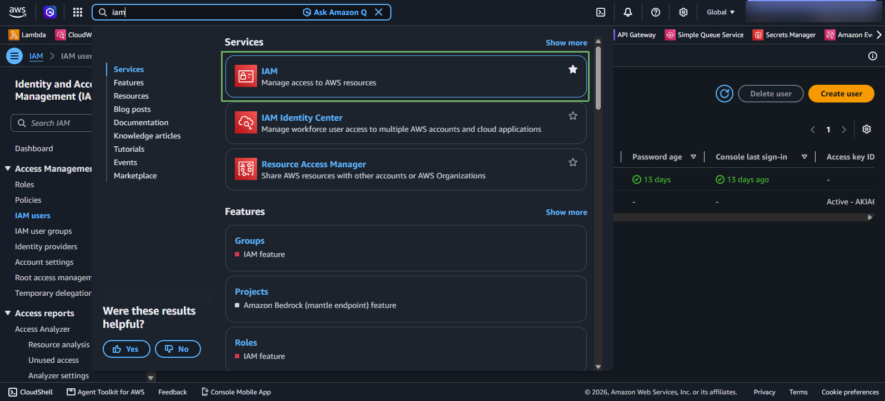
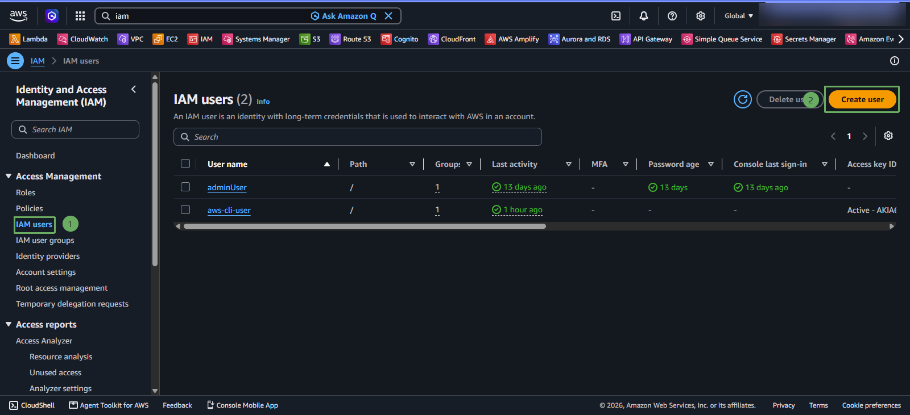
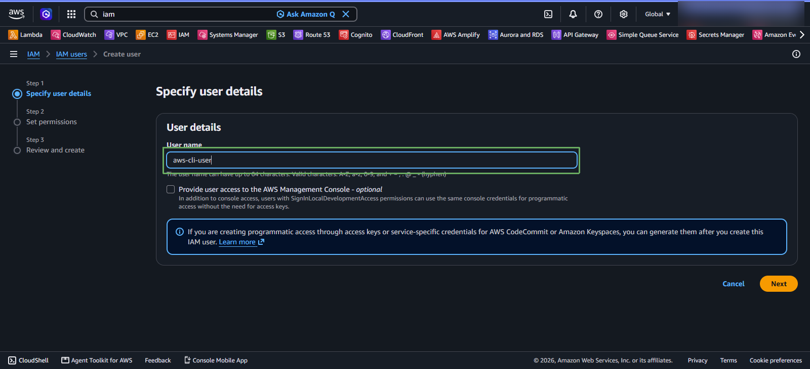
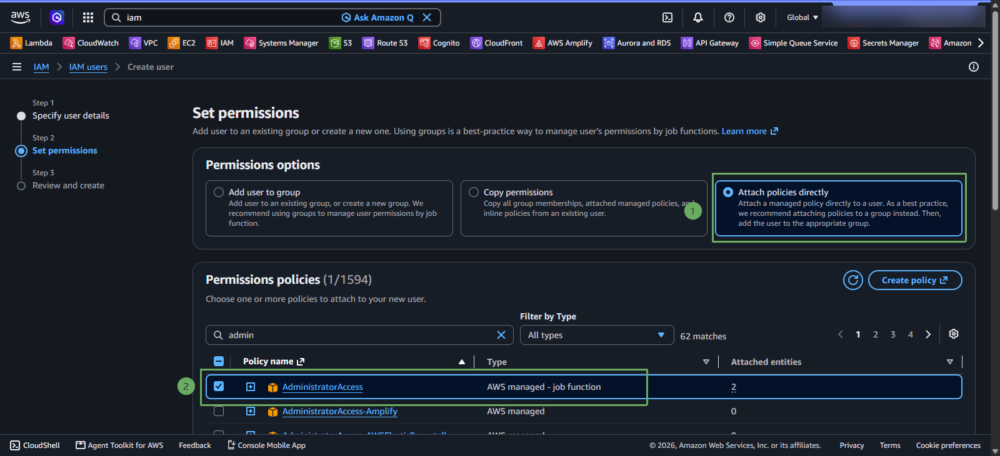
* Click **Next** to proceed to the next step.
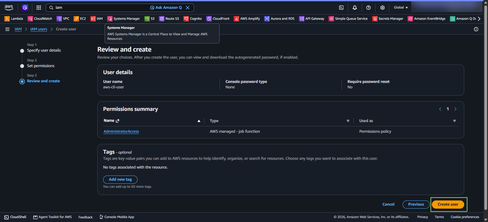

* Access the newly created IAM user
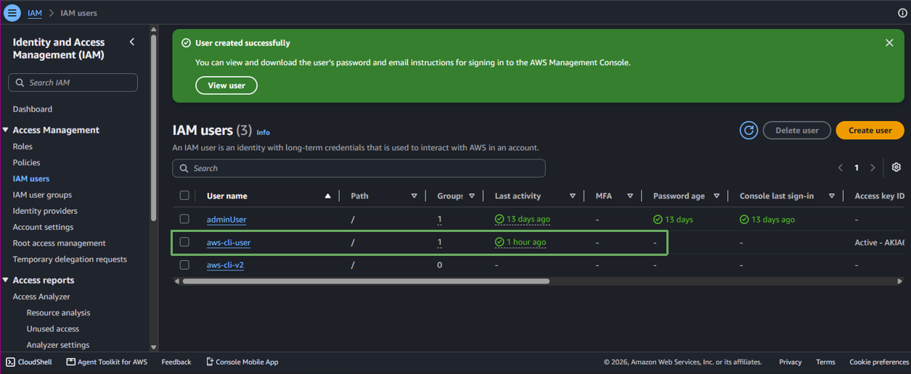

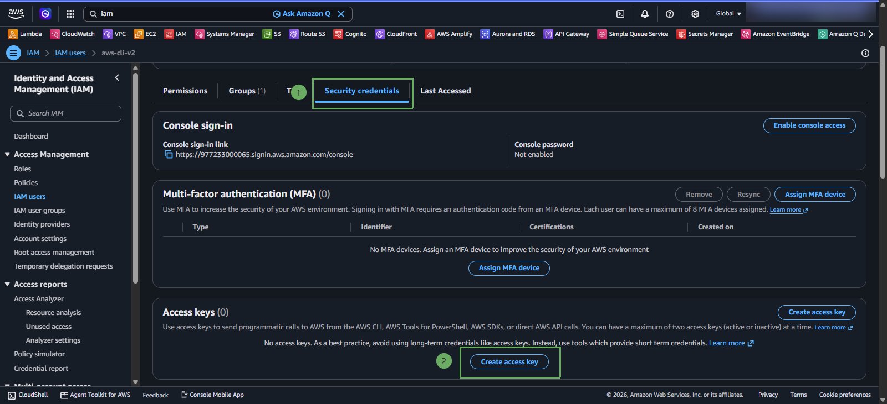
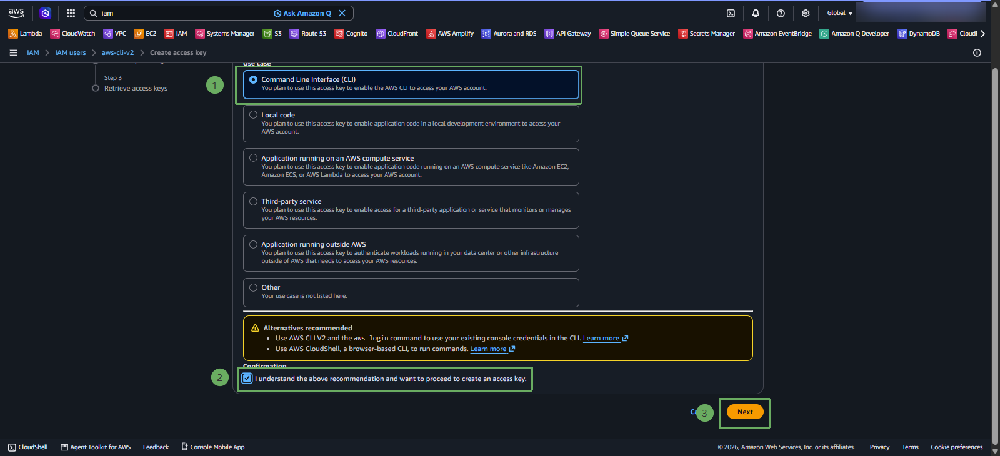
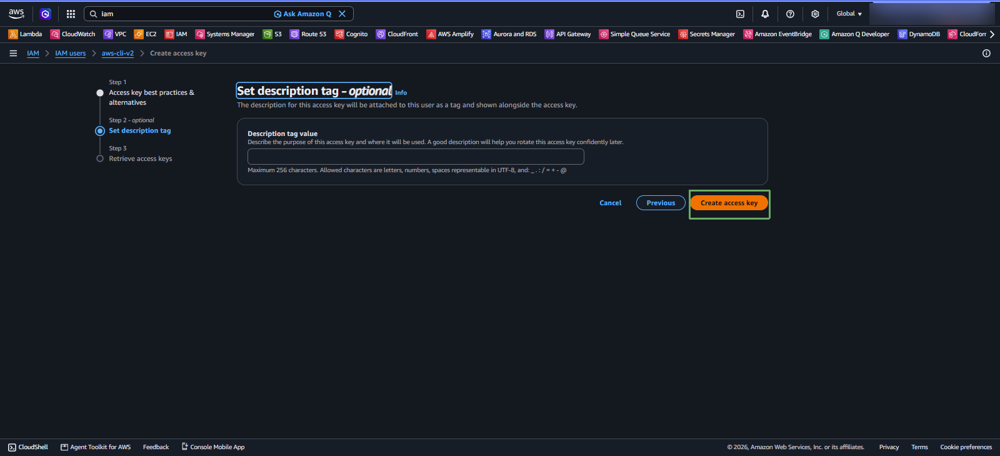

* At this step, you can download the .csv file to save your access key, which can be reused for other workshops without having to create a new user.
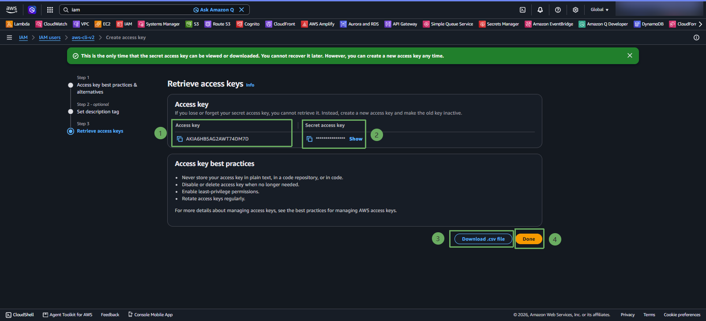

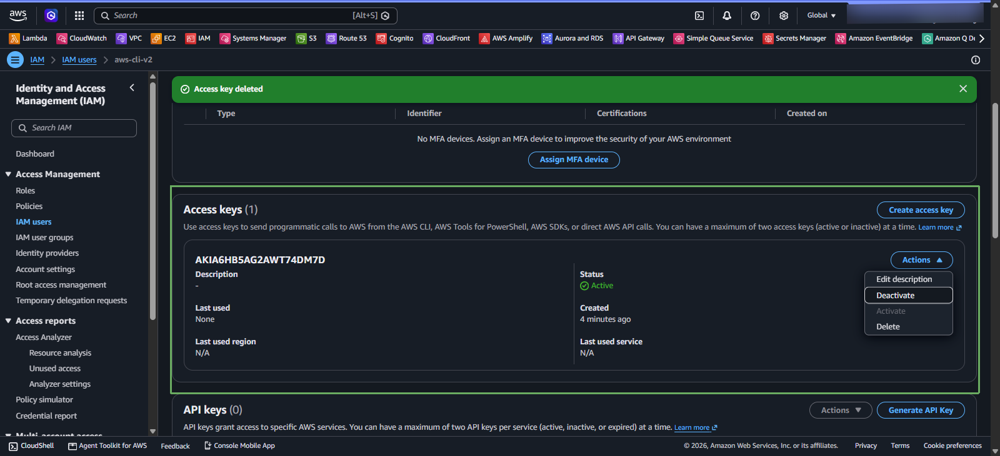
* When not in use, you can deactivate it.
