Để sử dụng AWS CLI với quyền cần thiết cho bài lab, bạn cần tạo một IAM User và lưu thông tin đăng nhập (Access Key ID, Secret Access Key) trên máy local.

1. Truy cập vào trang [AWS IAM Console](https://console.aws.amazon.com/iam/).
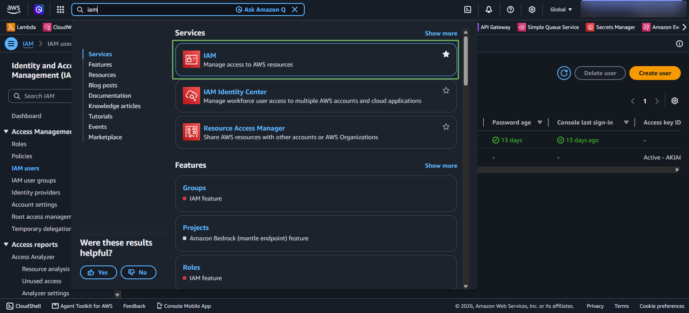
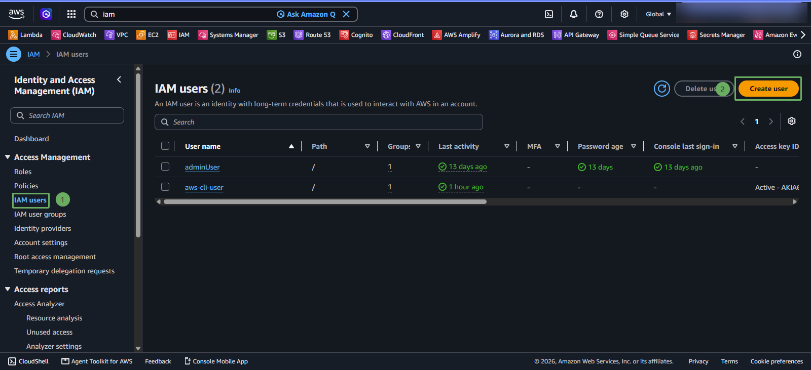
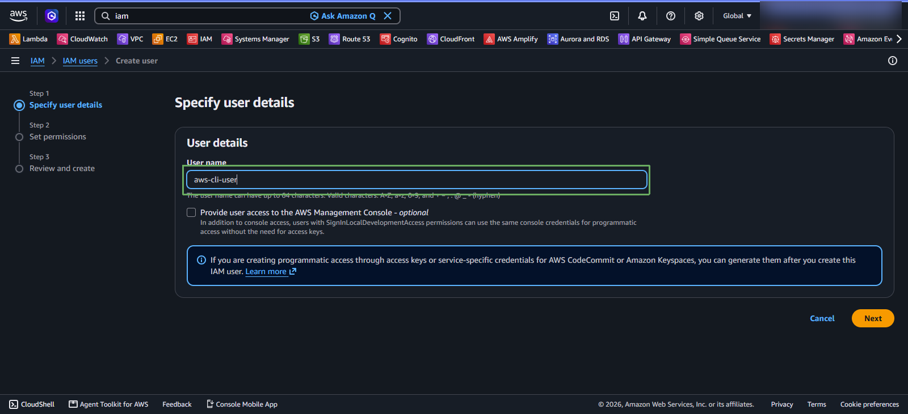
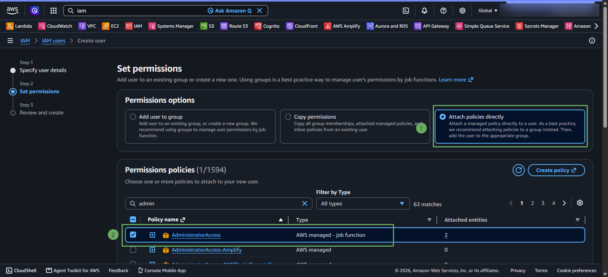
* Click vào **Next** để chuyển sang bước tiếp theo.
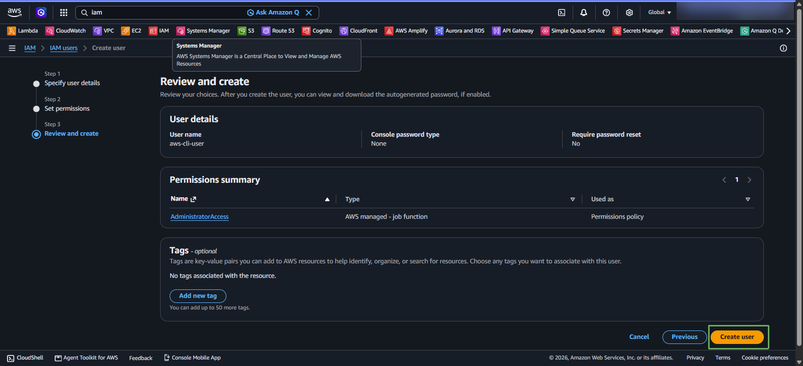

* Truy cập vào IAM User vừa tạo
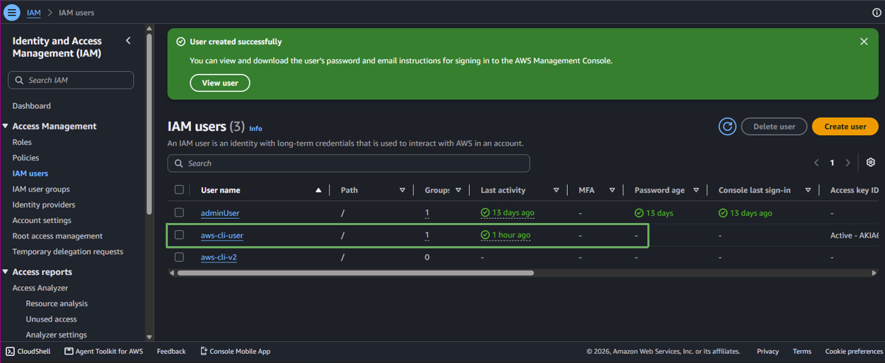

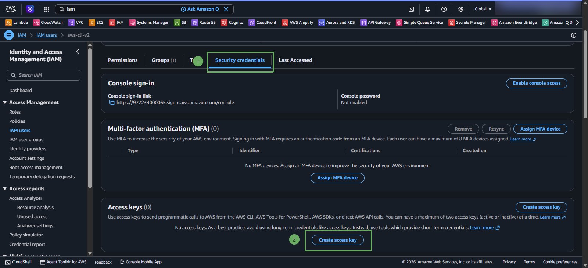
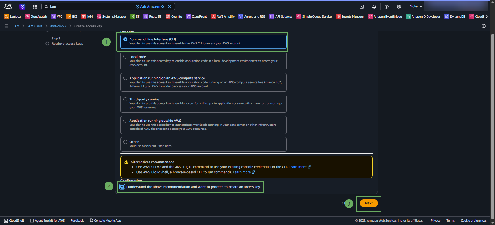
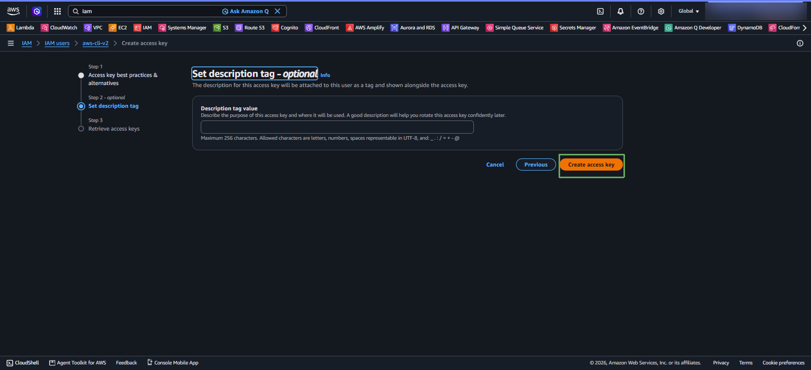

* Ở bước này, bạn có thể tải file .csv để lưu trữ access key có thể tái sử dụng cho các bài lab khác mà không cần phải tạo mới user.
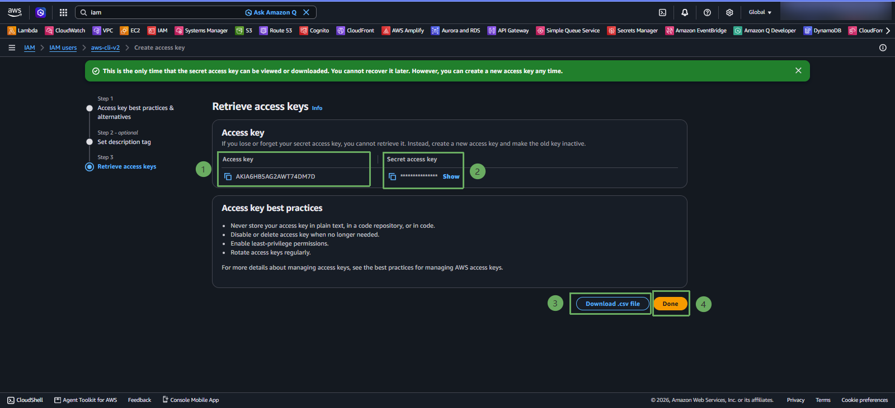

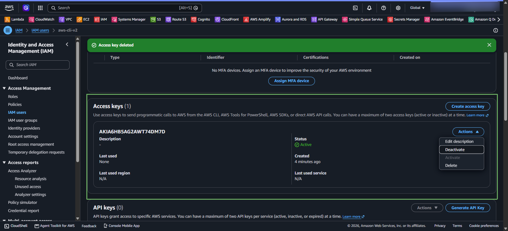
* Khi không sử dụng, bạn có thể vô hiệu hóa (deactivate).

