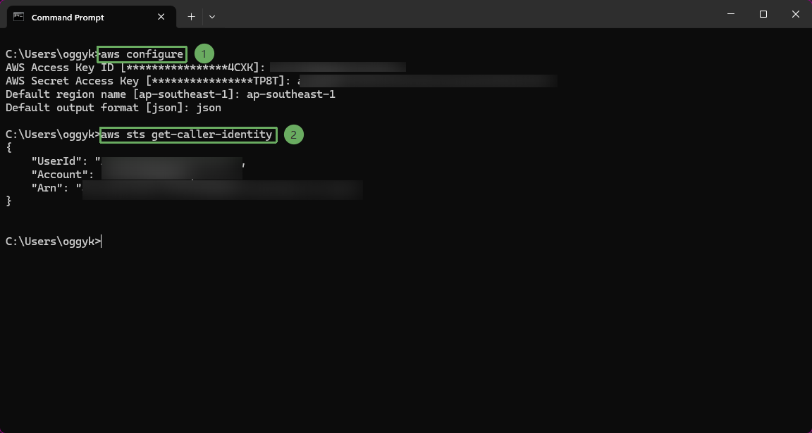

After installing the tools and configuring the IAM User, verify your AWS account information and environment configuration on your local machine (you can use Command Prompt or PowerShell).

* Sign in to AWS using a personal profile, using the access key and secret key from the .csv file downloaded during the IAM User creation step, and verify your identity:

- Run the 2 commands in sequence:

~~~powershell
aws configure
~~~

~~~powershell
aws sts get-caller-identity
~~~

{}

The account needs permissions to create VPC, ECR, ECS, IAM role, DynamoDB, API Gateway, CloudWatch Logs, and X-Ray. Never put access keys or secrets into source code, screenshots, or Docker images.

{}
