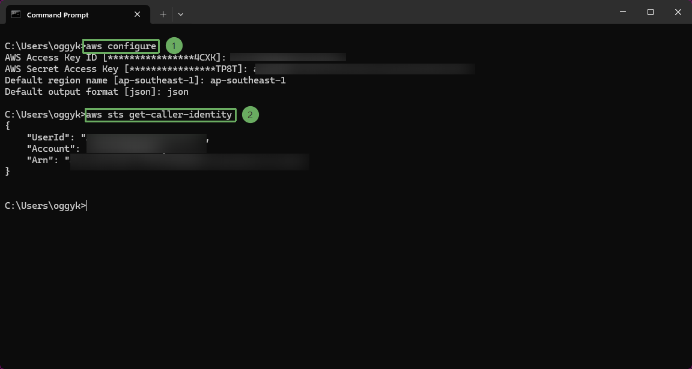

Sau khi cài đặt các công cụ và cấu hình IAM User, hãy kiểm tra thông tin tài khoản và cấu hình môi trường AWS trên máy local (có thể dùng Command Prompt hoặc PowerShell).

* Đăng nhập AWS bằng profile cá nhân, sử dụng Access Key và Secret Access Key (secret key) trong file .csv đã tải về từ bước tạo IAM User và kiểm tra danh tính:

- Chạy lần lượt 2 lệnh:

~~~powershell
aws configure
~~~

~~~powershell
aws sts get-caller-identity
~~~

{}

Tài khoản cần quyền tạo VPC, ECR, ECS, IAM role, DynamoDB, API Gateway, CloudWatch Logs và X-Ray. Tuyệt đối không đưa access key hoặc secret vào source code, ảnh chụp hay Docker image.

{}

