### 1. Create project directory

Example: Create project in the `IaC-ECS-CDK` directory.

* **Create Spring Boot project using the Extension in VS Code (in the `fcaj-spring` folder)**

Open VS Code, select the `IaC-ECS-CDK` directory, and click **Select folder**.

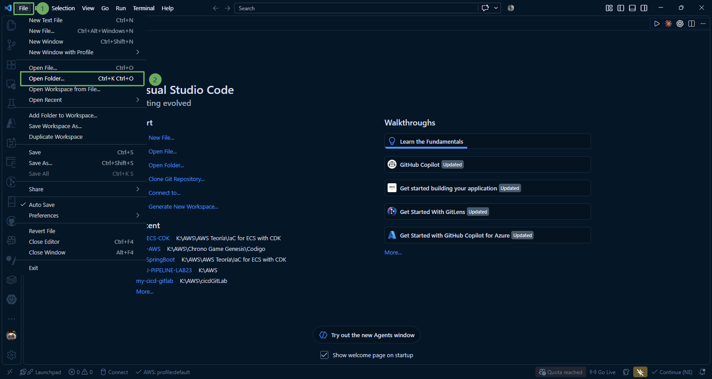

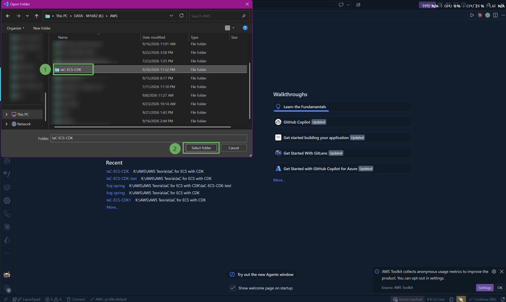

Press `Ctrl + Shift + P` (or `Cmd + Shift + P` on macOS) to open the Command Palette -> type **java** in the search box -> select **Java: Create Java Project**

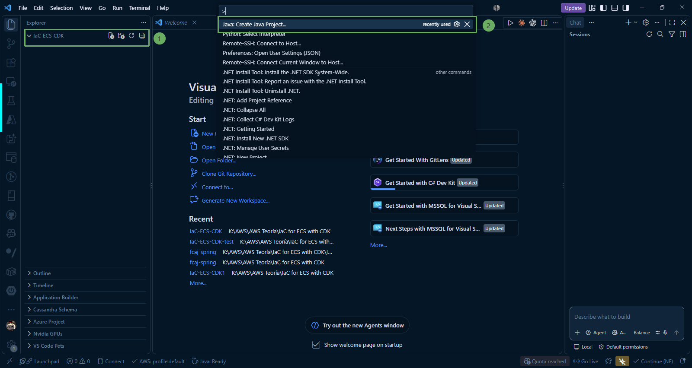

Select the following configurations in order:
  * **Project type:** Spring Boot -> Maven Project
  * **Version:** 4.2.0 (M2)
  * **Project language:** Java
  * **Spring Initializr (input group ID):** `com.example`
  * **Spring Initializr (input artifact ID):** `fcaj-spring`
  * **Spring Initializr (input package name):** `com.example.fcaj_spring`
  * **Spring Initializr (specify packaging type):** `Jar`
  * **Spring Initializr (Java version):** `25` (Corresponding to JDK 25)
  * **Spring Initializr (choose dependencies):** `Spring Boot Devtools`, `Thymeleaf`, `Spring Web`, `Spring Boot Actuator`

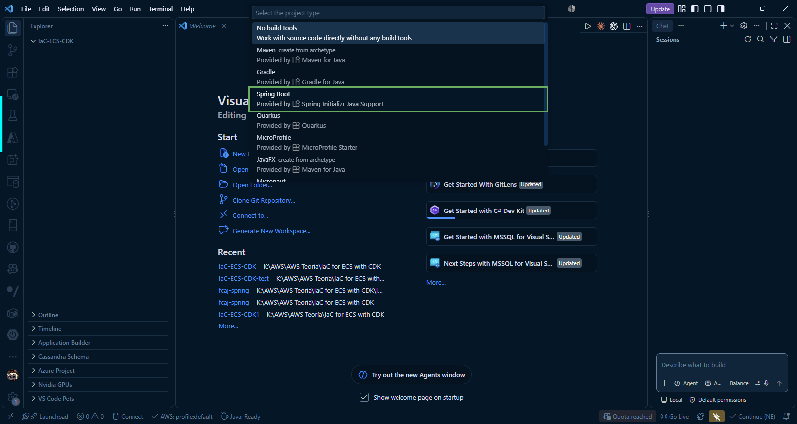

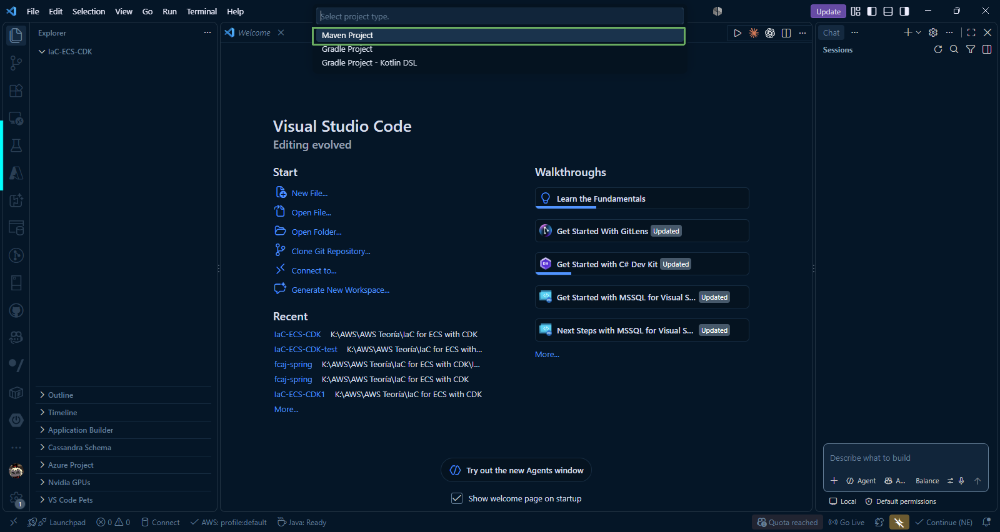

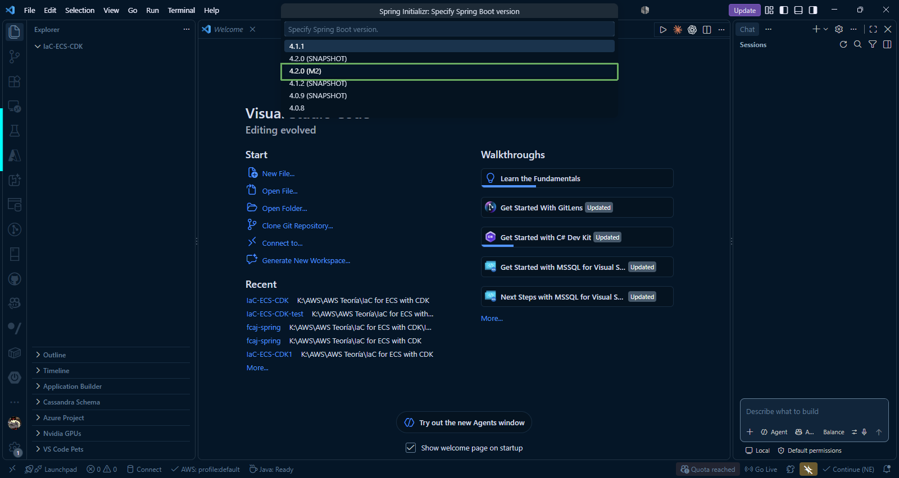

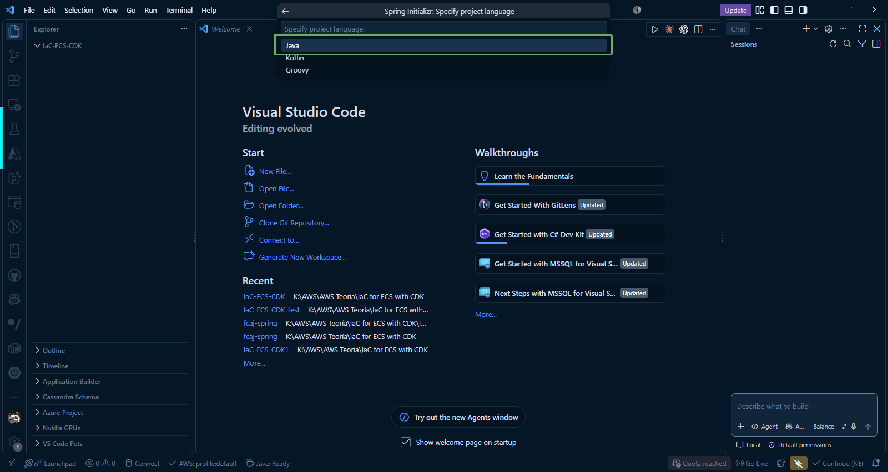

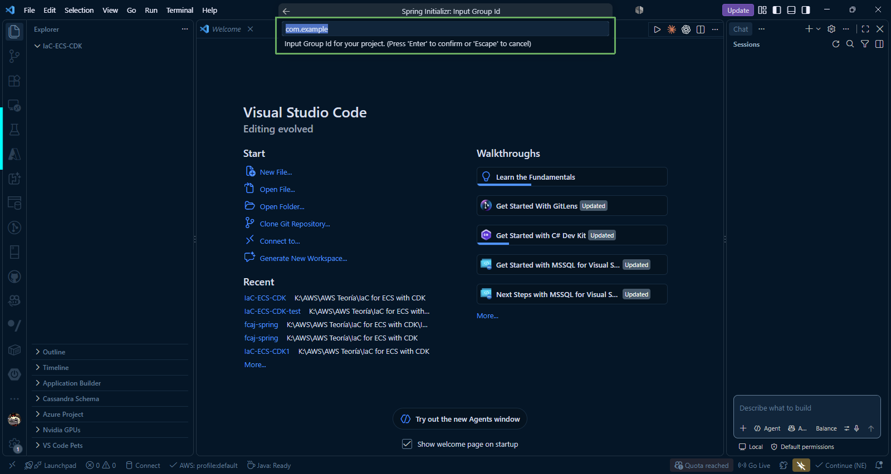

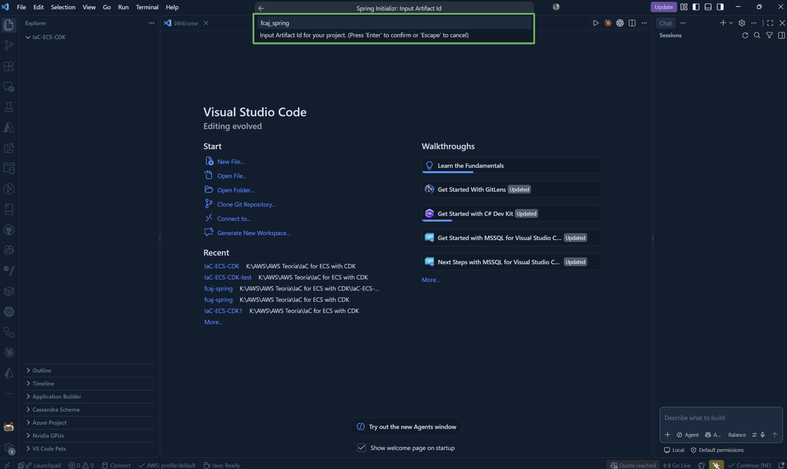

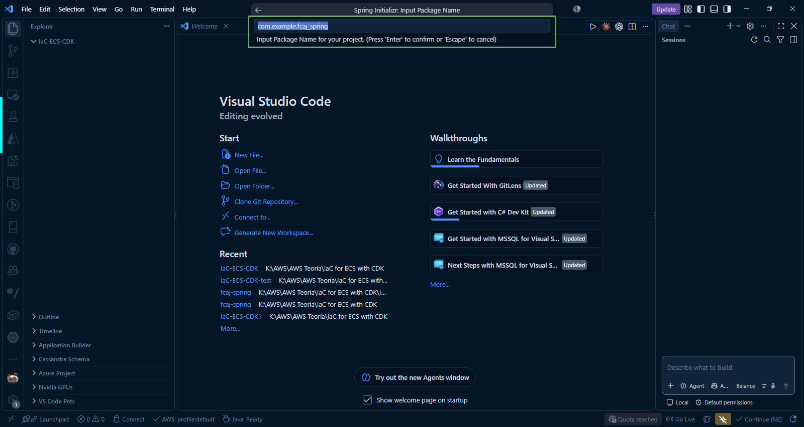

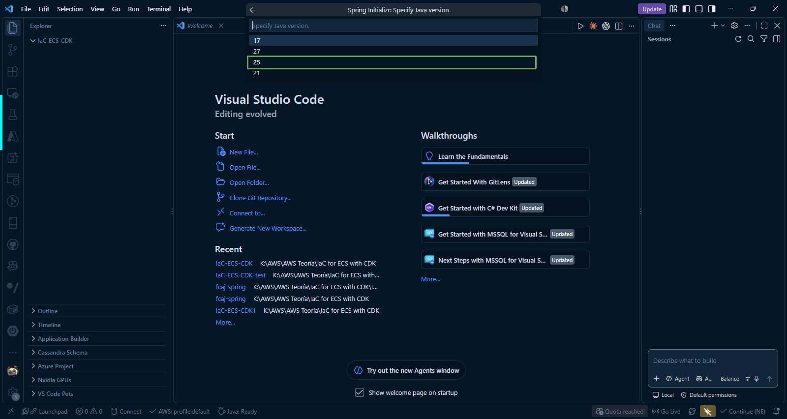

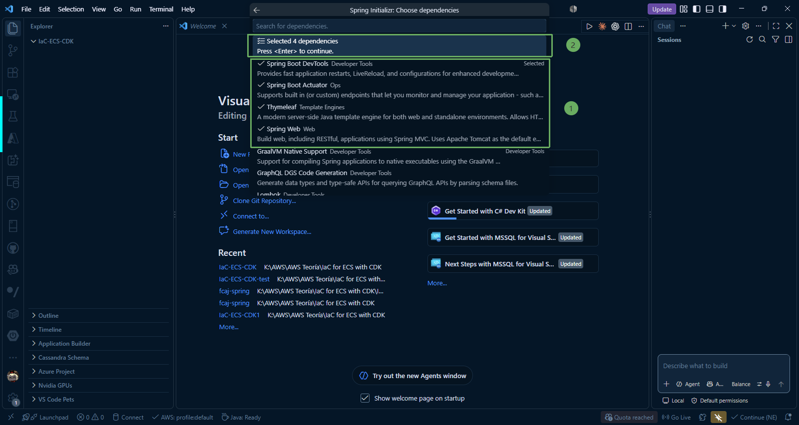

After completing the steps in creating the Spring Boot project, a window will appear to select the directory to save the Spring Boot project. Select the **IaC-ECS-CDK** directory and click **Generate into folder**.

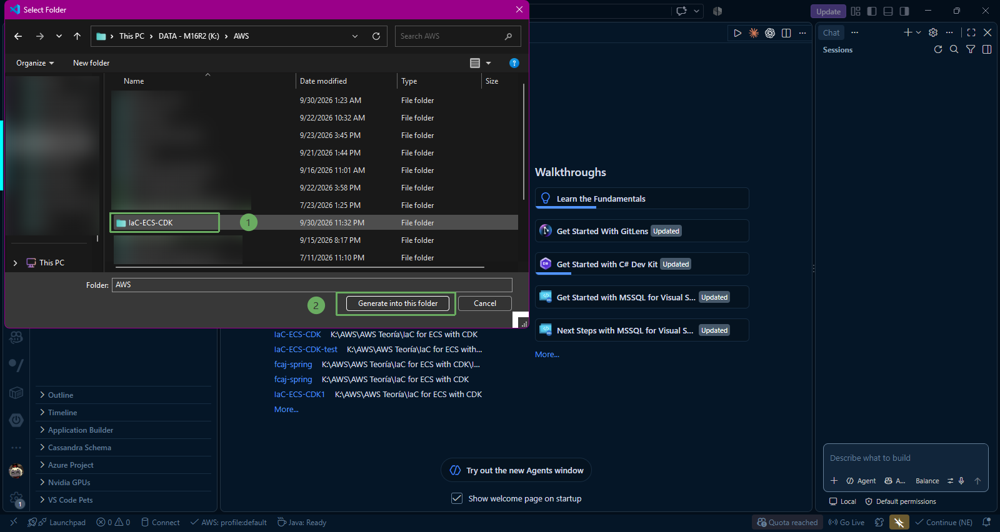

After successful creation, we will have the `fcaj-spring` folder inside the **IaC-ECS-CDK** directory.

Next, click **Run java** to check that the Spring Boot project has downloaded all dependencies and works normally.

- Run the following command in the terminal to start the Spring Boot project:

~~~terminal
.\mvnw spring-boot:run
~~~

As you can see in the image, the project is running on port `8080`.

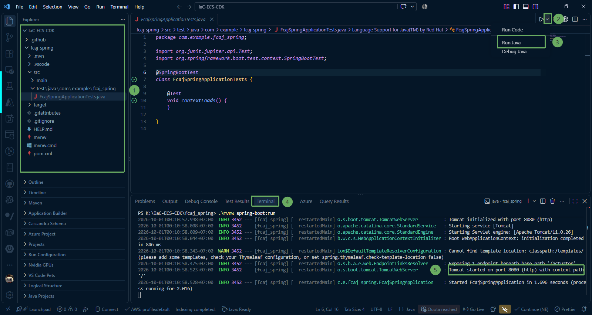

---

### 2. Add required libraries to `pom.xml`

#### Add Log4j2 Library

The Log4j2 library supports Asynchronous Loggers based on the LMAX Disruptor library, minimizing latency for the main application thread when writing high volumes of logs, outperforming traditional logging libraries.

~~~xml
<dependency>
    <groupId>org.springframework.boot</groupId>
    <artifactId>spring-boot-starter-log4j2</artifactId>
</dependency>
~~~

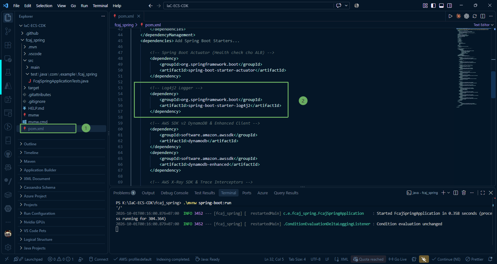

#### Add Centralized AWS SDK v2 Dependency Management

~~~xml
<dependencyManagement>
    <dependencies>
        <dependency>
            <groupId>software.amazon.awssdk</groupId>
            <artifactId>bom</artifactId>
            <version>2.25.16</version>
            <type>pom</type>
            <scope>import</scope>
        </dependency>
    </dependencies>
</dependencyManagement>
~~~

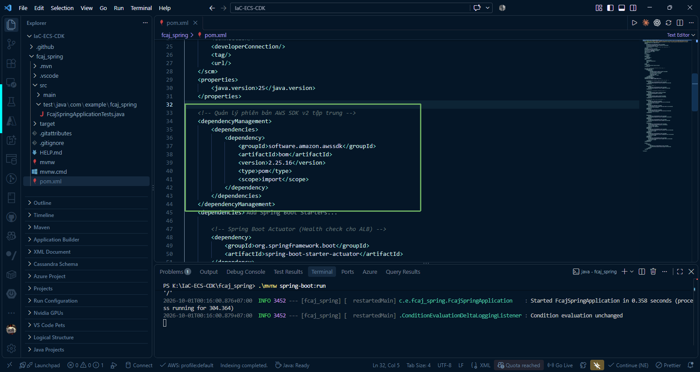

#### Add AWS SDK v2 DynamoDB & Enhanced Client

~~~xml
<dependency>
    <groupId>software.amazon.awssdk</groupId>
    <artifactId>dynamodb</artifactId>
</dependency>
<dependency>
    <groupId>software.amazon.awssdk</groupId>
    <artifactId>dynamodb-enhanced</artifactId>
</dependency>
~~~

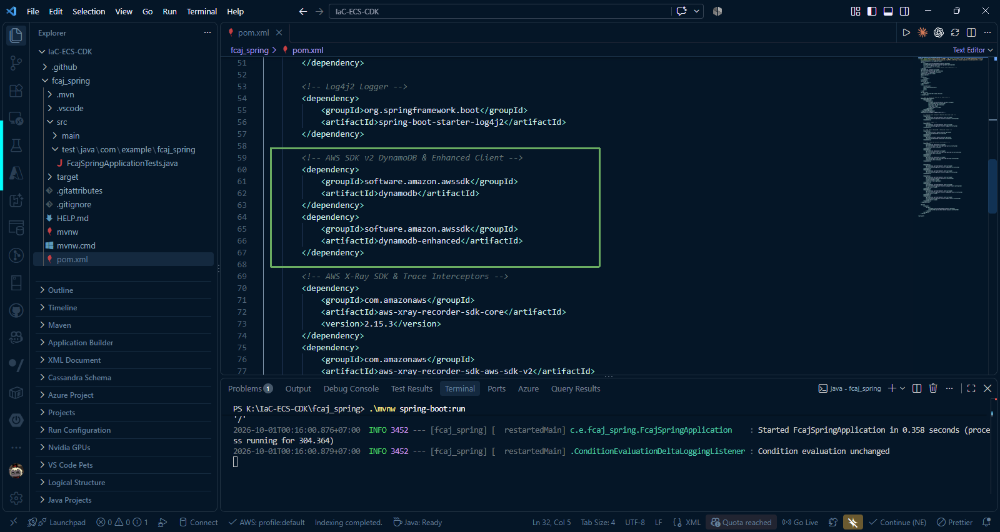

#### Add AWS X-Ray Core SDK & Trace Interceptors and Spring Integration

~~~xml
<dependency>
    <groupId>com.amazonaws</groupId>
    <artifactId>aws-xray-recorder-sdk-core</artifactId>
    <version>2.15.3</version>
</dependency>
<dependency>
    <groupId>com.amazonaws</groupId>
    <artifactId>aws-xray-recorder-sdk-aws-sdk-v2</artifactId>
    <version>2.15.3</version>
</dependency>
<dependency>
    <groupId>com.amazonaws</groupId>
    <artifactId>aws-xray-recorder-sdk-spring</artifactId>
    <version>2.15.3</version>
</dependency>
~~~

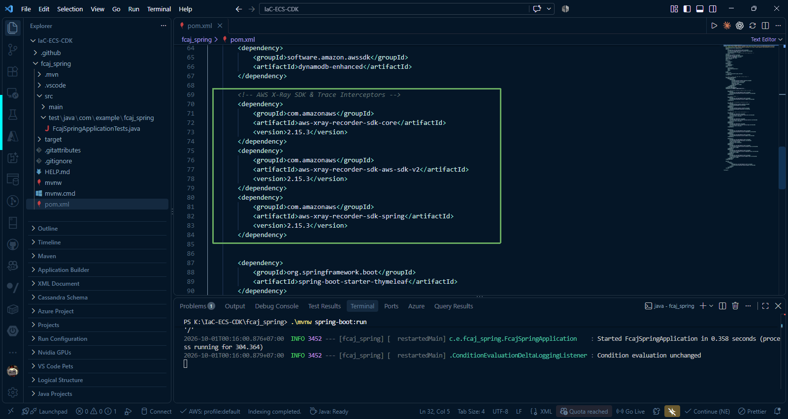

---

### 3. Test project on Postman

Create an HTTP GET request to `http://localhost:8080/actuator/health` to test.

The response returns `"status": "UP"`, indicating that the project is operating normally.

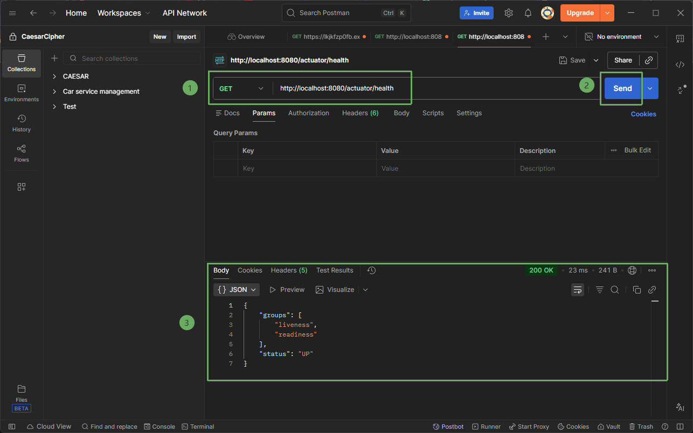

{}
If you encounter an issue where you cannot test HTTP GET with `http://localhost:8080/actuator/health`, please check the configuration in **pom.xml** to ensure the **spring-boot-starter-actuator** dependency has been added. If not, add the library:

~~~xml
<dependency>
    <groupId>org.springframework.boot</groupId>
    <artifactId>spring-boot-starter-actuator</artifactId>
</dependency>
~~~
{}
