### 1. Tạo thư mục chứa project

Ví dụ: Tạo project tại thư mục `IaC-ECS-CDK`

* **Tạo project Spring Boot bằng Extension trong VS Code (thư mục `fcaj-spring`)**

Mở VSCode, chọn thư mục `IaC-ECS-CDK` và click **Select folder**.

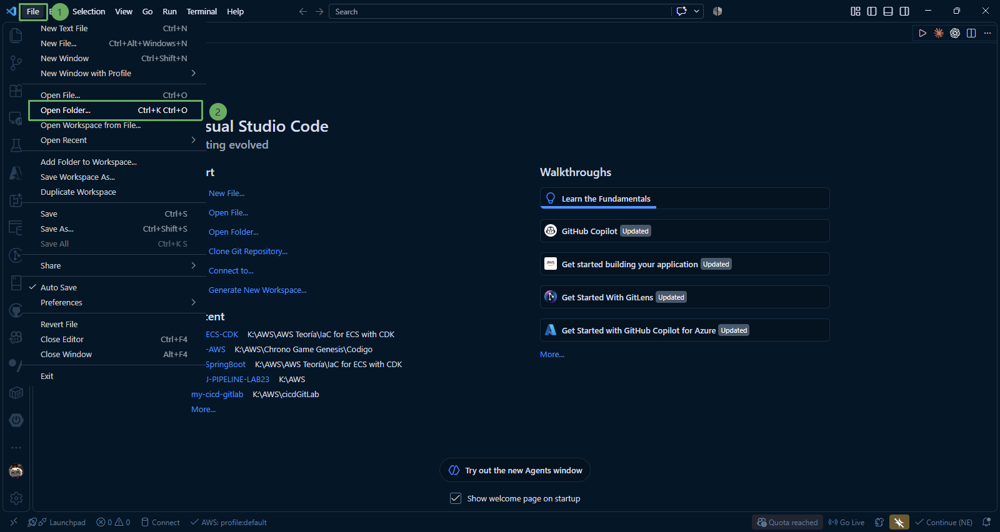

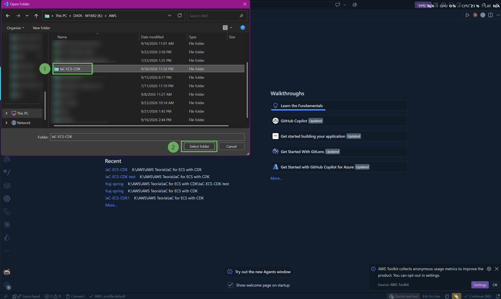

Nhấn tổ hợp phím `Ctrl + Shift + P` (hoặc `Cmd + Shift + P` trên macOS) để mở Command Palette -> gõ **java** trên search -> chọn **Java: Create Java Project**

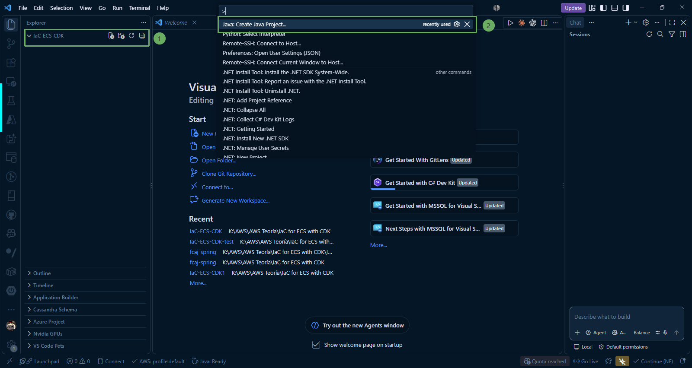

Chọn lần lượt các cấu hình:
  * **Project type:** Spring Boot -> Maven Project
  * **Version:** 4.2.0 (M2)
  * **Project language:** Java
  * **Spring Initializr (input group ID):** `com.example`
  * **Spring Initializr (input artifact ID):** `fcaj-spring`
  * **Spring Initializr (input package name):** `com.example.fcaj_spring`
  * **Spring Initializr (specify packaging type):** `Jar`
  * **Spring Initializr (Java version):** `25` (Tương ứng với JDK 25)
  * **Spring Initializr (choose dependencies):** `Spring Boot Devtools`, `Thymeleaf`, `Spring Web`, `Spring Boot Actuator`

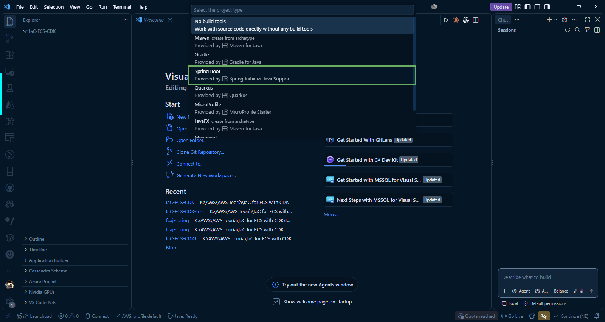

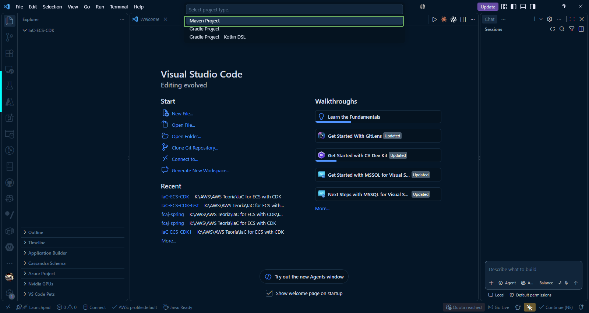

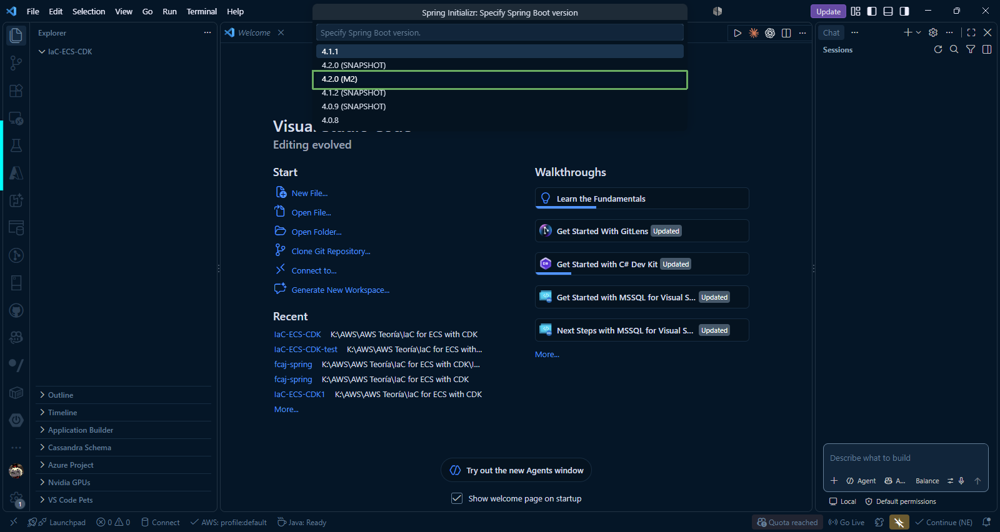

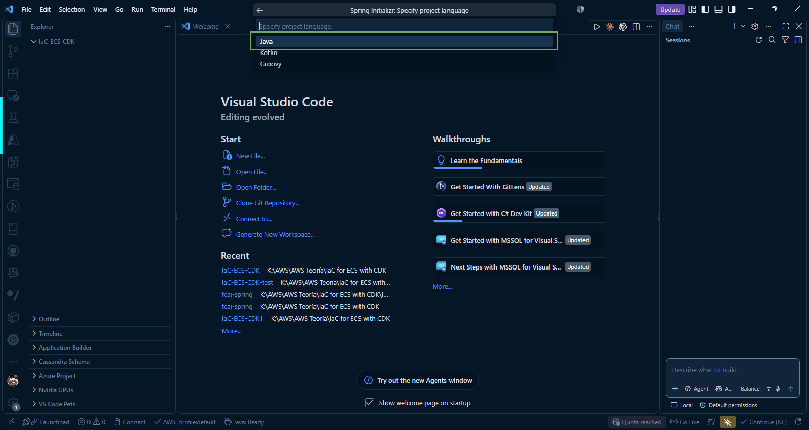

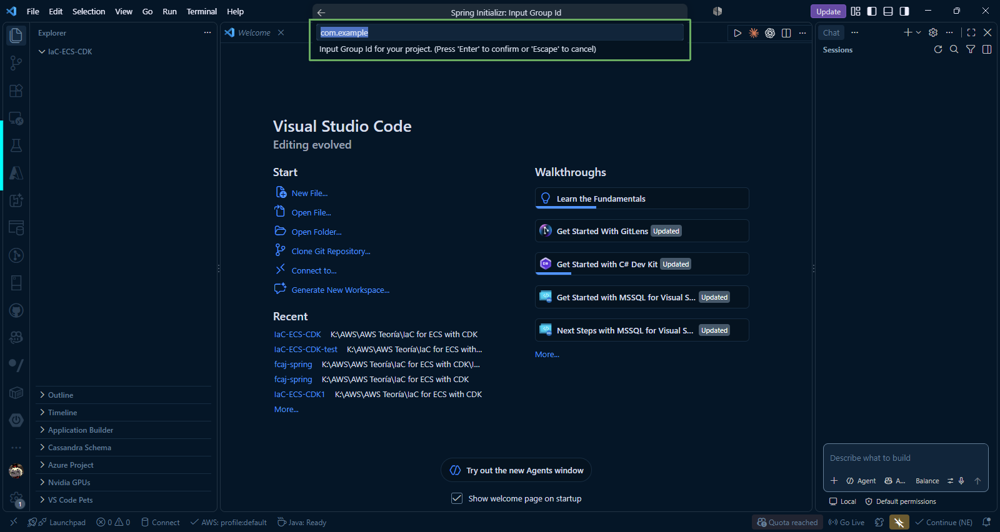

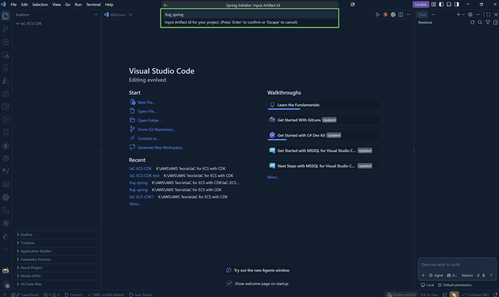

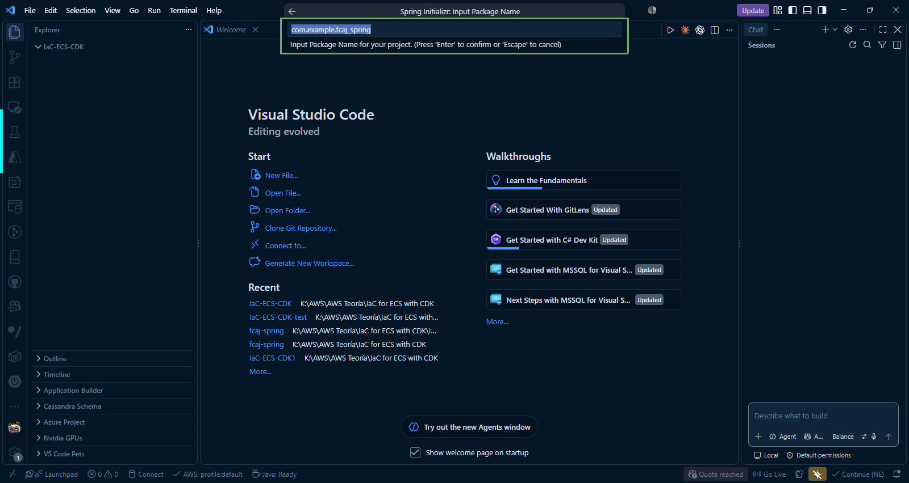

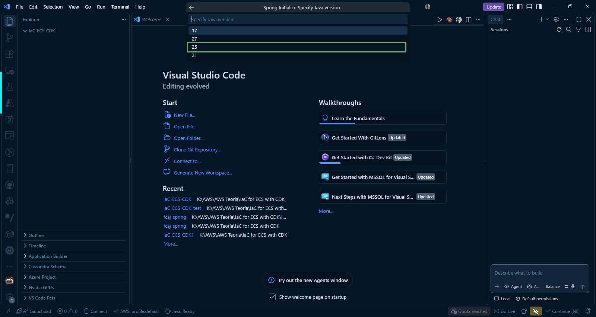

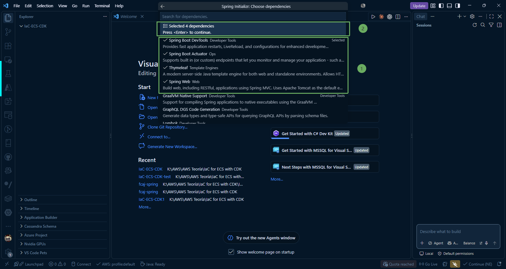

Sau khi hoàn thành các bước trong tạo Spring Boot project, sẽ hiển thị cửa sổ để chọn thư mục lưu project Spring Boot. Chọn thư mục **IaC-ECS-CDK** và click **Generate into folder**.

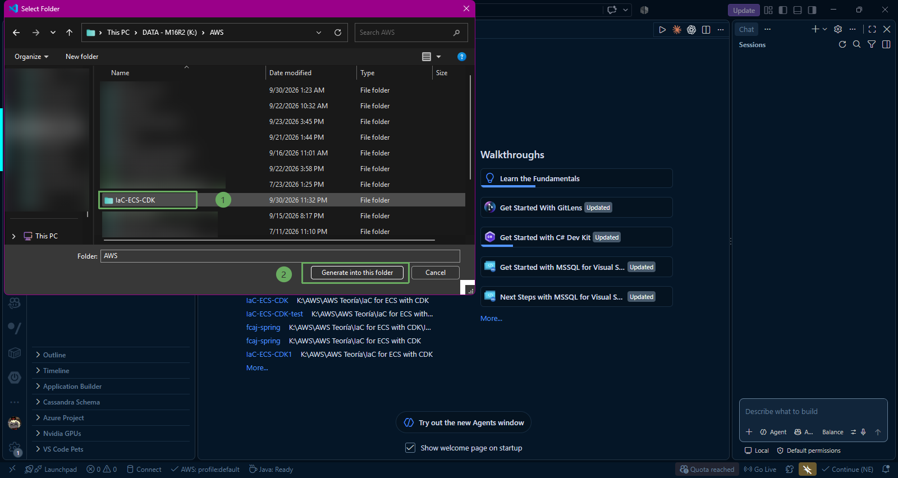

Sau khi tạo thành công, ta sẽ có thư mục `fcaj-spring` nằm trong thư mục **IaC-ECS-CDK**.

Tiếp theo, bấm **Run java** để kiểm tra project Spring Boot đã tải đầy đủ thư viện và đảm bảo hoạt động bình thường. 

- Chạy lệnh sau trong terminal để khởi động Spring Boot project:

~~~terminal
.\mvnw spring-boot:run
~~~

Như bạn thấy trong hình, project đang hoạt động trên port `8080`.

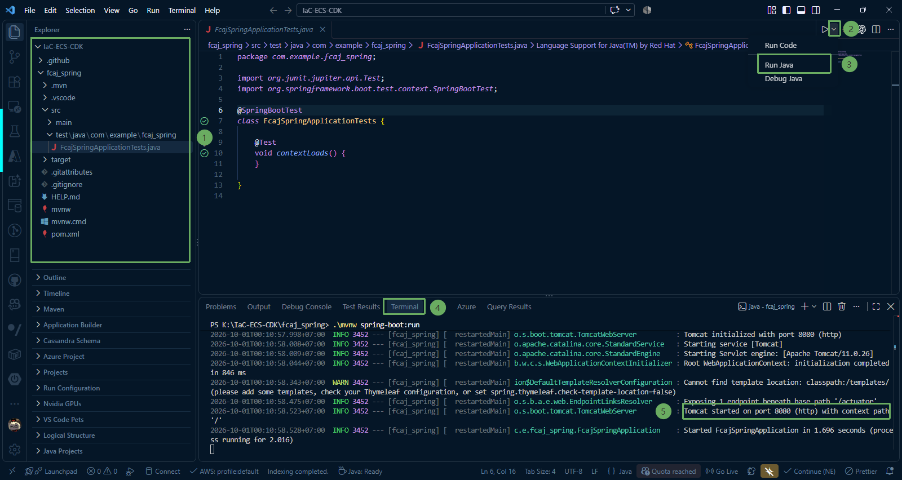

---

### 2. Thêm các thư viện cần thiết vào file `pom.xml`

#### Thêm thư viện Log4j2

Thư viện Log4j2 hỗ trợ tính năng Asynchronous Loggers (Ghi log bất đồng bộ) dựa trên thư viện LMAX Disruptor, giúp giảm thiểu độ trễ cho luồng xử lý chính của ứng dụng khi phải ghi lượng log lớn, vượt trội so với các thư viện log truyền thống.

~~~xml
<dependency>
    <groupId>org.springframework.boot</groupId>
    <artifactId>spring-boot-starter-log4j2</artifactId>
</dependency>
~~~

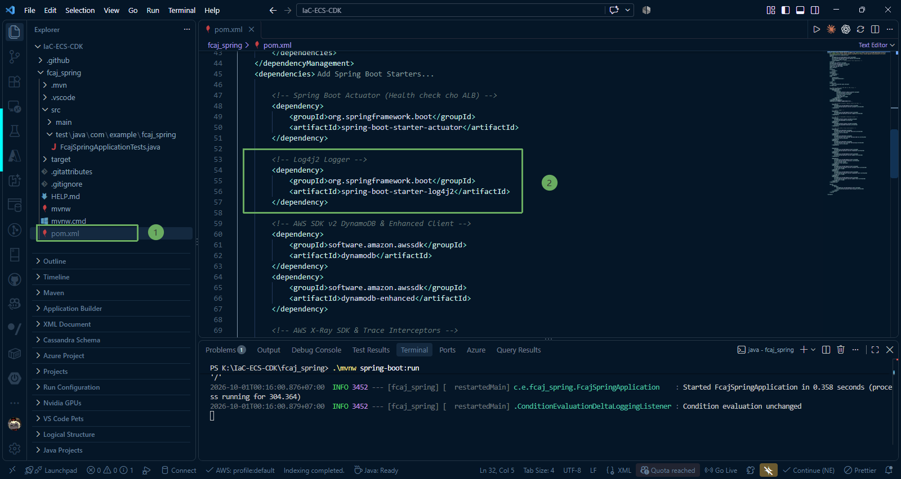

#### Thêm Quản lý phiên bản AWS SDK v2 tập trung

~~~xml
<dependencyManagement>
    <dependencies>
        <dependency>
            <groupId>software.amazon.awssdk</groupId>
            <artifactId>bom</artifactId>
            <version>2.25.16</version>
            <type>pom</type>
            <scope>import</scope>
        </dependency>
    </dependencies>
</dependencyManagement>
~~~

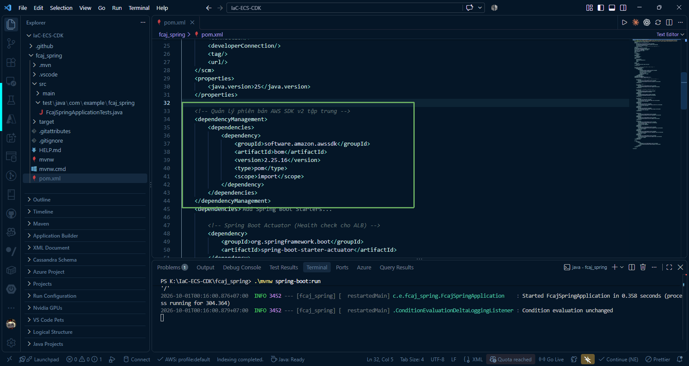

#### Thêm AWS SDK v2 DynamoDB & Enhanced Client

~~~xml
<dependency>
    <groupId>software.amazon.awssdk</groupId>
    <artifactId>dynamodb</artifactId>
</dependency>
<dependency>
    <groupId>software.amazon.awssdk</groupId>
    <artifactId>dynamodb-enhanced</artifactId>
</dependency>
~~~

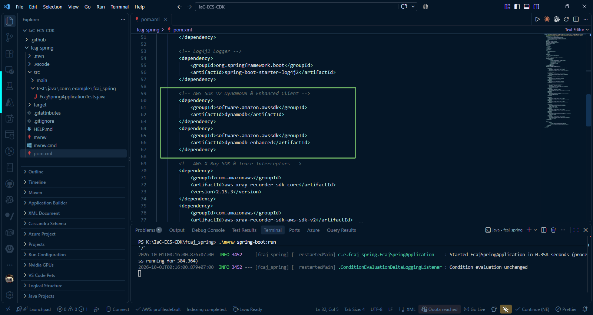

#### Thêm AWS X-Ray Core SDK & Trace Interceptors và Spring Integration

~~~xml
<dependency>
    <groupId>com.amazonaws</groupId>
    <artifactId>aws-xray-recorder-sdk-core</artifactId>
    <version>2.15.3</version>
</dependency>
<dependency>
    <groupId>com.amazonaws</groupId>
    <artifactId>aws-xray-recorder-sdk-aws-sdk-v2</artifactId>
    <version>2.15.3</version>
</dependency>
<dependency>
    <groupId>com.amazonaws</groupId>
    <artifactId>aws-xray-recorder-sdk-spring</artifactId>
    <version>2.15.3</version>
</dependency>
~~~

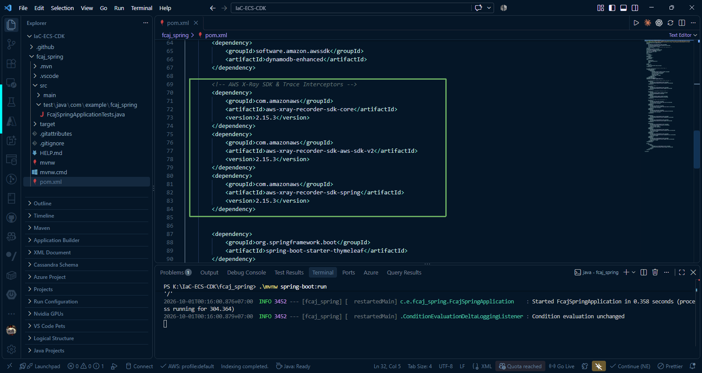

---

### 3. Kiểm thử project trên Postman

Tạo request HTTP GET với đường dẫn `http://localhost:8080/actuator/health` để kiểm tra.

Response trả về `"status": "UP"` chứng tỏ project hoạt động bình thường.

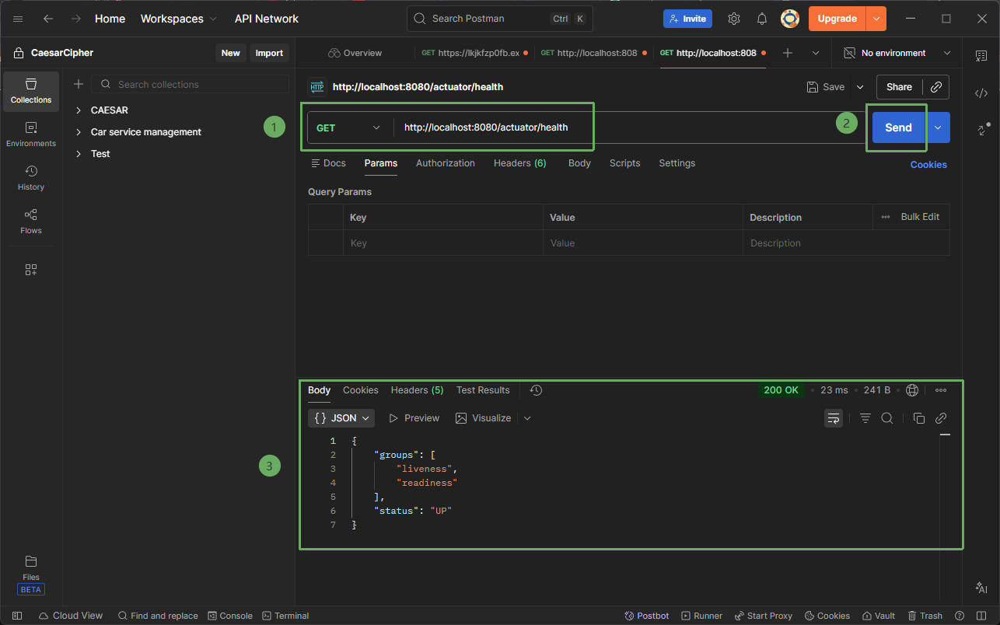

{}
Nếu bạn gặp trường hợp không thể test HTTP GET với đường dẫn `http://localhost:8080/actuator/health` thì hãy kiểm tra lại cấu hình trong file **pom.xml**, đảm bảo có thư viện **spring-boot-starter-actuator** đã được thêm vào. Nếu không có, hãy thêm thư viện vào:

~~~xml
<dependency>
    <groupId>org.springframework.boot</groupId>
    <artifactId>spring-boot-starter-actuator</artifactId>
</dependency>
~~~
{}
