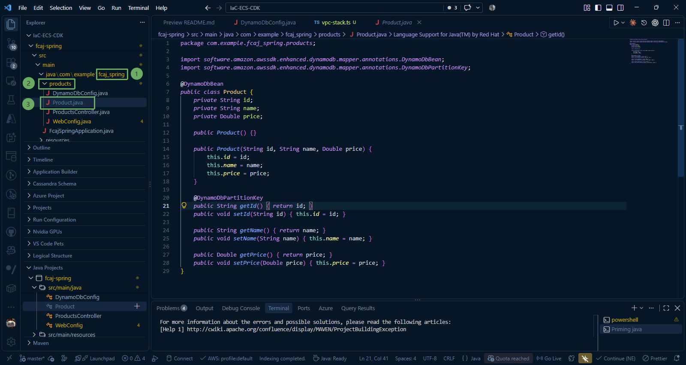
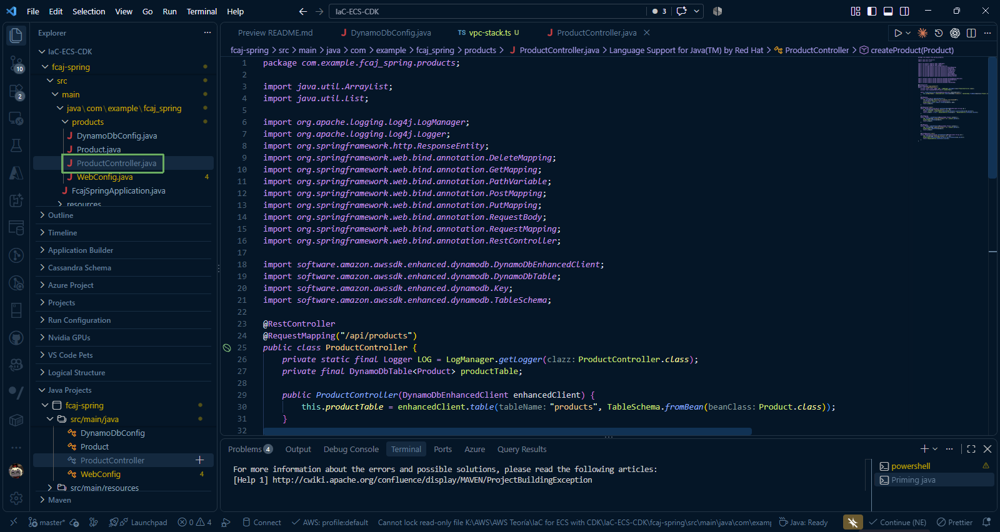
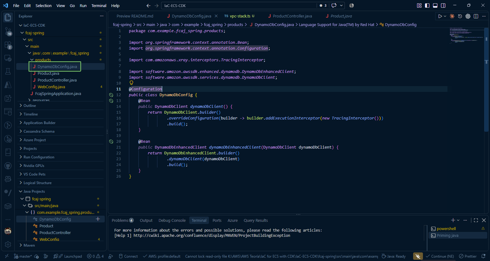
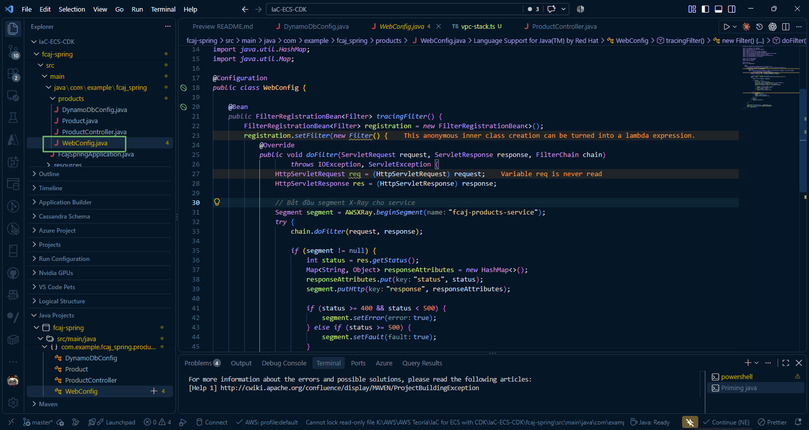

### 1. Create Model and Controller for Product

* Create the **products** folder and create the **Product.java** file. Copy the following code:

~~~java
import software.amazon.awssdk.enhanced.dynamodb.mapper.annotations.DynamoDbBean;
import software.amazon.awssdk.enhanced.dynamodb.mapper.annotations.DynamoDbPartitionKey;

@DynamoDbBean
public class Product {
    private String id;
    private String name;
    private Double price;

    public Product() {}

    public Product(String id, String name, Double price) {
        this.id = id;
        this.name = name;
        this.price = price;
    }

    @DynamoDbPartitionKey
    public String getId() { return id; }
    public void setId(String id) { this.id = id; }

    public String getName() { return name; }
    public void setName(String name) { this.name = name; }

    public Double getPrice() { return price; }
    public void setPrice(Double price) { this.price = price; }
}
~~~

* Create the **ProductController.java** file. Copy the following code:

~~~java
import java.util.ArrayList;
import java.util.List;

import org.apache.logging.log4j.LogManager;
import org.apache.logging.log4j.Logger;
import org.springframework.http.ResponseEntity;
import org.springframework.web.bind.annotation.DeleteMapping;
import org.springframework.web.bind.annotation.GetMapping;
import org.springframework.web.bind.annotation.PathVariable;
import org.springframework.web.bind.annotation.PostMapping;
import org.springframework.web.bind.annotation.PutMapping;
import org.springframework.web.bind.annotation.RequestBody;
import org.springframework.web.bind.annotation.RequestMapping;
import org.springframework.web.bind.annotation.RestController;

import software.amazon.awssdk.enhanced.dynamodb.DynamoDbEnhancedClient;
import software.amazon.awssdk.enhanced.dynamodb.DynamoDbTable;
import software.amazon.awssdk.enhanced.dynamodb.Key;
import software.amazon.awssdk.enhanced.dynamodb.TableSchema;

@RestController
@RequestMapping("/api/products")
public class ProductController {
    private static final Logger LOG = LogManager.getLogger(ProductController.class);
    private final DynamoDbTable<Product> productTable;

    public ProductController(DynamoDbEnhancedClient enhancedClient) {
        this.productTable = enhancedClient.table("products", TableSchema.fromBean(Product.class));
    }

    @GetMapping
    public List<Product> getAllProducts() {
        LOG.info("Fetching all products from DynamoDB");
        List<Product> products = new ArrayList<>();
        productTable.scan().items().forEach(products::add);
        return products;
    }

    @GetMapping("/{id}")
    public ResponseEntity<Product> getProductById(@PathVariable String id) {
        LOG.info("Fetching product: {}", id);
        Product product = productTable.getItem(Key.builder().partitionValue(id).build());
        return product != null ? ResponseEntity.ok(product) : ResponseEntity.notFound().build();
    }

    @PostMapping
    public List<Product> createProduct(@RequestBody List<Product> products) {
        for (Product product : products) {
            LOG.info("Creating product: {}", product.getId());
            productTable.putItem(product);
        }
        return products;
    }

    @PutMapping
    public Product updateProduct(@RequestBody Product product) {
        LOG.info("Updating product: {}", product.getId());
        productTable.updateItem(product);
        return product;
    }

    @DeleteMapping("/{id}")
    public ResponseEntity<Void> deleteProduct(@PathVariable String id) {
        LOG.info("Deleting product: {}", id);
        productTable.deleteItem(Key.builder().partitionValue(id).build());
        return ResponseEntity.noContent().build();
    }
}
~~~

---

### 2. Configure DynamoDB and AWS X-Ray

* Create the **DynamoDbConfig.java** file (Client configuration with X-Ray Interceptor). Copy the following code:

~~~java
import org.springframework.context.annotation.Bean;
import org.springframework.context.annotation.Configuration;

import com.amazonaws.xray.interceptors.TracingInterceptor;

import software.amazon.awssdk.enhanced.dynamodb.DynamoDbEnhancedClient;
import software.amazon.awssdk.services.dynamodb.DynamoDbClient;

@Configuration
public class DynamoDbConfig {
    @Bean
    public DynamoDbClient dynamoDbClient() {
        return DynamoDbClient.builder()
                .overrideConfiguration(builder -> builder.addExecutionInterceptor(new TracingInterceptor()))
                .build();
    }

    @Bean
    public DynamoDbEnhancedClient dynamoDbEnhancedClient(DynamoDbClient dynamoDbClient) {
        return DynamoDbEnhancedClient.builder()
                .dynamoDbClient(dynamoDbClient)
                .build();
    }
}
~~~

* Create the **WebConfig.java** file (X-Ray Tracing Servlet Filter following Jakarta EE standard). Copy the following code:

~~~java
import com.amazonaws.xray.AWSXRay;
import com.amazonaws.xray.entities.Segment;
import jakarta.servlet.*;
import jakarta.servlet.http.HttpServletRequest;
import jakarta.servlet.http.HttpServletResponse;
import org.springframework.boot.web.servlet.FilterRegistrationBean;
import org.springframework.context.annotation.Bean;
import org.springframework.context.annotation.Configuration;
import org.springframework.core.Ordered;

import java.io.IOException;
import java.util.HashMap;
import java.util.Map;

@Configuration
public class WebConfig {

    @Bean
    public FilterRegistrationBean<Filter> tracingFilter() {
        FilterRegistrationBean<Filter> registration = new FilterRegistrationBean<>();
        registration.setFilter(new Filter() {
            @Override
            public void doFilter(ServletRequest request, ServletResponse response, FilterChain chain)
                    throws IOException, ServletException {
                HttpServletRequest req = (HttpServletRequest) request;
                HttpServletResponse res = (HttpServletResponse) response;

                // Start X-Ray segment for the service
                Segment segment = AWSXRay.beginSegment("fcaj-products-service");
                try {
                    chain.doFilter(request, response);

                    if (segment != null) {
                        int status = res.getStatus();
                        Map<String, Object> responseAttributes = new HashMap<>();
                        responseAttributes.put("status", status);
                        segment.putHttp("response", responseAttributes);

                        if (status >= 400 && status < 500) {
                            segment.setError(true);
                        } else if (status >= 500) {
                            segment.setFault(true);
                        }
                    }
                } catch (Exception e) {
                    if (segment != null) {
                        segment.addException(e);
                        segment.setFault(true);
                    }
                    throw e;
                } finally {
                    AWSXRay.endSegment();
                }
            }
        });

        registration.addUrlPatterns("/*");
        registration.setOrder(Ordered.HIGHEST_PRECEDENCE);
        return registration;
    }
}
~~~

{}
If you encounter issues during the Spring Boot build process (inline errors or dependency conflicts), please check:
1. Duplicate dependencies:
   - `.\mvnw dependency:tree`: This command lists the dependency tree to help check for duplicate or conflicting dependencies.
2. Local cache issues: often caused by local cache or classpath conflicts. Try running:
   - `.\mvnw clean compile`: This command clears the local build cache and recompiles.
3. Restart VS Code.
{}

**You have completed creating the Spring Boot Product Service (ECR). The files include configurations for AWS X-Ray and DynamoDB.**
