The Dockerfile is the recipe for creating an image. In the current file, EXPOSE 8080 describes the application port and ENTRYPOINT starts the Spring Boot class. The Docker image should be built for linux/amd64 to match the Fargate x86_64 environment.

The current Dockerfile copies the target/dependency/BOOT-INF and target/dependency/META-INF directories. If these directories do not exist after the Maven build, docker build will fail. To make the lab accessible, you can use a direct-JAR Dockerfile after aligning the JAR file name with pom.xml. Do not proceed to ECR before running the container locally.

### 2.4.1 Create Dockerfile and Docker Image

**1. Create a `.dockerignore` file to specify files and directories that Docker will ignore when packaging (building) a Docker image from the project components.**

- In the project root directory in VS Code, create a file named `.dockerignore` with the following content:

```docker
.git
.gitignore
.dockerignore
.vscode
*.class
README.md
```

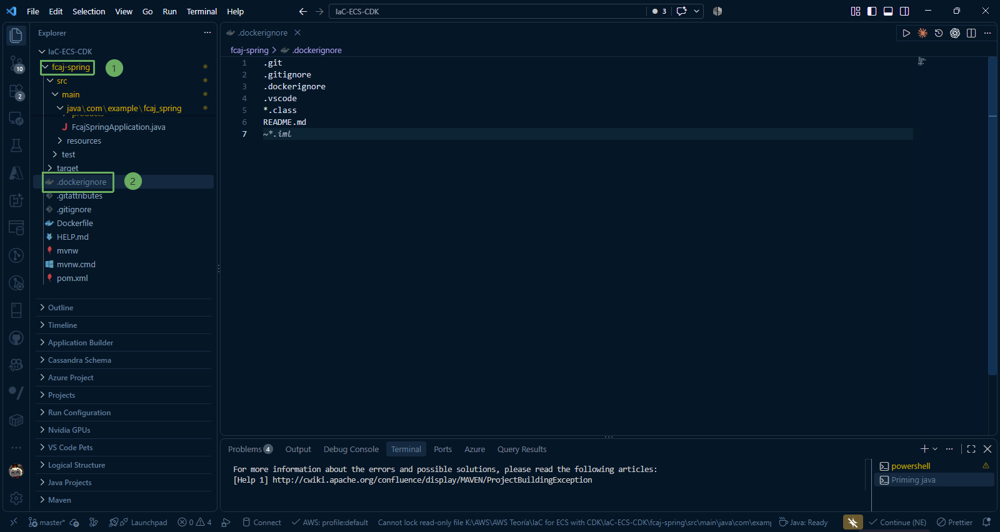

**2. Build JAR file and extract**

Open Terminal in VS Code (Ctrl + ~), navigate to the `.../fcaj-spring` directory and run the following commands:

- Build the jar file with Maven:

```powershell
.\mvnw.cmd clean package -DskipTests
```

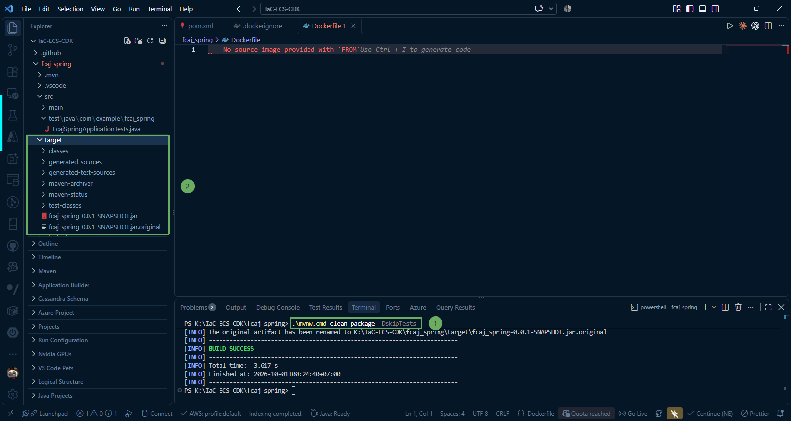

- Extract the JAR file into the `target/dependency` directory:

```powershell
mkdir -Force target\dependency
tar -xf (Get-Item target\*.jar).FullName -C target\dependency
```

{}

Verification: Inside the `target/dependency/` folder, 3 subdirectories will appear: BOOT-INF, META-INF, and org

{}

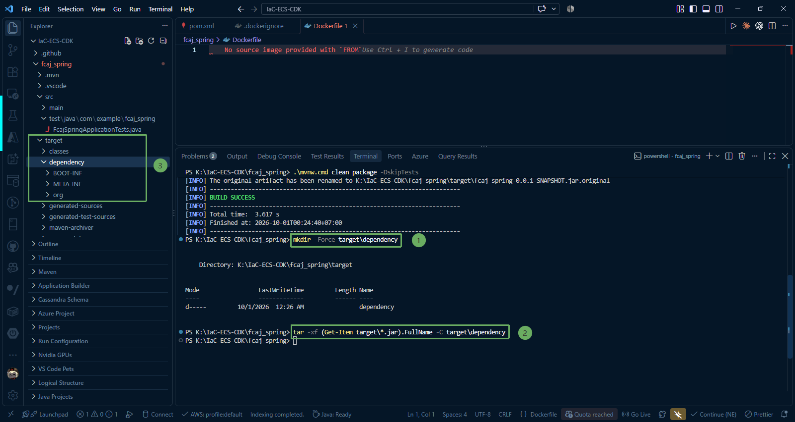

**3. Create Dockerfile**

In the root directory of the project, create a file named Dockerfile (without any extension).

The variable DEPENDENCY = target/dependency points to the directory containing Maven's extracted build artifacts:

```docker
FROM eclipse-temurin:25-jdk-alpine
VOLUME /tmp
ARG DEPENDENCY=target/dependency
COPY ${DEPENDENCY}/BOOT-INF/lib /app/lib
COPY ${DEPENDENCY}/META-INF /app/META-INF
COPY ${DEPENDENCY}/BOOT-INF/classes /app
EXPOSE 8080
ENTRYPOINT ["java", "-cp", "app:app/lib/*", "com.example.fcaj_spring.FcajSpringApplication"]
```

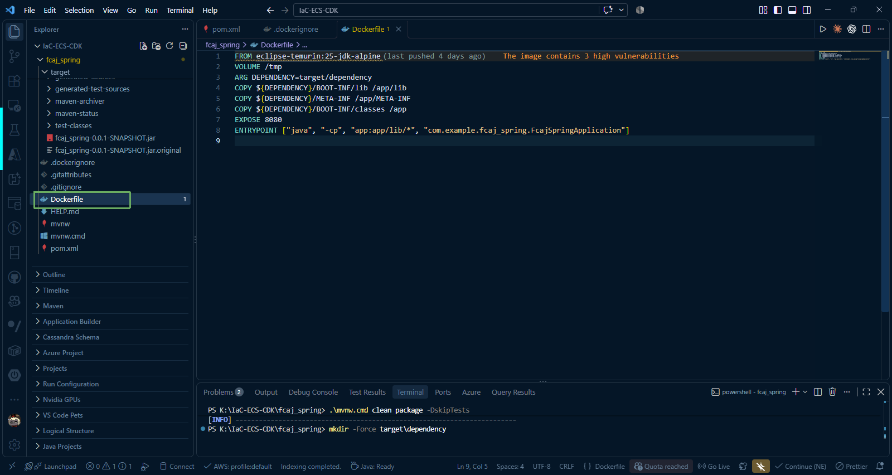

{}

Important notes:

- EXPOSE: port 8080 based on the server port configured in **application.properties**.
- ENTRYPOINT: main startup class is **com.example.fcaj_spring.FcajSpringApplication**.

{}

**4. Build Docker Image in VS Code Terminal**
   Ensure **Docker Desktop is running**, then execute the following command in the VS Code terminal:

```docker
docker build --platform linux/amd64 -t productsservice:1.0.0 .
```

Note the dot `.` at the end of the command representing the build context in the current directory.

- You can also observe this via the Docker extension in VS Code. We have created an **image** named **productsservice** with tag **1.0.0**.

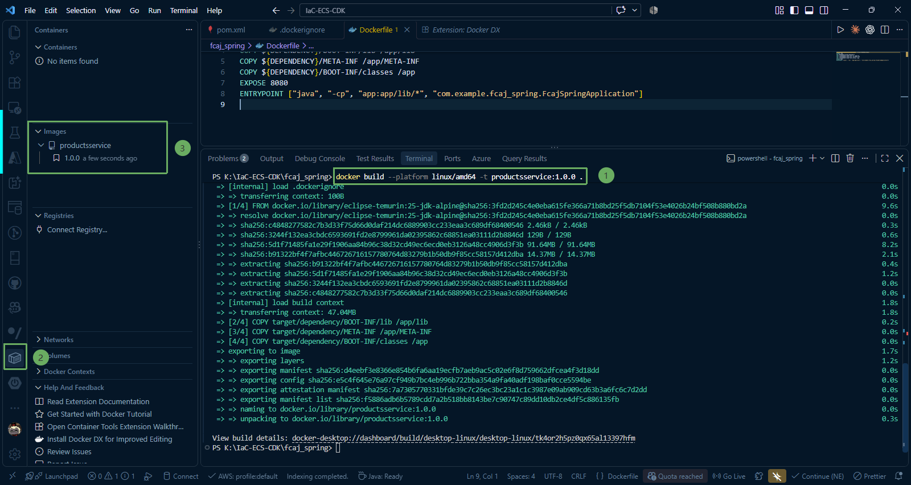

**5. Check Docker Image**

* Once the terminal finishes building, check the newly created image using the command:

```docker
docker images
```
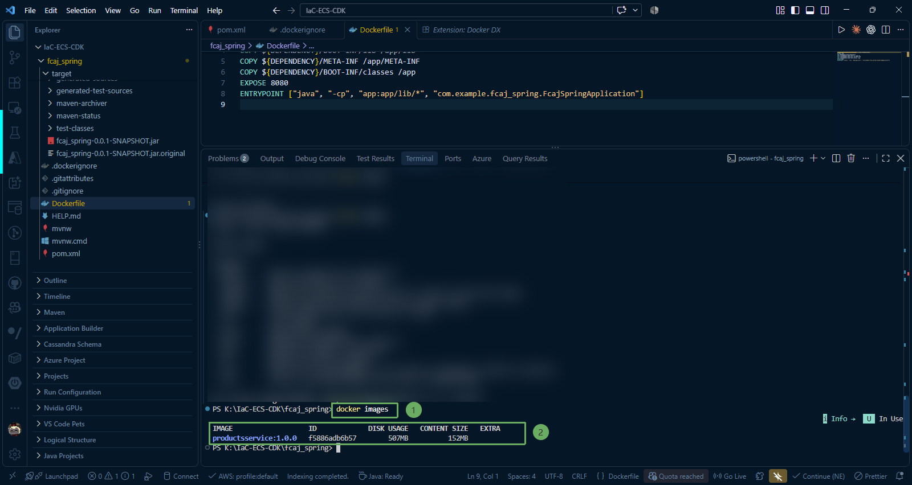

### 2.4.2 Run Docker Image on Local Machine

In this step, we will run a Docker container from the newly built **productsservice:1.0.0** image, verify the application running on the local environment on port 8080, and view container logs.

**1. Launch Docker container**

Open Terminal in VS Code (Ctrl + ~) and run the container start command:

~~~docker
docker run -d --name productsservice-app -p 8080:8080 productsservice:1.0.0
~~~

Explanation of parameters:

* -d: Run container in detached mode (background), without occupying the terminal window.

* --name productsservice-app: Assigns an easily manageable name to the container.

* -p 8080:8080: Maps port 8080 on the host machine to port 8080 inside the container.

* productsservice:1.0.0: The image name created in lab 2.4.

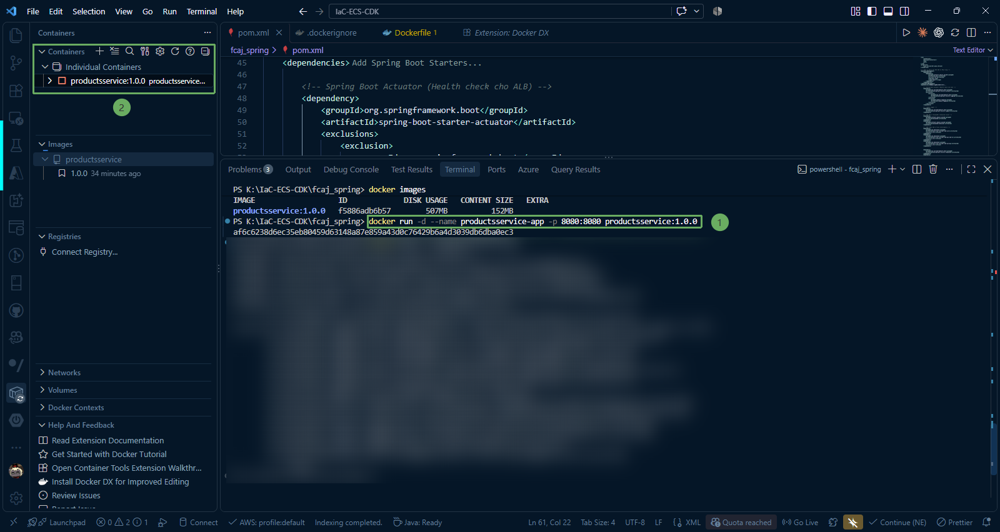

**2. Follow container logs**

After running in the background, you have 2 ways to view the Spring Boot startup logs inside the container:

* Option 1 (Using Terminal):

~~~docker
docker logs -f productsservice-app
~~~

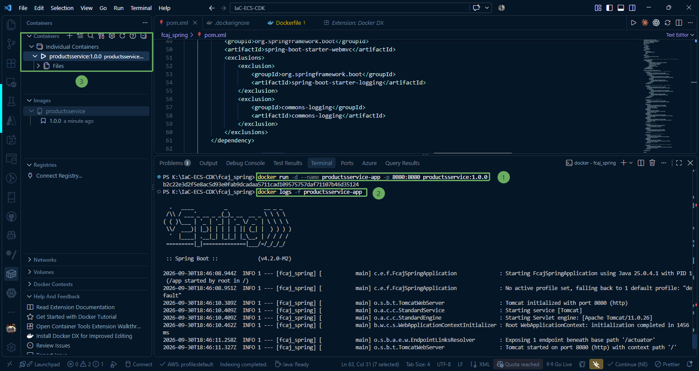

{}
(Press Ctrl + C to exit the log viewing screen without stopping the container).
{}

* Option 2 (Using the Docker Extension UI in VS Code):
  * Click the Docker icon in the vertical Activity Bar on the left.

* Expand the Containers section.

* You will see the container productsservice-app with a green status (Running).

Right-click on that container -> select View Logs. VS Code will open a dedicated Terminal tab showing real-time logs.

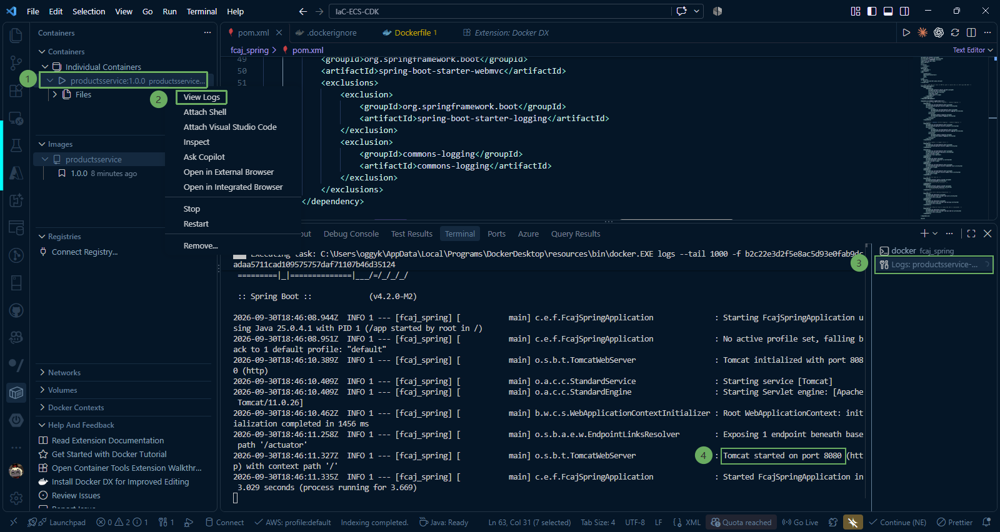

When you see the familiar log line:

~~~code
Started FcajSpringApplication in ... seconds
~~~

**=> The Spring Boot application inside Docker has started successfully.**


#### In case you encounter an error like in the image:
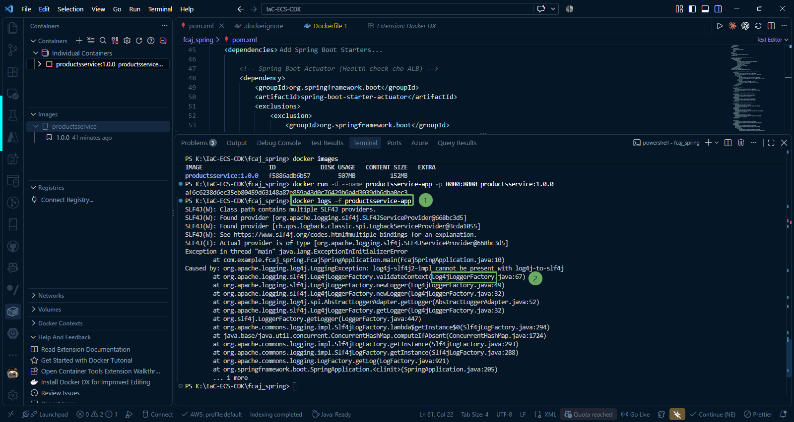

{}
This error occurs due to logging library conflicts.  
{}

Currently, both Logback (default Spring Boot logging) and Log4j2 exist simultaneously on the classpath. This happens because spring-boot-starter-logging was not completely excluded from all dependent starters (e.g., both spring-boot-starter-web and spring-boot-starter-actuator pull in starter-logging), or old Logback jar files remain in the target/dependency/BOOT-INF/lib folder.


To resolve this error, open **pom.xml**, check if you are using spring-boot-starter-actuator or any other starters besides spring-boot-starter-web. Add `<exclusions>` for all those starters.

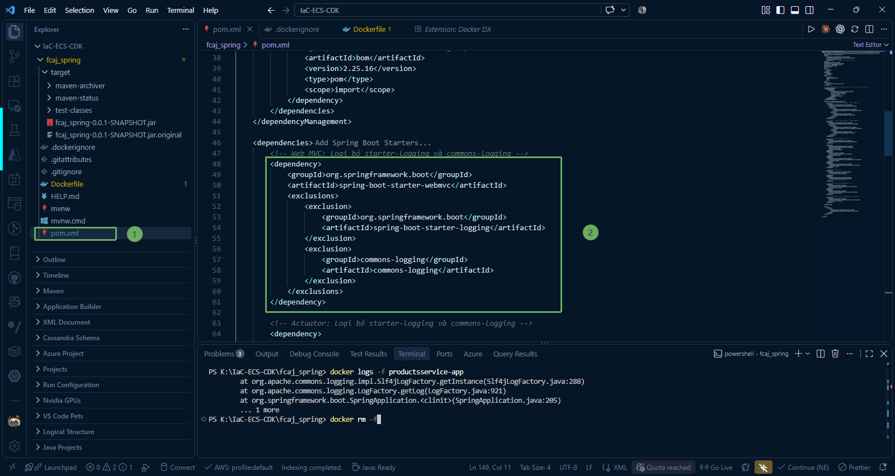

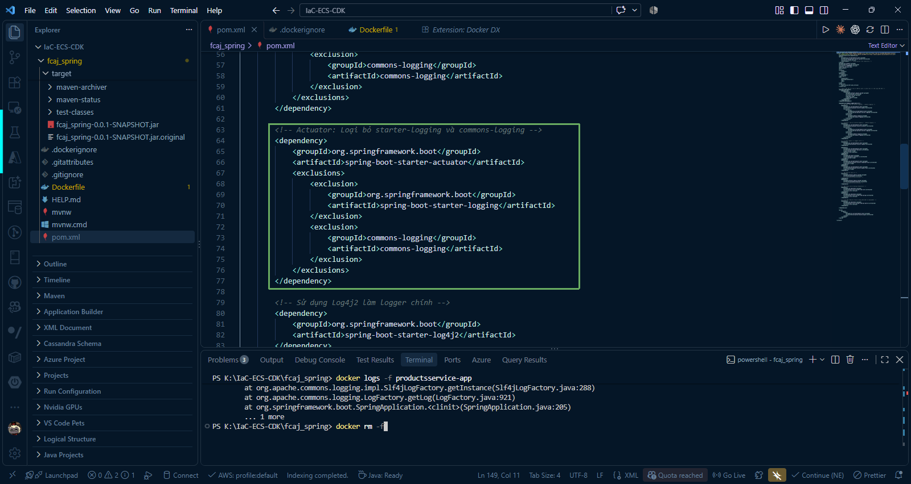

* Then perform the following steps in sequence to rebuild the image and verify the result:

1. Remove the currently broken container:

~~~docker
docker rm -f productsservice-app
~~~

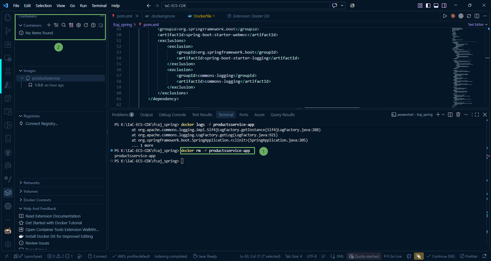


2. Clean the build directory, recompile, and extract the new JAR:

~~~java
.\mvnw.cmd clean package -DskipTests
~~~
~~~java
Remove-Item -Recurse -Force target\dependency -ErrorAction SilentlyContinue
~~~    
~~~java
mkdir -Force target\dependency
~~~     
~~~java
tar -xf (Get-Item target\*.jar).FullName -C target\dependency
~~~   

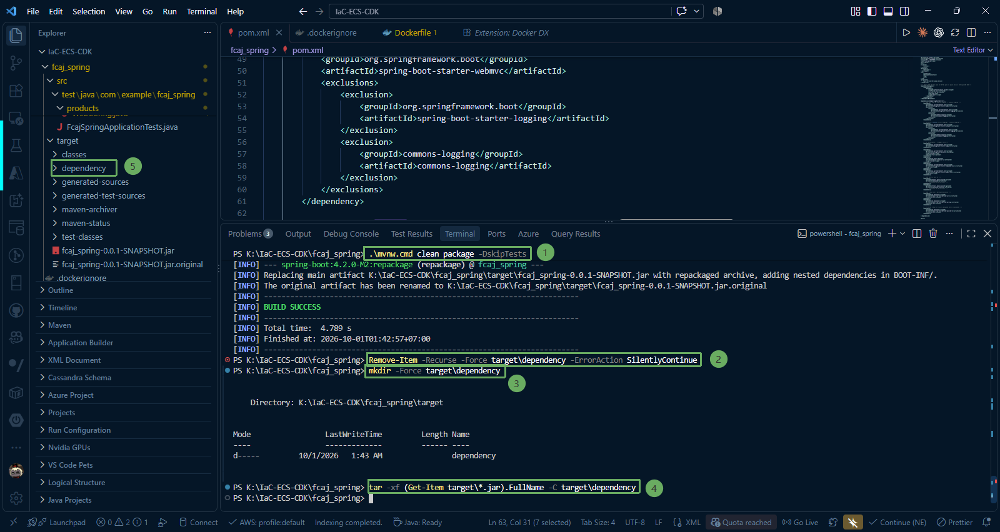

3. Rebuild the image (without cache):

~~~docker
docker build --no-cache --platform linux/amd64 -t productsservice:1.0.0 .
~~~

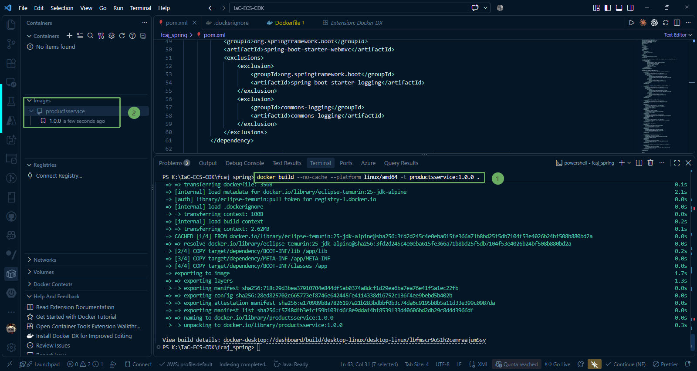

4. Run the container and check logs:

~~~docker
docker run -d --name productsservice-app -p 8080:8080 productsservice:1.0.0
docker logs -f productsservice-app
~~~


**3. Verify API (Verification)**
Open Postman or a Web Browser and test the endpoints:

* Check Health endpoint (Actuator):

URL: `http://localhost:8080/actuator/health`

Method: GET

Expected Result: Status 200 OK, JSON {"status": "UP"}.

**4. Stop local container to prevent port conflicts in subsequent steps**

~~~docker
docker stop productsservice-app
~~~

You have finished building and running the Docker image on your local machine. You are now ready to push the application to ECR.

{}

If you encounter errors, you can clean the build directory following the steps starting from **[1. Remove the currently broken container](/2-preparation/2.4-docker/#in-case-you-encounter-an-error-like-in-the-image)**:

{}
