Dockerfile là công thức tạo image. Trong file hiện tại, EXPOSE 8080 mô tả cổng ứng dụng và ENTRYPOINT khởi động lớp Spring Boot. Docker image nên được build cho linux/amd64 để phù hợp với môi trường Fargate x86_64.

Dockerfile hiện tại copy các thư mục target/dependency/BOOT-INF và target/dependency/META-INF. Nếu các thư mục này chưa tồn tại sau khi Maven build, docker build sẽ thất bại. Để lab dễ tiếp cận, bạn có thể dùng Dockerfile dạng chạy trực tiếp JAR sau khi đã thống nhất tên file JAR với pom.xml. Không nên tiếp tục sang ECR khi chưa chạy được container local.

### 2.4.1 Tạo Dockerfile và Docker Image

**1. Tạo file `.dockerignore` để chỉ định những file và thư mục mà Docker sẽ bỏ qua (ignore) khi bạn đóng gói (build) một image Docker từ các thành phần của project.**

- Tại thư mục gốc của dự án trên VS Code, tạo file tên `.dockerignore` với nội dung sau:

```docker
.git
.gitignore
.dockerignore
.vscode
*.class
README.md
```

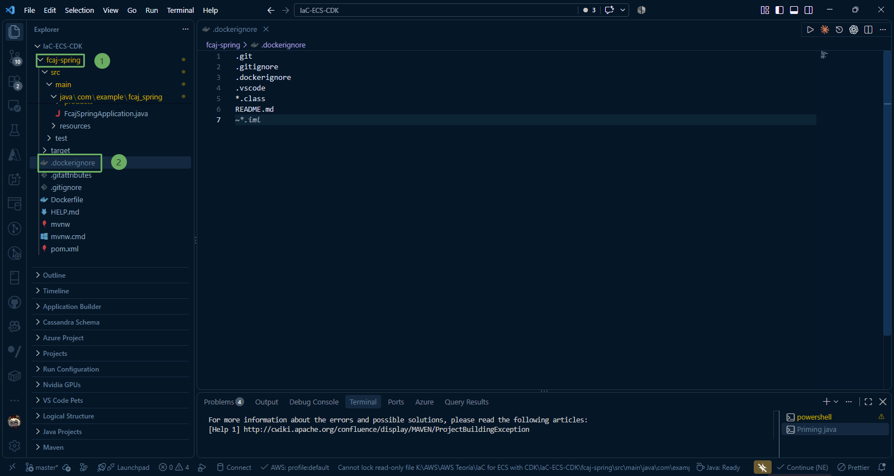

**2. Build file JAR và giải nén**

Mở Terminal trong VS Code (Ctrl + ~), trỏ đến thư mục `.../fcaj-spring` và chạy các lệnh sau:

- Build file jar bằng Maven:

```powershell
.\mvnw.cmd clean package -DskipTests
```

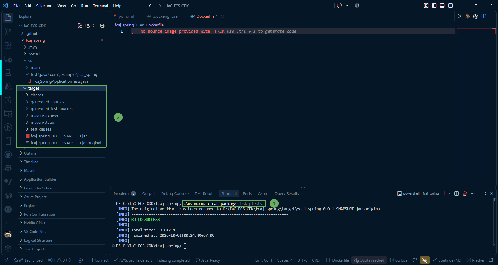

- Giải nén file JAR vào thư mục target/dependency:

```powershell
mkdir -Force target\dependency
tar -xf (Get-Item target\*.jar).FullName -C target\dependency
```

{}

Kiểm tra: Trong thư mục target/dependency/ sẽ xuất hiện 3 thư mục con: BOOT-INF, META-INF và org

{}

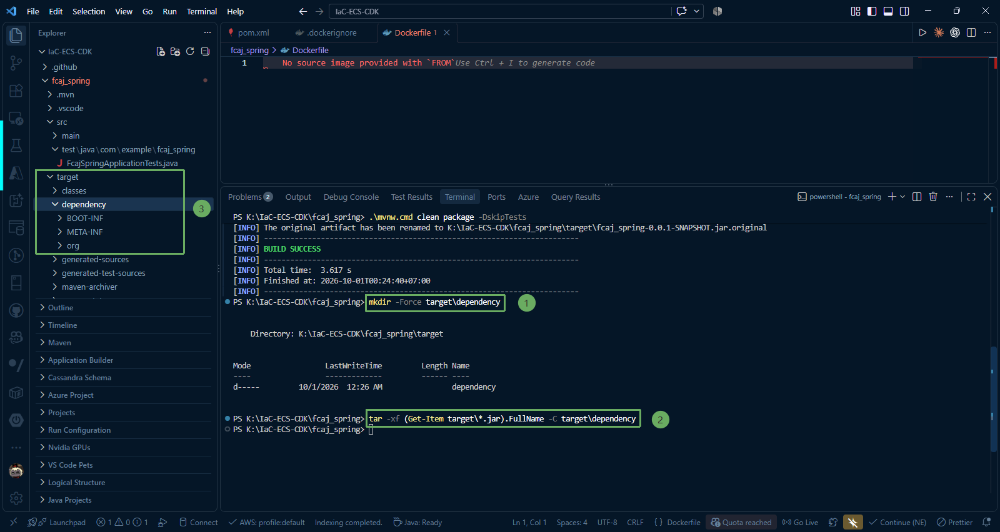

**3. Tạo file Dockerfile**

Tại thư mục gốc của dự án, tạo file Dockerfile (không có đuôi mở rộng).

Biến `DEPENDENCY = target/dependency` trỏ tới thư mục chứa các build artifact đã được giải nén từ file JAR của Maven:

```docker
FROM eclipse-temurin:25-jdk-alpine
VOLUME /tmp
ARG DEPENDENCY=target/dependency
COPY ${DEPENDENCY}/BOOT-INF/lib /app/lib
COPY ${DEPENDENCY}/META-INF /app/META-INF
COPY ${DEPENDENCY}/BOOT-INF/classes /app
EXPOSE 8080
ENTRYPOINT ["java", "-cp", "app:app/lib/*", "com.example.fcaj_spring.FcajSpringApplication"]
```

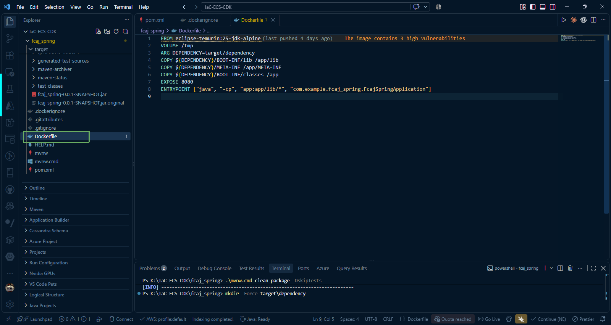

{}

Lưu ý quan trọng:

- EXPOSE: port 8080 dựa vào cấu hình server port trong **application.properties**.
- ENTRYPOINT: class chính khởi chạy là **com.example.fcaj_spring.FcajSpringApplication**.

{}

**4. Build Docker Image trên VS Code Terminal**
   Đảm bảo **Docker Desktop đang chạy**, sau đó chạy lệnh sau trong terminal VS Code:

```docker
docker build --platform linux/amd64 -t productsservice:1.0.0 .
```

Lưu ý dấu chấm `.` ở cuối lệnh biểu thị build context tại thư mục hiện tại.

- Bạn cũng có thể quan sát qua Docker extension trong VSCode. Chúng ta đã tạo **image** có tên **productsservice** với tag là **1.0.0**.

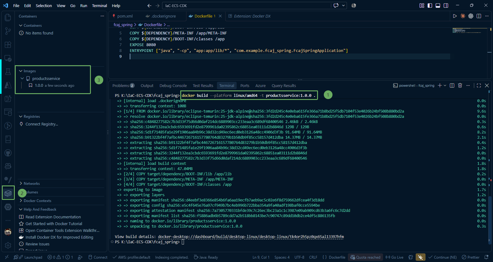

**5. Kiểm tra Docker Image**

* Sau khi terminal build xong, kiểm tra image vừa tạo bằng lệnh:

```docker
docker images
```
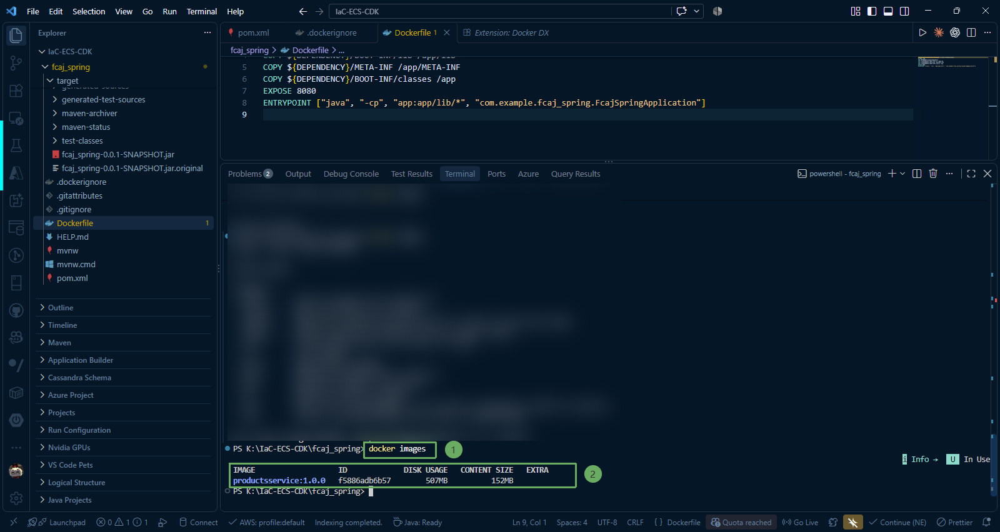

### 2.4.2 Chạy Docker Image trên máy Local

Ở bước này, chúng ta sẽ chạy Docker container từ image **productsservice:1.0.0** vừa build, sau đó kiểm tra ứng dụng hoạt động trên môi trường local qua cổng 8080 và xem log container.

**1. Khởi chạy Docker container**

Mở Terminal trong VS Code (Ctrl + ~) và chạy lệnh run container:

~~~docker
docker run -d --name productsservice-app -p 8080:8080 productsservice:1.0.0
~~~

Giải thích các tham số:

* -d: Chạy container ở chế độ ngầm (detached mode), không chiếm giữ cửa sổ terminal.

* --name productsservice-app: Đặt tên định danh dễ quản lý cho container.

* -p 8080:8080: Ánh xạ cổng 8080 của máy tính (host) vào cổng 8080 bên trong container.

* productsservice:1.0.0: Tên image đã tạo ở lab 2.4.

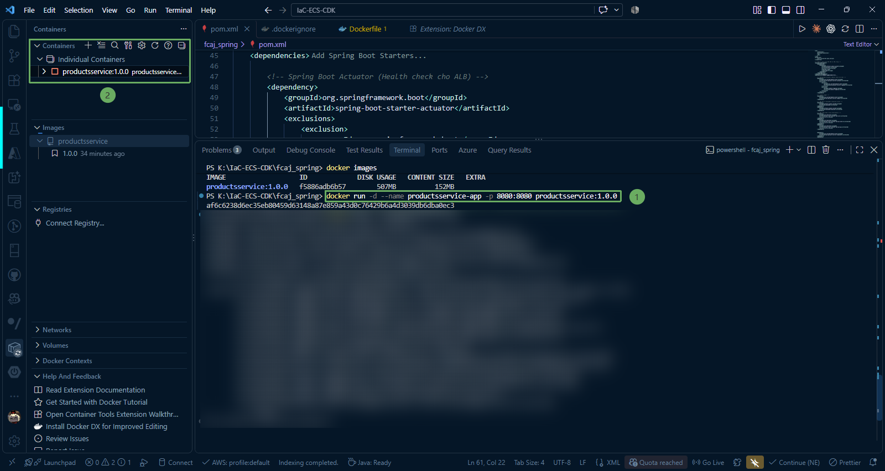

**2. Theo dõi log của container**

Sau khi chạy ngầm, bạn có 2 cách xem log khởi động của Spring Boot bên trong container:

* Cách 1 (Dùng Terminal):

~~~docker
docker logs -f productsservice-app
~~~

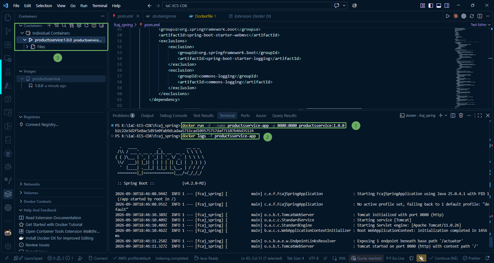

{}
(Nhấn Ctrl + C để thoát màn hình xem log mà không tắt container).
{}

* Cách 2 (Dùng UI Extension Docker trên VS Code):
  * Click vào biểu tượng Docker ở thanh công cụ dọc bên trái (Activity Bar).

* Mở rộng mục Containers.

* Bạn sẽ thấy container productsservice-app có trạng thái màu xanh lá cây (Running).

Click chuột phải vào container đó -> chọn View Logs. VS Code sẽ mở hẳn một tab Terminal hiển thị log trực tiếp.

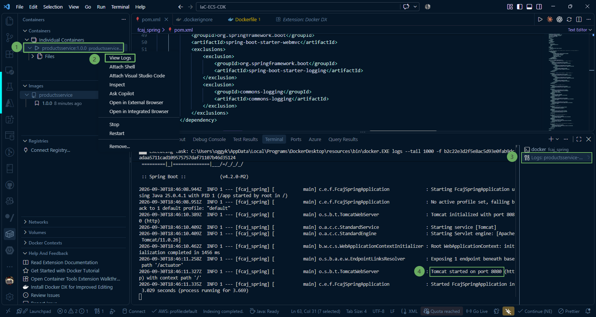

Khi thấy dòng log quen thuộc:

~~~code
Started FcajSpringApplication in ... seconds
~~~

**=> ứng dụng Spring Boot bên trong Docker đã khởi động thành công.**


#### Trong trường hợp gặp lỗi giống như trong hình:
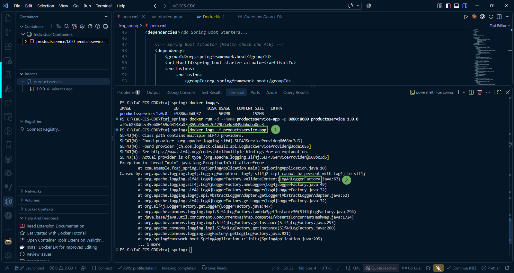

{}
Lỗi này xuất hiện do xung đột thư viện logging.  
{}

Hiện tại trên classpath đang tồn tại song song cả Logback (logging mặc định của Spring Boot) và Log4j2. Điều này xảy ra do spring-boot-starter-logging chưa được loại trừ triệt để ở tất cả các starter phụ thuộc (ví dụ cả spring-boot-starter-web lẫn spring-boot-starter-actuator đều kéo starter logging về), hoặc trong thư mục target/dependency/BOOT-INF/lib cũ vẫn còn sót lại file jar của Logback.


Để xử lý lỗi này, bạn mở **pom.xml**, kiểm tra xem ngoài `spring-boot-starter-web` bạn có đang dùng `spring-boot-starter-actuator` hay starter nào khác không. Hãy thêm `<exclusions>` cho tất cả starter đó.

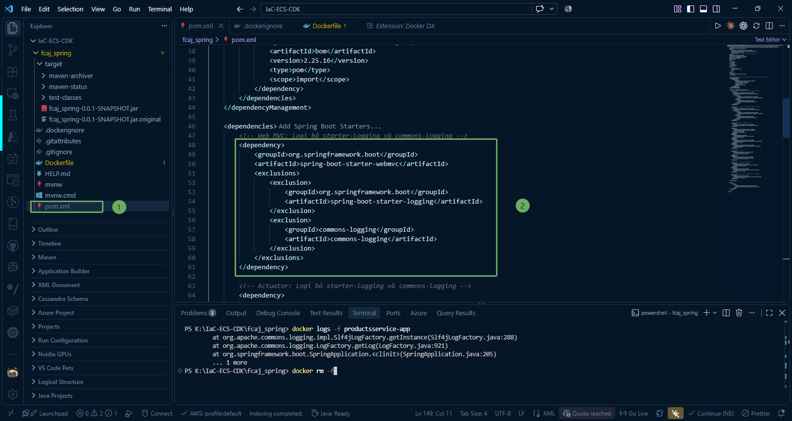

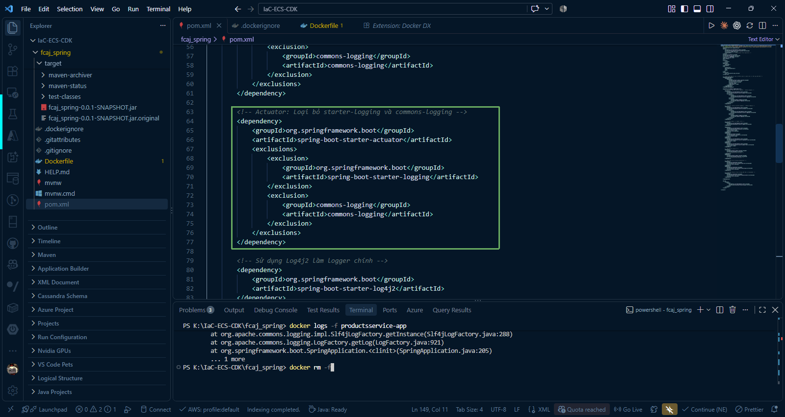

* Sau đó thực hiện lần lượt các bước sau để build lại image và kiểm tra kết quả:

1. Xoá container hỏng hiện tại:

~~~docker
docker rm -f productsservice-app
~~~

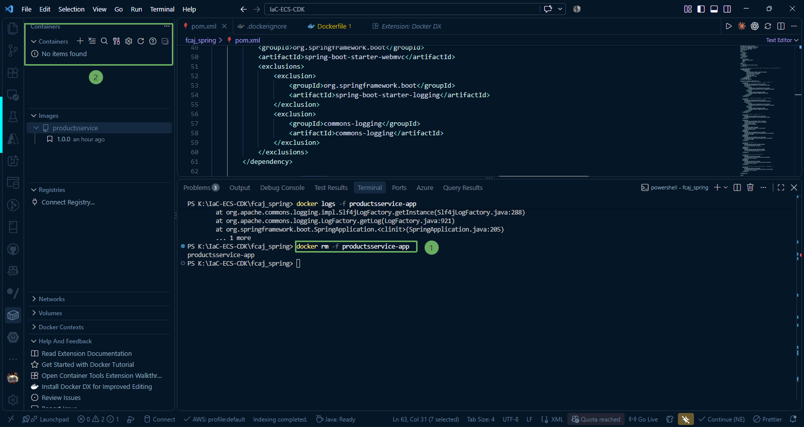


2. Dọn sạch thư mục build, compile lại và giải nén JAR mới:

~~~java
.\mvnw.cmd clean package -DskipTests
~~~
~~~java
Remove-Item -Recurse -Force target\dependency -ErrorAction SilentlyContinue
~~~    
~~~java
mkdir -Force target\dependency
~~~     
~~~java
tar -xf (Get-Item target\*.jar).FullName -C target\dependency
~~~   

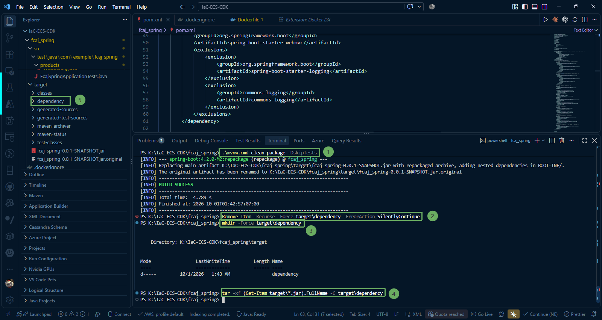

3. Build lại image (không dùng cache):

~~~docker
docker build --no-cache --platform linux/amd64 -t productsservice:1.0.0 .
~~~

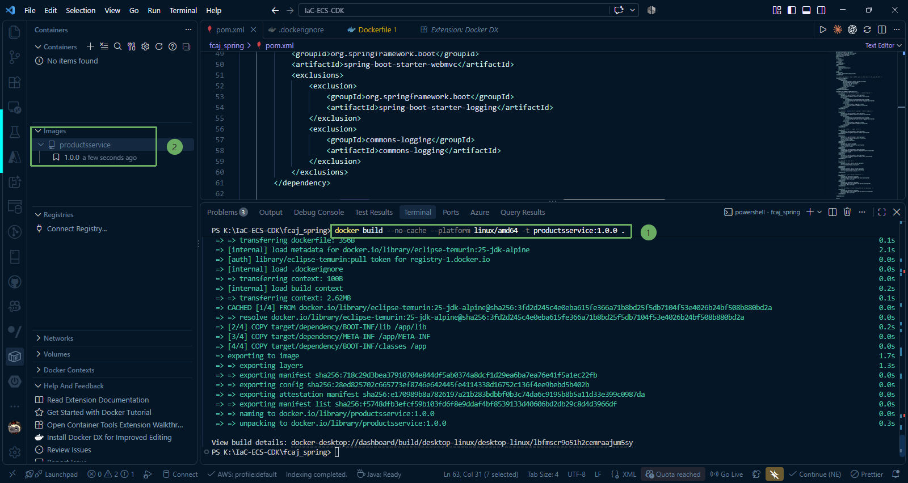

4. Chạy container và xem log:

~~~docker
docker run -d --name productsservice-app -p 8080:8080 productsservice:1.0.0
docker logs -f productsservice-app
~~~


**3. Kiểm tra API (Verification)**
Mở Postman hoặc Trình duyệt web và kiểm tra các endpoint:

* Kiểm tra Health endpoint (Actuator):

URL: `http://localhost:8080/actuator/health`

Method: GET

Kết quả mong đợi: Status 200 OK, JSON {"status": "UP"}.

**4. Dừng container local để các bước sau không bị xung đột cổng**

~~~docker
docker stop productsservice-app
~~~

Bạn đã hoàn thành build và run Docker image trên máy local. Bây giờ bạn sẵn sàng đưa ứng dụng vào ECR.

{}

Nếu gặp lỗi, bạn có thể dọn sạch thư mục build theo các bước từ **[1. Xóa container hỏng hiện tại](/2-preparation/2.4-docker/#trong-trường-hợp-gặp-lỗi-giống-như-trong-hình)**:

{}
