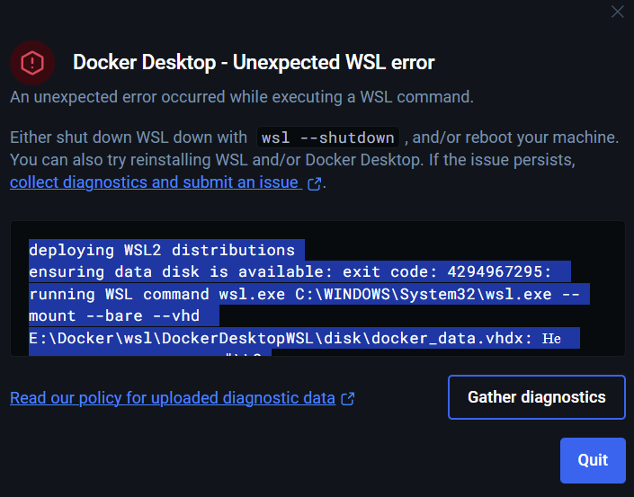
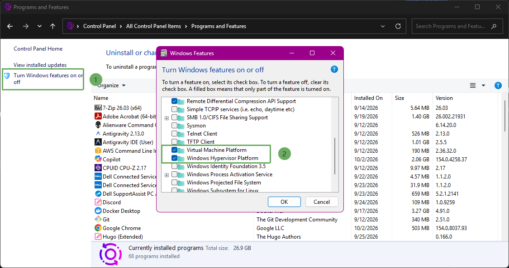

# Environment preparation

All installation and verification steps prior to creating AWS resources are located in this section. The goal is to confirm that the local machine can build Spring Boot, run Docker containers, and synthesize CDK before deploying.

{}
The lab uses region **ap-southeast-1**. If you choose another region, you need to change the region in AWS CLI commands, in the CDK configuration, and in the Spring Boot application.
{}

## Preparation Steps

Below is the step-by-step guide to installing the required tools from their official websites and verifying their versions in the Terminal.

---

**1. Java Development Kit (JDK 25)**

* **Official Download Page:** [Oracle Java Downloads](https://www.oracle.com/java/technologies/downloads/) or [Adoptium Eclipse Temurin](https://adoptium.net/temurin/releases/)
* **Steps:**
  1. Access the download link and select the installer suitable for your operating system (e.g., Windows x64 Installer **.exe** / **.msi**, macOS **.pkg**, or Linux **.tar.gz**).
  2. Open the downloaded file and proceed with the installation using default settings.
  3. Ensure the **JAVA_HOME** environment variable is configured and the path **%JAVA_HOME%\bin** is added to the system **PATH** variable.
* **Verify version in Terminal / PowerShell:**
  ```powershell
  java -version
  javac -version
  ```
* **Output:**
  ```text
  java version "25" ...
  Java(TM) SE Runtime Environment ...
  javac 25
  ```

---

**2. Node.js (LTS v24.x) and npm (v11)**

* **Official Download Page:** [Node.js Official Download](https://nodejs.org/en/download)
* **Steps:**
  1. Visit the Node.js homepage and download the **LTS** installer (version v24.x).
  2. Run the installer (**.msi** on Windows or **.pkg** on macOS), click **Next**, and accept default terms to complete.
* **Verify version in Terminal / PowerShell:**
  ```powershell
  node -v
  npm -v
  ```
* **Sample Output:**
  ```text
  v24.x.x
  11.x.x
  ```

---

**3. AWS CLI**

* **Official Download Page:** [AWS CLI Installation Guide](https://docs.aws.amazon.com/cli/latest/userguide/getting-started-install.html) | [Direct Download AWS CLI for Windows (MSI)](https://awscli.amazonaws.com/AWSCLIV2.msi)
* **Steps:**
  1. Download the AWS CLI v2 installation package corresponding to your operating system.
  2. Launch the installer and follow the on-screen instructions.
  3. Restart your Terminal / PowerShell window to reload new environment variables.
* **Verify version in Terminal / PowerShell:**
  ```powershell
  aws --version
  ```
* **Sample Output:**
  ```text
  aws-cli/2.x.x Python/3.x.x Windows/10 exe/x86_64
  ```

---

**4. AWS CDK**

* **Official Documentation Page:** [AWS CDK Documentation](https://docs.aws.amazon.com/cdk/v2/guide/getting_started.html) | [AWS CDK on npm](https://www.npmjs.com/package/aws-cdk)
* **Steps:**
  Install AWS CDK globally via **npm**:
  ```powershell
  npm install -g aws-cdk
  ```
* **Verify version in Terminal / PowerShell:**
  ```powershell
  cdk --version
  ```
* **Sample Output:**
  ```text
  2.x.x (build ...)
  ```

---

**5. Install Postman**

* **Official Download Page:** [Postman Download](https://www.postman.com/downloads/)
* **Steps:**
  1. Go to the link and download the **Postman Desktop Agent / App** suitable for your operating system.
  2. Launch the installer file to open the Postman application.
  3. Sign in or select **Skip and go to the app** to be ready to send test API requests after the Spring Boot application is deployed.

---

**6. Install VS Code and Extensions for Spring Boot**

* **Official Download Page:** [Visual Studio Code Download](https://code.visualstudio.com/Download)
* **Steps:**
  1. Download and install **VS Code**.
  2. Open VS Code, press `Ctrl + Shift + X` (on Windows/Linux) or `Cmd + Shift + X` (on macOS) to open the **Extensions** panel.
  3. Search and install the following extensions:
     * [Extension Pack for Java](https://marketplace.visualstudio.com/items?itemName=vscjava.vscode-java-pack) (`vscjava.vscode-java-pack`)
     * [Language Support for Java™ by Red Hat](https://marketplace.visualstudio.com/items?itemName=redhat.java) (`redhat.java`)
     * [Spring Boot Extension Pack](https://marketplace.visualstudio.com/items?itemName=vmware.vscode-boot-dev-pack) (`vmware.vscode-boot-dev-pack`)
     * [Spring Initializr Java Support](https://marketplace.visualstudio.com/items?itemName=vscjava.vscode-spring-initializr) (`vscjava.vscode-spring-initializr`)
     * [Docker](https://marketplace.visualstudio.com/items?itemName=ms-azuretools.vscode-docker) (`ms-azuretools.vscode-docker`)
     * [Docker DX](https://marketplace.visualstudio.com/items?itemName=docker.docker) (`docker.docker`)
     * [AWS Toolkit](https://marketplace.visualstudio.com/items?itemName=AmazonWebServices.aws-toolkit-vscode) (`amazonwebservices.aws-toolkit-vscode`)
     
  
  *(Optional)* You can quickly install all extensions via Terminal command:
  ```powershell
  code --install-extension vscjava.vscode-java-pack
  code --install-extension redhat.java
  code --install-extension vmware.vscode-boot-dev-pack
  code --install-extension vscjava.vscode-spring-initializr
  ```
* **Verify installation in Terminal / PowerShell:**
  ```powershell
  code --version
  code --list-extensions
  ```

---

**7. Install Docker Desktop**

* **Official Download Page:** [Docker Desktop Download](https://www.docker.com/products/docker-desktop/)
* **Steps:**
  1. Download the Docker Desktop installation package suitable for your operating system (on Windows, enabling the **WSL 2 backend** feature is recommended).
  2. Proceed with the installation and restart your computer if required.
  3. Launch Docker Desktop and make sure the displayed status is **Engine running**.
* **Verify version and status in Terminal / PowerShell:**
  ```powershell
  docker --version
  docker compose version
  docker info
  ```
* **Sample Output:**
  ```text
  Docker version 29.x.x, build ...
  Docker Compose version v5.x.x
  ```

{}
**Docker Desktop Troubleshooting (WSL 2 & Virtualization on Windows):**  
If Docker Desktop fails to launch or displays errors regarding **WSL 2 (Windows Subsystem for Linux)**, "WSL 2 installation is incomplete", or "Virtualization is not enabled in BIOS", follow these steps:
{}



#### Step 1: Check Virtualization Features in Control Panel
1. Press the `Windows` key, search for and open **Turn Windows features on or off** (or navigate to **Control Panel** > **Programs and Features** > **Turn Windows features on or off**).
2. Ensure the following features are checked:
   * **Virtual Machine Platform**
   * **Windows Hypervisor Platform**
   * **Windows Subsystem for Linux**
   * *(Optional for Hyper-V)*: **Hyper-V**
3. Click **OK** to apply the features.



#### Step 2: Check and Install WSL 2 via PowerShell (Administrator)
Open **PowerShell** as an administrator (**Run as Administrator**):

1. **Verify if WSL is installed on your system:**
   ```powershell
   wsl --status
   ```
   * If version details and kernel version appear, WSL is already installed.
   * If an error like `wsl is not recognized...` appears or WSL is disabled:

2. **Enable Virtualization and Install WSL:**
   Enable Hyper-V:
   ```powershell
   Enable-WindowsOptionalFeature -Online -FeatureName Microsoft-Hyper-V -All
   ```
   Install the latest WSL:
   ```powershell
   wsl --install
   ```
   *(Or install WSL without default Linux distribution if used exclusively for Docker: `wsl --install --no-distribution`)*.

3. **Update the WSL kernel to the latest version:**
   ```powershell
   wsl --update
   ```

4. **Set WSL 2 as the default version for Docker:**
   ```powershell
   wsl --set-default-version 2
   ```

5. **Restart your computer** so that all virtualization features and the WSL kernel take effect.

#### Step 3: Verify Stable WSL Status
After restarting, open **PowerShell** again and verify the WSL status:

1. **Check WSL configuration status:**
   ```powershell
   wsl --status
   ```
   * Expected output confirming a stable WSL 2 environment:
     ```text
     Default Version: 2
     WSL version: 2.x.x
     Kernel version: 5.x.x (or newer)
     WSLg version: ...
     ```

2. **Check the list of running Linux distributions for Docker:**
   ```powershell
   wsl -l -v
   ```
   * When Docker Desktop runs successfully, you will see backend processes in the `Running` state on version 2:
     ```text
       NAME                   STATE           VERSION
     * docker-desktop         Running         2
       docker-desktop-data    Running         2
     ```

3. Launch the **Docker Desktop** application; the Docker whale icon in your system tray should turn green (**Engine running**).

