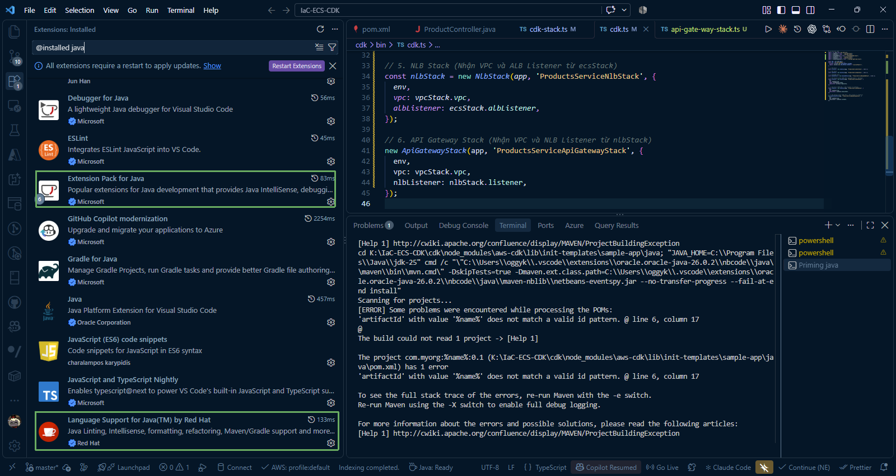
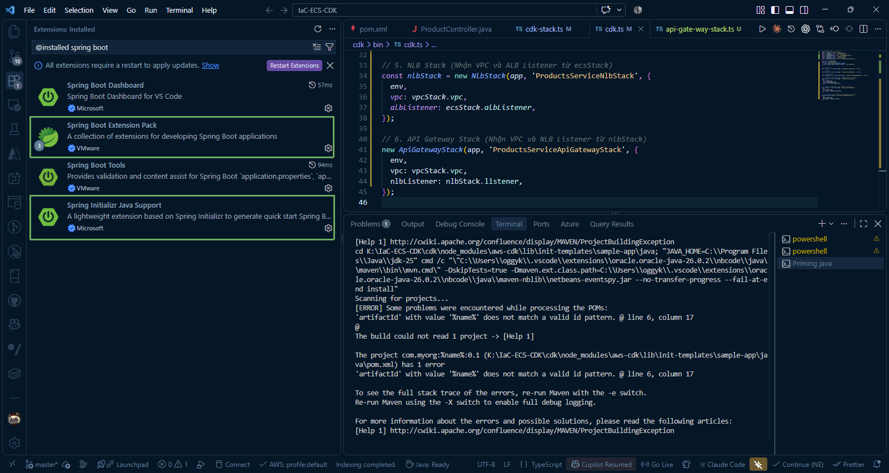
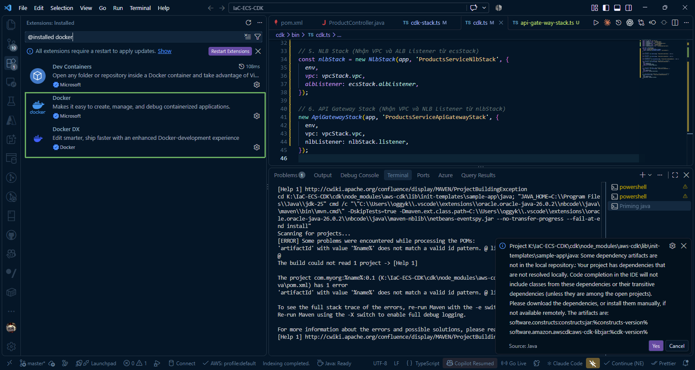
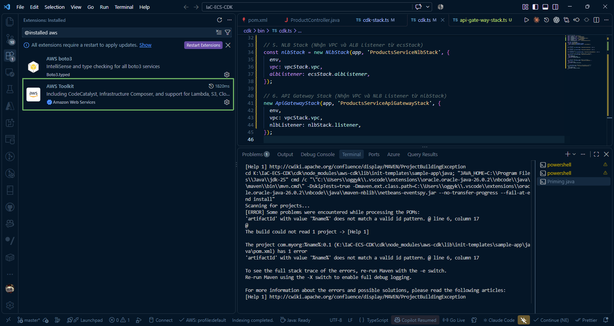
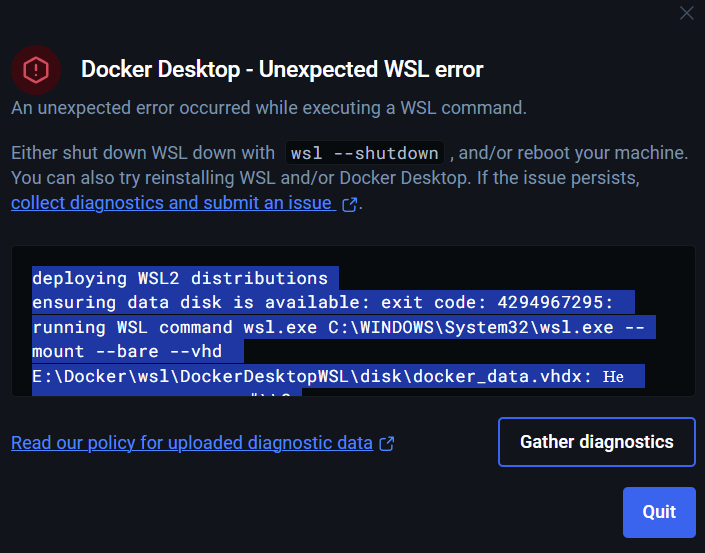
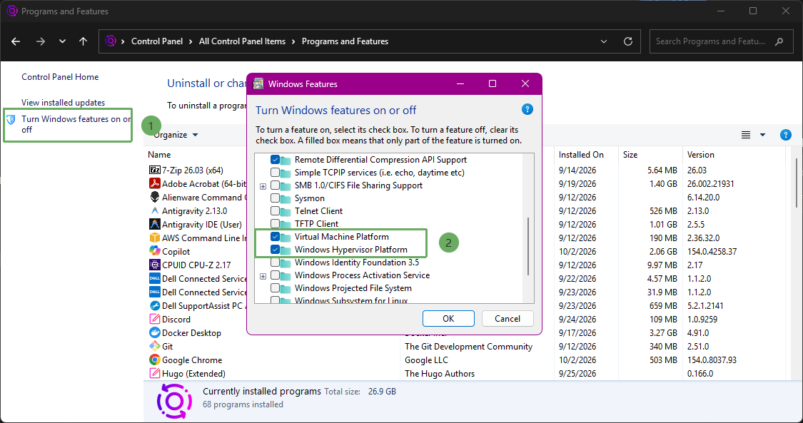

# Chuẩn bị môi trường

Toàn bộ bước cài đặt và kiểm tra trước khi tạo tài nguyên AWS nằm trong mục này. Mục tiêu là xác nhận máy local có thể build Spring Boot, chạy Docker container và synth CDK trước khi deploy.

{}
Bài lab dùng region **ap-southeast-1**. Nếu bạn chọn region khác, cần thay đổi region trong lệnh AWS CLI, trong cấu hình CDK và trong ứng dụng Spring Boot.
{}

## Các bước chuẩn bị

Dưới đây là hướng dẫn chi tiết từng bước cài đặt các công cụ cần thiết từ trang web chính thức đến kiểm tra phiên bản trên Terminal.

---

**1. Java Development Kit (JDK 25)**

* **Trang tải chính thức:** [Oracle Java Downloads](https://www.oracle.com/java/technologies/downloads/) hoặc [Adoptium Eclipse Temurin](https://adoptium.net/temurin/releases/)
* **Các bước thực hiện:**
  1. Truy cập liên kết tải và chọn gói cài đặt phù hợp với hệ điều hành (ví dụ: Windows x64 Installer **.exe** / **.msi**, macOS **.pkg**, hoặc Linux **.tar.gz**).
  2. Mở tệp vừa tải và tiến hành cài đặt theo hướng dẫn mặc định.
  3. Đảm bảo biến môi trường **JAVA_HOME** đã được cấu hình và đường dẫn **%JAVA_HOME%\bin** được thêm vào biến hệ thống **PATH**.
* **Kiểm tra phiên bản trong Terminal / PowerShell:**
  ```powershell
  java -version
  javac -version
  ```
* **Kết quả:**
  ```text
  java version "25" ...
  Java(TM) SE Runtime Environment ...
  javac 25
  ```

---

**2. Node.js (LTS v24.x) và npm (v11)**

* **Trang tải chính thức:** [Node.js Official Download](https://nodejs.org/en/download)
* **Các bước thực hiện:**
  1. Truy cập trang chủ Node.js và tải bản cài đặt **LTS** (phiên bản v24.x).
  2. Chạy tệp cài đặt (**.msi** trên Windows hoặc **.pkg** trên macOS), nhấn **Next** và chấp nhận các điều khoản mặc định để hoàn tất.
* **Kiểm tra phiên bản trong Terminal / PowerShell:**
  ```powershell
  node -v
  npm -v
  ```
* **Kết quả mẫu:**
  ```text
  v24.x.x
  11.x.x
  ```

---

**3. AWS CLI**

* **Trang tải chính thức:** [AWS CLI Installation Guide](https://docs.aws.amazon.com/cli/latest/userguide/getting-started-install.html) | [Tải trực tiếp AWS CLI cho Windows (MSI)](https://awscli.amazonaws.com/AWSCLIV2.msi)
* **Các bước thực hiện:**
  1. Tải gói cài đặt AWS CLI v2 tương ứng với hệ điều hành.
  2. Khởi chạy trình cài đặt và làm theo hướng dẫn trên màn hình.
  3. Khởi động lại cửa sổ Terminal / PowerShell để nạp lại các biến môi trường mới.
* **Kiểm tra phiên bản trong Terminal / PowerShell:**
  ```powershell
  aws --version
  ```
* **Kết quả mẫu:**
  ```text
  aws-cli/2.x.x Python/3.x.x Windows/10 exe/x86_64
  ```

---

**4. AWS CDK**

* **Trang tài liệu chính thức:** [AWS CDK Documentation](https://docs.aws.amazon.com/cdk/v2/guide/getting_started.html) | [AWS CDK trên npm](https://www.npmjs.com/package/aws-cdk)
* **Các bước thực hiện:**
  Cài đặt AWS CDK toàn cục (global) thông qua **npm**:
  ```powershell
  npm install -g aws-cdk
  ```
* **Kiểm tra phiên bản trong Terminal / PowerShell:**
  ```powershell
  cdk --version
  ```
* **Kết quả mẫu:**
  ```text
  2.x.x (build ...)
  ```

---

**5. Cài đặt Postman**

* **Trang tải chính thức:** [Postman Download](https://www.postman.com/downloads/)
* **Các bước thực hiện:**
  1. Truy cập liên kết và tải phiên bản **Postman Desktop Agent / App** phù hợp với hệ điều hành.

  2. Khởi chạy file cài đặt để mở ứng dụng Postman.
  3. Đăng nhập hoặc chọn **Skip and go to the app** để sẵn sàng gửi request kiểm thử API sau khi ứng dụng Spring Boot được triển khai.

---

**6. Cài đặt VS Code và các Extension cho Spring Boot**

* **Trang tải chính thức:** [Visual Studio Code Download](https://code.visualstudio.com/Download)
* **Các bước thực hiện:**
  1. Tải và cài đặt phần mềm **VS Code**.

  2. Mở VS Code, nhấn tổ hợp phím `Ctrl + Shift + X` (trên Windows/Linux) hoặc `Cmd + Shift + X` (trên macOS) để mở bảng **Extensions**.
  3. Tìm kiếm và cài đặt các tiện ích mở rộng sau:
     * [Extension Pack for Java](https://marketplace.visualstudio.com/items?itemName=vscjava.vscode-java-pack) (`vscjava.vscode-java-pack`)
     * [Language Support for Java™ by Red Hat](https://marketplace.visualstudio.com/items?itemName=redhat.java) (`redhat.java`)
     * [Spring Boot Extension Pack](https://marketplace.visualstudio.com/items?itemName=vmware.vscode-boot-dev-pack) (`vmware.vscode-boot-dev-pack`)
     * [Spring Initializr Java Support](https://marketplace.visualstudio.com/items?itemName=vscjava.vscode-spring-initializr) (`vscjava.vscode-spring-initializr`)
     * [Docker](https://marketplace.visualstudio.com/items?itemName=ms-azuretools.vscode-docker) (`ms-azuretools.vscode-docker`)
     * [Docker DX](https://marketplace.visualstudio.com/items?itemName=docker.docker) (`docker.docker`)
     * [AWS Toolkit](https://marketplace.visualstudio.com/items?itemName=AmazonWebServices.aws-toolkit-vscode) (`AmazonWebServices.aws-toolkit-vscode`)









 
  
  *(Tuỳ chọn)* Bạn có thể cài đặt nhanh toàn bộ extension bằng lệnh Terminal:
  ```powershell
  code --install-extension vscjava.vscode-java-pack
  code --install-extension redhat.java
  code --install-extension vmware.vscode-boot-dev-pack
  code --install-extension vscjava.vscode-spring-initializr
  ```
* **Kiểm tra cài đặt trong Terminal / PowerShell:**
  ```powershell
  code --version
  code --list-extensions
  ```

---

**7. Cài đặt Docker Desktop**

* **Trang tải chính thức:** [Docker Desktop Download](https://www.docker.com/products/docker-desktop/)
* **Các bước thực hiện:**
  1. Tải gói cài đặt Docker Desktop tương ứng với hệ điều hành (trên Windows khuyến nghị kích hoạt tính năng **WSL 2 backend**).

  2. Tiến hành cài đặt và khởi động lại máy tính nếu được yêu cầu.
  3. Khởi chạy Docker Desktop và đảm bảo trạng thái hiển thị là **Engine running**.
* **Kiểm tra phiên bản và trạng thái trong Terminal / PowerShell:**
  ```powershell
  docker --version
  docker compose version
  docker info
  ```
* **Kết quả mẫu:**
  ```text
  Docker version 29.x.x, build ...
  Docker Compose version v5.x.x
  ```

{}
**Xử lý sự cố Docker Desktop (Lỗi WSL 2 và Ảo hóa trên Windows):**  
Nếu Docker Desktop không khởi động được hoặc báo lỗi liên quan đến **WSL 2 (Windows Subsystem for Linux)**, "WSL 2 installation is incomplete" hay "Virtualization is not enabled in BIOS", hãy thực hiện lần lượt các bước sau:
{}



#### Bước 1: Kiểm tra tính năng ảo hóa trong Control Panel
1. Nhấn phím `Windows`, tìm kiếm và mở **Turn Windows features on or off** (hoặc vào **Control Panel** > **Programs and Features** > **Turn Windows features on or off**).
2. Kiểm tra và đảm bảo đã đánh dấu chọn các mục:
   * **Virtual Machine Platform** (Nền tảng máy ảo)

   * **Windows Hypervisor Platform** (Nền tảng phần mềm ảo hóa Windows)
   * **Windows Subsystem for Linux**
   * *(Tùy chọn cho Hyper-V)*: **Hyper-V**
3. Nhấn **OK** để Windows nạp tính năng.



#### Bước 2: Kiểm tra và cài đặt WSL 2 bằng PowerShell (Quyền Administrator)
Mở cửa sổ **PowerShell** với quyền quản trị (**Run as Administrator**):

1. **Kiểm tra WSL đã được cài đặt trên hệ thống hay chưa:**
   ```powershell
   wsl --status
   ```
   * Nếu hiển thị thông tin phiên bản WSL và Kernel thì WSL đã có sẵn trên máy.
   * Nếu hiển thị thông báo lỗi `wsl is not recognized...` hoặc chưa được bật:

2. **Kích hoạt tính năng ảo hóa và cài đặt WSL:**
   Kích hoạt Hyper-V:
   ```powershell
   Enable-WindowsOptionalFeature -Online -FeatureName Microsoft-Hyper-V -All
   ```
   Cài đặt WSL mới nhất (nếu chưa cài):
   ```powershell
   wsl --install
   ```
   *(Hoặc cài đặt WSL không kèm bản phân phối Linux mặc định nếu chỉ dùng cho Docker: `wsl --install --no-distribution`)*.

3. **Cập nhật nhân WSL kernel lên phiên bản mới nhất:**
   ```powershell
   wsl --update
   ```

4. **Thiết lập WSL 2 làm phiên bản mặc định cho Docker:**
   ```powershell
   wsl --set-default-version 2
   ```

5. **Khởi động lại máy tính** để toàn bộ cấu hình ảo hóa và kernel WSL có hiệu lực.

#### Bước 3: Xác nhận trạng thái WSL hoạt động ổn định
Sau khi máy tính khởi động lại, mở lại **PowerShell** và kiểm tra trạng thái WSL:

1. **Kiểm tra thông số cấu hình WSL:**
   ```powershell
   wsl --status
   ```
   * Kết quả mong đợi xác nhận WSL 2 đang hoạt động ổn định:
     ```text
     Default Distribution: docker-desktop
     Default Version: 2
     WSL version: 2.x.x
     Kernel version: 5.x.x (hoặc mới hơn)
     WSLg version: ...
     ```

2. **Kiểm tra danh sách các bản phân phối Linux đang chạy cho Docker:**
   ```powershell
   wsl -l -v
   ```
   * Khi Docker Desktop khởi chạy thành công, bạn sẽ thấy các tiến trình backend hiển thị trạng thái `Running` trên phiên bản 2:
     ```text
       NAME                   STATE           VERSION
     * docker-desktop         Running         2
       docker-desktop-data    Running         2
     ```

3. Khởi chạy lại ứng dụng **Docker Desktop**, biểu tượng cá voi Docker ở góc dưới thanh Taskbar sẽ chuyển sang trạng thái xanh lá cây (**Engine running**).

