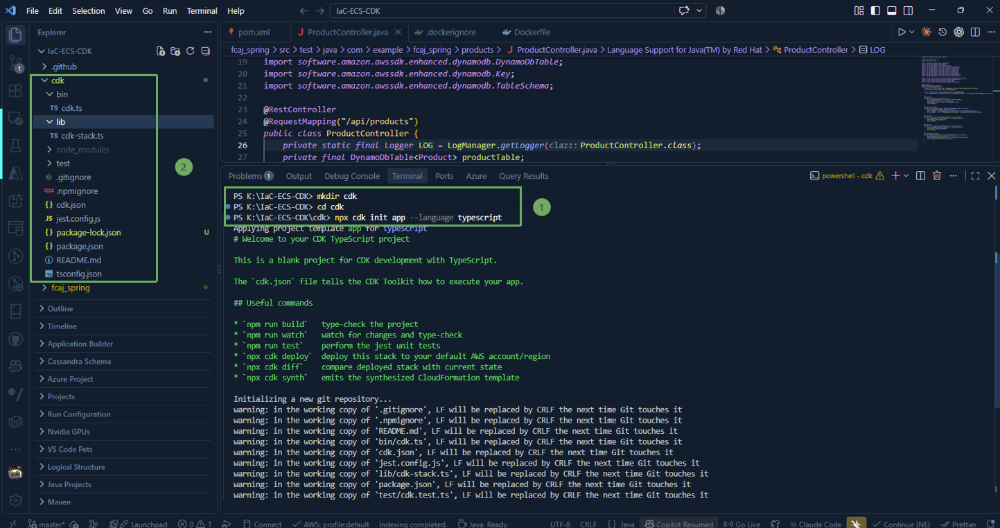
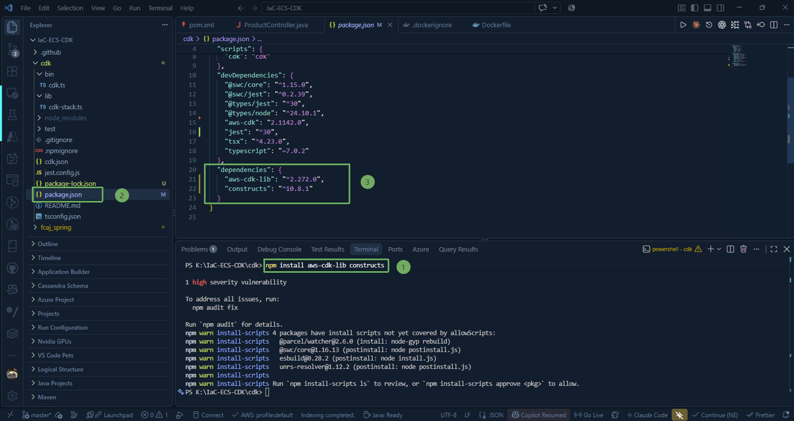
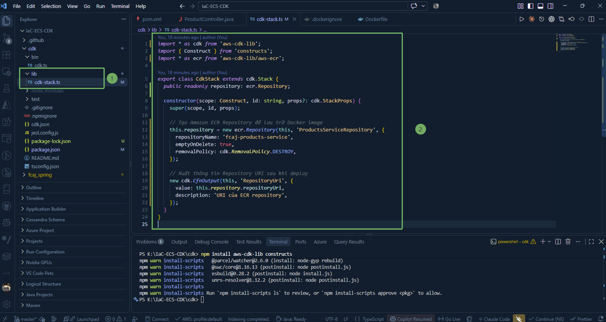

In this step, we will initialize an **AWS Cloud Development Kit (CDK)** project using **TypeScript** from the parent directory `IaC-ECS-CDK`, install the necessary construct libraries, and write the stack source code to create an **Amazon Elastic Container Registry (ECR)** repository.

---

### 1. Overall Project Structure

Recall the directory structure of the `IaC-ECS-CDK` project:

~~~text
IaC-ECS-CDK/
├── fcaj-spring/   # Spring Boot application source code and Dockerfile (created in steps 2.3 & 2.4)
└── cdk/           # Directory containing all AWS CDK infrastructure code in TypeScript
~~~

Infrastructure source code is completely separated from the backend application source code in the `cdk` directory, making resource lifecycle management and CI/CD independent and clear.

---

### 2. Initialize AWS CDK Project with TypeScript

1. Open Terminal in VS Code (`Ctrl + ~`) or PowerShell in the root directory `IaC-ECS-CDK`.

2. Create the `cdk` directory and switch into it:

~~~powershell
mkdir cdk
cd cdk
~~~

3. Initialize a new AWS CDK project with the TypeScript template:

~~~powershell
npx cdk init app --language typescript
~~~

{}
The `cdk init` command automatically generates a basic project scaffold with TypeScript file structure, configuration files `cdk.json`, `tsconfig.json`, and installs initial packages via `npm`.
{}

After the initialization command finishes, the structure inside the `cdk` directory will be:

~~~text
cdk/
├── bin/
│   └── cdk.ts          # Application entry point for CDK
├── lib/
│   └── cdk-stack.ts    # Where AWS resources are defined (CDK Stack)
├── package.json        # Defines dependencies and scripts
└── tsconfig.json       # TypeScript compiler configuration
~~~

---

### 3. Install CDK Libraries and Constructs

AWS CDK v2 groups all service constructs into a single library `aws-cdk-lib`. Check and install the latest versions of `aws-cdk-lib` and `constructs`:

~~~powershell
npm install aws-cdk-lib constructs
~~~

The **package.json** file in the `cdk` directory will record the main dependencies.

---

### 4. Write Source Code for ECR Stack (`cdk-stack.ts`)

Access `/lib` and open the **cdk-stack.ts** file to update the content defining the ECR repository stack:

~~~typescript
import * as cdk from 'aws-cdk-lib';
import { Construct } from 'constructs';
import * as ecr from 'aws-cdk-lib/aws-ecr';

export class CdkStack extends cdk.Stack {
  public readonly repository: ecr.Repository;

  constructor(scope: Construct, id: string, props?: cdk.StackProps) {
    super(scope, id, props);

    // Create Amazon ECR Repository to store Docker images
    this.repository = new ecr.Repository(this, 'ProductsServiceRepository', {
      repositoryName: 'fcaj-products-service',
      emptyOnDelete: true,
      removalPolicy: cdk.RemovalPolicy.DESTROY,
    });

    // Output Repository URI after deploy
    new cdk.CfnOutput(this, 'RepositoryUri', {
      value: this.repository.repositoryUri,
      description: 'URI of the ECR repository',
    });
  }
}
~~~

---

### 5. Detailed Explanation of Properties

* **public readonly repository: ecr.Repository;**: Declares a public property so that the repository object can be passed to other stacks (for example: **EcsStack** in later sections will need to reference this repository to pull the image and run it on Fargate Tasks).

* **repositoryName: 'fcaj-products-service'**: The name of the ECR repository on AWS. This name must be unique within your account and region.

* **removalPolicy: cdk.RemovalPolicy.DESTROY**: Specifies the resource handling policy when the Stack is deleted. By default, CloudFormation retains (RETAIN) storage resources to prevent unintended data loss. In a practice/lab environment, setting **DESTROY** makes it easy to clean up resources without errors.

* **emptyOnDelete: true**: Automatically deletes all images inside the repository before destroying the repository. Without this option, CloudFormation will fail to delete the repository if it still contains images.

* **cdk.CfnOutput**: Prints the **repositoryUri** address to the console output immediately after successful deployment, making it easy to copy for tagging and pushing Docker images.
