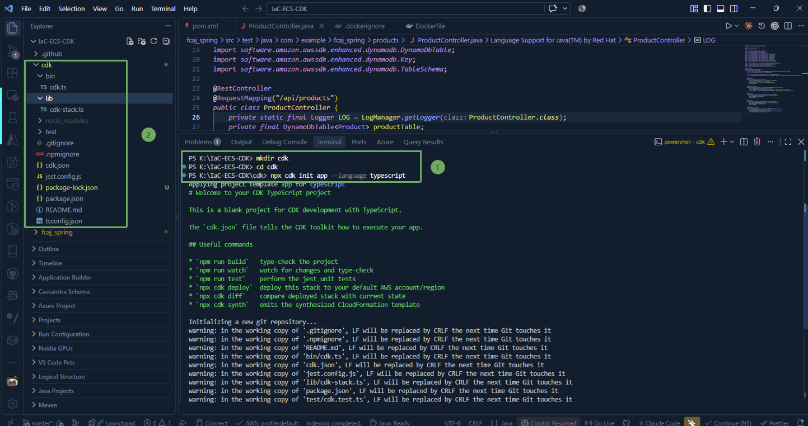
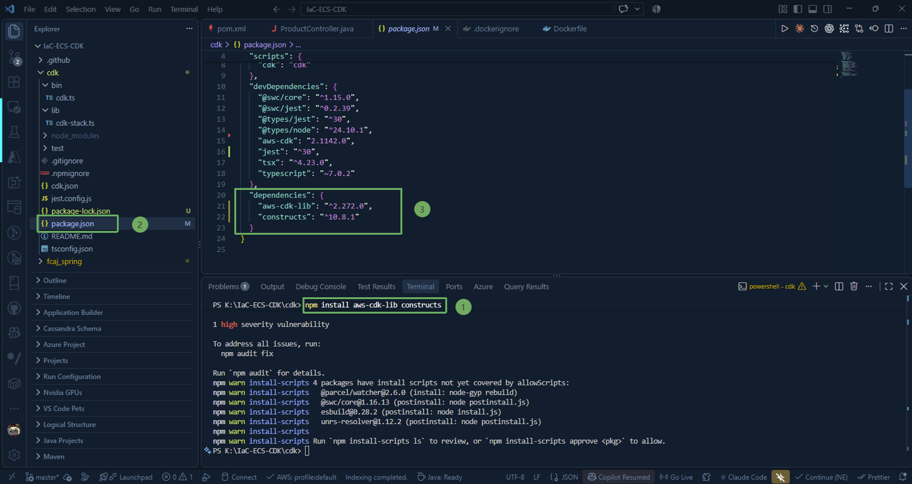
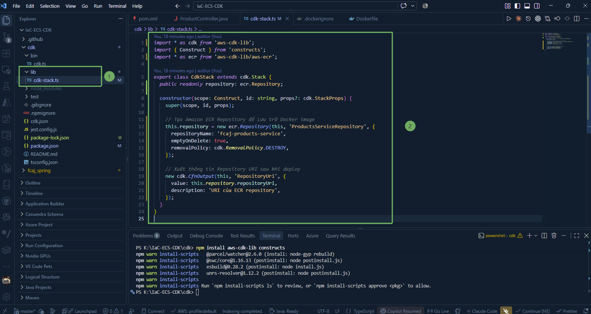

Trong bước này, chúng ta sẽ khởi tạo dự án **AWS Cloud Development Kit (CDK)** sử dụng ngôn ngữ **TypeScript** từ thư mục cha `IaC-ECS-CDK`, cài đặt các thư viện construct cần thiết và viết mã nguồn stack tạo kho lưu trữ **Amazon Elastic Container Registry (ECR)**.

---

### 1. Cấu trúc dự án tổng thể

Nhắc lại cấu trúc thư mục của dự án `IaC-ECS-CDK`:

~~~text
IaC-ECS-CDK/
├── fcaj-spring/   # Mã nguồn ứng dụng Spring Boot và Dockerfile (đã tạo ở bước 2.3 & 2.4)
└── cdk/           # Thư mục chứa toàn bộ mã nguồn hạ tầng AWS CDK bằng TypeScript
~~~

Mã nguồn hạ tầng được tách biệt hoàn toàn với mã nguồn ứng dụng backend trong thư mục `cdk`, giúp việc quản lý vòng đời tài nguyên và CI/CD độc lập, rõ ràng.

---

### 2. Khởi tạo dự án AWS CDK bằng TypeScript

1. Mở Terminal trong VS Code (`Ctrl + ~`) hoặc PowerShell tại thư mục gốc `IaC-ECS-CDK`.

2. Tạo thư mục `cdk` và chuyển vào thư mục này:

~~~powershell
mkdir cdk
cd cdk
~~~

3. Thực hiện khởi tạo một project AWS CDK mới với template TypeScript:

~~~powershell
npx cdk init app --language typescript
~~~

{}
Lệnh `cdk init` sẽ tự động tạo khung dự án cơ bản với cấu trúc file TypeScript, file cấu hình `cdk.json`, `tsconfig.json` và cài đặt các package ban đầu qua `npm`.
{}

Sau khi lệnh khởi tạo hoàn thành, cấu trúc bên trong thư mục `cdk` sẽ như sau:

~~~text
cdk/
├── bin/
│   └── cdk.ts          # Điểm khởi chạy (entry point) của ứng dụng CDK
├── lib/
│   └── cdk-stack.ts    # Nơi định nghĩa các tài nguyên AWS (CDK Stack)
├── package.json        # Định nghĩa các dependencies và scripts
└── tsconfig.json       # Cấu hình trình biên dịch TypeScript
~~~

---

### 3. Cài đặt các thư viện CDK và Constructs

AWS CDK v2 gom toàn bộ các service constructs vào thư viện duy nhất là `aws-cdk-lib`. Kiểm tra và cài đặt phiên bản mới nhất của `aws-cdk-lib` và `constructs`:

~~~powershell
npm install aws-cdk-lib constructs
~~~

File **package.json** trong thư mục `cdk` sẽ ghi nhận các phụ thuộc chính:

---

### 4. Viết mã nguồn tạo ECR Stack (`cdk-stack.ts`)

Truy cập vào `/lib` và mở file **cdk-stack.ts** để cập nhật nội dung định nghĩa stack tạo kho lưu trữ ECR:

~~~typescript
import * as cdk from 'aws-cdk-lib';
import { Construct } from 'constructs';
import * as ecr from 'aws-cdk-lib/aws-ecr';

export class CdkStack extends cdk.Stack {
  public readonly repository: ecr.Repository;

  constructor(scope: Construct, id: string, props?: cdk.StackProps) {
    super(scope, id, props);

    // Tạo Amazon ECR Repository để lưu trữ Docker image
    this.repository = new ecr.Repository(this, 'ProductsServiceRepository', {
      repositoryName: 'fcaj-products-service',
      emptyOnDelete: true,
      removalPolicy: cdk.RemovalPolicy.DESTROY,
    });

    // Xuất thông tin Repository URI sau khi deploy
    new cdk.CfnOutput(this, 'RepositoryUri', {
      value: this.repository.repositoryUri,
      description: 'URI of the ECR repository',
    });
  }
}
~~~

---

### 5. Giải thích chi tiết các thuộc tính

* **public readonly repository: ecr.Repository;**: Khai báo thuộc tính công khai để đối tượng repository có thể được truyền sang các stack khác (ví dụ: **EcsStack** ở các phần sau sẽ cần tham chiếu repository này để kéo image chạy trên Fargate Task).

* **repositoryName: 'fcaj-products-service'**: Tên của ECR repository trên AWS. Tên này phải là duy nhất trong tài khoản và region của bạn.

* **removalPolicy: cdk.RemovalPolicy.DESTROY**: Quy định chính sách xử lý tài nguyên khi Stack bị xoá. Theo mặc định, CloudFormation sẽ giữ lại (RETAIN) các tài nguyên lưu trữ để tránh mất mát dữ liệu ngoài ý muốn. Trong môi trường thực hành/lab, đặt **DESTROY** giúp bạn dễ dàng dọn dẹp sạch tài nguyên mà không gặp lỗi.

* **emptyOnDelete: true**: Tự động xoá toàn bộ image có bên trong kho lưu trữ trước khi huỷ repository. Nếu không có tùy chọn này, CloudFormation sẽ thất bại khi xoá repository nếu bên trong vẫn còn chứa image.

* **cdk.CfnOutput**: In địa chỉ **repositoryUri** ra màn hình console ngay sau khi triển khai thành công, giúp bạn dễ dàng copy để tag và push Docker image.

