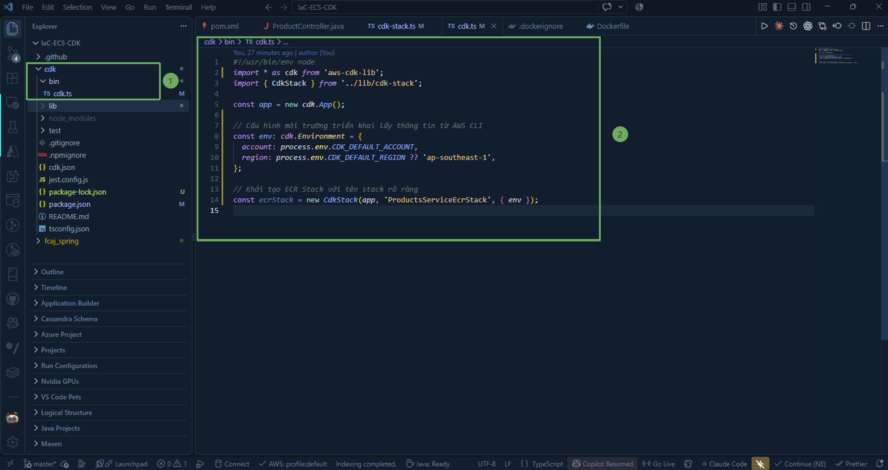
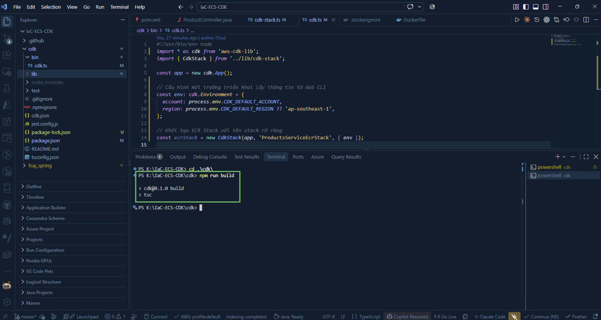
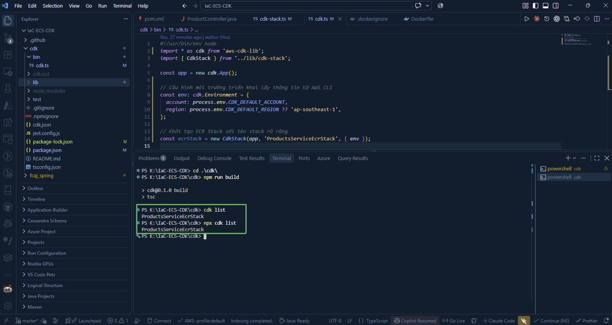
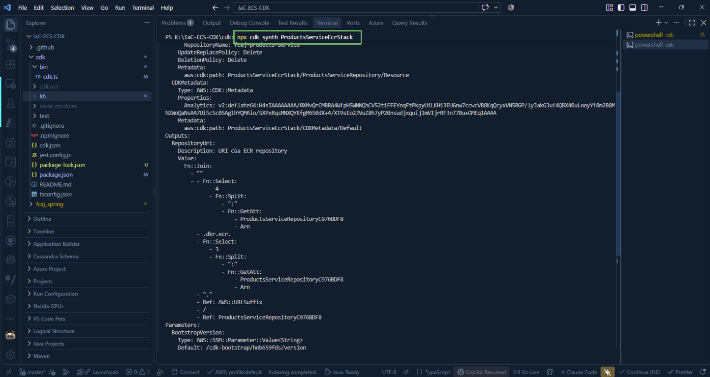

After defining **CdkStack** for ECR in the **lib** directory, the next step is to declare and organize this Stack in the application's main entry point at **bin/cdk.ts**, configure the deployment environment (AWS Account & Region), and verify the correctness of the source code before deploying.

---

### 1. Configure Entry Point (`cdk.ts`)

Access **bin** and open the **cdk.ts** file in VS Code. This file acts as the "conductor" to initialize the CDK application ( **cdk.App** ) and connect Stacks together.

Update the contents of **bin/cdk.ts** to initialize **ProductsServiceEcrStack**:

~~~typescript
#!/usr/bin/env node
import * as cdk from 'aws-cdk-lib';
import { CdkStack } from '../lib/cdk-stack';

const app = new cdk.App();

// Configure the deployment environment with information retrieved from AWS CLI
const env: cdk.Environment = {
  account: process.env.CDK_DEFAULT_ACCOUNT,
  region: process.env.CDK_DEFAULT_REGION ?? 'ap-southeast-1',
};

// Initialize ECR Stack with a clear stack name
const ecrStack = new CdkStack(app, 'ProductsServiceEcrStack', { env });
~~~

#### Important Points Explained:

* **env**: Object determining the target AWS account and region where the infrastructure will be created.

  * **process.env.CDK_DEFAULT_ACCOUNT**: CDK automatically reads the currently logged-in Account ID from the AWS CLI (`aws sts get-caller-identity`).

  * **process.env.CDK_DEFAULT_REGION ?? 'ap-southeast-1'**: Sets Singapore (`ap-southeast-1`) as the default region.

* **ProductsServiceEcrStack**: This is the unique identifier of the CloudFormation Stack when created on AWS. Giving it a descriptive prefix makes it easy to distinguish from other stacks in the same lab.

---

### 2. Compile and Check TypeScript Errors

Whenever you edit TypeScript code, you should run the build command so the tsc compiler can check syntax and data types:

~~~powershell
npm run build
~~~

{}
If the command finishes without any error messages in the terminal, your TypeScript code is completely valid and was compiled successfully.
{}

---

### 3. Check Stack List (`cdk list`)

Run the `cdk list` command to check the list of Stacks registered in the CDK application:

~~~powershell
npx cdk list
~~~

Or:

~~~powershell
cdk list
~~~

This confirms that CDK has properly recognized the **ProductsServiceEcrStack** Stack and it is ready for deployment.

---

### 4. Synthesize CloudFormation Template (`cdk synth`)

The `synth` (synthesize) command translates all TypeScript code into equivalent CloudFormation templates (in JSON/YAML format) and stores them in the `cdk.out` directory:

~~~powershell
npx cdk synth ProductsServiceEcrStack
~~~

{}
**Note:** The `npx cdk synth` command only executes in your local environment to generate and validate CloudFormation templates; it **does not create any resources on AWS yet**. This helps you catch configuration errors early before submitting requests to the cloud.
{}
