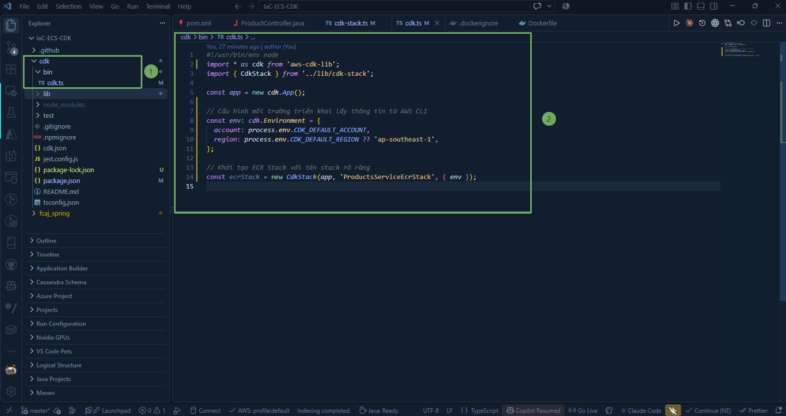
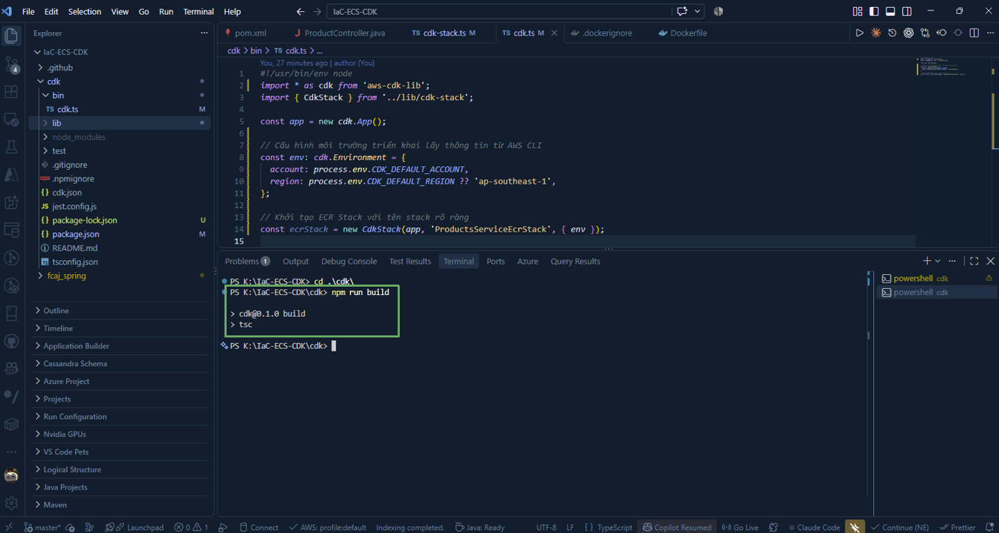
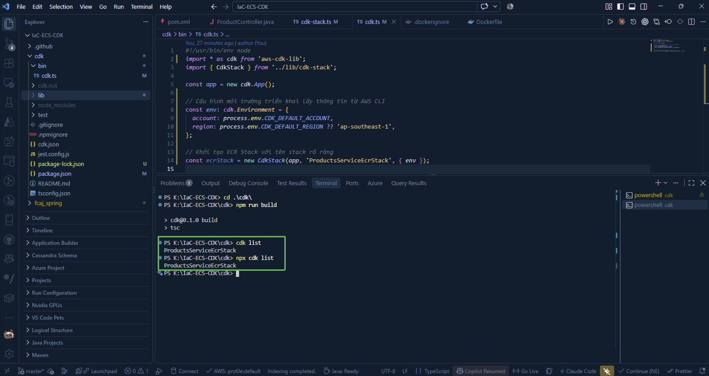
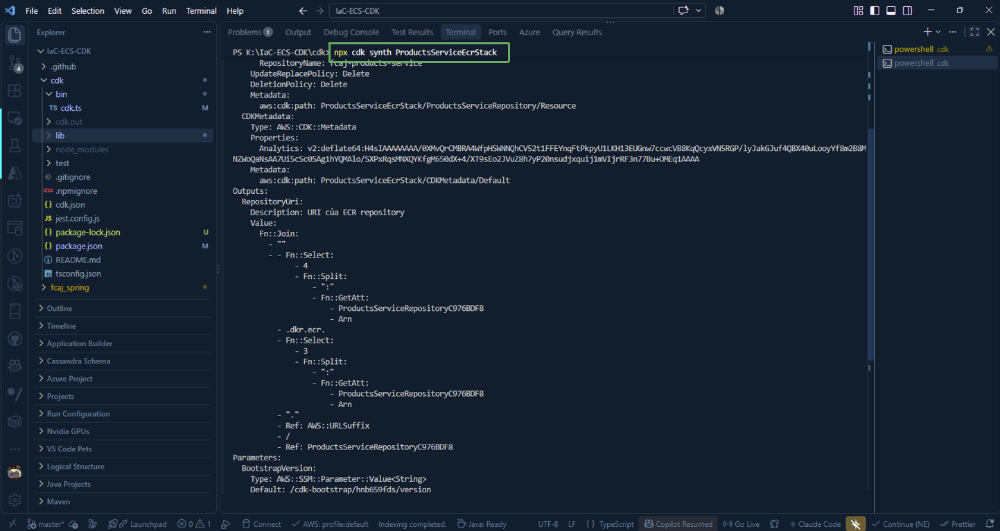

Sau khi đã định nghĩa **CdkStack** cho ECR trong thư mục **lib**, bước tiếp theo là khai báo và tổ chức Stack này vào điểm khởi chạy chính của ứng dụng tại **bin/cdk.ts**, cấu hình môi trường triển khai (AWS Account & Region), và kiểm tra tính đúng đắn của mã nguồn trước khi deploy.

---

### 1. Cấu hình Entry Point (`cdk.ts`)

Truy cập vào **bin** và mở file **cdk.ts** trong VS Code. File này đóng vai trò là "nhạc trưởng" để khởi tạo ứng dụng CDK ( **cdk.App** ) và kết nối các Stack với nhau.

Cập nhật nội dung **bin/cdk.ts** để khởi tạo **ProductsServiceEcrStack**:

~~~typescript
#!/usr/bin/env node
import * as cdk from 'aws-cdk-lib';
import { CdkStack } from '../lib/cdk-stack';

const app = new cdk.App();

// Cấu hình môi trường triển khai lấy thông tin từ AWS CLI
const env: cdk.Environment = {
  account: process.env.CDK_DEFAULT_ACCOUNT,
  region: process.env.CDK_DEFAULT_REGION ?? 'ap-southeast-1',
};

// Khởi tạo ECR Stack với tên stack rõ ràng
const ecrStack = new CdkStack(app, 'ProductsServiceEcrStack', { env });
~~~

#### Giải thích các điểm quan trọng:

* **env**: Đối tượng xác định tài khoản AWS account và region mục tiêu nơi hạ tầng sẽ được tạo.

  * **process.env.CDK_DEFAULT_ACCOUNT**: CDK tự động đọc thông tin Account ID đang đăng nhập trong AWS CLI (`aws sts get-caller-identity`).

  * **process.env.CDK_DEFAULT_REGION ?? 'ap-southeast-1'**: Thiết lập vùng mặc định là Singapore (`ap-southeast-1`).

* **ProductsServiceEcrStack**: Đây là tên định danh duy nhất của CloudFormation Stack khi được tạo trên AWS. Việc đặt tên có tiền tố giúp bạn dễ phân biệt với các stack khác trong cùng bài lab.

---

### 2. Biên dịch và kiểm tra lỗi TypeScript

Mỗi khi chỉnh sửa mã TypeScript, bạn nên chạy lệnh build để trình biên dịch tsc kiểm tra cú pháp và kiểu dữ liệu:

~~~powershell
npm run build
~~~

{}
Nếu lệnh chạy và kết thúc mà không xuất hiện thông báo lỗi nào trên terminal, mã TypeScript của bạn hoàn toàn hợp lệ và đã được biên dịch thành công.
{}

---

### 3. Kiểm tra danh sách Stack (`cdk list`)

Chạy lệnh `cdk list` để kiểm tra danh sách các Stack đã được đăng ký trong ứng dụng CDK:

~~~powershell
npx cdk list
~~~

Hoặc:

~~~powershell
cdk list
~~~

Dòng kết quả trên xác nhận CDK đã nhận diện đúng Stack **ProductsServiceEcrStack** sẵn sàng cho việc triển khai.

---

### 4. Tổng hợp CloudFormation Template (`cdk synth`)

Lệnh `synth` (synthesize) sẽ dịch toàn bộ mã TypeScript thành CloudFormation template tương đương (dưới dạng JSON/YAML) và lưu trong thư mục `cdk.out`:

~~~powershell
npx cdk synth ProductsServiceEcrStack
~~~

{}
**Lưu ý:** Lệnh `npx cdk synth` chỉ thực thi ở môi trường local của bạn để sinh và kiểm tra template CloudFormation, hoàn toàn **chưa tạo bất kỳ tài nguyên nào trên AWS**. Điều này giúp bạn phát hiện sớm các lỗi cấu hình trước khi gửi yêu cầu lên cloud.
{}
