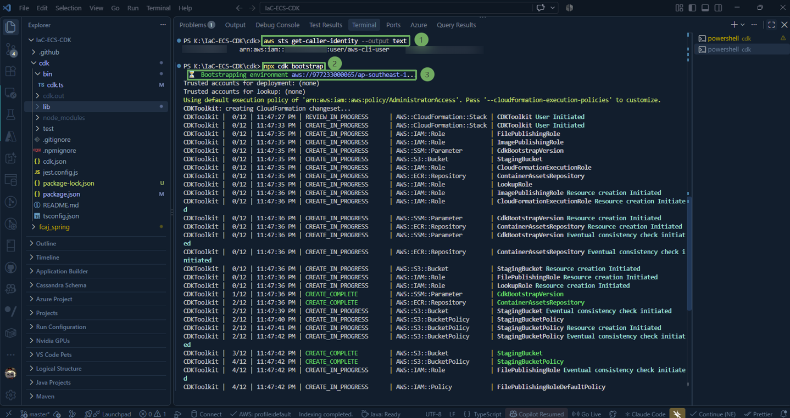
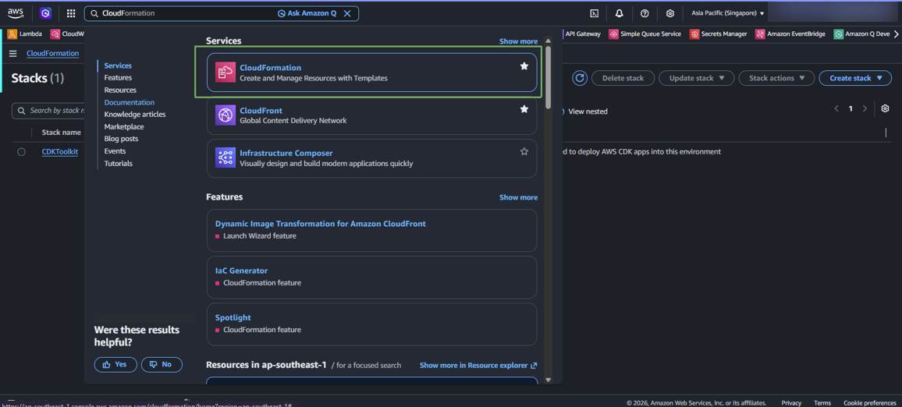
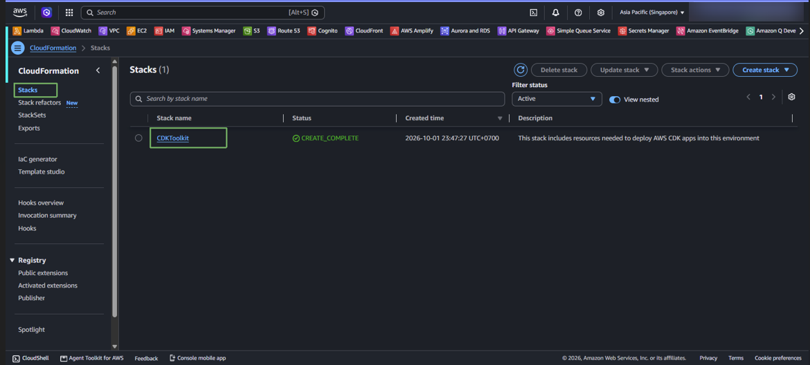
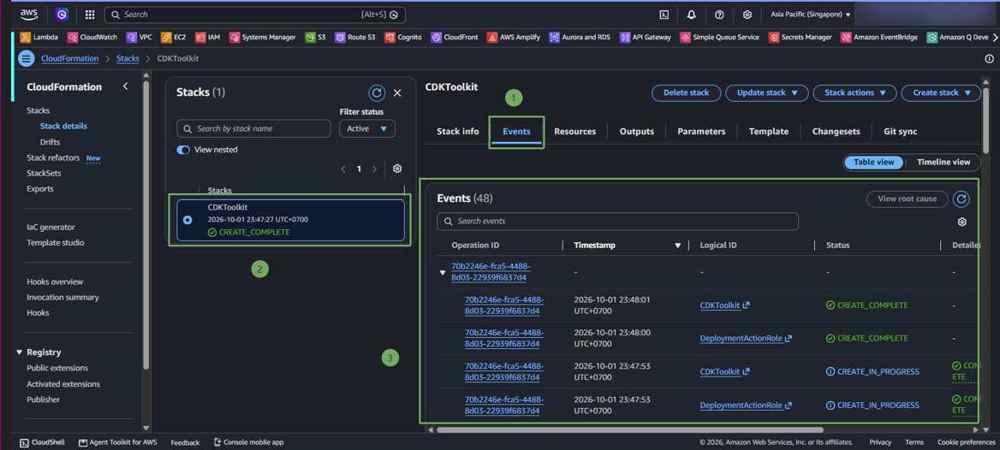
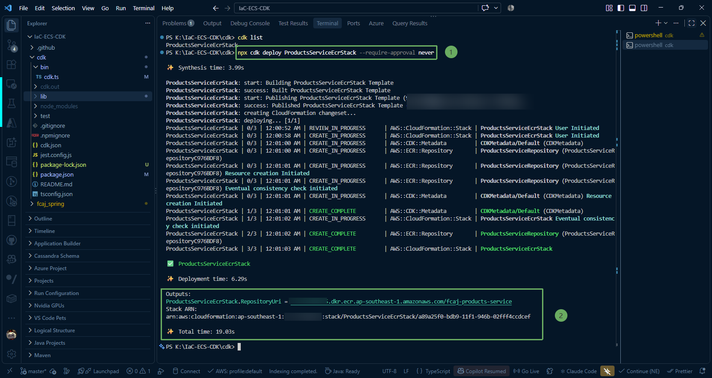
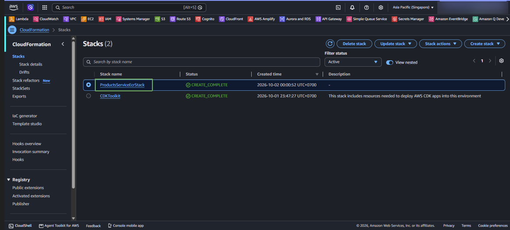
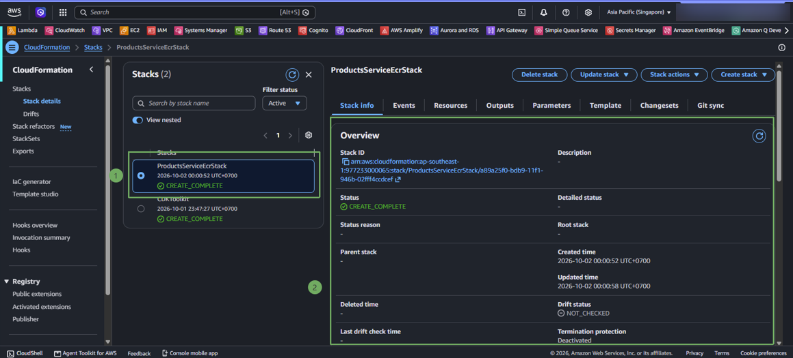
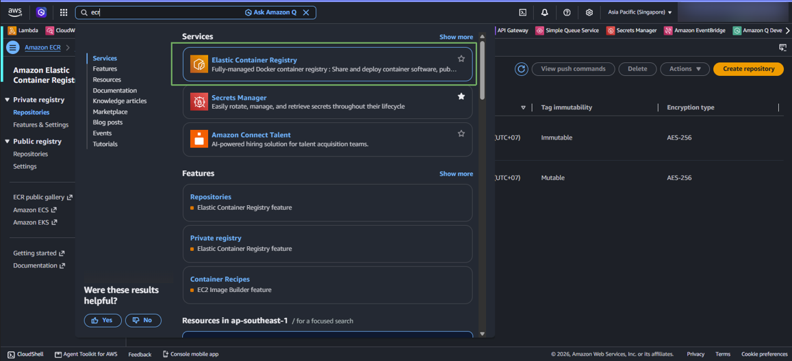
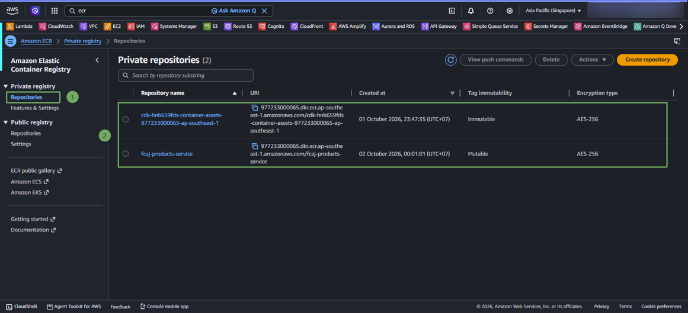
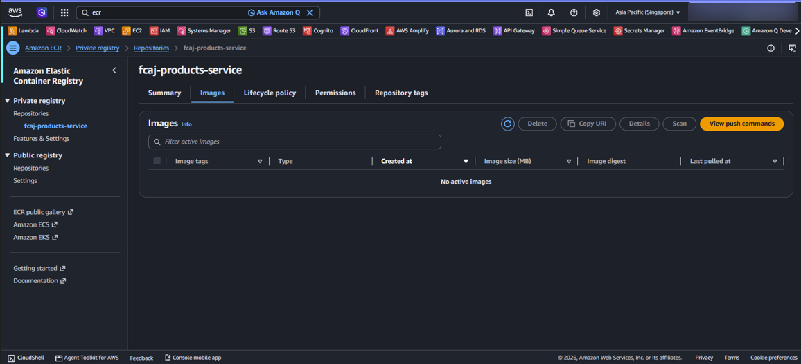

In this step, we will deploy the **ProductsServiceEcrStack** to our AWS account using the AWS CDK CLI, monitor the CloudFormation resource creation process, and verify the ECR repository in the AWS Management Console.

---

### 1. Check Environment Bootstrap

Before any stack can be deployed, the AWS environment (Account & Region) must be bootstrapped with management resources (S3 bucket for assets, CDK IAM roles).

Check account information:

~~~powershell
aws sts get-caller-identity --output text
~~~ 

Run the bootstrap command:

~~~powershell
npx cdk bootstrap
~~~

#### Access CloudFormation to check the CDKToolkit stack.

Access the AWS Console -> CloudFormation -> Stacks -> Select stack `CDKToolkit`.

---

### 2. Deploy ECR Stack (`cdk deploy`)

1. Open Terminal in VS Code at the **IaC-ECS-CDK/cdk** directory.

2. Run the command to deploy only the ECR Stack:

~~~powershell
npx cdk deploy ProductsServiceEcrStack --require-approval never
~~~

{}
**Parameter meaning:**  
The **--require-approval never** parameter directs CDK to automatically approve security-related changes (such as IAM Roles or Resource Policies) without stopping to ask the user to type **y/n**, allowing the deployment process to run smoothly.
{}

3. The deployment process will create a CloudFormation ChangeSet and provision the **AWS::ECR::Repository** resource. When completed, the terminal will display a success message along with the **Outputs** information:

{}
Save the **RepositoryUri** value displayed in the Outputs section. This is the unique registry identifier on AWS ECR, which will be used for tagging and pushing the Docker image in the next step.
{}

---

#### Access CloudFormation to check the ProductsServiceEcrStack.

### 3. Verify ECR in the AWS Management Console

1. Sign in to the [AWS Management Console](https://console.aws.amazon.com/).

2. In the top search bar, type **ECR** and select the **Elastic Container Registry** service. Ensure you have selected the correct region **Singapore (ap-southeast-1)** in the upper right corner.

3. In the left navigation menu, select **Repositories** (under **Private registry**). You will see the newly created repository named **`fcaj-products-service`** appear in the list.

4. Click on the repository name **`fcaj-products-service`** to view details.

Currently, the repository is newly created, so there are no images yet. We will proceed to authenticate Docker and push the image to this repository in the next step.
