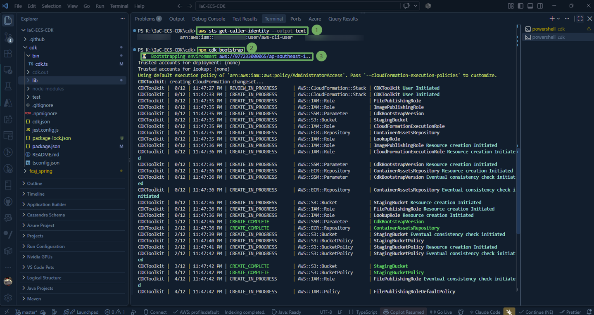
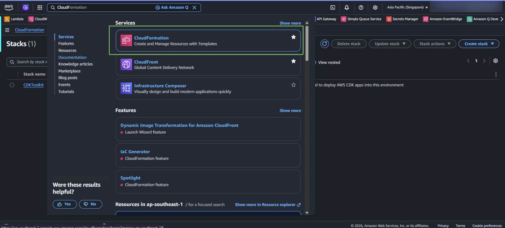
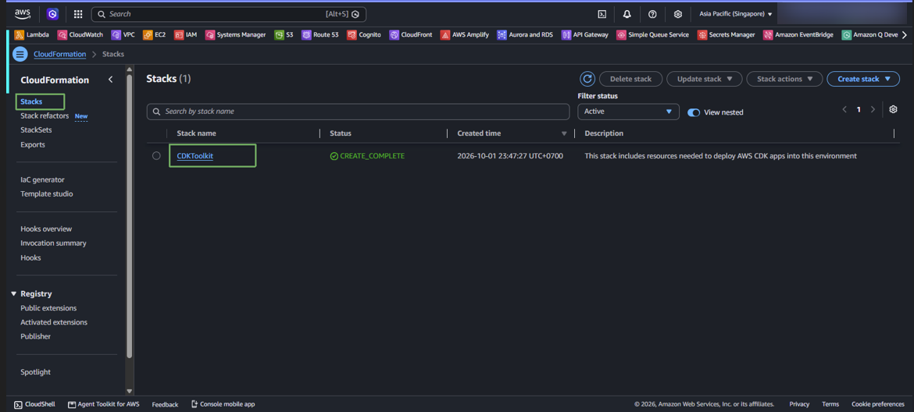
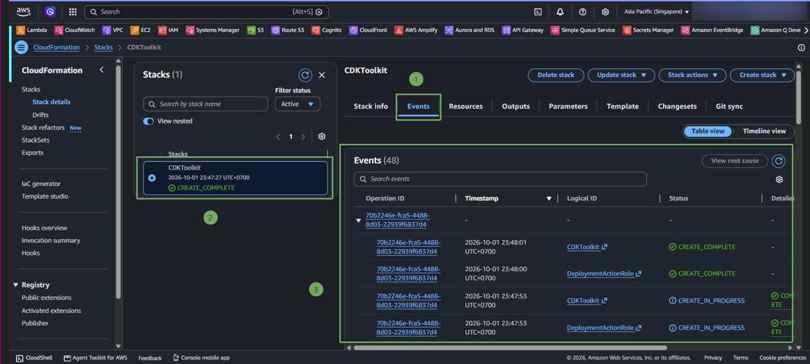
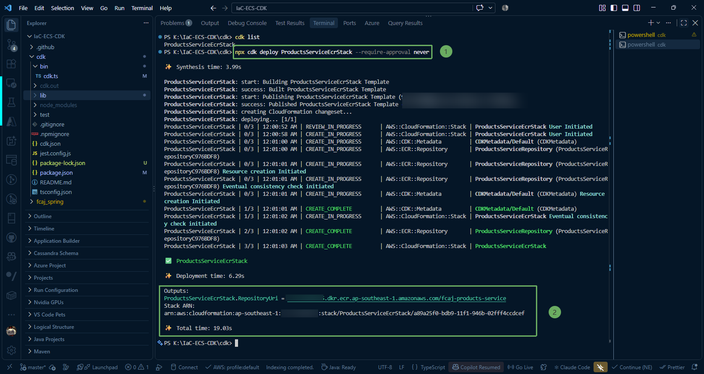
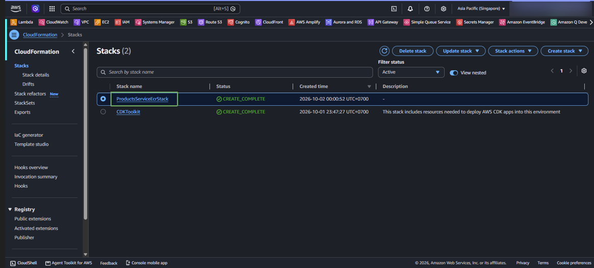
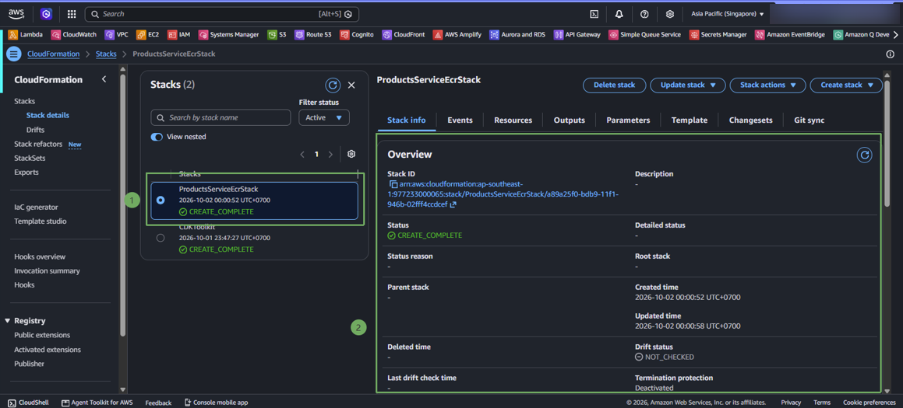
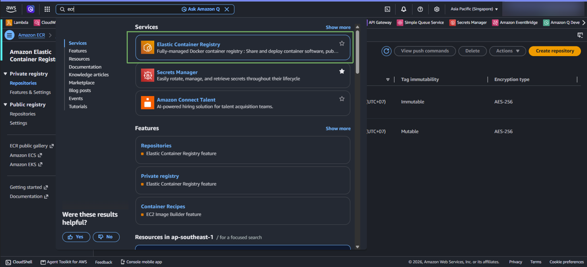
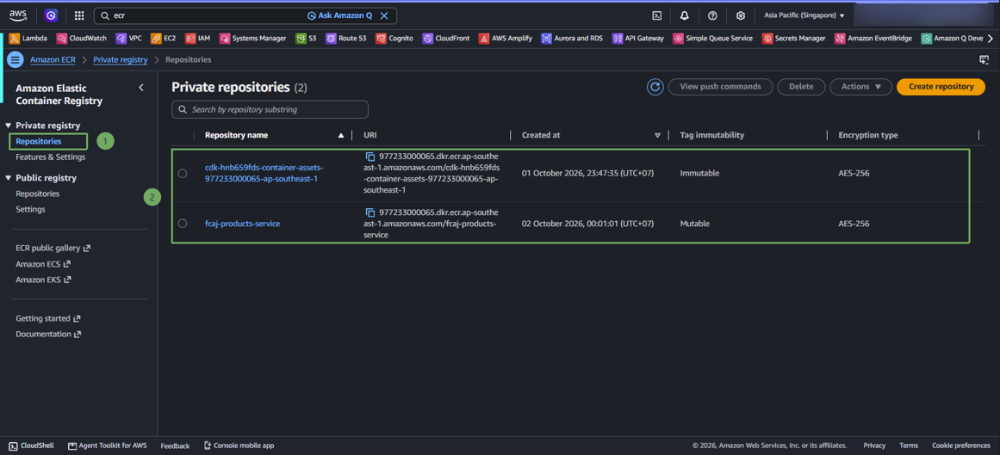
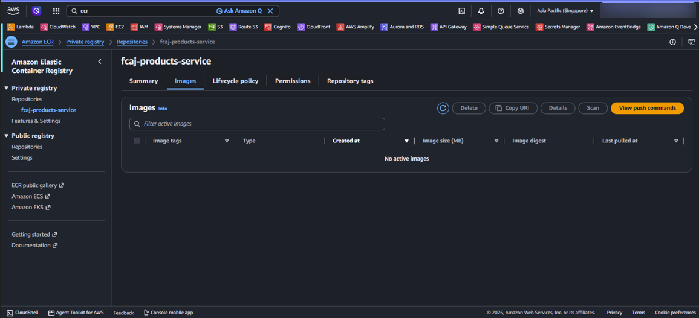

Trong bước này, chúng ta sẽ thực hiện triển khai Stack **ProductsServiceEcrStack** lên tài khoản AWS thông qua AWS CDK CLI, theo dõi quá trình tạo tài nguyên CloudFormation và xác thực kho lưu trữ ECR trên AWS Management Console.

---

### 1. Kiểm tra Bootstrap môi trường

Trước khi có thể triển khai bất kỳ stack nào, môi trường AWS (Account & Region) cần được bootstrap các tài nguyên quản lý (S3 bucket cho assets, IAM roles của CDK).

Kiểm tra thông tin tài khoản:

~~~powershell
aws sts get-caller-identity --output text
~~~ 

Chạy lệnh bootstrap:

~~~powershell
npx cdk bootstrap
~~~

#### Truy cập vào CloudFormation để kiểm tra stack CDKToolkit.

Truy cập vào AWS Console -> CloudFormation -> Stacks -> Chọn stack `CDKToolkit`.

---

### 2. Triển khai ECR Stack (`cdk deploy`)

1. Mở Terminal trong VS Code tại thư mục **IaC-ECS-CDK/cdk**.

2. Chạy lệnh triển khai riêng Stack ECR:

~~~powershell
npx cdk deploy ProductsServiceEcrStack --require-approval never
~~~

{}
**Ý nghĩa tham số:**  
Tham số **--require-approval never** hướng dẫn CDK tự động chấp thuận các thay đổi liên quan đến bảo mật (như IAM Role hoặc Resource Policy) mà không cần dừng lại yêu cầu người dùng gõ xác nhận **y/n**, giúp quy trình triển khai diễn ra liền mạch.
{}

3. Quá trình triển khai sẽ tiến hành tạo CloudFormation ChangeSet và tạo tài nguyên **AWS::ECR::Repository**. Khi hoàn tất, terminal sẽ hiển thị thông báo thành công cùng thông tin **Outputs**:

{}
Hãy lưu lại giá trị **RepositoryUri** hiển thị ở phần Outputs. Đây là địa chỉ định danh duy nhất của kho lưu trữ trên AWS ECR, sẽ được dùng để gắn thẻ (tag) và đẩy (push) Docker image ở bước tiếp theo.
{}

---

#### Truy cập vào CloudFormation kiểm tra stack ProductsServiceEcrStack.

### 3. Kiểm tra ECR trên AWS Management Console

1. Đăng nhập vào [AWS Management Console](https://console.aws.amazon.com/).

2. Tại thanh tìm kiếm trên cùng, gõ **ECR** và chọn dịch vụ **Elastic Container Registry**. Đảm bảo bạn đang chọn đúng vùng **Singapore (ap-southeast-1)** ở góc trên bên phải.

3. Trong menu điều hướng bên trái, chọn **Repositories** (mục **Private registry**). Bạn sẽ thấy repository mới tạo có tên **`fcaj-products-service`** xuất hiện trong danh sách.

4. Nhấp vào tên repository **`fcaj-products-service`** để xem thông tin chi tiết. 

Hiện tại repository mới được tạo nên chưa có image nào. Chúng ta sẽ tiến hành xác thực Docker và đẩy image lên repository này ở bước tiếp theo.
