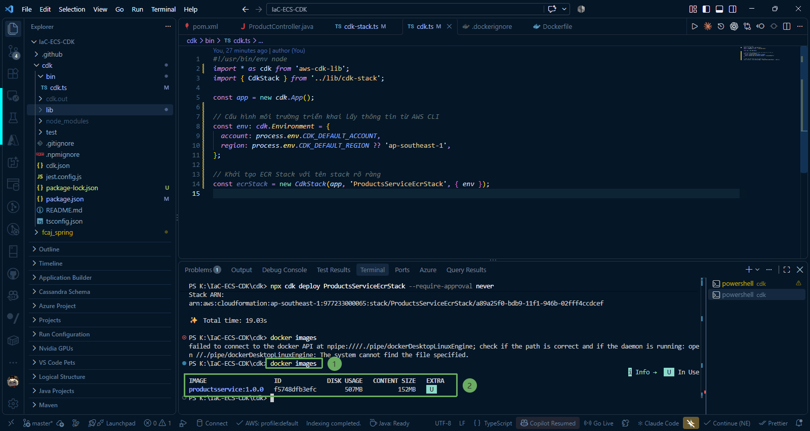
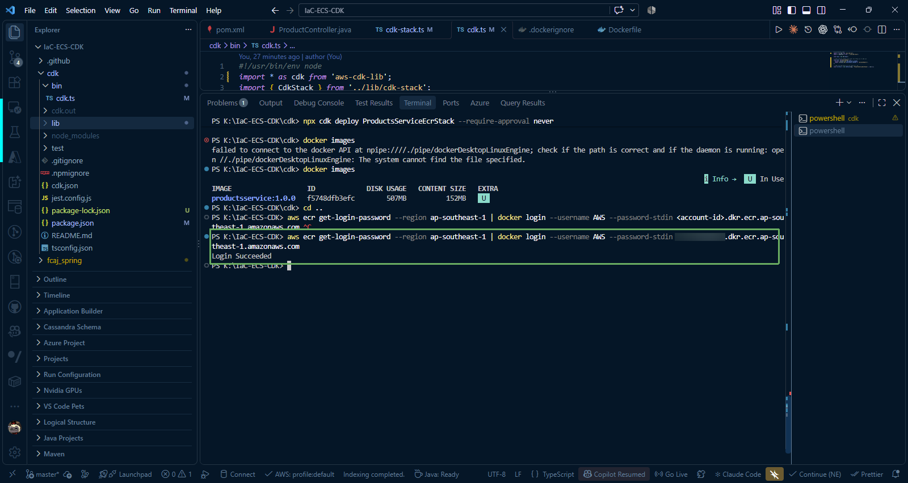
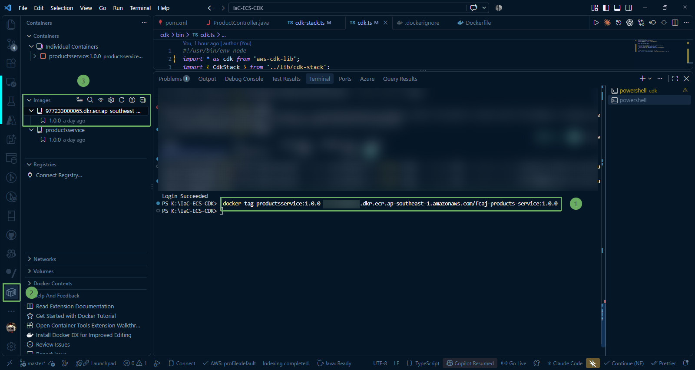
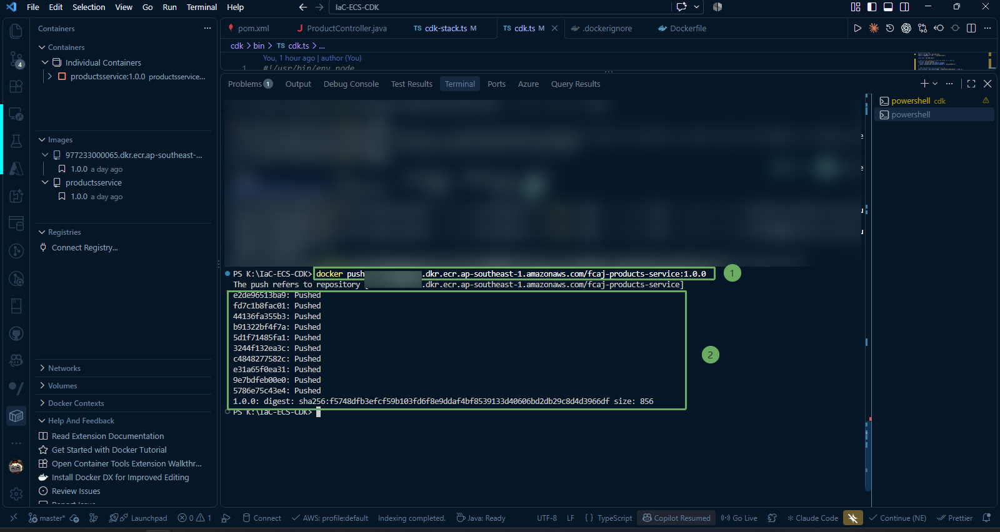
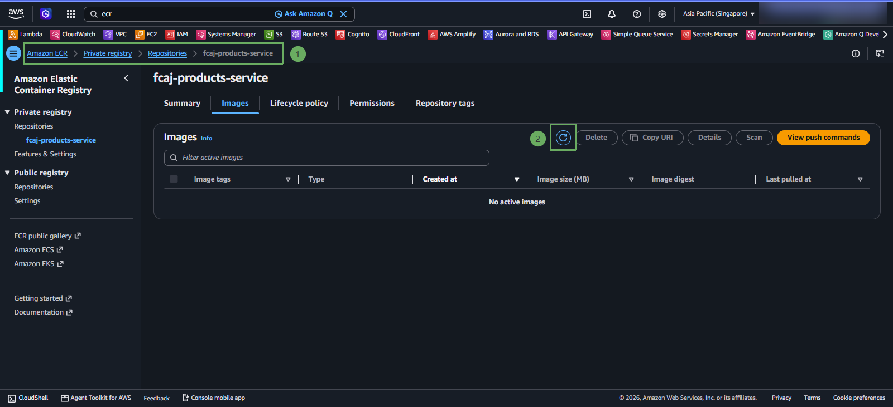
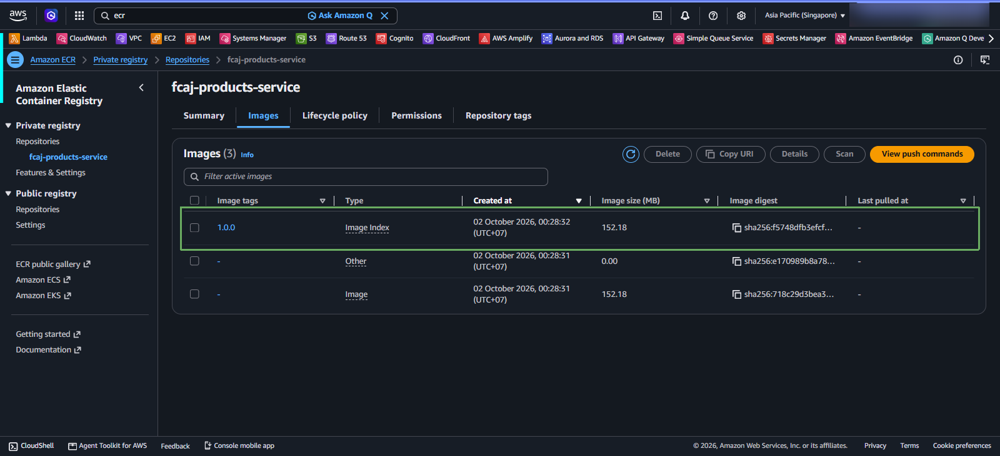

After the ECR repository **fcaj-products-service** has been successfully created, the final step in this section is to authenticate Docker CLI with the AWS ECR registry, tag the Spring Boot Docker image built previously, and push the image to AWS Cloud.

{}
**Note:** You need to have **Docker Desktop** running to perform the following steps. If Docker Desktop is stopped, please start it.
{}

---

### 1. Check Docker Image on Local Machine

Open Terminal in VS Code and check the Docker image `productsservice:1.0.0` (built successfully in step [2.4. Create Dockerfile and Build Docker Image](/2-preparation/2.4-docker/)):

~~~powershell
docker images 
~~~

---

### 2. Log in Docker to Amazon ECR Registry

Docker CLI needs to be granted authentication permissions to communicate and push images to the private repository (Private registry) of your AWS account.

Run the following PowerShell commands to retrieve an authentication token via AWS CLI v2 and log in:

~~~powershell
aws sts get-caller-identity --query Account --output text
~~~

~~~powershell
aws ecr get-login-password --region ap-southeast-1 | docker login --username AWS --password-stdin <account-id>.dkr.ecr.ap-southeast-1.amazonaws.com 
~~~

or 

~~~powershell
docker login
~~~

{}
**Note:** The authentication token returned from the `aws ecr get-login-password` command is valid for **12 hours**. If you attempt to push an image after this period and encounter the error **denied: Your authorization token has expired**, simply re-run the login command above.
{}

---

### 3. Tag Docker Image Following ECR Standards

For Docker to know which repository on ECR to push the image to, the local image needs an additional tag in the format: `<Registry-URI>/<Repository-Name>:<Tag>`.

Run the tag command:

~~~powershell
docker tag productsservice:1.0.0 <account-id>.dkr.ecr.ap-southeast-1.amazonaws.com/fcaj-products-service:1.0.0
~~~

{}
**Tag Management Rule:**  
The **1.0.0** tag represents the version of the application. When you upgrade or modify your Spring Boot source code in the future, increment the version number (for example: **1.0.1**, **1.1.0**) instead of using the **latest** tag or overwriting the old tag, allowing the ECS Fargate service to rollback when necessary.
{}

---

### 4. Push Docker Image to Amazon ECR

Run the `docker push` command to upload all layers of the image to the ECR repository:

~~~powershell
docker push <account-id>.dkr.ecr.ap-southeast-1.amazonaws.com/fcaj-products-service:1.0.0
~~~

The terminal will show the upload progress for each layer:

---

### 5. Check Image on AWS ECR Console

1. Return to your browser on the **Amazon ECR** service page > **Repositories** > click on the repository **`fcaj-products-service`**.

2. Click the **Refresh** icon on the toolbar.

3. You will see the image with tag **`1.0.0`** appear in the list along with detailed information:
   * **Image tag:** `1.0.0`
   * **Artifact type:** `Container Image`
   * **Pushed at:** Upload timestamp
   * **Size:** Compressed storage size

{}
Congratulations! You have completed creating an Amazon ECR repository using AWS CDK (TypeScript) and successfully pushed the Docker image of your Spring Boot application to AWS Cloud. This image is ready to be used in the next steps when building the ECS Fargate cluster.
{}
