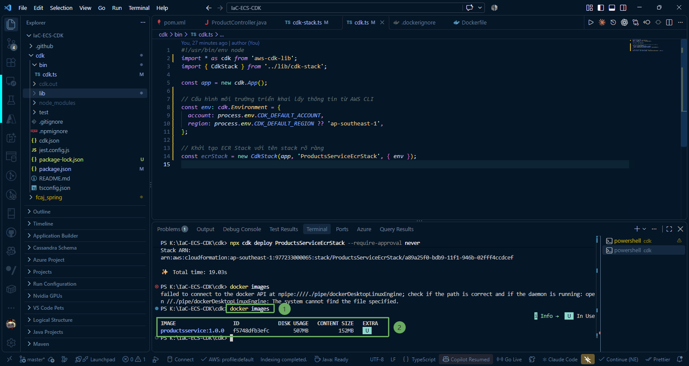
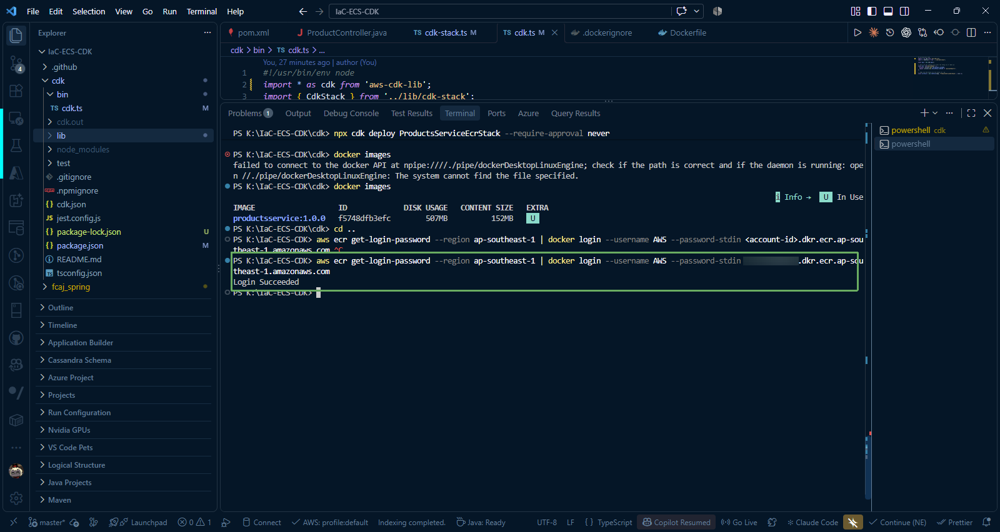
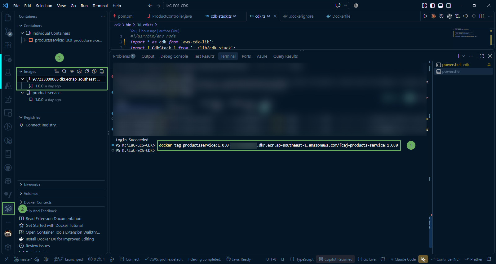
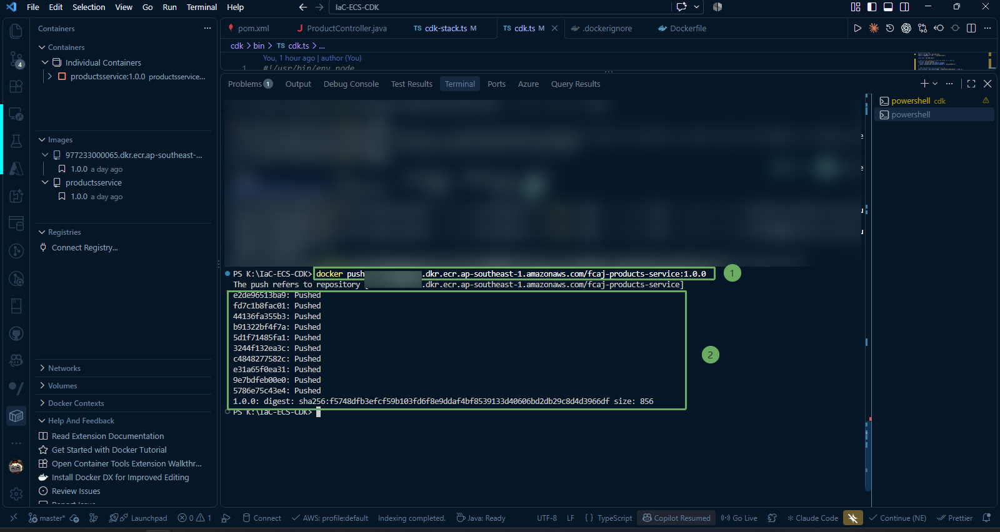
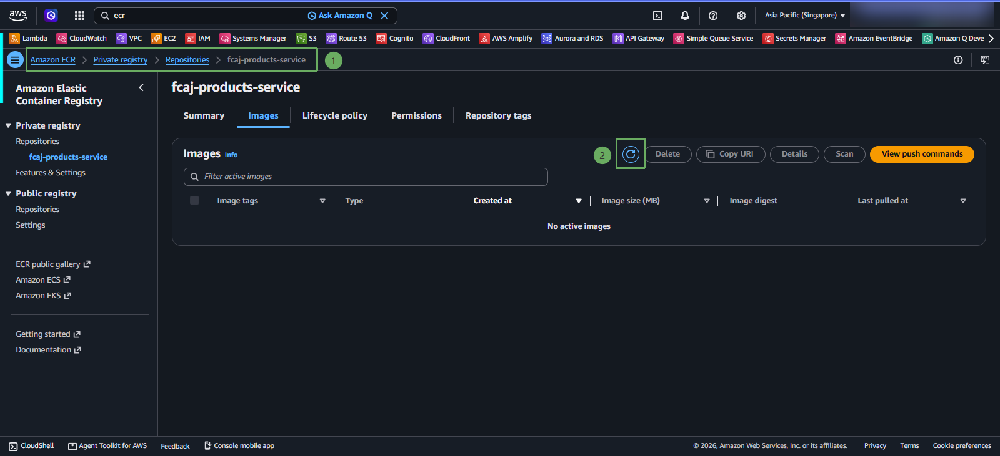
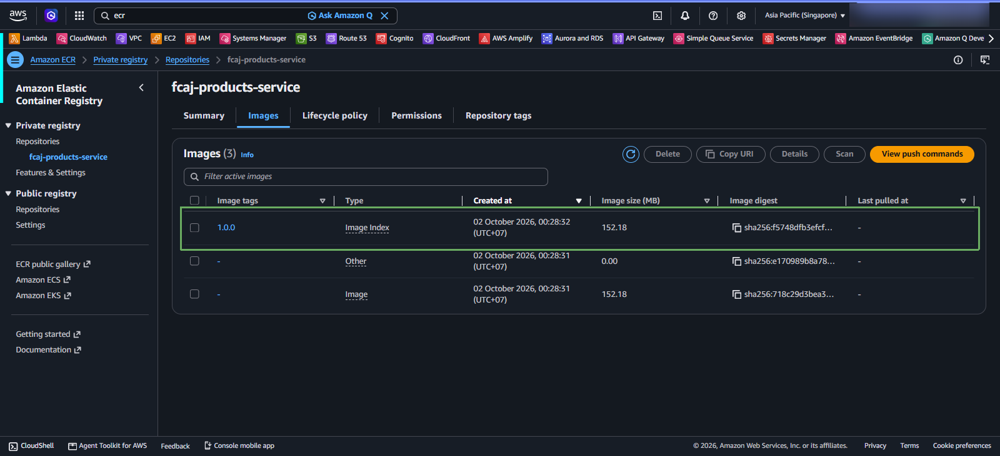

Sau khi kho lưu trữ ECR **fcaj-products-service** đã được tạo thành công, bước cuối cùng trong phần này là xác thực Docker CLI với AWS ECR registry, gắn tag cho Docker image Spring Boot đã build ở bước trước và đẩy (push) image lên đám mây AWS.

{}
**Lưu ý:** Bạn cần bật **Docker Desktop** để thực hiện các bước sau. Nếu Docker Desktop đang dừng, hãy khởi động nó.
{}

---

### 1. Kiểm tra Docker Image trên máy local

Mở Terminal trong VS Code và kiểm tra Docker image `productsservice:1.0.0` (đã build thành công ở bước [2.4. Tạo Dockerfile và Build Docker Image](/2-preparation/2.4-docker/)):

~~~powershell
docker images 
~~~

---

### 2. Đăng nhập Docker vào Amazon ECR Registry

Docker CLI cần được cấp quyền xác thực để giao tiếp và đẩy image lên kho lưu trữ riêng (Private registry) của tài khoản AWS của bạn.

Chạy các lệnh PowerShell sau để lấy token xác thực thông qua AWS CLI v2 và thực hiện đăng nhập:

~~~powershell
aws sts get-caller-identity --query Account --output text
~~~

~~~powershell
aws ecr get-login-password --region ap-southeast-1 | docker login --username AWS --password-stdin <account-id>.dkr.ecr.ap-southeast-1.amazonaws.com 
~~~

hoặc 

~~~powershell
docker login
~~~

{}
**Lưu ý:** Token xác thực trả về từ lệnh `aws ecr get-login-password` có hiệu lực trong vòng **12 giờ**. Nếu sau khoảng thời gian này bạn thực hiện push image mà gặp lỗi **denied: Your authorization token has expired**, bạn chỉ cần chạy lại lệnh đăng nhập trên.
{}

---

### 3. Gắn Tag (Tagging) cho Docker Image theo chuẩn ECR

Để Docker biết cần đẩy image lên repository nào trên ECR, image local cần được gắn thẻ bổ sung với định dạng: `<Registry-URI>/<Repository-Name>:<Tag>`.

Chạy lệnh gắn tag:

~~~powershell
docker tag productsservice:1.0.0 <account-id>.dkr.ecr.ap-southeast-1.amazonaws.com/fcaj-products-service:1.0.0
~~~

{}
**Quy tắc quản lý Tag:**  
Thẻ tag **1.0.0** đại diện cho phiên bản của ứng dụng. Khi bạn nâng cấp hoặc sửa đổi mã nguồn Spring Boot trong tương lai, hãy tăng số version (ví dụ: **1.0.1**, **1.1.0**) thay vì dùng thẻ **latest** hoặc ghi đè tag cũ, giúp dịch vụ ECS Fargate có thể rollback khi cần thiết.
{}

---

### 4. Đẩy (Push) Docker Image lên Amazon ECR

Chạy lệnh `docker push` để tải toàn bộ các layers của image lên kho lưu trữ ECR:

~~~powershell
docker push <account-id>.dkr.ecr.ap-southeast-1.amazonaws.com/fcaj-products-service:1.0.0
~~~

Terminal sẽ hiển thị tiến trình tải lên từng layer:

---

### 5. Kiểm tra Image trên AWS ECR Console

1. Mở lại trình duyệt tại trang dịch vụ **Amazon ECR** > **Repositories** > nhấp vào repository **`fcaj-products-service`**.

2. Nhấn biểu tượng **Refresh** (Làm mới) trên thanh công cụ.

3. Bạn sẽ thấy image với tag **`1.0.0`** xuất hiện trong danh sách kèm theo thông tin chi tiết:
   * **Image tag:** `1.0.0`
   * **Artifact type:** `Container Image`
   * **Pushed at:** Thời điểm đẩy image lên
   * **Size:** Kích thước nén lưu trữ

{}
Chúc mừng bạn! Bạn đã hoàn thành việc tạo kho lưu trữ Amazon ECR bằng AWS CDK (TypeScript) và đẩy thành công Docker image của ứng dụng Spring Boot lên AWS Cloud. Image này sẵn sàng để được sử dụng trong các bước tiếp theo khi xây dựng cụm ECS Fargate.
{}
