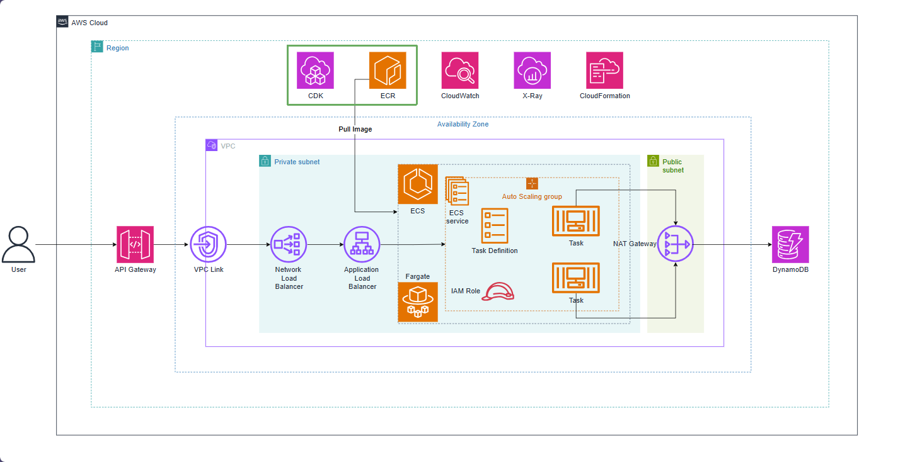

# Create ECR and push the Docker image

In this section, we will learn how to provision an **Amazon Elastic Container Registry (ECR)** repository on AWS using **AWS CDK (TypeScript)**. We will also authenticate Docker CLI, tag, and push our Spring Boot container image to the created ECR repository.

