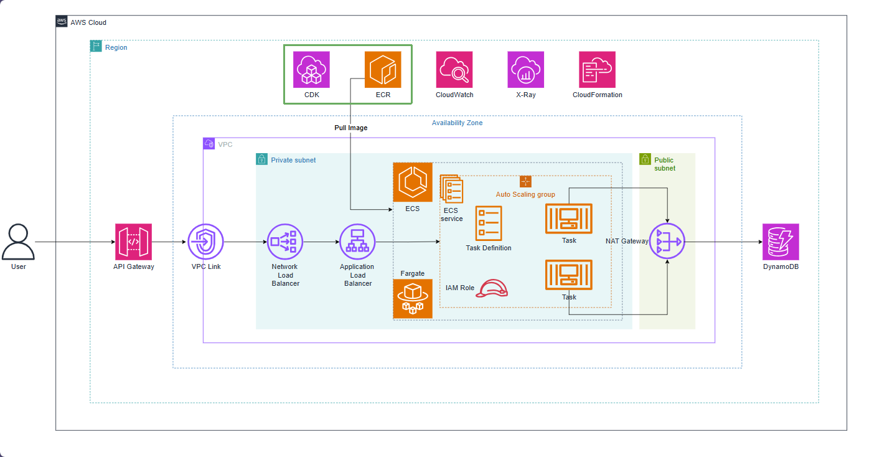

# Tạo ECR và push Docker image

Trong phần này, chúng ta sẽ tìm hiểu về cách xây dựng hạ tầng tạo kho lưu trữ **Amazon Elastic Container Registry (ECR)** trên AWS bằng **AWS CDK (TypeScript)**. Đồng thời, chúng ta sẽ thực hiện cấu hình xác thực, gắn thẻ (tag) và đẩy (push) Docker image của ứng dụng Spring Boot lên ECR repository.

