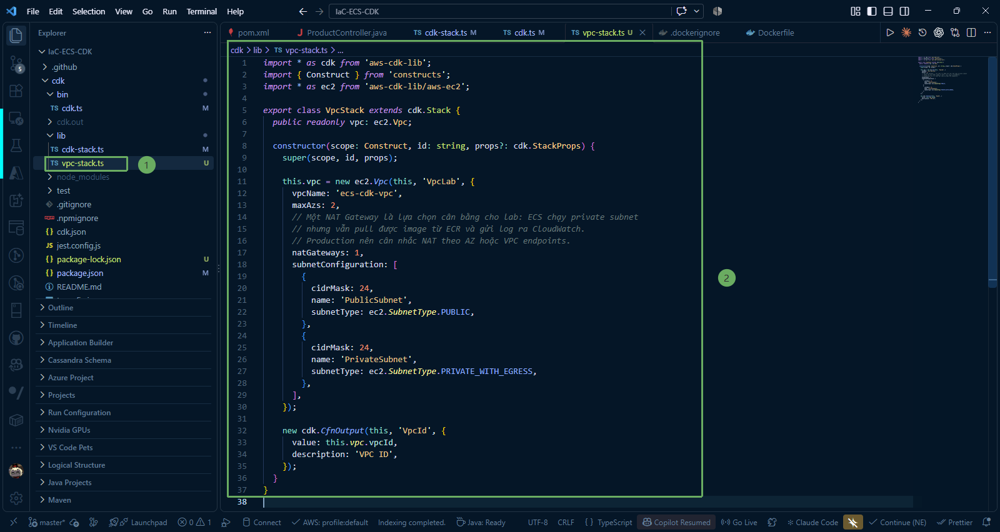

In this step, we will learn about the network architecture required for containerized applications running on **Amazon ECS Fargate** and write the stack source code to create a **Virtual Private Cloud (VPC)**, Subnets, and **NAT Gateway** using AWS CDK (TypeScript).

---

### 1. Network Architecture for ECS Fargate

The network infrastructure of the system is designed according to a standard multi-layer security model:

* **VPC spanning 2 Availability Zones (AZs)**: Ensures High Availability. If one Data Center experiences an incident, the system continues to operate on the remaining AZ.
* **Public Subnets**: Connected directly to the Internet Gateway. In this lab, Public Subnets are used to host the **NAT Gateway**.
* **Private Subnets (with Egress)**: An isolated network area used to place **ECS Fargate Tasks** and the **Internal Load Balancer**.
  * Containers in Private Subnets cannot be accessed directly from the public Internet (enhancing security).
  * Containers can still reach the Internet via the **NAT Gateway** to pull Docker images from Amazon ECR, send metrics/logs to Amazon CloudWatch, and access other AWS services.
* **NAT Gateway (`natGateways: 1`)**: Provides one-way outbound Internet access for containers in Private Subnets.
  * In the lab environment, only **1 NAT Gateway** is configured and shared across both AZs to minimize costs.
  * In a Production environment, it is recommended to place 1 NAT Gateway per AZ to ensure independent redundancy, or configure **VPC Endpoints** for internal AWS services.

---

### 2. Write VPC Stack Source Code (`vpc-stack.ts`)

Navigate to the directory **IaC-ECS-CDK/cdk/lib** and open the file **vpc-stack.ts** (or create it if not present). Update the contents defining the VPC stack:

~~~typescript
import * as cdk from 'aws-cdk-lib';
import { Construct } from 'constructs';
import * as ec2 from 'aws-cdk-lib/aws-ec2';

export class VpcStack extends cdk.Stack {
  public readonly vpc: ec2.Vpc;

  constructor(scope: Construct, id: string, props?: cdk.StackProps) {
    super(scope, id, props);

    this.vpc = new ec2.Vpc(this, 'VpcLab', {
      vpcName: 'ecs-cdk-vpc',
      maxAzs: 2,
      // A single NAT Gateway is a balanced choice for labs: ECS runs in private subnets
      // but still pulls images from ECR and sends logs to CloudWatch.
      // Production should consider NAT per AZ or VPC endpoints.
      natGateways: 1,
      subnetConfiguration: [
        {
          cidrMask: 24,
          name: 'PublicSubnet',
          subnetType: ec2.SubnetType.PUBLIC,
        },
        {
          cidrMask: 24,
          name: 'PrivateSubnet',
          subnetType: ec2.SubnetType.PRIVATE_WITH_EGRESS,
        },
      ],
    });

    new cdk.CfnOutput(this, 'VpcId', {
      value: this.vpc.vpcId,
      description: 'VPC ID',
    });
  }
}
~~~

---

### 3. Detailed Explanation of Properties

* **public readonly vpc: ec2.Vpc;**: Declares the public **vpc** variable so this network object can be passed to subsequent Stacks (such as **EcsStack**, **NlbStack**, **ApiGatewayStack**) to share the same network infrastructure.

* **vpcName: 'ecs-cdk-vpc'**: Sets a clear, explicit name for the VPC on the AWS Management Console.

* **maxAzs: 2**: AWS CDK will automatically select 2 available Availability Zones in the current Region (for example: **ap-southeast-1a** and **ap-southeast-1b**).

* **natGateways: 1**: CDK will automatically create 1 NAT Gateway, 1 Elastic IP (EIP) placed in the first Public Subnet, and configure the route **0.0.0.0/0** pointing to the NAT Gateway for all Private Subnets.

* **subnetConfiguration**:
  * **PublicSubnet** (**ec2.SubnetType.PUBLIC**): CIDR mask **/24** (providing 256 IP addresses per subnet), automatically attached to the Internet Gateway.
  * **PrivateSubnet** (**ec2.SubnetType.PRIVATE_WITH_EGRESS**): CIDR mask **/24**, outbound Internet traffic routed through the NAT Gateway.

* **cdk.CfnOutput**: Prints the identifier **VpcId** (vpc-xxxxxx) to the terminal screen upon successful deployment.
