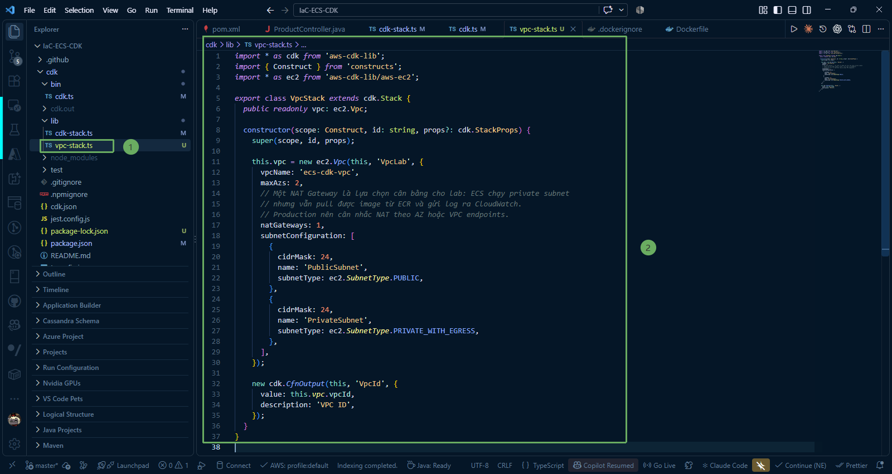

Trong bước này, chúng ta sẽ tìm hiểu về kiến trúc mạng cần thiết cho ứng dụng container chạy trên **Amazon ECS Fargate** và viết mã nguồn stack tạo **Virtual Private Cloud (VPC)**, Subnets và **NAT Gateway** bằng AWS CDK (TypeScript).

---

### 1. Kiến trúc mạng cho ECS Fargate

Hạ tầng mạng của hệ thống được thiết kế theo mô hình chuẩn bảo mật nhiều lớp:

* **VPC trải dài trên 2 Availability Zones (AZs)**: Đảm bảo tính sẵn sàng cao (High Availability). Nếu một Data Center gặp sự cố, hệ thống vẫn duy trì hoạt động trên AZ còn lại.
* **Public Subnets**: Được kết nối trực tiếp với Internet Gateway. Trong bài lab này, Public Subnet dùng để chứa **NAT Gateway**.
* **Private Subnets (with Egress)**: Là vùng mạng cách ly dùng để đặt **ECS Fargate Tasks** và **Internal Load Balancer**.
  * Các container trong Private Subnet không thể bị truy cập trực tiếp từ Internet công cộng (tăng cường bảo mật).
  * Container vẫn có thể đi ra ngoài Internet thông qua **NAT Gateway** để kéo Docker image từ Amazon ECR, gửi metric/log về Amazon CloudWatch và truy xuất các dịch vụ AWS khác.
* **NAT Gateway (`natGateways: 1`)**: Cung cấp kết nối Internet một chiều cho các container trong Private Subnet.
  * Trong môi trường lab, chỉ cấu hình **1 NAT Gateway** dùng chung cho cả 2 AZ để tiết kiệm tối đa chi phí.
  * Trong môi trường Production, khuyến nghị đặt 1 NAT Gateway trên mỗi AZ để đảm bảo dự phòng độc lập, hoặc cấu hình **VPC Endpoints** cho các dịch vụ AWS nội bộ.

---

### 2. Viết mã nguồn VPC Stack (`vpc-stack.ts`)

Truy cập vào thư mục **IaC-ECS-CDK/cdk/lib** và mở file **vpc-stack.ts** (hoặc tạo mới nếu chưa có). Cập nhật nội dung định nghĩa stack VPC:

~~~typescript
import * as cdk from 'aws-cdk-lib';
import { Construct } from 'constructs';
import * as ec2 from 'aws-cdk-lib/aws-ec2';

export class VpcStack extends cdk.Stack {
  public readonly vpc: ec2.Vpc;

  constructor(scope: Construct, id: string, props?: cdk.StackProps) {
    super(scope, id, props);

    this.vpc = new ec2.Vpc(this, 'VpcLab', {
      vpcName: 'ecs-cdk-vpc',
      maxAzs: 2,
      // Một NAT Gateway là lựa chọn cân bằng cho lab: ECS chạy private subnet
      // nhưng vẫn pull được image từ ECR và gửi log ra CloudWatch.
      // Production nên cân nhắc NAT theo AZ hoặc VPC endpoints.
      natGateways: 1,
      subnetConfiguration: [
        {
          cidrMask: 24,
          name: 'PublicSubnet',
          subnetType: ec2.SubnetType.PUBLIC,
        },
        {
          cidrMask: 24,
          name: 'PrivateSubnet',
          subnetType: ec2.SubnetType.PRIVATE_WITH_EGRESS,
        },
      ],
    });

    new cdk.CfnOutput(this, 'VpcId', {
      value: this.vpc.vpcId,
      description: 'VPC ID',
    });
  }
}
~~~

---

### 3. Giải thích chi tiết các thuộc tính

* **public readonly vpc: ec2.Vpc;**: Khai báo biến **vpc** công khai để đối tượng mạng này có thể được truyền sang các Stack kế tiếp (như **EcsStack**, **NlbStack**, **ApiGatewayStack**) dùng chung hạ tầng mạng.

* **vpcName: 'ecs-cdk-vpc'**: Đặt tên định danh tường minh cho VPC trên AWS Management Console.

* **maxAzs: 2**: AWS CDK sẽ tự động chọn 2 Availability Zones khả dụng trong Region hiện tại (ví dụ: **ap-southeast-1a** và **ap-southeast-1b**).

* **natGateways: 1**: CDK sẽ tự động tạo 1 NAT Gateway, 1 Elastic IP (EIP) đặt tại Public Subnet đầu tiên và cấu hình tuyến đường (route) **0.0.0.0/0** trỏ về NAT Gateway cho tất cả các Private Subnet.

* **subnetConfiguration**:
  * **PublicSubnet** (**ec2.SubnetType.PUBLIC**): CIDR mask **/24** (cung cấp 256 địa chỉ IP cho mỗi subnet), tự động gắn Internet Gateway.
  * **PrivateSubnet** (**ec2.SubnetType.PRIVATE_WITH_EGRESS**): CIDR mask **/24**, lưu lượng đi ra ngoài Internet thông qua NAT Gateway.

* **cdk.CfnOutput**: In mã định danh **VpcId** (vpc-xxxxxx) ra màn hình terminal sau khi triển khai thành công.

