After defining **VpcStack** in the **lib** directory, the next step is to declare and organize this Stack in the main entry point at **bin/cdk.ts**, compile and check the source code, and deploy the network infrastructure to AWS.

---

### 1. Organize VPC Stack in `bin/cdk.ts`

Navigate to the **bin** directory and open the **cdk.ts** file in VS Code. Add the initialization declaration for `VpcStack`:

~~~typescript
#!/usr/bin/env node
import * as cdk from 'aws-cdk-lib';
import { CdkStack } from '../lib/cdk-stack';
import { VpcStack } from '../lib/vpc-stack';

const app = new cdk.App();
const env: cdk.Environment = {
  account: process.env.CDK_DEFAULT_ACCOUNT,
  region: process.env.CDK_DEFAULT_REGION ?? 'ap-southeast-1',
};

// Initialize ECR Stack
const ecrStack = new CdkStack(app, 'ProductsServiceEcrStack', { env });

// Initialize VPC Stack
const vpcStack = new VpcStack(app, 'ProductsServiceVpcStack', {
  env,
});
~~~

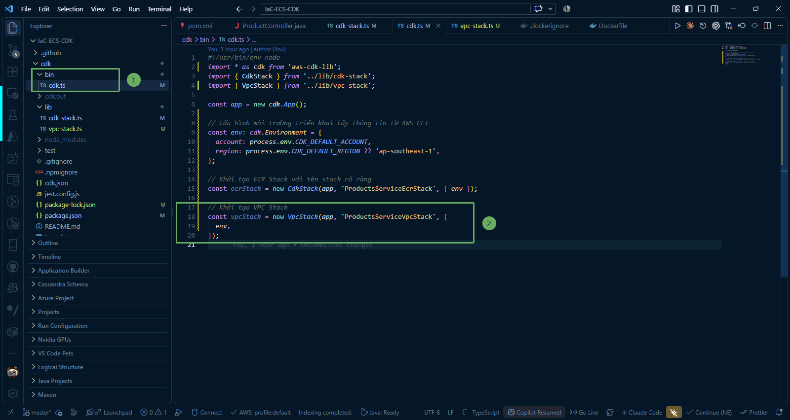

{}
**Note:** The **vpcStack** object will later be used to pass network attributes **vpc: vpcStack.vpc** into the ECS Fargate cluster and Internal Load Balancers in subsequent steps.
{}

---

### 2. Compile and Check Source Code

1. Run the build command for the TypeScript compiler (`tsc`) to check all syntax errors:

~~~powershell
npm run build
~~~

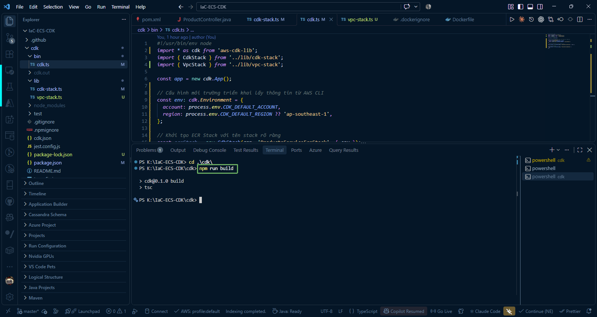

2. Check the list of Stacks registered in the CDK App:

~~~powershell
npx cdk list
~~~

Or:

~~~powershell
cdk list
~~~

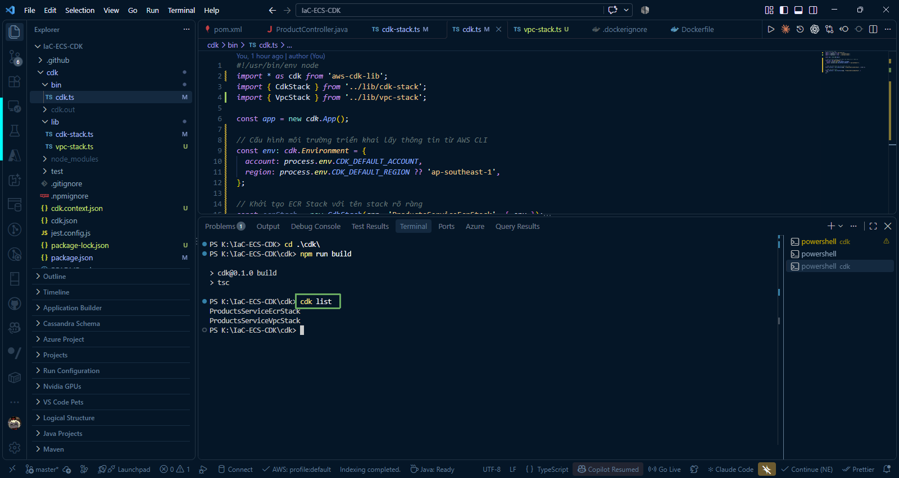

Output displayed:

~~~text
ProductsServiceEcrStack
ProductsServiceVpcStack
~~~

3. Synthesize and inspect the standard CloudFormation Template for the VPC Stack:

~~~powershell
npx cdk synth ProductsServiceVpcStack
~~~

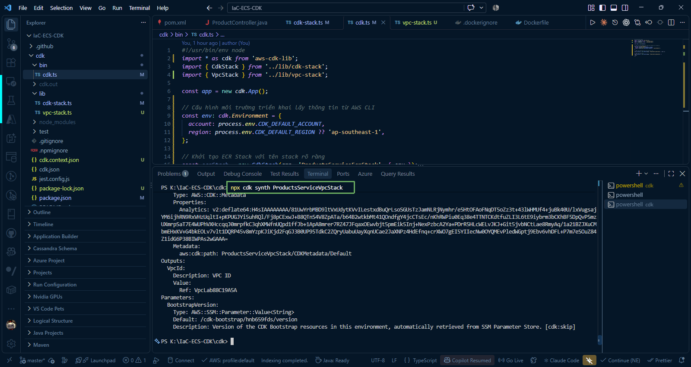

---

### 3. Deploy VPC Stack to AWS (`cdk deploy`)

1. Open Terminal in VS Code at the **IaC-ECS-CDK/cdk** directory.

2. Run the command to deploy only the VPC Stack:

~~~powershell
npx cdk deploy ProductsServiceVpcStack --require-approval never
~~~

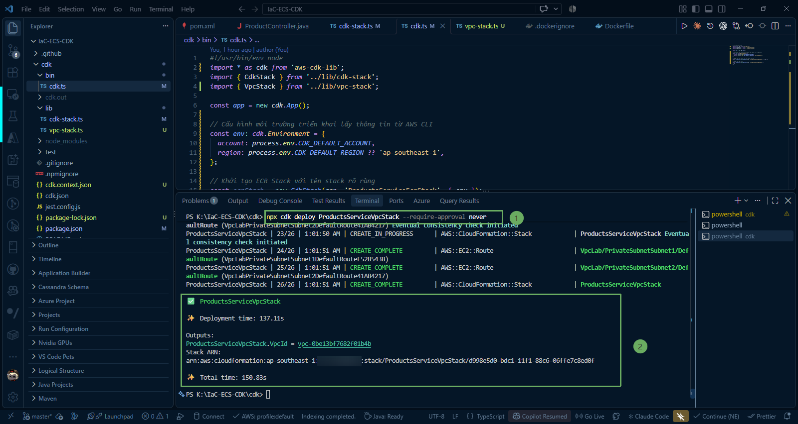

{}
The process of creating the VPC, allocating Elastic IP, and configuring the NAT Gateway usually takes about **2 to 3 minutes**. The CDK CLI will update resource creation progress in real time on the terminal screen.
{}

---

### 4. Check Resources on AWS Management Console

#### 1. Check CloudFormation Stack

1. Sign in to the [AWS Management Console](https://console.aws.amazon.com/).
2. Search for the **CloudFormation** service (ensure the correct Region `ap-southeast-1` is selected).
3. You will see the **ProductsServiceVpcStack** stack with the status **CREATE_COMPLETE**.

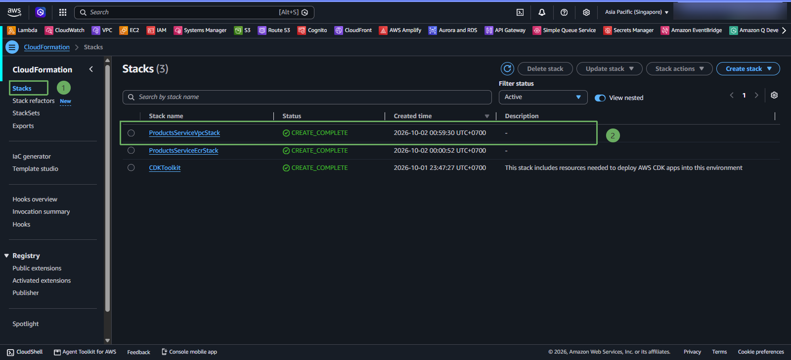

#### 2. Check VPC

Go to the **VPC** service > select **Your VPCs**. You will see the VPC named **`ecs-cdk-vpc`** with default IPv4 CIDR range `10.0.0.0/16`.

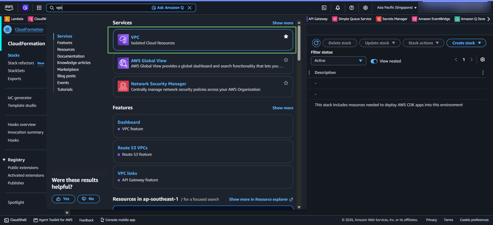

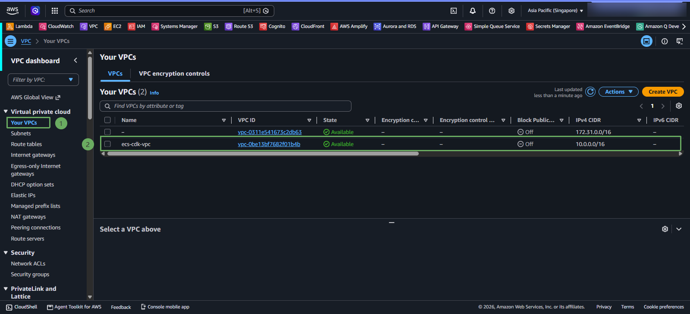

#### 3. Check Subnets

Go to the **Subnets** section in the left menu. The system has automatically created **4 subnets** across 2 AZs:
* 2 Public Subnets (1 subnet per AZ): `ProductsServiceVpcStack/VpcLab/PublicSubnetSubnet1` and `...Subnet2`.
* 2 Private Subnets (1 subnet per AZ): `ProductsServiceVpcStack/VpcLab/PrivateSubnetSubnet1` and `...Subnet2`.

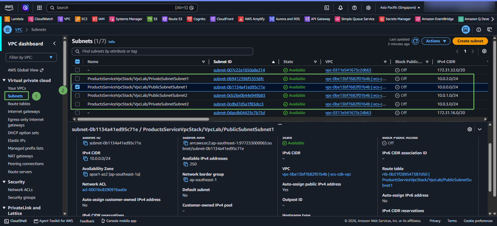

#### 4. Check NAT Gateway

Go to the **NAT gateways** section in the left menu. You will see **1 NAT Gateway** in the **Available** state, allocated an **Elastic IP**, and placed in the Public Subnet.

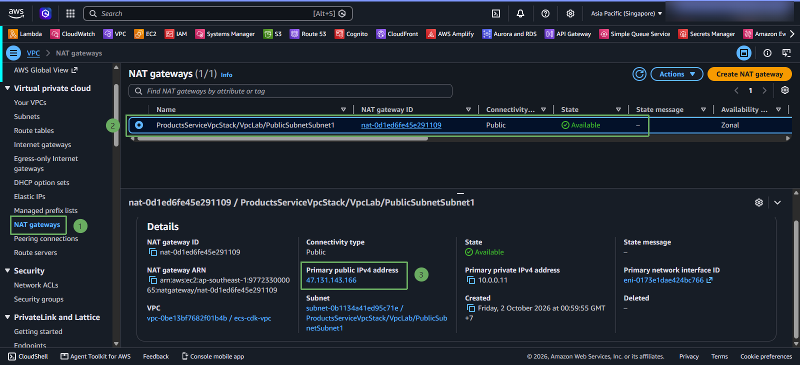

#### 5. Check Route Tables

Go to the **Route tables** section in the left menu to inspect routing configuration:
* **Public Route Table**: Has route `0.0.0.0/0` pointing to the Internet Gateway (`igw-xxxxxx`).
* **Private Route Table**: Has route `0.0.0.0/0` pointing to the NAT Gateway (`nat-xxxxxx`), ensuring containers running in the Private Subnet have one-way outbound Internet access.

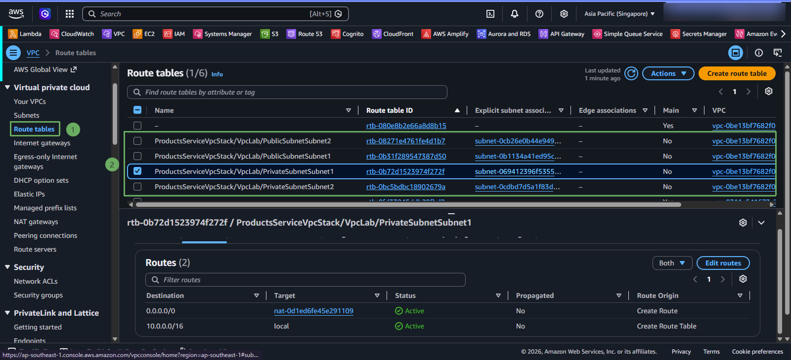

{}
Congratulations! You have completed building and deploying a secure standard VPC network infrastructure with AWS CDK. This network system is ready to host the Amazon ECS Fargate cluster and database in the following lessons.
{}
