Sau khi đã định nghĩa **VpcStack** trong thư mục **lib**, bước tiếp theo là khai báo và tổ chức Stack này vào điểm khởi chạy chính tại **bin/cdk.ts**, biên dịch kiểm tra mã nguồn và triển khai hạ tầng mạng lên AWS.

---

### 1. Tổ chức VPC Stack trong `bin/cdk.ts`

Truy cập vào thư mục **bin** và mở file **cdk.ts** trong VS Code. Thêm khai báo khởi tạo `VpcStack`:

~~~typescript
#!/usr/bin/env node
import * as cdk from 'aws-cdk-lib';
import { CdkStack } from '../lib/cdk-stack';
import { VpcStack } from '../lib/vpc-stack';

const app = new cdk.App();
const env: cdk.Environment = {
  account: process.env.CDK_DEFAULT_ACCOUNT,
  region: process.env.CDK_DEFAULT_REGION ?? 'ap-southeast-1',
};

// Khởi tạo ECR Stack
const ecrStack = new CdkStack(app, 'ProductsServiceEcrStack', { env });

// Khởi tạo VPC Stack
const vpcStack = new VpcStack(app, 'ProductsServiceVpcStack', {
  env,
});
~~~

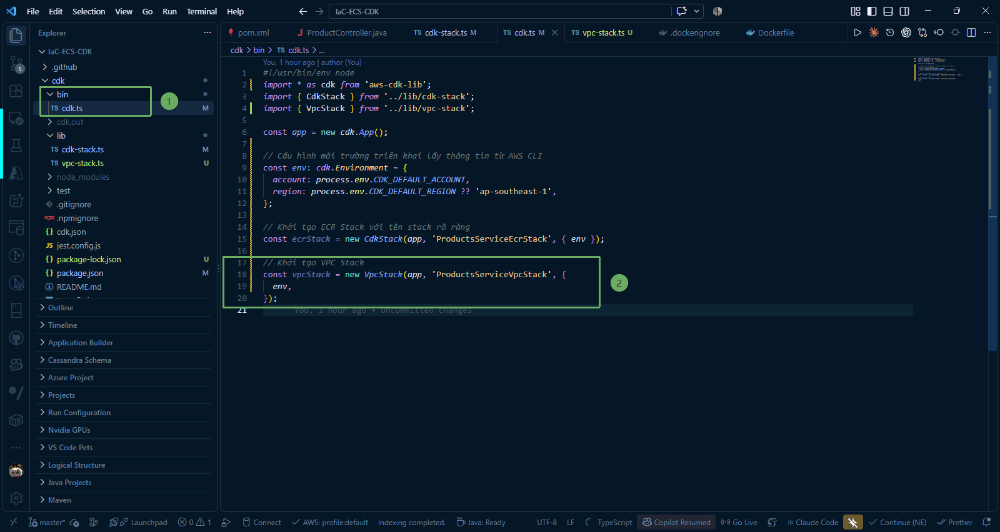

{}
**Lưu ý:** Đối tượng **vpcStack** sau này sẽ được dùng để truyền thuộc tính mạng **vpc: vpcStack.vpc** vào cụm ECS Fargate và Internal Load Balancers ở các bước tiếp theo.
{}

---

### 2. Biên dịch và kiểm tra mã nguồn

1. Chạy lệnh build để TypeScript compiler (`tsc`) kiểm tra toàn bộ lỗi cú pháp:

~~~powershell
npm run build
~~~

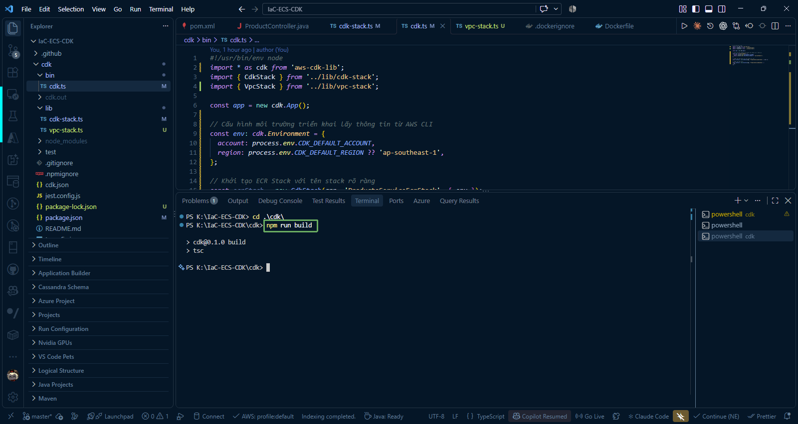

2. Kiểm tra danh sách các Stack đã đăng ký trong CDK App:

~~~powershell
npx cdk list
~~~

Hoặc:

~~~powershell
cdk list
~~~

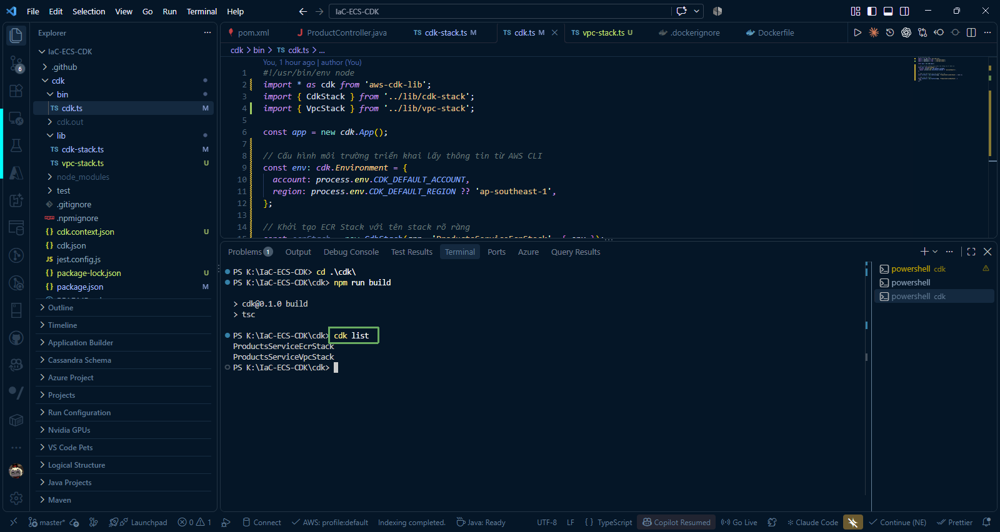

Kết quả hiển thị:

~~~text
ProductsServiceEcrStack
ProductsServiceVpcStack
~~~

3. Biên dịch và kiểm tra CloudFormation Template chuẩn cho VPC Stack:

~~~powershell
npx cdk synth ProductsServiceVpcStack
~~~

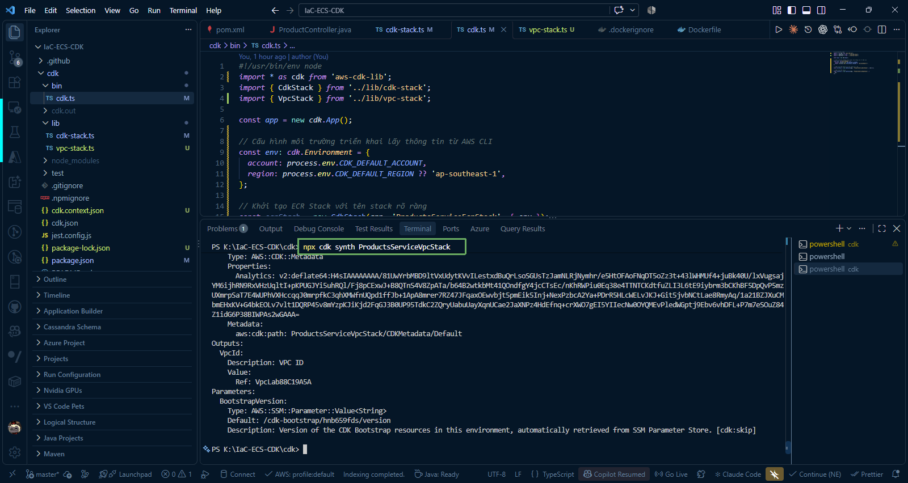

---

### 3. Triển khai VPC Stack lên AWS (`cdk deploy`)

1. Mở Terminal trong VS Code tại thư mục **IaC-ECS-CDK/cdk**.

2. Chạy lệnh triển khai riêng Stack VPC:

~~~powershell
npx cdk deploy ProductsServiceVpcStack --require-approval never
~~~

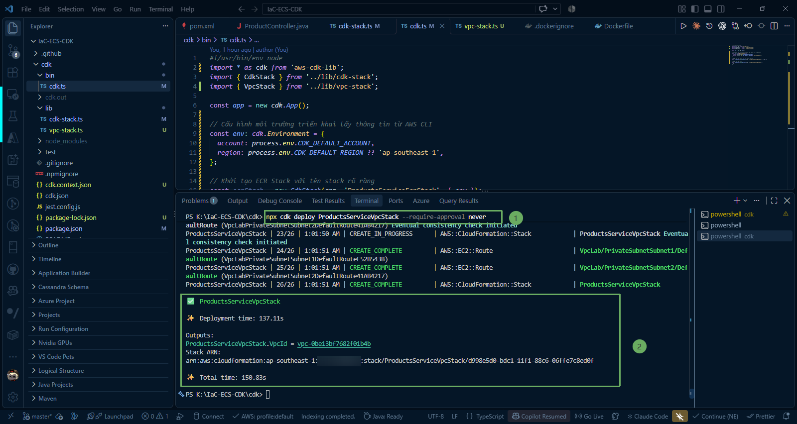

{}
Quá trình khởi tạo VPC, phân bổ Elastic IP và cấu hình NAT Gateway thường mất khoảng **2 đến 3 phút**. CDK CLI sẽ cập nhật tiến trình tạo tài nguyên theo thời gian thực trên màn hình terminal.
{}

---

### 4. Kiểm tra tài nguyên trên AWS Management Console

#### 1. Kiểm tra CloudFormation Stack

1. Đăng nhập vào [AWS Management Console](https://console.aws.amazon.com/).
2. Tìm kiếm dịch vụ **CloudFormation** (chọn đúng Region `ap-southeast-1`).
3. Bạn sẽ thấy stack **ProductsServiceVpcStack** có trạng thái **CREATE_COMPLETE**.

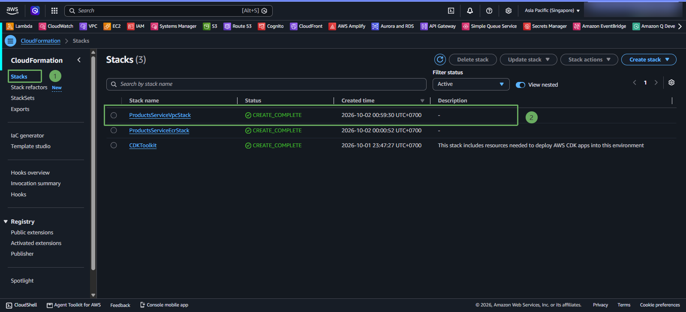

#### 2. Kiểm tra VPC

Vào dịch vụ **VPC** > chọn **Your VPCs**. Bạn sẽ thấy VPC có tên **`ecs-cdk-vpc`** với dải địa chỉ IPv4 CIDR mặc định là `10.0.0.0/16`.

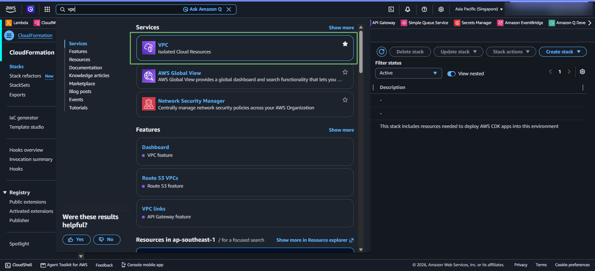

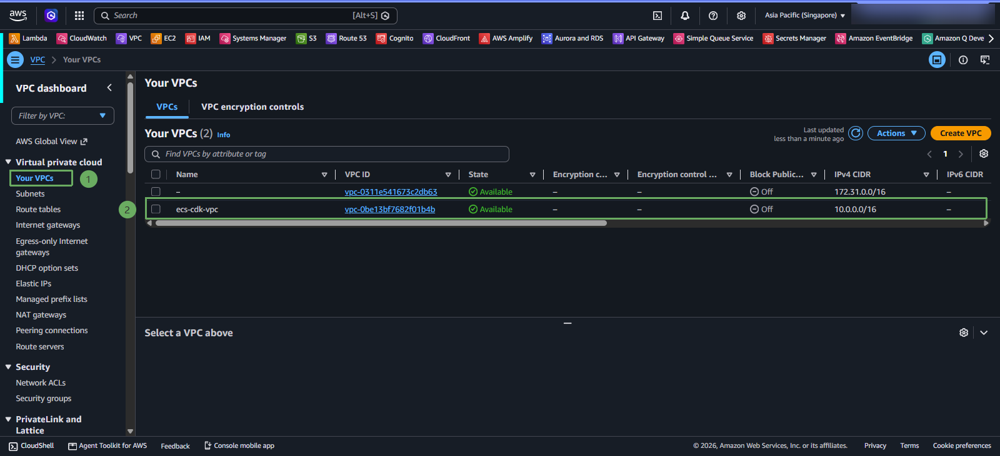

#### 3. Kiểm tra Subnets

Vào mục **Subnets** trong menu bên trái. Hệ thống đã tự động tạo **4 subnets** trải trên 2 AZs:
* 2 Public Subnets (mỗi AZ 1 subnet): `ProductsServiceVpcStack/VpcLab/PublicSubnetSubnet1` và `...Subnet2`.
* 2 Private Subnets (mỗi AZ 1 subnet): `ProductsServiceVpcStack/VpcLab/PrivateSubnetSubnet1` và `...Subnet2`.

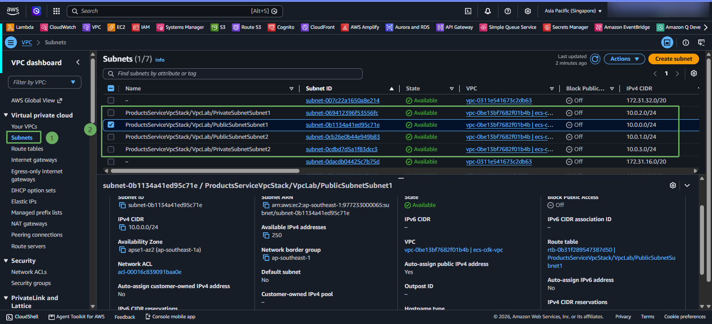

#### 4. Kiểm tra NAT Gateway

Vào mục **NAT gateways** trong menu bên trái. Bạn sẽ thấy **1 NAT Gateway** ở trạng thái **Available**, được cấp phát một **Elastic IP** và đặt tại Public Subnet.

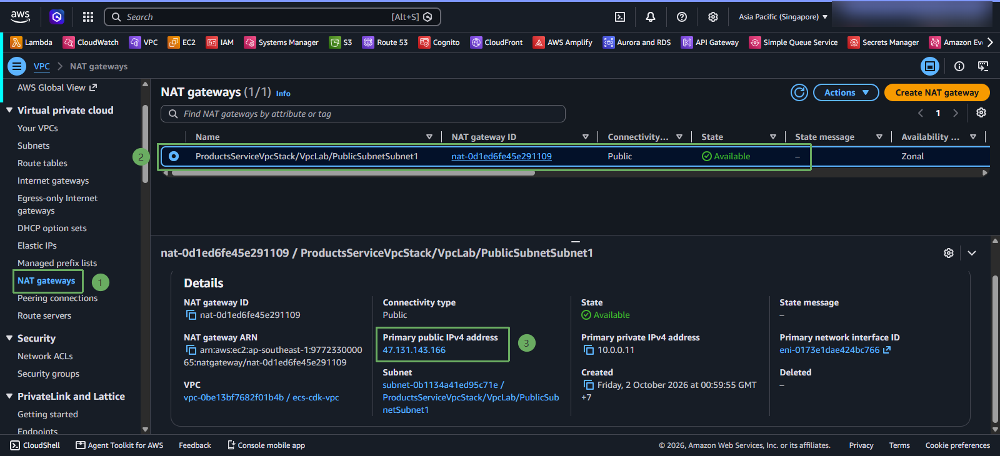

#### 5. Kiểm tra Route Tables

Vào mục **Route tables** trong menu bên trái để kiểm tra cấu hình định tuyến:
* **Public Route Table**: Có route `0.0.0.0/0` trỏ tới Internet Gateway (`igw-xxxxxx`).
* **Private Route Table**: Có route `0.0.0.0/0` trỏ tới NAT Gateway (`nat-xxxxxx`), đảm bảo các container chạy trong Private Subnet có thể kết nối Internet một chiều.

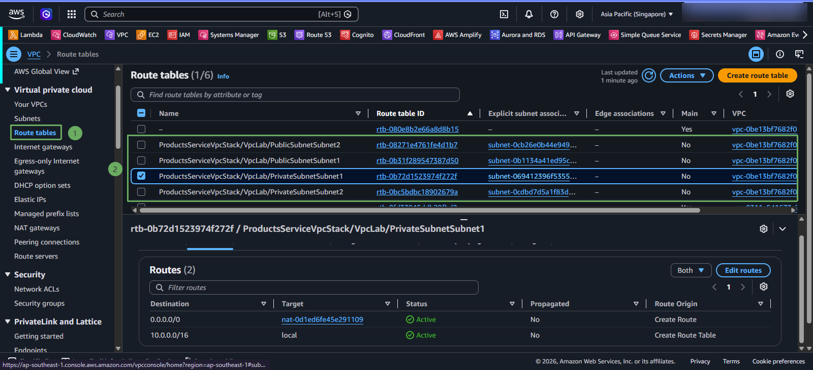

{}
Chúc mừng bạn! Bạn đã hoàn thành việc xây dựng và triển khai hạ tầng mạng VPC chuẩn bảo mật với AWS CDK. Hệ thống mạng này đã sẵn sàng để tiếp nhận cụm Amazon ECS Fargate và cơ sở dữ liệu ở các bài tiếp theo.
{}
