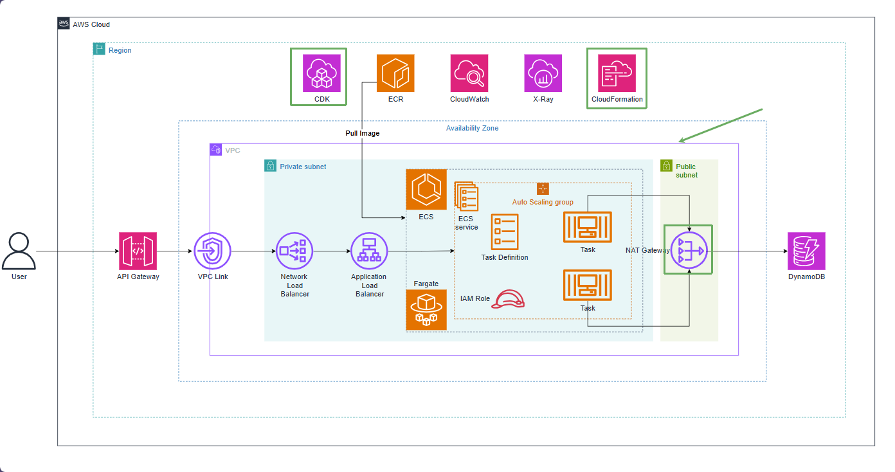

# Create the VPC and private network

VpcStack creates a VPC across two Availability Zones. Each AZ receives a public subnet and a private subnet. Public subnets host resources needing direct Internet access, while private subnets host ECS tasks and internal load balancers.

The repository configures one NAT Gateway (`natGateways: 1`) because tasks in private subnets need to pull images from ECR, send logs to CloudWatch, and access AWS services. A NAT Gateway incurs hourly and data processing charges, so remember to destroy the stack after completing the workshop.

