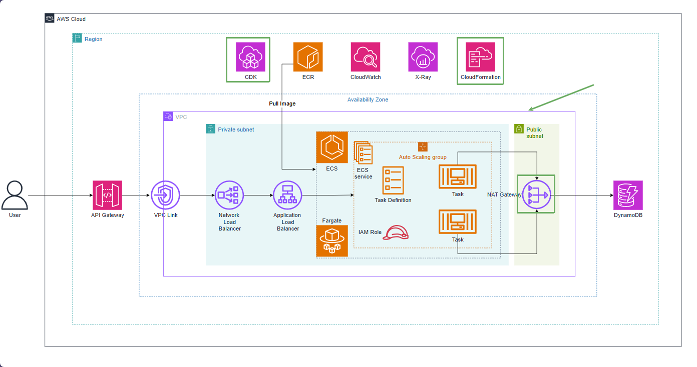

# Tạo VPC và mạng private

VpcStack tạo một VPC trải trên hai Availability Zone. Mỗi AZ có public subnet và private subnet. Public subnet chứa tài nguyên cần kết nối Internet trực tiếp, còn private subnet chứa ECS task và internal load balancer.

Dự án cấu hình một NAT Gateway (`natGateways: 1`) vì task trong private subnet cần pull image từ ECR, gửi log tới CloudWatch và gọi các dịch vụ AWS. Một NAT Gateway vẫn phát sinh phí theo giờ và dữ liệu, vì vậy hãy nhớ xóa stack sau khi hoàn thành workshop.

