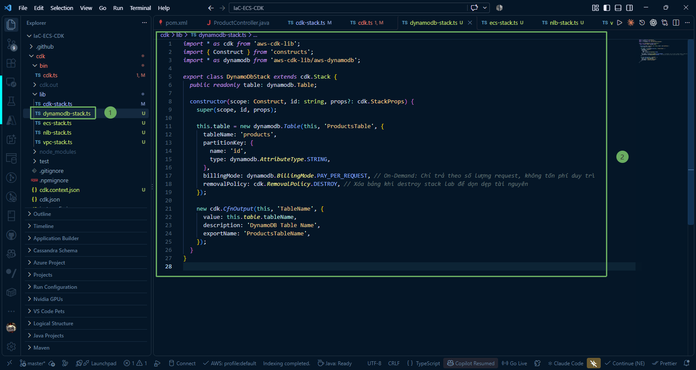

In this section, we will learn how to build a NoSQL database with **Amazon DynamoDB** using AWS CDK (TypeScript) to store product catalog data for the Spring Boot microservice.

---

### 1. Role of DynamoDB in the Microservice Architecture

Within our backend application architecture:
* **Spring Boot Microservice**: Provides CRUD (Create, Read, Update, Delete) REST APIs for the product catalog via the `/api/products` endpoint.

* **Amazon DynamoDB**: Serves as a high-performance serverless NoSQL database. DynamoDB completely eliminates the operational burden of server management, requires no cluster provisioning, and automatically replicates data across 3 Availability Zones within the Region for high availability.

* **Connection with ECS Fargate**: The ECS Fargate cluster requires permissions to access the DynamoDB table. Therefore, separating the DynamoDB table into an independent CDK Stack (`DynamoDbStack`) allows us to share the `table` object with `EcsStack`, thereby granting read/write IAM permissions (`grantReadWriteData`) to the Task Role explicitly and securely.

---

### 2. Write DynamoDB Stack Source Code (`dynamodb-stack.ts`)

Navigate to the directory **IaC-ECS-CDK/cdk/lib** and open the file **dynamodb-stack.ts** (or create it if not present). Update the contents defining the DynamoDB stack:

~~~typescript
import * as cdk from 'aws-cdk-lib';
import { Construct } from 'constructs';
import * as dynamodb from 'aws-cdk-lib/aws-dynamodb';

export class DynamoDbStack extends cdk.Stack {
  public readonly table: dynamodb.Table;

  constructor(scope: Construct, id: string, props?: cdk.StackProps) {
    super(scope, id, props);

    this.table = new dynamodb.Table(this, 'ProductsTable', {
      tableName: 'products',
      partitionKey: {
        name: 'id',
        type: dynamodb.AttributeType.STRING,
      },
      billingMode: dynamodb.BillingMode.PAY_PER_REQUEST, // On-Demand: Pay per request, zero idle maintenance fees
      removalPolicy: cdk.RemovalPolicy.DESTROY, // Clean up table on stack deletion during lab cleanup
    });

    new cdk.CfnOutput(this, 'TableName', {
      value: this.table.tableName,
      description: 'DynamoDB Table Name',
      exportName: 'ProductsTableName',
    });
  }
}
~~~

---

### 3. Detailed Explanation of Core Properties

* **public readonly table: dynamodb.Table;**:
  * Declares a public property so that the DynamoDB table instance can be passed to other stacks via props in the `bin/cdk.ts` file.
  * This allows `EcsStack` to execute the command **props.table.grantReadWriteData(fargateService.taskDefinition.taskRole)** without hardcoding ARNs or manually configuring IAM policies.

* **tableName: 'products'**:
  * Identifier name of the table on DynamoDB. This name matches the table name configured in the repository layer of the Spring Boot application.

* **partitionKey: { name: 'id', type: dynamodb.AttributeType.STRING }**:
  * Configures the unique Partition Key (Hash Key) for the table as the **id** field with string data type (**STRING** / UUID).
  * DynamoDB uses this **id** value to distribute data evenly across physical partitions, ensuring constant-time $O(1)$ query speed.

* **billingMode: dynamodb.BillingMode.PAY_PER_REQUEST**:
  * On-Demand Capacity Mode.
  * Unlike the traditional mode (**Provisioned**) which requires pre-configuring Read Capacity Units (RCU) and Write Capacity Units (WCU), On-Demand automatically scales to accommodate traffic bursts instantly and **incurs no charges when there are no reads/writes**. This is the ideal choice for learning environments, experimentation, and microservices with fluctuating traffic.

* **removalPolicy: cdk.RemovalPolicy.DESTROY**:
  * By default in AWS CDK, DynamoDB tables are protected by the **RETAIN** policy (keeping data even if the stack is deleted).
  * In a practice/lab environment, we set it to **DESTROY** so that when running the cleanup command (**cdk destroy**), the DynamoDB table is completely deleted automatically, avoiding leftover resources incurring unexpected costs.

* **cdk.CfnOutput**:
  * Outputs the table name to CloudFormation Outputs and the terminal screen for easy verification and integration.

{}
**Architectural Tip**: Separating the database into an independent `DynamoDbStack` from `EcsStack` adheres to the principle of Separation of Concerns. You can redeploy, update, or scale the Fargate container application without affecting the lifecycle and persisted data stored in DynamoDB.
{}
