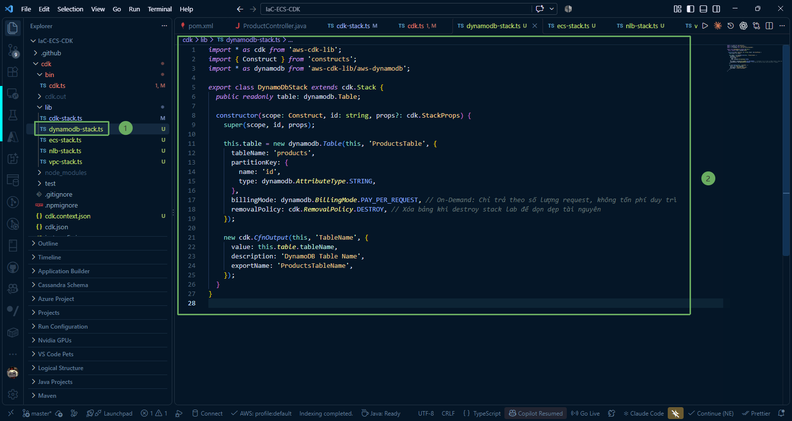

Trong phần này, chúng ta sẽ tìm hiểu về cách xây dựng cơ sở dữ liệu NoSQL với **Amazon DynamoDB** bằng AWS CDK (TypeScript) để lưu trữ dữ liệu sản phẩm cho microservice Spring Boot.

---

### 1. Vai trò của DynamoDB trong kiến trúc microservice

Trong hệ thống backend của chúng ta:
* **Microservice Spring Boot**: Cung cấp các REST API CRUD (Tạo, Đọc, Cập nhật, Xóa) cho danh mục sản phẩm thông qua endpoint `/api/products`.

* **Amazon DynamoDB**: Là cơ sở dữ liệu NoSQL serverless hiệu năng cao. DynamoDB loại bỏ hoàn toàn gánh nặng quản trị máy chủ, không cần thiết lập cụm (cluster), và tự động nhân bản dữ liệu qua 3 Availability Zones trong Region để đảm bảo tính sẵn sàng cao.

* **Mối liên kết với ECS Fargate**: Cụm ECS Fargate cần có quyền truy cập vào bảng DynamoDB. Vì vậy, việc tách riêng bảng DynamoDB thành một CDK Stack độc lập (`DynamoDbStack`) cho phép chúng ta chia sẻ đối tượng `table` sang `EcsStack`, từ đó cấp quyền IAM đọc/ghi (`grantReadWriteData`) cho Task Role một cách tường minh và an toàn.

---

### 2. Viết mã nguồn DynamoDB Stack (`dynamodb-stack.ts`)

Truy cập vào thư mục **IaC-ECS-CDK/cdk/lib** và mở file **dynamodb-stack.ts** (hoặc tạo mới nếu chưa có). Cập nhật nội dung định nghĩa stack DynamoDB:

~~~typescript
import * as cdk from 'aws-cdk-lib';
import { Construct } from 'constructs';
import * as dynamodb from 'aws-cdk-lib/aws-dynamodb';

export class DynamoDbStack extends cdk.Stack {
  public readonly table: dynamodb.Table;

  constructor(scope: Construct, id: string, props?: cdk.StackProps) {
    super(scope, id, props);

    this.table = new dynamodb.Table(this, 'ProductsTable', {
      tableName: 'products',
      partitionKey: {
        name: 'id',
        type: dynamodb.AttributeType.STRING,
      },
      billingMode: dynamodb.BillingMode.PAY_PER_REQUEST, // On-Demand: Chỉ trả theo số lượng request, không tốn phí duy trì
      removalPolicy: cdk.RemovalPolicy.DESTROY, // Xóa bảng khi destroy stack lab để dọn dẹp tài nguyên
    });

    new cdk.CfnOutput(this, 'TableName', {
      value: this.table.tableName,
      description: 'DynamoDB Table Name',
      exportName: 'ProductsTableName',
    });
  }
}
~~~

---

### 3. Giải thích chi tiết các thuộc tính cốt lõi

* **public readonly table: dynamodb.Table;**:
  * Khai báo thuộc tính công khai (public) để instance của bảng DynamoDB có thể được truyền sang các stack khác thông qua props trong file `bin/cdk.ts`.
  * Điều này cho phép `EcsStack` thực hiện lệnh **props.table.grantReadWriteData(fargateService.taskDefinition.taskRole)** mà không cần hardcode ARN hay cấu hình IAM policy thủ công.

* **tableName: 'products'**:
  * Tên định danh của bảng trên DynamoDB. Tên này sẽ khớp với tên bảng được cấu hình trong tầng repository của ứng dụng Spring Boot.

* **partitionKey: { name: 'id', type: dynamodb.AttributeType.STRING }**:
  * Thiết lập khóa phân vùng (Partition Key / Hash Key) duy nhất cho bảng là trường **id** với kiểu dữ liệu chuỗi (**STRING** / UUID).
  * DynamoDB sẽ sử dụng giá trị **id** này để phân tán dữ liệu đều trên các phân vùng vật lý, đảm bảo tốc độ truy vấn đạt $O(1)$.

* **billingMode: dynamodb.BillingMode.PAY_PER_REQUEST**:
  * Chế độ thanh toán theo lượng yêu cầu (**On-Demand Capacity Mode**).
  * Khác với chế độ truyền thống (**Provisioned**) yêu cầu phải cấu hình trước Read Capacity Units (RCU) và Write Capacity Units (WCU), On-Demand tự động mở rộng đáp ứng tải tức thì và **không tính phí khi không có lượt đọc/ghi**. Đây là lựa chọn hoàn hảo cho môi trường học tập, thử nghiệm và microservices có lưu lượng biến động.

* **removalPolicy: cdk.RemovalPolicy.DESTROY**:
  * Theo mặc định của AWS CDK, bảng DynamoDB được bảo vệ bằng chính sách **RETAIN** (giữ lại dữ liệu ngay cả khi stack bị xóa).
  * Trong môi trường thực hành/lab, chúng ta đặt thành **DESTROY** để khi chạy lệnh dọn dẹp (**cdk destroy**), bảng DynamoDB sẽ được tự động xóa bỏ hoàn toàn, tránh sót lại tài nguyên gây phát sinh chi phí ngoài ý muốn.

* **cdk.CfnOutput**:
  * Xuất tên bảng ra CloudFormation Outputs và màn hình terminal để người dùng dễ dàng kiểm tra và tích hợp.

{}
**Mẹo kiến trúc**: Việc tách cơ sở dữ liệu thành `DynamoDbStack` độc lập với `EcsStack` tuân thủ nguyên tắc tách biệt mối quan tâm (Separation of Concerns). Bạn có thể triển khai lại, cập nhật hoặc mở rộng quy mô ứng dụng container Fargate mà không làm ảnh hưởng đến vòng đời và dữ liệu đã lưu trữ trong DynamoDB.
{}
