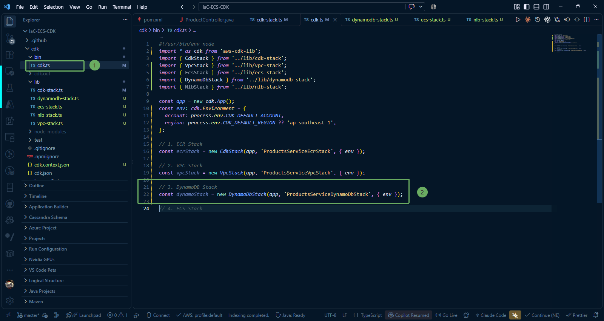
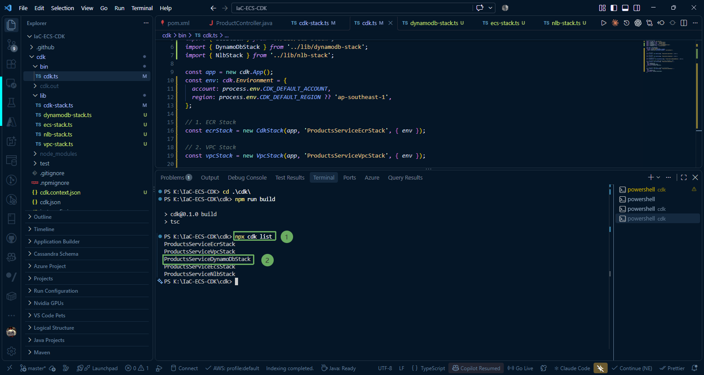
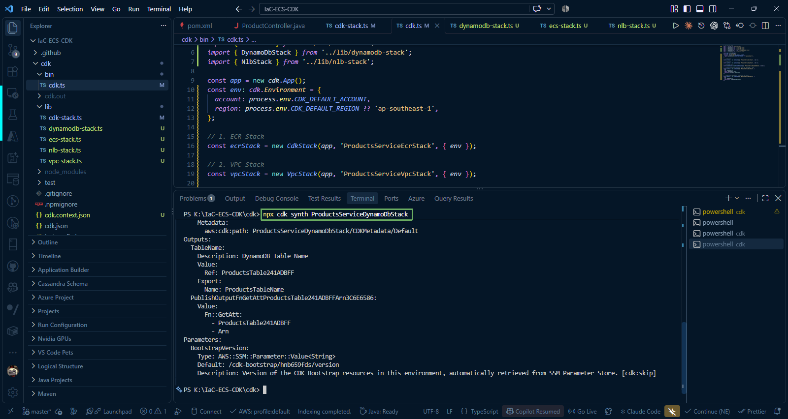
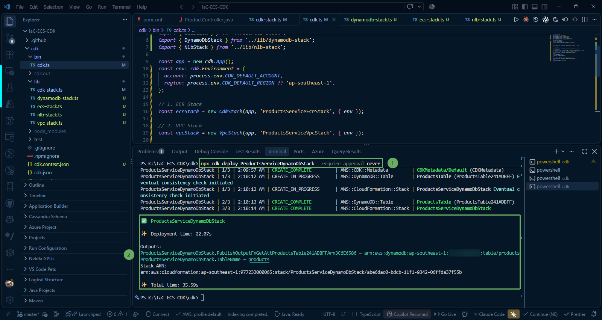
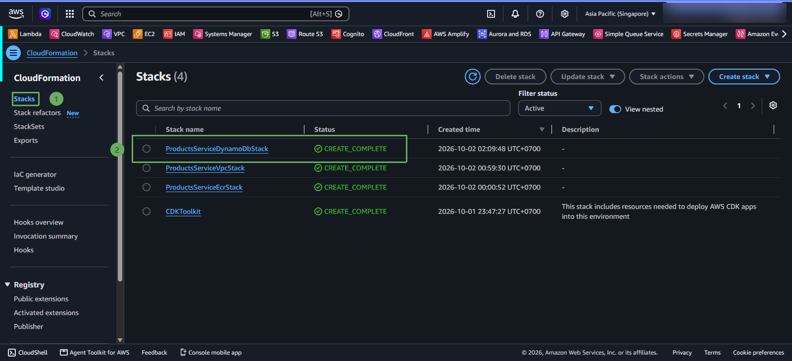
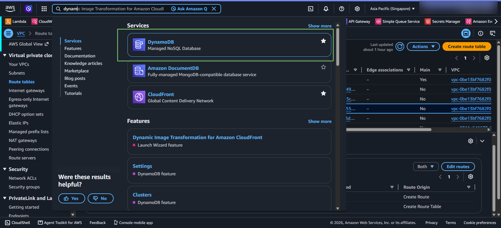
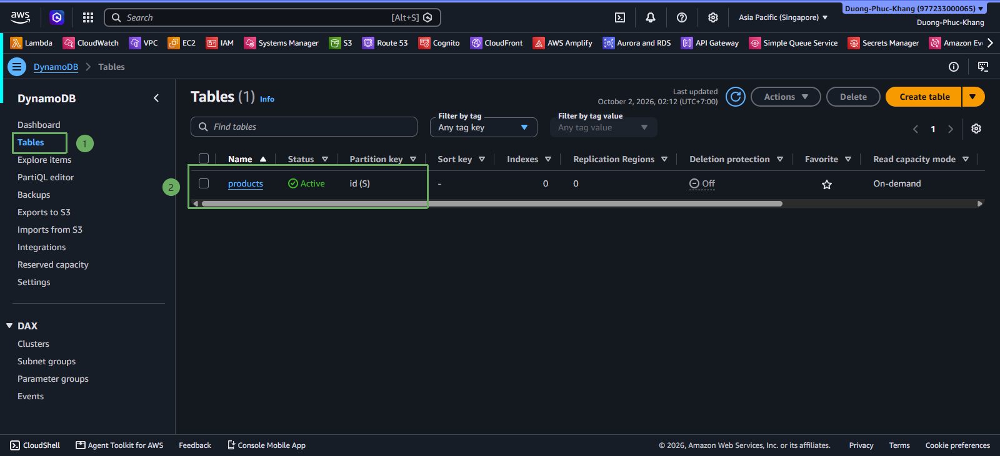
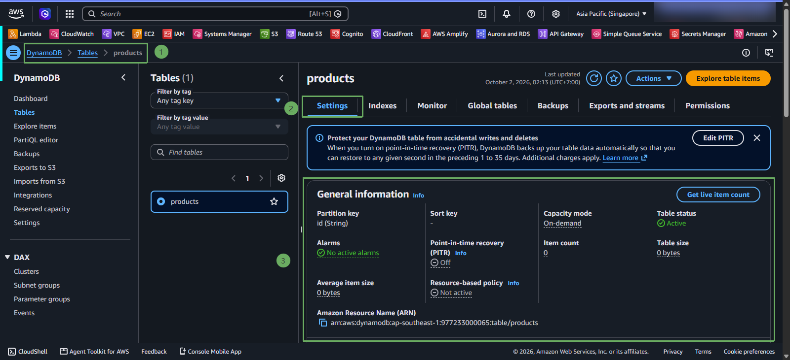

After completing the source code for `DynamoDbStack` in the `lib` directory, the next step is to declare the stack in the main entry point file `bin/cdk.ts`, check TypeScript compilation, and deploy the `products` table to AWS.

---

### 1. Declare DynamoDB Stack in `bin/cdk.ts`

Open the file **IaC-ECS-CDK/cdk/bin/cdk.ts** in VS Code and add the declaration to initialize `DynamoDbStack`:

~~~typescript
#!/usr/bin/env node
import 'source-map-support/register';
import * as cdk from 'aws-cdk-lib';
import { EcrStack } from '../lib/ecr-stack';
import { VpcStack } from '../lib/vpc-stack';
import { DynamoDbStack } from '../lib/dynamodb-stack';

const app = new cdk.App();

const env: cdk.Environment = {
  account: process.env.CDK_DEFAULT_ACCOUNT,
  region: process.env.CDK_DEFAULT_REGION || 'ap-southeast-1',
};

// 1. VPC Stack
const vpcStack = new VpcStack(app, 'ProductsServiceVpcStack', { env });

// 2. ECR Stack
const ecrStack = new EcrStack(app, 'ProductsServiceEcrStack', { env });

// 3. DynamoDB Stack
const dynamoStack = new DynamoDbStack(app, 'ProductsServiceDynamoDbStack', { env });
~~~

{}
**Note**: The **dynamoStack** object provides the property `dynamoStack.table` (type **dynamodb.Table**). In the next step, this object will be passed directly into **ProductsServiceEcsStack** to grant IAM read/write permissions to the ECS Fargate container.
{}

---

### 2. Compile and Check Source Code

1. List the Stacks registered in the CDK application:

~~~powershell
npx cdk list
~~~

Output displayed on the terminal:

2. Synthesize and inspect the standard CloudFormation Template for the DynamoDB stack:

~~~powershell
npx cdk synth ProductsServiceDynamoDbStack
~~~

The above command synthesizes a pure CloudFormation template containing the `AWS::DynamoDB::Table` resource with the Partition Key and On-Demand Billing configurations that we defined.

---

### 3. Deploy DynamoDB Stack to AWS (`cdk deploy`)

Run the command to deploy only `ProductsServiceDynamoDbStack`:

~~~powershell
npx cdk deploy ProductsServiceDynamoDbStack --require-approval never
~~~

{}
Since DynamoDB is a purely serverless service, AWS does not need to provision physical hardware or complex VPC networking. Table creation occurs very quickly, typically taking only **30 to 45 seconds** to complete.
{}

---

### 4. Check Resources on AWS Management Console

#### Access CloudFormation, check ProductsServiceDynamoDbStack successfully created

1. Sign in to the [AWS Management Console](https://console.aws.amazon.com/).
2. Access the CloudFormation service.

1. In the search bar, type **DynamoDB** and click the service.
2. In the left navigation bar, select **Tables**.
3. Click on the table name **`products`** in the list to view details:
   * **Table status**: `Active` (Table is ready for operations).
   * **Partition key**: `id (String)`.
   * **Capacity mode**: `On-demand` (Pay per request).

{}
Great! The `products` database table has been successfully created on AWS. In **Step 6**, we will build the **Amazon ECS Fargate** cluster, grant DynamoDB read/write permissions to the Task Role, and deploy the entire Spring Boot application along with the ALB/NLB load balancing system.
{}
