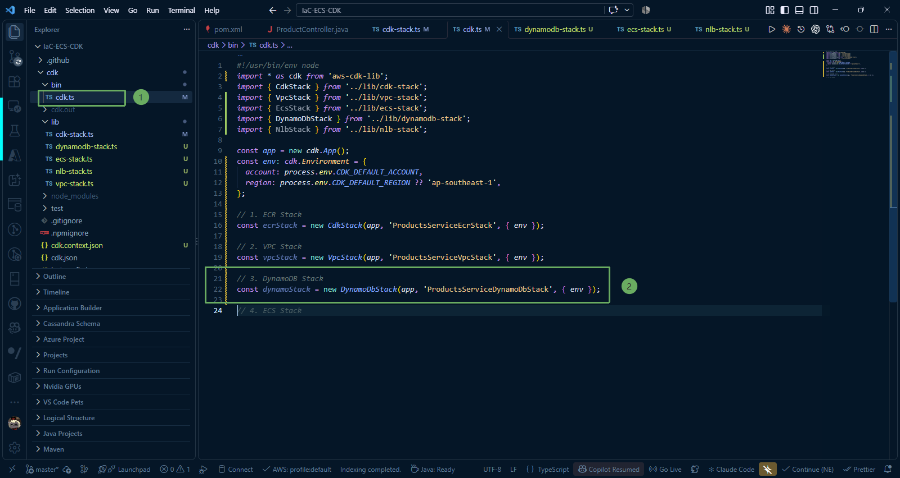
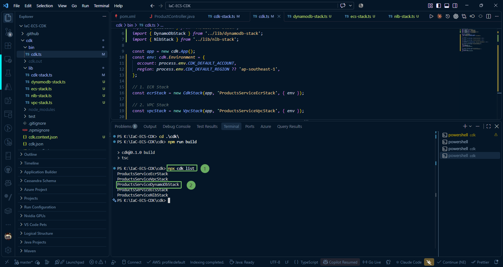
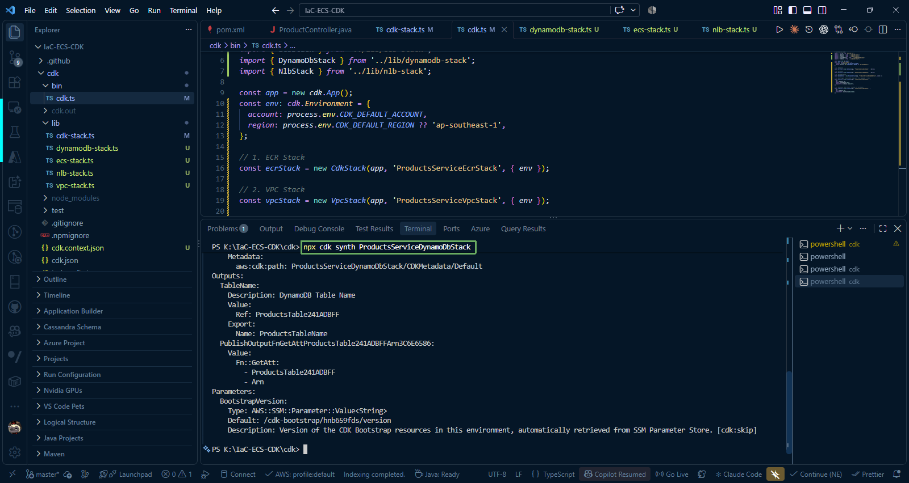
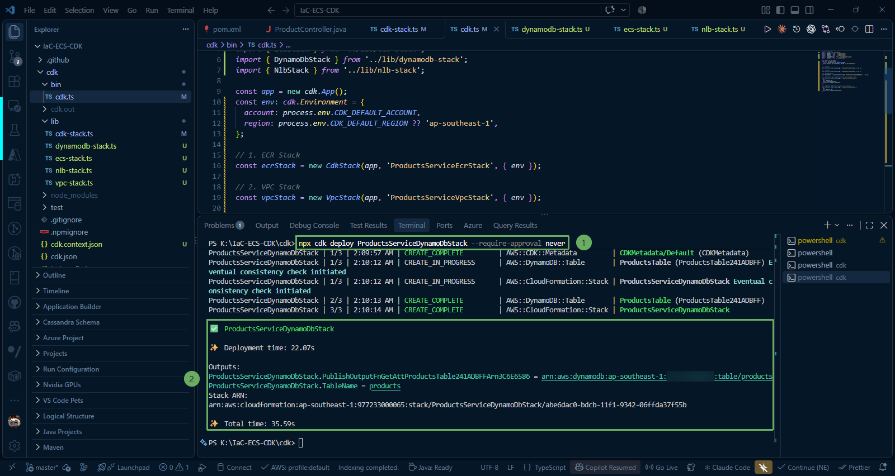
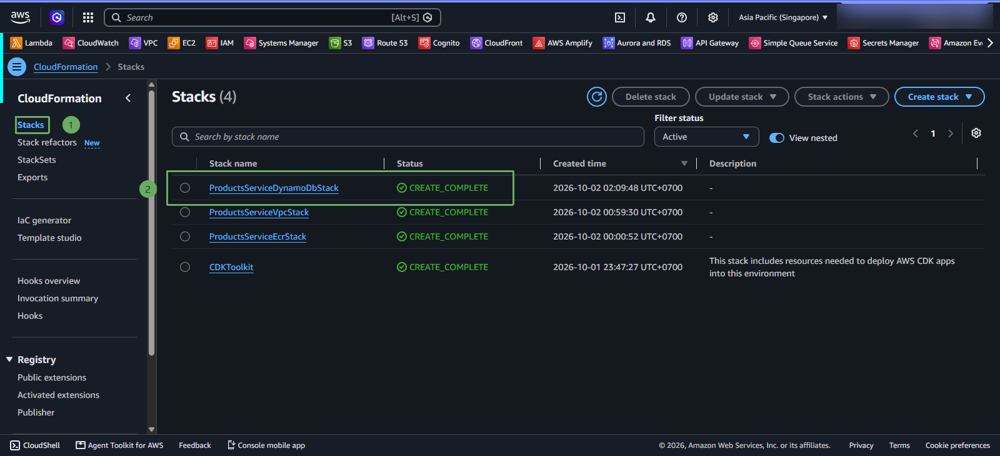
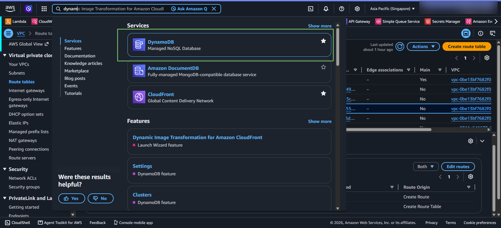
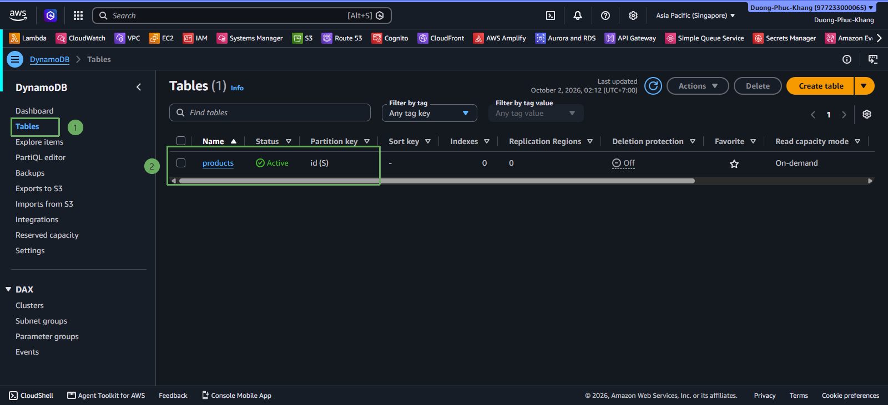
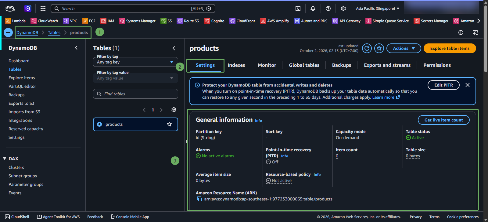

Sau khi đã hoàn thiện mã nguồn `DynamoDbStack` trong thư mục `lib`, bước tiếp theo là khai báo stack vào file điểm vào chính `bin/cdk.ts`, kiểm tra biên dịch TypeScript và triển khai bảng `products` lên AWS.

---

### 1. Khai báo DynamoDB Stack trong `bin/cdk.ts`

Mở file **IaC-ECS-CDK/cdk/bin/cdk.ts** trong VS Code và thêm khai báo khởi tạo `DynamoDbStack`:

~~~typescript
#!/usr/bin/env node
import 'source-map-support/register';
import * as cdk from 'aws-cdk-lib';
import { EcrStack } from '../lib/ecr-stack';
import { VpcStack } from '../lib/vpc-stack';
import { DynamoDbStack } from '../lib/dynamodb-stack';

const app = new cdk.App();

const env: cdk.Environment = {
  account: process.env.CDK_DEFAULT_ACCOUNT,
  region: process.env.CDK_DEFAULT_REGION || 'ap-southeast-1',
};

// 1. VPC Stack
const vpcStack = new VpcStack(app, 'ProductsServiceVpcStack', { env });

// 2. ECR Stack
const ecrStack = new EcrStack(app, 'ProductsServiceEcrStack', { env });

// 3. DynamoDB Stack
const dynamoStack = new DynamoDbStack(app, 'ProductsServiceDynamoDbStack', { env });
~~~

{}
**Lưu ý**: Đối tượng **dynamoStack** cung cấp thuộc tính `dynamoStack.table` (kiểu **dynamodb.Table**). Ở bước kế tiếp, đối tượng này sẽ được truyền thẳng vào **ProductsServiceEcsStack** để cấp quyền đọc/ghi IAM cho container ECS Fargate.
{}

---

### 2. Biên dịch và kiểm tra mã nguồn

1. Liệt kê danh sách các Stack đã đăng ký trong ứng dụng CDK:

~~~powershell
npx cdk list
~~~

Kết quả hiển thị trên terminal:

2. Biên dịch và kiểm tra CloudFormation Template chuẩn cho stack DynamoDB:

~~~powershell
npx cdk synth ProductsServiceDynamoDbStack
~~~

Lệnh trên sẽ sinh ra mẫu CloudFormation thuần chứa tài nguyên `AWS::DynamoDB::Table` với các cấu hình Partition Key và On-Demand Billing mà chúng ta vừa định nghĩa.

---

### 3. Triển khai DynamoDB Stack lên AWS (`cdk deploy`)

Chạy lệnh triển khai riêng `ProductsServiceDynamoDbStack`:

~~~powershell
npx cdk deploy ProductsServiceDynamoDbStack --require-approval never
~~~

{}
Do DynamoDB là dịch vụ serverless thuần túy, AWS không cần khởi tạo phần cứng hay thiết lập mạng VPC phức tạp. Quá trình tạo bảng diễn ra rất nhanh, thường chỉ mất từ **30 đến 45 giây** để hoàn tất.
{}

---

### 4. Kiểm tra tài nguyên trên AWS Management Console

#### Truy cập vào CloudFormation, kiểm tra ProductsServiceDynamoDbStack đã tạo thành công

1. Đăng nhập vào [AWS Management Console](https://console.aws.amazon.com/).
2. Truy cập vào dịch vụ CloudFormation.

1. Trên thanh tìm kiếm, gõ **DynamoDB** và nhấp chọn dịch vụ.
2. Ở thanh điều hướng bên trái, chọn **Tables** (hoặc **Bảng**).
3. Nhấp vào tên bảng **`products`** trong danh sách để xem thông tin chi tiết:
   * **Table status**: `Active` (Bảng đã sẵn sàng hoạt động).
   * **Partition key**: `id (String)`.
   * **Capacity mode**: `On-demand` (Thanh toán theo mức sử dụng).

{}
Tuyệt vời! Bảng cơ sở dữ liệu `products` đã được khởi tạo thành công trên AWS. Ở **Bước 6**, chúng ta sẽ xây dựng cụm **Amazon ECS Fargate**, cấp quyền đọc/ghi vào bảng DynamoDB này cho Task Role và triển khai toàn bộ ứng dụng Spring Boot cùng hệ thống cân bằng tải ALB/NLB.
{}
