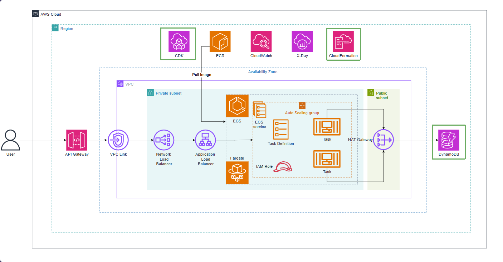

# Create DynamoDB products table

In our microservices architecture powered by **Amazon ECS Fargate**, the database layer manages and persists product catalog data. This workshop leverages **Amazon DynamoDB** — a fully managed NoSQL key-value database service that delivers single-digit millisecond latency and seamless automatic scaling.

Under our Infrastructure as Code (IaC) modular design with AWS CDK, **DynamoDbStack** is defined and provisioned ahead of **EcsStack** to satisfy dependency requirements:

1. **Initialize the `products` table**: Configures the partition key as `id` (`AttributeType.STRING`).
2. **Grant IAM permissions**: Exports the table construct (`table: dynamodb.Table`) so that `EcsStack` can grant read/write access (`grantReadWriteData`) to the ECS Fargate Task Role.
3. **Inject container environment variables**: Provides the table name to populate the `AWS_PRODUCTSDDB_NAME` environment variable, enabling Spring Boot to connect seamlessly.

By adopting the **On-Demand (PAY_PER_REQUEST)** billing mode, the DynamoDB table dynamically scales with request volume and incurs zero idle maintenance costs during lab workflows.

