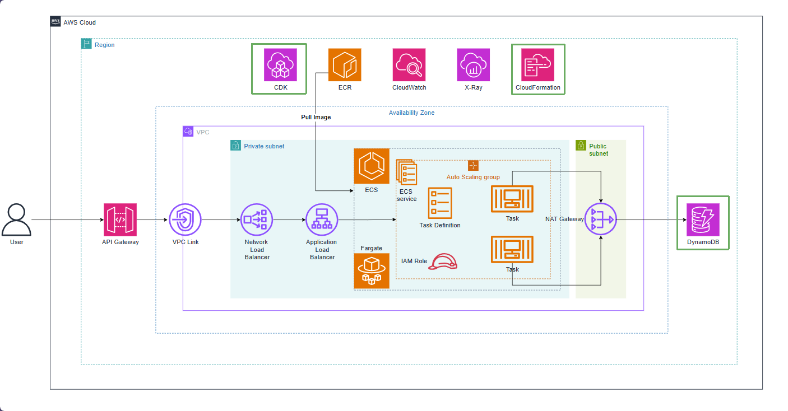

# Tạo bảng DynamoDB products

Trong kiến trúc ứng dụng microservices với **Amazon ECS Fargate**, tầng cơ sở dữ liệu đóng vai trò lưu trữ và quản lý thông tin danh mục sản phẩm. Bài lab này sử dụng **Amazon DynamoDB** — dịch vụ cơ sở dữ liệu NoSQL được quản lý hoàn toàn (fully managed), cung cấp hiệu năng vượt trội với độ trễ ở mức mili-giây đơn và khả năng mở rộng quy mô liền mạch.

Theo thiết kế hạ tầng bằng mã (Infrastructure as Code) với AWS CDK, **DynamoDbStack** được định nghĩa và triển khai trước cụm **EcsStack** nhằm đáp ứng các yêu cầu liên kết tài nguyên:

1. **Khởi tạo bảng `products`**: Thiết lập khóa phân vùng (partition key) là `id` (`AttributeType.STRING`).
2. **Cấp quyền truy cập IAM**: Xuất đối tượng bảng construct (`table: dynamodb.Table`) để `EcsStack` có thể cấp quyền đọc/ghi (`grantReadWriteData`) cho Task Role của ECS Fargate.
3. **Tiêm biến môi trường container**: Cung cấp tên bảng để đưa vào biến môi trường `AWS_PRODUCTSDDB_NAME`, giúp ứng dụng Spring Boot kết nối chính xác tới cơ sở dữ liệu.

Nhờ áp dụng chế độ thanh toán **On-Demand (PAY_PER_REQUEST)**, bảng DynamoDB tự động co giãn theo lưu lượng truy cập thực tế và không phát sinh chi phí duy trì khi hệ thống ở trạng thái nhàn rỗi trong quá trình thực hành.

