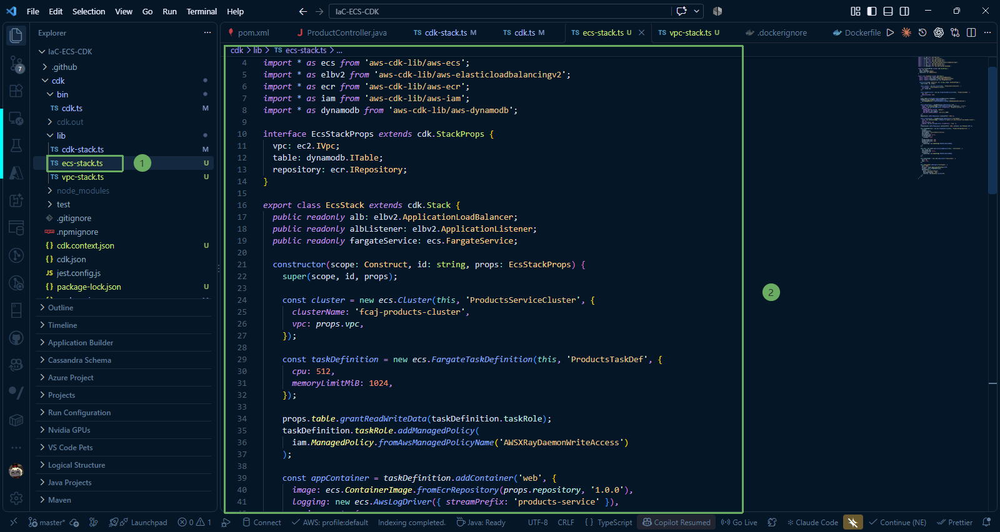

In this step, we will explore packaging and launching our Spring Boot container on **AWS Fargate** (Amazon ECS Serverless compute engine) alongside an **AWS X-Ray daemon** sidecar, and configuring an internal **Application Load Balancer (ALB)** for private traffic routing.

---

### 1. ECS Fargate and Internal ALB Architecture

The application runs entirely within the **Private Subnet with Egress** provisioned in step 4:

* **Amazon ECS Cluster (`fcaj-products-cluster`)**: Logical grouping managing container services and tasks.
* **Fargate Task Definition (`ProductsTaskDef`)**: Specifies container resource allocation and behaviors:
  * **CPU**: 512 units (0.5 vCPU), **Memory**: 1024 MiB (1 GB).
  * **Primary Container (`web`)**: Runs the Spring Boot app pulled from ECR `fcaj-products-service:1.0.0`, listens on port `8080`, and streams logs to CloudWatch.
  * **Sidecar Container (`xray-daemon`)**: Runs `public.ecr.aws/xray/aws-xray-daemon:latest`, listens on UDP port `2000`, and relays application trace data to AWS X-Ray.
  * **Task Role**: Grants DynamoDB read/write permissions and attaches the `AWSXRayDaemonWriteAccess` policy.
* **ECS Fargate Service (`fcaj-products-service`)**: Maintains desired task count (`desiredCount: 1`), with automatic recovery enabled by the **deployment circuit breaker**. Tasks run without public IPs for maximum security.
* **Internal Application Load Balancer (`InternalAlb`)**: Placed within Private Subnets, listening on port `80` and forwarding requests to container port `8080` guided by the health check at `/actuator/health`.

---

### 2. Write the ECS Stack Definition (`ecs-stack.ts`)

Navigate to **IaC-ECS-CDK/cdk/lib** and open **ecs-stack.ts** (or create it). We will construct each component of the Stack step by step below:

#### 2.1. Imports and Props Interface

First, import the required AWS CDK constructs and define the `EcsStackProps` interface to accept dependency inputs (`vpc`, `table`, `repository`):

~~~typescript
import * as cdk from 'aws-cdk-lib';
import { Construct } from 'constructs';
import * as ec2 from 'aws-cdk-lib/aws-ec2';
import * as ecs from 'aws-cdk-lib/aws-ecs';
import * as elbv2 from 'aws-cdk-lib/aws-elasticloadbalancingv2';
import * as ecr from 'aws-cdk-lib/aws-ecr';
import * as iam from 'aws-cdk-lib/aws-iam';
import * as dynamodb from 'aws-cdk-lib/aws-dynamodb';

interface EcsStackProps extends cdk.StackProps {
  vpc: ec2.IVpc;
  table: dynamodb.ITable;
  repository: ecr.IRepository;
}

export class EcsStack extends cdk.Stack {
  public readonly alb: elbv2.ApplicationLoadBalancer;
  public readonly albListener: elbv2.ApplicationListener;
  public readonly fargateService: ecs.FargateService;

  constructor(scope: Construct, id: string, props: EcsStackProps) {
    super(scope, id, props);
~~~

#### 2.2. Initialize Amazon ECS Cluster

Create the ECS Cluster attached to our private VPC:

~~~typescript
    // 1. Initialize ECS Cluster within the VPC
    const cluster = new ecs.Cluster(this, 'ProductsServiceCluster', {
      clusterName: 'fcaj-products-cluster',
      vpc: props.vpc,
    });
~~~

#### 2.3. Define Fargate Task Definition and Task Role Permissions

Allocate container resources (CPU 512, RAM 1024 MiB) and grant the **Task Role** permissions to read/write DynamoDB and stream traces to AWS X-Ray:

~~~typescript
    // 2. Define Fargate Task Definition (CPU 512, RAM 1024 MiB)
    const taskDefinition = new ecs.FargateTaskDefinition(this, 'ProductsTaskDef', {
      cpu: 512,
      memoryLimitMiB: 1024,
    });

    // Grant DynamoDB and X-Ray permissions to Task Role
    props.table.grantReadWriteData(taskDefinition.taskRole);
    taskDefinition.taskRole.addManagedPolicy(
      iam.ManagedPolicy.fromAwsManagedPolicyName('AWSXRayDaemonWriteAccess')
    );
~~~

#### 2.4. Add Spring Boot Container and X-Ray Daemon Sidecar

Configure two containers running concurrently within the same Task:
* Primary `web` container: Pulls image from ECR (tag `1.0.0`), maps port 8080, and configures CloudWatch logging.
* Sidecar `xray-daemon`: Collects trace data over UDP port 2000.

~~~typescript
    // 3. Add primary Spring Boot Web Container
    const appContainer = taskDefinition.addContainer('web', {
      image: ecs.ContainerImage.fromEcrRepository(props.repository, '1.0.0'),
      logging: new ecs.AwsLogDriver({ streamPrefix: 'products-service' }),
      environment: {
        SPRING_PROFILES_ACTIVE: 'default',
        AWS_REGION: this.region,
        AWS_XRAY_DAEMON_ADDRESS: '127.0.0.1:2000',
      },
    });
    appContainer.addPortMappings({ containerPort: 8080 });

    // 4. Add AWS X-Ray Daemon Sidecar Container
    const xrayContainer = taskDefinition.addContainer('xray-daemon', {
      image: ecs.ContainerImage.fromRegistry('public.ecr.aws/xray/aws-xray-daemon:latest'),
      cpu: 32,
      memoryLimitMiB: 256,
      logging: new ecs.AwsLogDriver({ streamPrefix: 'xray' }),
    });
    xrayContainer.addPortMappings({ containerPort: 2000, protocol: ecs.Protocol.UDP });
~~~

#### 2.5. Initialize ECS Fargate Service in Private Subnets

Instantiate the service with `desiredCount: 1`, hosted in `PRIVATE_WITH_EGRESS` subnets with automated rollback on deployment failure:

~~~typescript
    // 5. Initialize ECS Fargate Service in Private Subnets
    this.fargateService = new ecs.FargateService(this, 'ProductsFargateService', {
      cluster,
      taskDefinition,
      serviceName: 'fcaj-products-service',
      desiredCount: 1,
      assignPublicIp: false,
      circuitBreaker: {
        rollback: true,
      },
      minHealthyPercent: 100,
      maxHealthyPercent: 200,
      vpcSubnets: {
        subnetType: ec2.SubnetType.PRIVATE_WITH_EGRESS,
      },
    });
~~~

#### 2.6. Initialize Internal ALB and Configure Health Checks

Provision the internal Application Load Balancer (`internetFacing: false`), establish listener port 80, and route traffic to service port 8080 verified by health checks at `/actuator/health`:

~~~typescript
    // 6. Initialize Internal Application Load Balancer
    this.alb = new elbv2.ApplicationLoadBalancer(this, 'InternalAlb', {
      vpc: props.vpc,
      internetFacing: false,
      vpcSubnets: {
        subnetType: ec2.SubnetType.PRIVATE_WITH_EGRESS,
      },
    });

    this.albListener = this.alb.addListener('AlbListener', {
      port: 80,
      open: true,
    });

    // Forward traffic to ECS Tasks with Health Check configuration
    this.albListener.addTargets('EcsTargets', {
      port: 8080,
      protocol: elbv2.ApplicationProtocol.HTTP,
      targets: [this.fargateService],
      healthCheck: {
        path: '/actuator/health',
        healthyHttpCodes: '200',
        interval: cdk.Duration.seconds(30),
      },
    });
  }
}
~~~

#### 2.7. Complete Source Code of `ecs-stack.ts`

Bringing all pieces together, the full `ecs-stack.ts` file is structured as follows:

~~~typescript
import * as cdk from 'aws-cdk-lib';
import { Construct } from 'constructs';
import * as ec2 from 'aws-cdk-lib/aws-ec2';
import * as ecs from 'aws-cdk-lib/aws-ecs';
import * as elbv2 from 'aws-cdk-lib/aws-elasticloadbalancingv2';
import * as ecr from 'aws-cdk-lib/aws-ecr';
import * as iam from 'aws-cdk-lib/aws-iam';
import * as dynamodb from 'aws-cdk-lib/aws-dynamodb';

interface EcsStackProps extends cdk.StackProps {
  vpc: ec2.IVpc;
  table: dynamodb.ITable;
  repository: ecr.IRepository;
}

export class EcsStack extends cdk.Stack {
  public readonly alb: elbv2.ApplicationLoadBalancer;
  public readonly albListener: elbv2.ApplicationListener;
  public readonly fargateService: ecs.FargateService;

  constructor(scope: Construct, id: string, props: EcsStackProps) {
    super(scope, id, props);

    const cluster = new ecs.Cluster(this, 'ProductsServiceCluster', {
      clusterName: 'fcaj-products-cluster',
      vpc: props.vpc,
    });

    const taskDefinition = new ecs.FargateTaskDefinition(this, 'ProductsTaskDef', {
      cpu: 512,
      memoryLimitMiB: 1024,
    });

    props.table.grantReadWriteData(taskDefinition.taskRole);
    taskDefinition.taskRole.addManagedPolicy(
      iam.ManagedPolicy.fromAwsManagedPolicyName('AWSXRayDaemonWriteAccess')
    );

    const appContainer = taskDefinition.addContainer('web', {
      image: ecs.ContainerImage.fromEcrRepository(props.repository, '1.0.0'),
      logging: new ecs.AwsLogDriver({ streamPrefix: 'products-service' }),
      environment: {
        SPRING_PROFILES_ACTIVE: 'default',
        AWS_REGION: this.region,
        AWS_XRAY_DAEMON_ADDRESS: '127.0.0.1:2000',
      },
    });
    appContainer.addPortMappings({ containerPort: 8080 });

    const xrayContainer = taskDefinition.addContainer('xray-daemon', {
      image: ecs.ContainerImage.fromRegistry('public.ecr.aws/xray/aws-xray-daemon:latest'),
      cpu: 32,
      memoryLimitMiB: 256,
      logging: new ecs.AwsLogDriver({ streamPrefix: 'xray' }),
    });
    xrayContainer.addPortMappings({ containerPort: 2000, protocol: ecs.Protocol.UDP });

    this.fargateService = new ecs.FargateService(this, 'ProductsFargateService', {
      cluster,
      taskDefinition,
      serviceName: 'fcaj-products-service',
      desiredCount: 1,
      assignPublicIp: false,
      circuitBreaker: {
        rollback: true,
      },
      minHealthyPercent: 100,
      maxHealthyPercent: 200,
      vpcSubnets: {
        subnetType: ec2.SubnetType.PRIVATE_WITH_EGRESS,
      },
    });

    this.alb = new elbv2.ApplicationLoadBalancer(this, 'InternalAlb', {
      vpc: props.vpc,
      internetFacing: false,
      vpcSubnets: {
        subnetType: ec2.SubnetType.PRIVATE_WITH_EGRESS,
      },
    });

    this.albListener = this.alb.addListener('AlbListener', {
      port: 80,
      open: true,
    });

    this.albListener.addTargets('EcsTargets', {
      port: 8080,
      protocol: elbv2.ApplicationProtocol.HTTP,
      targets: [this.fargateService],
      healthCheck: {
        path: '/actuator/health',
        healthyHttpCodes: '200',
        interval: cdk.Duration.seconds(30),
      },
    });
  }
}
~~~

---

### 3. Key Properties Explanation

* **assignPublicIp: false**: Guarantees containers receive no public IP addresses, eliminating direct exposure to the public Internet.
* **circuitBreaker: { rollback: true }**: Automatically detects failed task deployments (such as container crash-loops or failing health checks) and rolls back to the previous stable task definition revision.
* **healthCheck: { path: '/actuator/health' }**: The load balancer periodically executes HTTP GET requests to the Spring Boot Actuator endpoint every 30 seconds. Tasks reporting 200 OK are marked as Healthy to receive traffic.
* **public readonly albListener**: Exposes the listener object so it can be passed to the Network Load Balancer (NLB) stack in the next step to complete the VPC Link pipeline.

