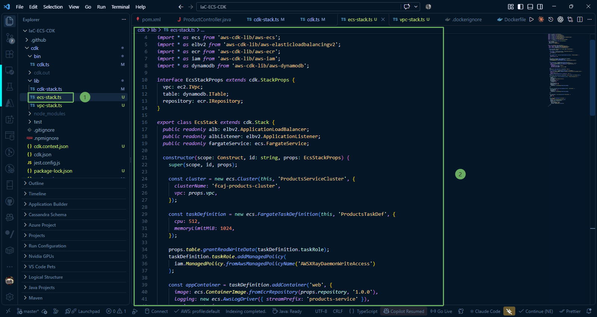

Trong bước này, chúng ta sẽ tìm hiểu về cách đóng gói và khởi chạy container Spring Boot trên **AWS Fargate** (mô hình Serverless Container của Amazon ECS) cùng sidecar **AWS X-Ray daemon** và thiết lập **Internal Application Load Balancer (ALB)** để điều phối tải nội bộ.

---

### 1. Kiến trúc ECS Fargate và Internal ALB

Hạ tầng ứng dụng được thiết kế chạy hoàn toàn trong vùng mạng **Private Subnet with Egress** đã tạo ở bước 4:

* **Amazon ECS Cluster (**fcaj-products-cluster**)**: Cụm quản lý logic cho toàn bộ các dịch vụ và task container.
* **Fargate Task Definition (**ProductsTaskDef**)**: Bản thiết kế mô tả cấu hình container:
  * **CPU**: 512 đơn vị (0.5 vCPU), **Memory**: 1024 MiB (1 GB).
  * **Container chính (**web**)**: Chạy ứng dụng Spring Boot kéo từ kho ECR **fcaj-products-service:1.0.0** (tạo ở bước 3), lắng nghe trên port **8080**, gửi log trực tiếp về CloudWatch Logs.
  * **Container phụ / sidecar (**xray-daemon**)**: Chạy image **public.ecr.aws/xray/aws-xray-daemon:latest**, nhận trace UDP trên port **2000** từ ứng dụng Spring Boot và chuyển tiếp lên AWS X-Ray.
  * **Task Role**: Cấp quyền đọc/ghi dữ liệu DynamoDB và chính sách **AWSXRayDaemonWriteAccess**.
* **ECS Fargate Service (`fcaj-products-service`)**: Đảm bảo luôn có 1 task container hoạt động, tự động phục hồi nếu có sự cố (tính năng **circuit breaker rollback**). Task không gắn Public IP để đảm bảo an toàn tuyệt đối.
* **Internal Application Load Balancer (`InternalAlb`)**: Đặt hoàn toàn trong Private Subnet, lắng nghe trên port **80** và chuyển tiếp lưu lượng vào port **8080** của các task Fargate thông qua cơ chế kiểm tra sức khỏe (**Health check**) tại **actuator/health**.

---

### 2. Viết mã nguồn ECS Stack (`ecs-stack.ts`)

Truy cập vào thư mục **IaC-ECS-CDK/cdk/lib** và mở file **ecs-stack.ts** (hoặc tạo mới nếu chưa có). Chúng ta sẽ lần lượt xây dựng các thành phần của Stack theo từng bước cụ thể dưới đây:

#### 2.1. Khai báo thư viện và Interface Props

Trước hết, import các module AWS CDK cần thiết và định nghĩa interface `EcsStackProps` để nhận các tài nguyên phụ thuộc (`vpc`, `table`, `repository`):

~~~typescript
import * as cdk from 'aws-cdk-lib';
import { Construct } from 'constructs';
import * as ec2 from 'aws-cdk-lib/aws-ec2';
import * as ecs from 'aws-cdk-lib/aws-ecs';
import * as elbv2 from 'aws-cdk-lib/aws-elasticloadbalancingv2';
import * as ecr from 'aws-cdk-lib/aws-ecr';
import * as iam from 'aws-cdk-lib/aws-iam';
import * as dynamodb from 'aws-cdk-lib/aws-dynamodb';

interface EcsStackProps extends cdk.StackProps {
  vpc: ec2.IVpc;
  table: dynamodb.ITable;
  repository: ecr.IRepository;
}

export class EcsStack extends cdk.Stack {
  public readonly alb: elbv2.ApplicationLoadBalancer;
  public readonly albListener: elbv2.ApplicationListener;
  public readonly fargateService: ecs.FargateService;

  constructor(scope: Construct, id: string, props: EcsStackProps) {
    super(scope, id, props);
~~~

#### 2.2. Khởi tạo Amazon ECS Cluster

Tạo cụm quản lý ECS gắn liền với VPC mạng private đã tạo:

~~~typescript
    // 1. Khởi tạo ECS Cluster trên VPC
    const cluster = new ecs.Cluster(this, 'ProductsServiceCluster', {
      clusterName: 'fcaj-products-cluster',
      vpc: props.vpc,
    });
~~~

#### 2.3. Định nghĩa Fargate Task Definition và Phân quyền Task Role

Khởi tạo cấu hình tài nguyên (CPU 512, RAM 1024 MiB), đồng thời phân quyền cho **Task Role** để ứng dụng có quyền truy cập DynamoDB và ghi trace vào AWS X-Ray:

~~~typescript
    // 2. Định nghĩa Fargate Task Definition (CPU 512, RAM 1024 MiB)
    const taskDefinition = new ecs.FargateTaskDefinition(this, 'ProductsTaskDef', {
      cpu: 512,
      memoryLimitMiB: 1024,
    });

    // Cấp quyền đọc/ghi DynamoDB và quyền ghi trace X-Ray cho Task Role
    props.table.grantReadWriteData(taskDefinition.taskRole);
    taskDefinition.taskRole.addManagedPolicy(
      iam.ManagedPolicy.fromAwsManagedPolicyName('AWSXRayDaemonWriteAccess')
    );
~~~

#### 2.4. Thêm Container Spring Boot và Sidecar X-Ray Daemon

Cấu hình 2 container chạy song song trong cùng một Task:
* Container `web`: Kéo image từ ECR repository (tag `1.0.0`), mapping port 8080 và cấu hình đẩy log về CloudWatch.
* Container `xray-daemon`: Sidecar nhận dữ liệu trace qua UDP port 2000.

~~~typescript
    // 3. Thêm Container Spring Boot chính
    const appContainer = taskDefinition.addContainer('web', {
      image: ecs.ContainerImage.fromEcrRepository(props.repository, '1.0.0'),
      logging: new ecs.AwsLogDriver({ streamPrefix: 'products-service' }),
      environment: {
        SPRING_PROFILES_ACTIVE: 'default',
        AWS_REGION: this.region,
        AWS_XRAY_DAEMON_ADDRESS: '127.0.0.1:2000',
      },
    });
    appContainer.addPortMappings({ containerPort: 8080 });

    // 4. Thêm Sidecar Container AWS X-Ray Daemon
    const xrayContainer = taskDefinition.addContainer('xray-daemon', {
      image: ecs.ContainerImage.fromRegistry('public.ecr.aws/xray/aws-xray-daemon:latest'),
      cpu: 32,
      memoryLimitMiB: 256,
      logging: new ecs.AwsLogDriver({ streamPrefix: 'xray' }),
    });
    xrayContainer.addPortMappings({ containerPort: 2000, protocol: ecs.Protocol.UDP });
~~~

#### 2.5. Khởi tạo ECS Fargate Service trong mạng Private

Khởi tạo service duy trì số lượng container mong muốn (`desiredCount: 1`), chạy trong subnet `PRIVATE_WITH_EGRESS` và kích hoạt cơ chế rollback tự động nếu gặp sự cố triển khai:

~~~typescript
    // 5. Khởi tạo ECS Fargate Service trong Private Subnet
    this.fargateService = new ecs.FargateService(this, 'ProductsFargateService', {
      cluster,
      taskDefinition,
      serviceName: 'fcaj-products-service',
      desiredCount: 1,
      assignPublicIp: false,
      circuitBreaker: {
        rollback: true,
      },
      minHealthyPercent: 100,
      maxHealthyPercent: 200,
      vpcSubnets: {
        subnetType: ec2.SubnetType.PRIVATE_WITH_EGRESS,
      },
    });
~~~

#### 2.6. Khởi tạo Internal ALB và Cấu hình Health Check

Tạo bộ cân bằng tải ứng dụng nội bộ (`internetFacing: false`), mở listener port 80 và chuyển tiếp lưu lượng vào port 8080 của service kèm cơ chế kiểm tra sức khỏe tại `/actuator/health`:

~~~typescript
    // 6. Khởi tạo Internal Application Load Balancer
    this.alb = new elbv2.ApplicationLoadBalancer(this, 'InternalAlb', {
      vpc: props.vpc,
      internetFacing: false,
      vpcSubnets: {
        subnetType: ec2.SubnetType.PRIVATE_WITH_EGRESS,
      },
    });

    this.albListener = this.alb.addListener('AlbListener', {
      port: 80,
      open: true,
    });

    // Chuyển tiếp lưu lượng tới ECS Task và cấu hình Health check
    this.albListener.addTargets('EcsTargets', {
      port: 8080,
      protocol: elbv2.ApplicationProtocol.HTTP,
      targets: [this.fargateService],
      healthCheck: {
        path: '/actuator/health',
        healthyHttpCodes: '200',
        interval: cdk.Duration.seconds(30),
      },
    });
  }
}
~~~

#### 2.7. Mã nguồn hoàn chỉnh của `ecs-stack.ts`

Tổng hợp toàn bộ các phần trên, file hoàn chỉnh `ecs-stack.ts` sẽ như sau:

~~~typescript
import * as cdk from 'aws-cdk-lib';
import { Construct } from 'constructs';
import * as ec2 from 'aws-cdk-lib/aws-ec2';
import * as ecs from 'aws-cdk-lib/aws-ecs';
import * as elbv2 from 'aws-cdk-lib/aws-elasticloadbalancingv2';
import * as ecr from 'aws-cdk-lib/aws-ecr';
import * as iam from 'aws-cdk-lib/aws-iam';
import * as dynamodb from 'aws-cdk-lib/aws-dynamodb';

interface EcsStackProps extends cdk.StackProps {
  vpc: ec2.IVpc;
  table: dynamodb.ITable;
  repository: ecr.IRepository;
}

export class EcsStack extends cdk.Stack {
  public readonly alb: elbv2.ApplicationLoadBalancer;
  public readonly albListener: elbv2.ApplicationListener;
  public readonly fargateService: ecs.FargateService;

  constructor(scope: Construct, id: string, props: EcsStackProps) {
    super(scope, id, props);

    const cluster = new ecs.Cluster(this, 'ProductsServiceCluster', {
      clusterName: 'fcaj-products-cluster',
      vpc: props.vpc,
    });

    const taskDefinition = new ecs.FargateTaskDefinition(this, 'ProductsTaskDef', {
      cpu: 512,
      memoryLimitMiB: 1024,
    });

    props.table.grantReadWriteData(taskDefinition.taskRole);
    taskDefinition.taskRole.addManagedPolicy(
      iam.ManagedPolicy.fromAwsManagedPolicyName('AWSXRayDaemonWriteAccess')
    );

    const appContainer = taskDefinition.addContainer('web', {
      image: ecs.ContainerImage.fromEcrRepository(props.repository, '1.0.0'),
      logging: new ecs.AwsLogDriver({ streamPrefix: 'products-service' }),
      environment: {
        SPRING_PROFILES_ACTIVE: 'default',
        AWS_REGION: this.region,
        AWS_XRAY_DAEMON_ADDRESS: '127.0.0.1:2000',
      },
    });
    appContainer.addPortMappings({ containerPort: 8080 });

    const xrayContainer = taskDefinition.addContainer('xray-daemon', {
      image: ecs.ContainerImage.fromRegistry('public.ecr.aws/xray/aws-xray-daemon:latest'),
      cpu: 32,
      memoryLimitMiB: 256,
      logging: new ecs.AwsLogDriver({ streamPrefix: 'xray' }),
    });
    xrayContainer.addPortMappings({ containerPort: 2000, protocol: ecs.Protocol.UDP });

    this.fargateService = new ecs.FargateService(this, 'ProductsFargateService', {
      cluster,
      taskDefinition,
      serviceName: 'fcaj-products-service',
      desiredCount: 1,
      assignPublicIp: false,
      circuitBreaker: {
        rollback: true,
      },
      minHealthyPercent: 100,
      maxHealthyPercent: 200,
      vpcSubnets: {
        subnetType: ec2.SubnetType.PRIVATE_WITH_EGRESS,
      },
    });

    this.alb = new elbv2.ApplicationLoadBalancer(this, 'InternalAlb', {
      vpc: props.vpc,
      internetFacing: false,
      vpcSubnets: {
        subnetType: ec2.SubnetType.PRIVATE_WITH_EGRESS,
      },
    });

    this.albListener = this.alb.addListener('AlbListener', {
      port: 80,
      open: true,
    });

    this.albListener.addTargets('EcsTargets', {
      port: 8080,
      protocol: elbv2.ApplicationProtocol.HTTP,
      targets: [this.fargateService],
      healthCheck: {
        path: '/actuator/health',
        healthyHttpCodes: '200',
        interval: cdk.Duration.seconds(30),
      },
    });
  }
}
~~~

---

### 3. Giải thích chi tiết các thuộc tính quan trọng

* **assignPublicIp: false**: Đảm bảo container không có địa chỉ IP công khai, loại bỏ hoàn toàn nguy cơ bị tấn công trực tiếp từ bên ngoài Internet.
* **circuitBreaker: { rollback: true }**: Cơ chế tự động phát hiện triển khai thất bại (ví dụ: container crash-loop hoặc không pass health check) và rollback về phiên bản task definition ổn định trước đó.
* **healthCheck: { path: '/actuator/health' }**: Load balancer định kỳ gửi yêu cầu HTTP GET tới endpoint của Spring Boot Actuator mỗi 30 giây. Khi nhận được mã phản hồi 200 OK, container mới được đánh dấu là Healthy để tiếp nhận lưu lượng truy cập.
* **public readonly albListener**: Listener này sẽ được export ra ngoài để truyền vào Stack Network Load Balancer (NLB) ở bước tiếp theo nhằm hoàn thiện đường dẫn VPC Link.

