After defining **EcsStack**, the next step is to build the **Network Load Balancer (NLB)** placed in front of the ALB to act as the reception point for the API Gateway VPC Link in subsequent steps, interconnect the Stacks in `bin/cdk.ts`, and proceed with deployment to AWS.

---

### 1. Role of Network Load Balancer in the Architecture

In the enterprise-grade secure microservices architecture on AWS:
* **ALB** operates at the application layer (Layer 7), responsible for HTTP path routing and managing Spring Boot application health checks.
* **NLB** operates at the transport layer (Layer 4), providing extreme performance, ultra-low latency, and acting as an ideal target for **VPC Link** from API Gateway into the private network.
* By combining **NLB -> ALB -> ECS Fargate**, the system optimizes private connection performance while taking full advantage of the rich routing capabilities of the Application Load Balancer.

---

### 2. Write NLB Stack Source Code (`nlb-stack.ts`)

Navigate to the directory **IaC-ECS-CDK/cdk/lib** and open the file **nlb-stack.ts** (or create it if not present). Update the contents defining `NlbStack`:

~~~typescript
import * as cdk from 'aws-cdk-lib';
import { Construct } from 'constructs';
import * as ec2 from 'aws-cdk-lib/aws-ec2';
import * as elbv2 from 'aws-cdk-lib/aws-elasticloadbalancingv2';
import * as targets from 'aws-cdk-lib/aws-elasticloadbalancingv2-targets';

interface NlbStackProps extends cdk.StackProps {
  vpc: ec2.IVpc;
  albListener: elbv2.ApplicationListener;
}

export class NlbStack extends cdk.Stack {
  public readonly nlb: elbv2.NetworkLoadBalancer;
  public readonly listener: elbv2.NetworkListener;

  constructor(scope: Construct, id: string, props: NlbStackProps) {
    super(scope, id, props);

    // 1. Create explicit Security Group for NLB
    const nlbSecurityGroup = new ec2.SecurityGroup(this, 'NlbSecurityGroup', {
      vpc: props.vpc,
      description: 'Security group for internal Network Load Balancer',
      allowAllOutbound: true, // Allow NLB to send health check and traffic to ALB
    });

    // Open port 80 allowing the entire VPC network range to connect (API Gateway VPC Link)
    nlbSecurityGroup.addIngressRule(
      ec2.Peer.ipv4(props.vpc.vpcCidrBlock),
      ec2.Port.tcp(80),
      'Allow HTTP from VPC (API Gateway VPC Link)'
    );

    // 2. Initialize internal NLB and assign explicit Security Group
    this.nlb = new elbv2.NetworkLoadBalancer(this, 'InternalNlb', {
      vpc: props.vpc,
      internetFacing: false, // Internal NLB
      securityGroups: [nlbSecurityGroup],
      vpcSubnets: {
        subnetType: ec2.SubnetType.PRIVATE_WITH_EGRESS,
      },
    });

    // 3. Add port 80 Listener for NLB
    this.listener = this.nlb.addListener('NlbListener', {
      port: 80,
    });

    // 4. Forward requests from NLB to Application Load Balancer Listener
    this.listener.addTargets('NlbToAlbTargets', {
      port: 80,
      targets: [new targets.AlbListenerTarget(props.albListener)],
      healthCheck: {
        protocol: elbv2.Protocol.HTTP,
        port: '80',
        path: '/actuator/health',
        healthyHttpCodes: '200',
      },
    });
  }
}
~~~

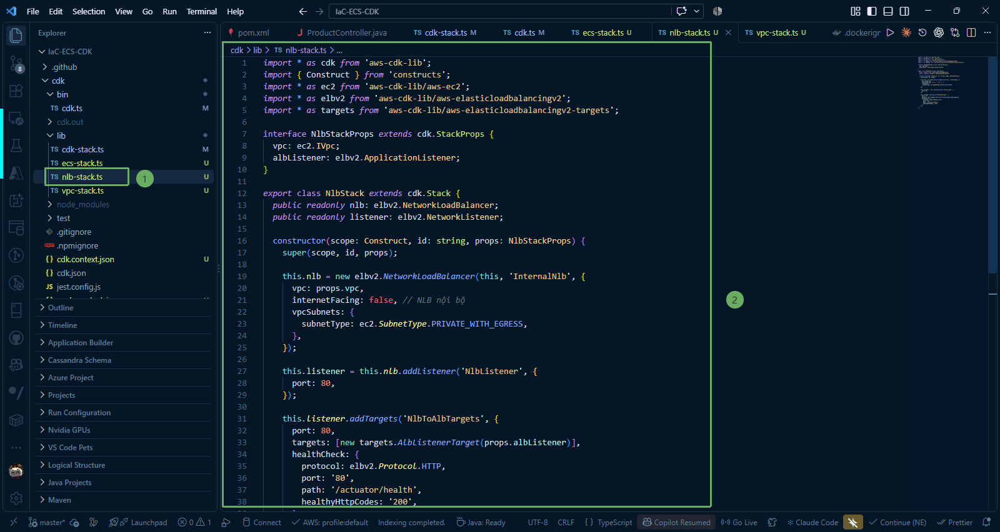

---

### 3. Organize and Connect Stacks in `bin/cdk.ts`

Open the file **bin/cdk.ts** in VS Code to register and connect the Stacks together:

~~~typescript
#!/usr/bin/env node
import * as cdk from 'aws-cdk-lib';
import { CdkStack } from '../lib/cdk-stack';
import { VpcStack } from '../lib/vpc-stack';
import { EcsStack } from '../lib/ecs-stack';
import { DynamoDbStack } from '../lib/dynamodb-stack';
import { NlbStack } from '../lib/nlb-stack';

const app = new cdk.App();
const env: cdk.Environment = {
  account: process.env.CDK_DEFAULT_ACCOUNT,
  region: process.env.CDK_DEFAULT_REGION ?? 'ap-southeast-1',
};

// 1. ECR Stack
const ecrStack = new CdkStack(app, 'ProductsServiceEcrStack', { env });

// 2. VPC Stack
const vpcStack = new VpcStack(app, 'ProductsServiceVpcStack', { env });

// 3. DynamoDB Stack
const dynamoStack = new DynamoDbStack(app, 'ProductsServiceDynamoDbStack', { env });

// 4. ECS Fargate Stack (Receives parameters from VPC, DynamoDB, and ECR)
const ecsStack = new EcsStack(app, 'ProductsServiceEcsStack', {
  env,
  vpc: vpcStack.vpc,
  table: dynamoStack.table,
  repository: ecrStack.repository,
});

// 5. NLB Stack (Receives VPC and listener from ECS Stack)
const nlbStack = new NlbStack(app, 'ProductsServiceNlbStack', {
  env,
  vpc: vpcStack.vpc,
  albListener: ecsStack.albListener,
});
~~~

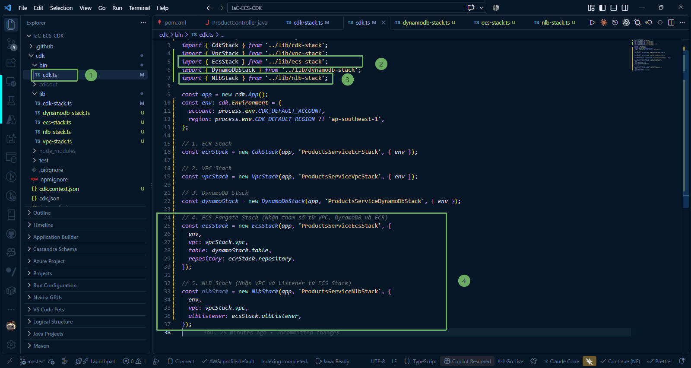

---

### 4. Compile and Check Source Code

1. Run the build command to check TypeScript syntax errors:

~~~powershell
npm run build
~~~

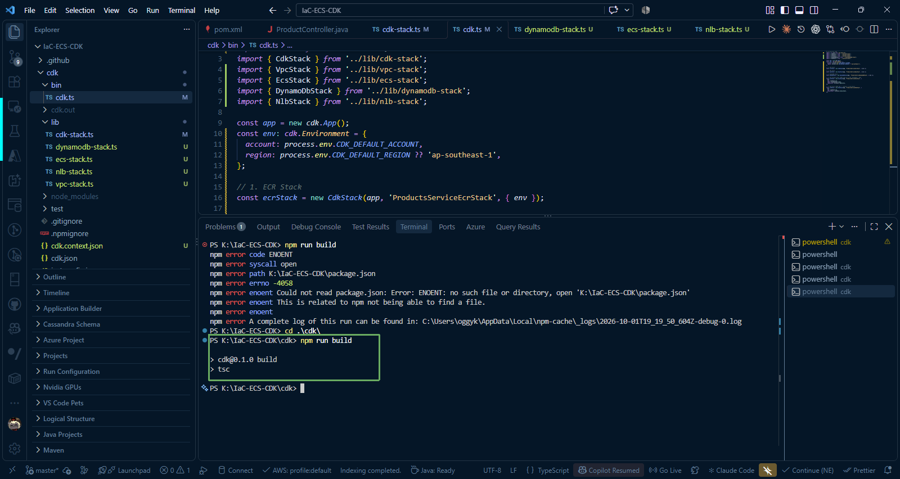

2. Check the list of registered Stacks:

~~~powershell
npx cdk list
~~~

or 

~~~powershell
cdk list
~~~

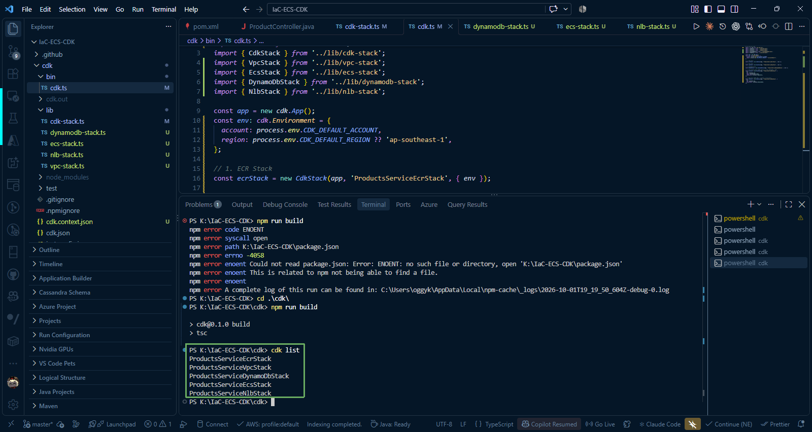

---

### 5. Deploy Stacks to AWS (`cdk deploy`)

Run the command to deploy all necessary stacks simultaneously:

~~~powershell
npx cdk deploy ProductsServiceDynamoDbStack ProductsServiceEcsStack ProductsServiceNlbStack --require-approval never
~~~

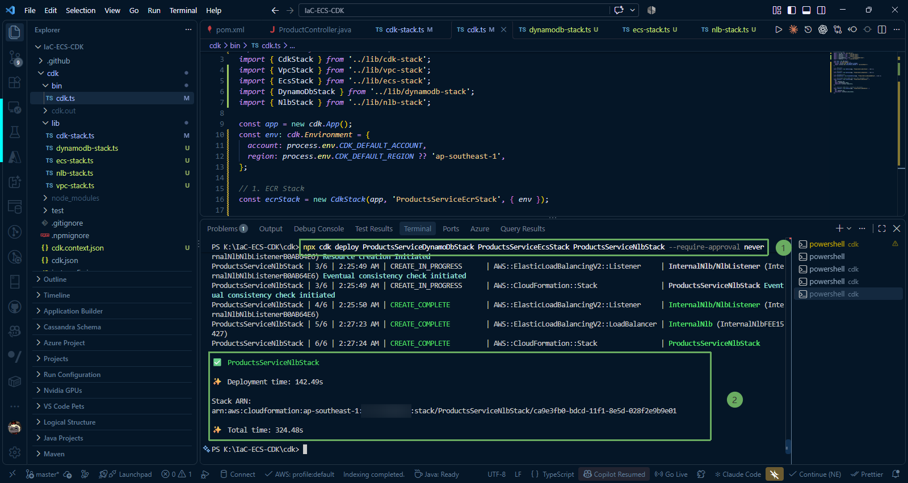

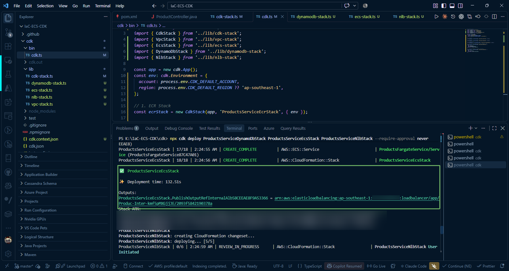

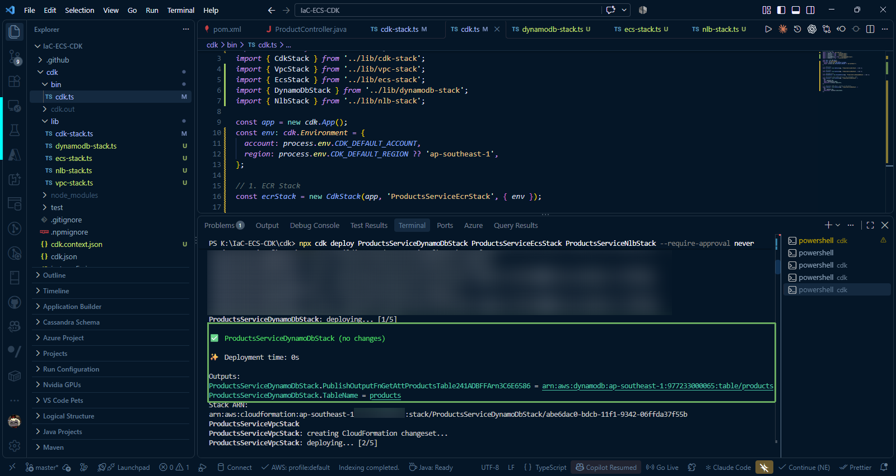

{}
AWS CDK will automatically analyze the dependency graph to deploy in the correct order: DynamoDB -> ECS Fargate -> NLB. This process typically takes about **3 to 5 minutes** to launch the Fargate cluster and configure the Load Balancers.
{}

---

### 6. Check Resources on AWS Management Console

#### Check CloudFormation has successfully created ecs, dynamodb, nlb stacks.

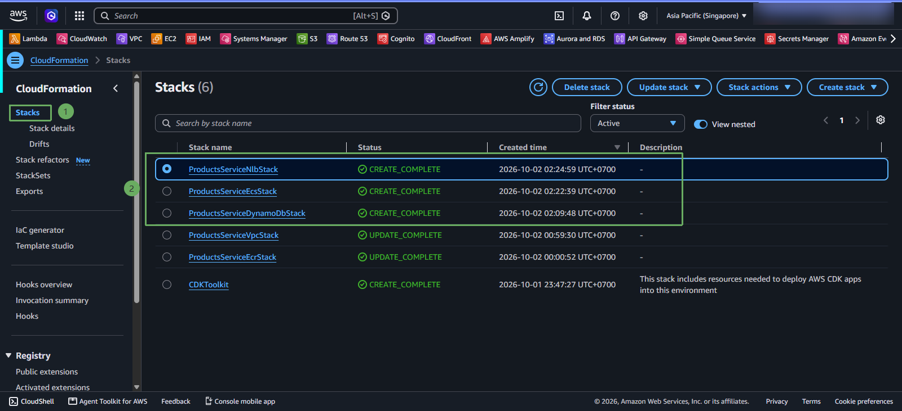

#### 1. Check Amazon ECS Cluster and Service

1. Sign in to the [AWS Management Console](https://console.aws.amazon.com/) > select **Elastic Container Service (ECS)**.
2. Click on the cluster **`fcaj-products-cluster`**.
3. Under the **Services** tab, you will see the service **`fcaj-products-service`** with status **Active** and **Running tasks: 1/1**.

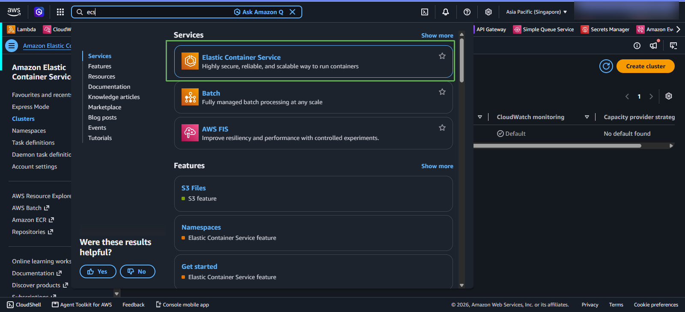

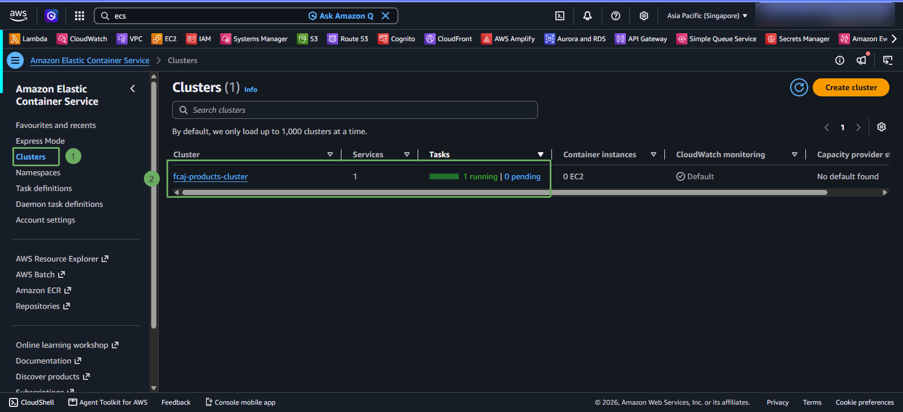

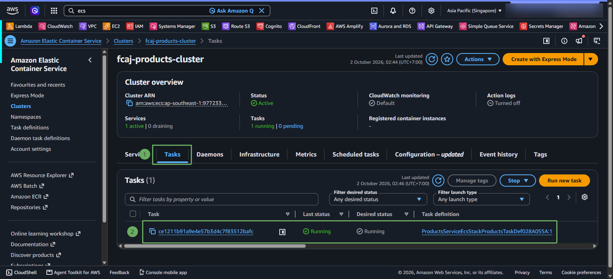

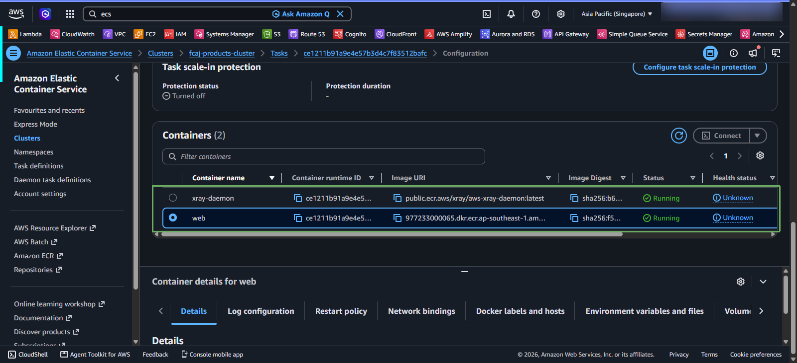

4. Switch to the **Tasks** / **Task definitions** tab and click on the running Task. Check the **Containers** section:
   * Container **`web`**: Runs the Spring Boot image, port **8080**.
   * Container **`xray-daemon`**: Runs the X-Ray sidecar, port **2000** UDP.

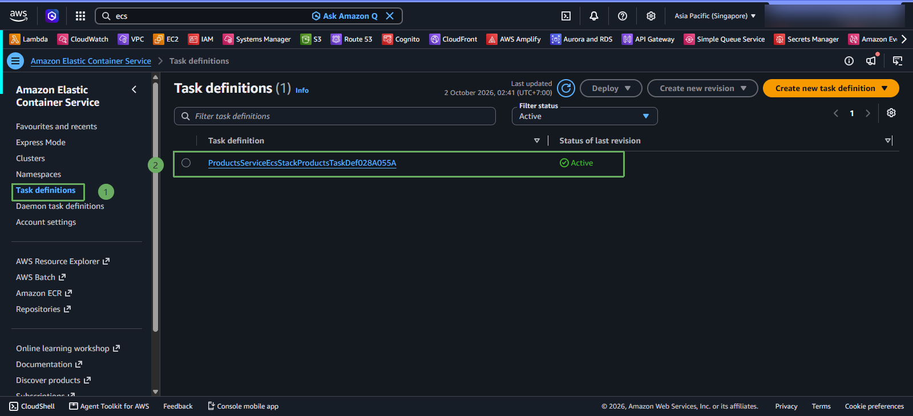

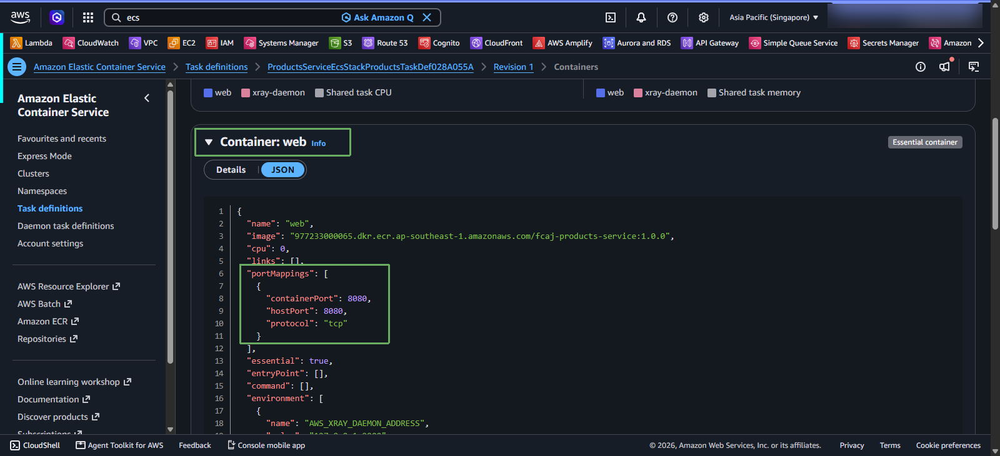

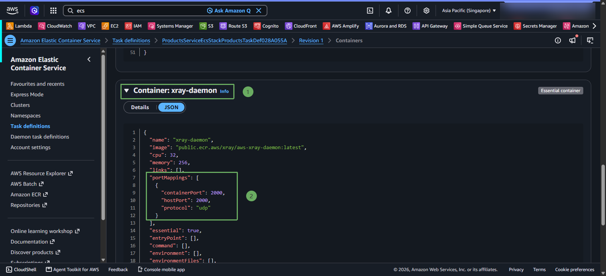

#### 2. Check Load Balancers (ALB and NLB)

Go to the **EC2** service > select **Load Balancers** from the left menu. You will see 2 internal load balancers:
* **`InternalAlb`**: Type `application`, scheme `internal`.
* **`InternalNlb`**: Type `network`, scheme `internal`.

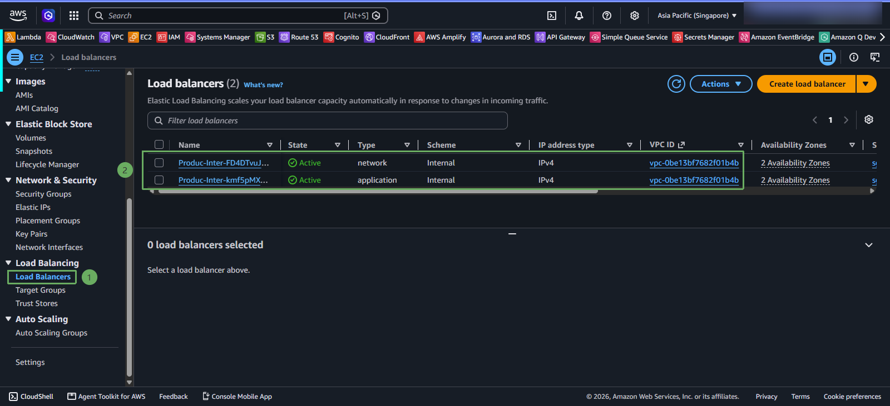

#### 3. Check Target Groups and Health Check

Go to the **Target groups** section in the left menu:
* Select the Target Group of **Internal ALB** (port `8080`) > check the **Targets** tab: Status of the Fargate Task is **Healthy** (passed the health check `/actuator/health`).
* Select the Target Group of **Internal NLB** (port `80`) > check the **Targets** tab: Status of the ALB target is **Healthy**.

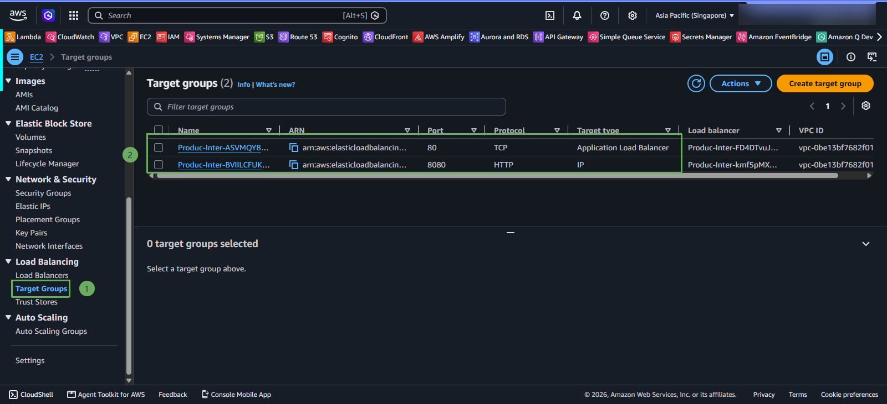

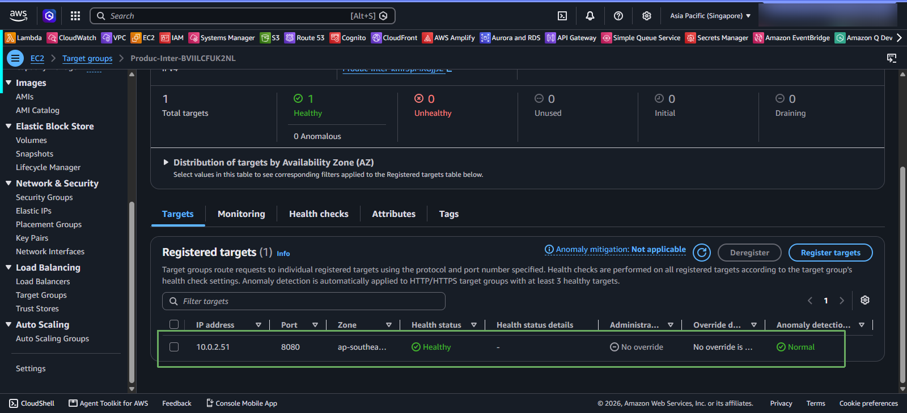

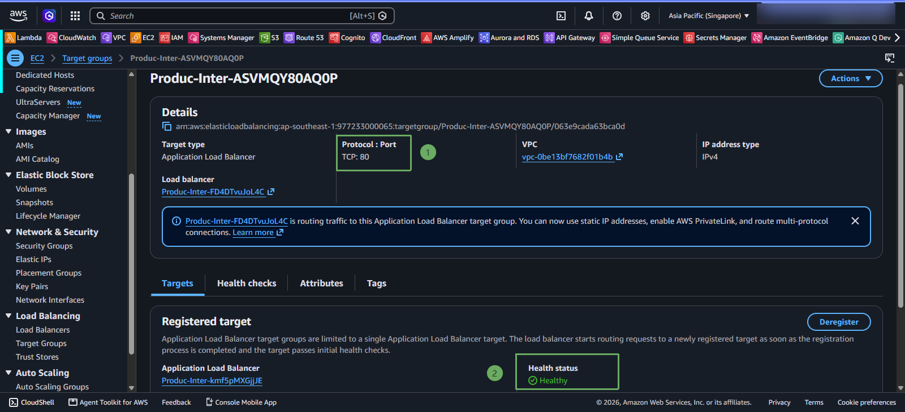

### In case of encountering unhealthy error on port 80 of the target group

{}
In case of encountering an unhealthy error on port 80 of the target group, you need to check and ensure the security group of the NLB has the following inbound and outbound rules:
* inbound rules: Type: HTTP, Port: 80, Source: 0.0.0.0/0
* outbound rules: All traffic, Destination: Anywhere-IPv4 (0.0.0.0/0) (or specify the VPC CIDR range 10.0.0.0/16)
{}

{}
Congratulations! You have completed deploying the Spring Boot application running on the serverless Amazon ECS Fargate cluster with 2 containers (App + X-Ray Daemon), securely connected via Internal Application Load Balancer and Network Load Balancer. This infrastructure is ready to integrate with API Gateway in step 7!
{}
