Sau khi đã định nghĩa **EcsStack**, bước tiếp theo là xây dựng **Network Load Balancer (NLB)** đặt phía trước ALB để làm điểm tiếp nhận cho API Gateway VPC Link ở các bước sau, liên kết các Stack trong `bin/cdk.ts` và tiến hành triển khai lên AWS.

---

### 1. Vai trò của Network Load Balancer trong kiến trúc

Trong mô hình kiến trúc microservices bảo mật chuẩn doanh nghiệp trên AWS:
* **ALB** hoạt động ở tầng ứng dụng (Layer 7), chịu trách nhiệm routing theo path HTTP, quản lý health check ứng dụng Spring Boot.
* **NLB** hoạt động ở tầng truyền vận (Layer 4), cung cấp hiệu năng cực cao, độ trễ siêu thấp và đóng vai trò là đích đến (target) lý tưởng cho **VPC Link** từ API Gateway đi vào mạng private.
* Bằng cách kết hợp **NLB -> ALB -> ECS Fargate**, hệ thống vừa tối ưu hóa hiệu năng kết nối private, vừa tận dụng được khả năng định tuyến phong phú của Application Load Balancer.

---

### 2. Viết mã nguồn NLB Stack (`nlb-stack.ts`)

Truy cập vào thư mục **IaC-ECS-CDK/cdk/lib** và mở file **nlb-stack.ts** (hoặc tạo mới nếu chưa có). Cập nhật nội dung định nghĩa `NlbStack`:

~~~typescript
import * as cdk from 'aws-cdk-lib';
import { Construct } from 'constructs';
import * as ec2 from 'aws-cdk-lib/aws-ec2';
import * as elbv2 from 'aws-cdk-lib/aws-elasticloadbalancingv2';
import * as targets from 'aws-cdk-lib/aws-elasticloadbalancingv2-targets';

interface NlbStackProps extends cdk.StackProps {
  vpc: ec2.IVpc;
  albListener: elbv2.ApplicationListener;
}

export class NlbStack extends cdk.Stack {
  public readonly nlb: elbv2.NetworkLoadBalancer;
  public readonly listener: elbv2.NetworkListener;

  constructor(scope: Construct, id: string, props: NlbStackProps) {
    super(scope, id, props);

    // 1. Tạo Security Group tường minh cho NLB
    const nlbSecurityGroup = new ec2.SecurityGroup(this, 'NlbSecurityGroup', {
      vpc: props.vpc,
      description: 'Security group for internal Network Load Balancer',
      allowAllOutbound: true, // Cho phép NLB gửi health check và traffic sang ALB
    });

    // Mở port 80 cho phép toàn bộ dải mạng VPC kết nối vào (API Gateway VPC Link)
    nlbSecurityGroup.addIngressRule(
      ec2.Peer.ipv4(props.vpc.vpcCidrBlock),
      ec2.Port.tcp(80),
      'Allow HTTP from VPC (API Gateway VPC Link)'
    );

    // 2. Khởi tạo NLB nội bộ và gán Security Group tường minh
    this.nlb = new elbv2.NetworkLoadBalancer(this, 'InternalNlb', {
      vpc: props.vpc,
      internetFacing: false, // NLB nội bộ
      securityGroups: [nlbSecurityGroup],
      vpcSubnets: {
        subnetType: ec2.SubnetType.PRIVATE_WITH_EGRESS,
      },
    });

    // 3. Thêm Listener port 80 cho NLB
    this.listener = this.nlb.addListener('NlbListener', {
      port: 80,
    });

    // 4. Chuyển tiếp request từ NLB tới Application Load Balancer Listener
    this.listener.addTargets('NlbToAlbTargets', {
      port: 80,
      targets: [new targets.AlbListenerTarget(props.albListener)],
      healthCheck: {
        protocol: elbv2.Protocol.HTTP,
        port: '80',
        path: '/actuator/health',
        healthyHttpCodes: '200',
      },
    });
  }
}
~~~

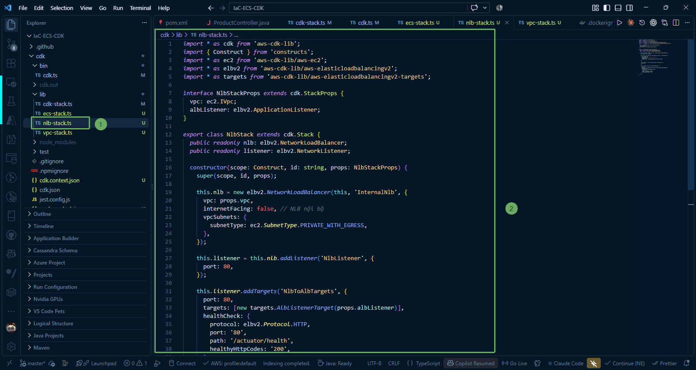

---

### 3. Tổ chức và kết nối các Stack trong `bin/cdk.ts`

Mở file **bin/cdk.ts** trong VS Code để đăng ký và kết nối các Stack lại với nhau:

~~~typescript
#!/usr/bin/env node
import * as cdk from 'aws-cdk-lib';
import { CdkStack } from '../lib/cdk-stack';
import { VpcStack } from '../lib/vpc-stack';
import { EcsStack } from '../lib/ecs-stack';
import { DynamoDbStack } from '../lib/dynamodb-stack';
import { NlbStack } from '../lib/nlb-stack';

const app = new cdk.App();
const env: cdk.Environment = {
  account: process.env.CDK_DEFAULT_ACCOUNT,
  region: process.env.CDK_DEFAULT_REGION ?? 'ap-southeast-1',
};

// 1. ECR Stack
const ecrStack = new CdkStack(app, 'ProductsServiceEcrStack', { env });

// 2. VPC Stack
const vpcStack = new VpcStack(app, 'ProductsServiceVpcStack', { env });

// 3. DynamoDB Stack
const dynamoStack = new DynamoDbStack(app, 'ProductsServiceDynamoDbStack', { env });

// 4. ECS Fargate Stack (Nhận tham số từ VPC, DynamoDB và ECR)
const ecsStack = new EcsStack(app, 'ProductsServiceEcsStack', {
  env,
  vpc: vpcStack.vpc,
  table: dynamoStack.table,
  repository: ecrStack.repository,
});

// 5. NLB Stack (Nhận VPC và listener từ ECS Stack)
const nlbStack = new NlbStack(app, 'ProductsServiceNlbStack', {
  env,
  vpc: vpcStack.vpc,
  albListener: ecsStack.albListener,
});
~~~

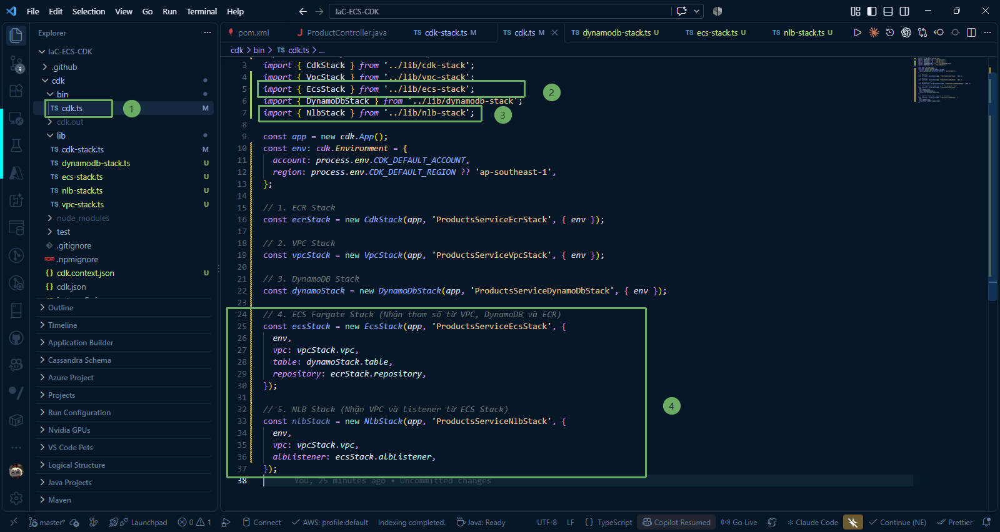

---

### 4. Biên dịch và kiểm tra mã nguồn

1. Chạy lệnh build kiểm tra lỗi cú pháp TypeScript:

~~~powershell
npm run build
~~~

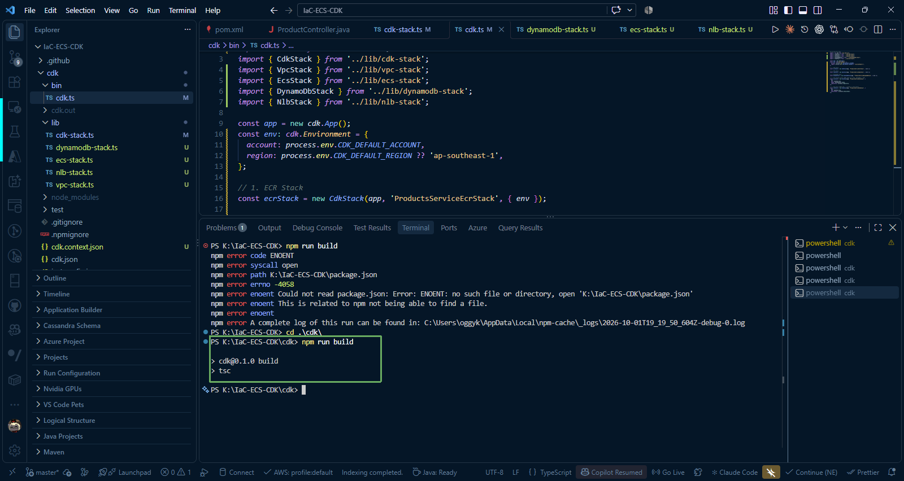

2. Kiểm tra danh sách các Stack đã đăng ký:

~~~powershell
npx cdk list
~~~

hoặc 

~~~powershell
cdk list
~~~

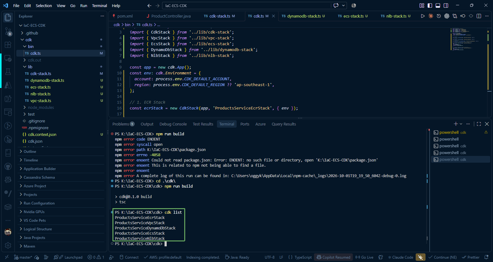

---

### 5. Triển khai các Stack lên AWS (`cdk deploy`)

Chạy lệnh triển khai đồng thời các stack cần thiết:

~~~powershell
npx cdk deploy ProductsServiceDynamoDbStack ProductsServiceEcsStack ProductsServiceNlbStack --require-approval never
~~~

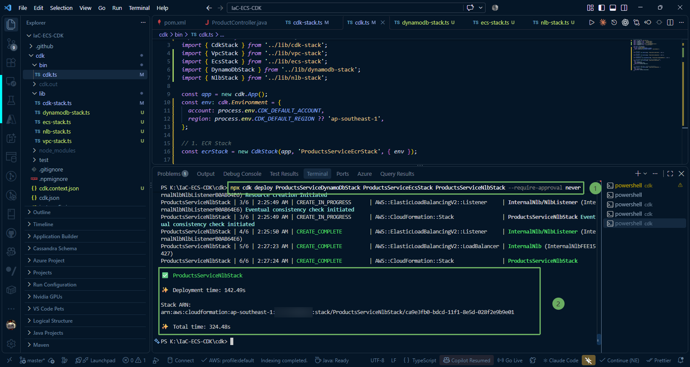

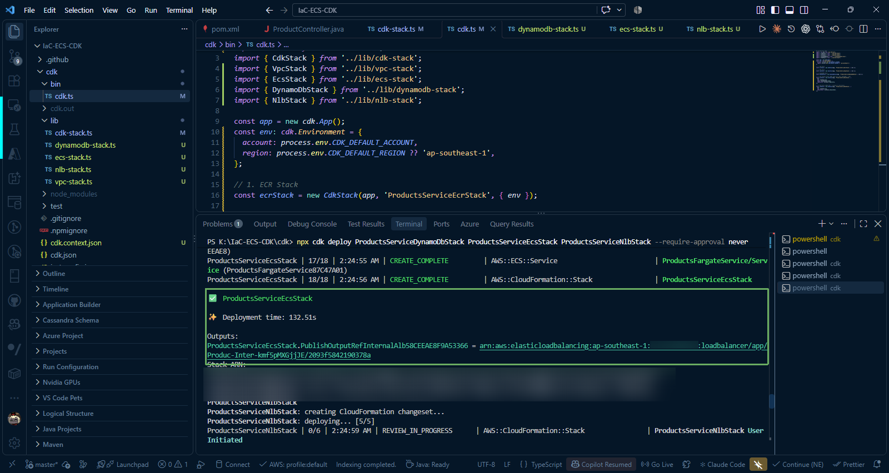

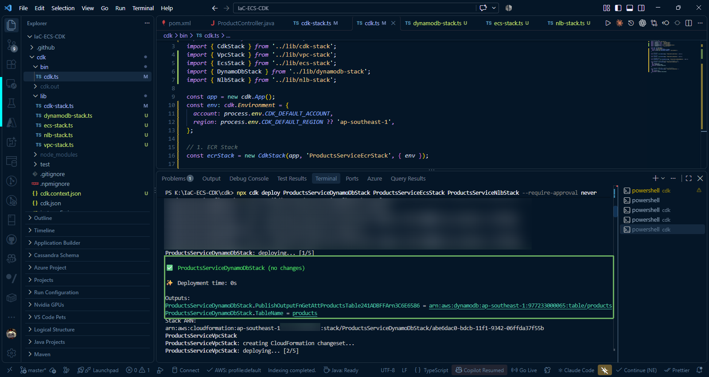

{}
AWS CDK sẽ tự động phân tích cây phụ thuộc (dependency graph) để triển khai theo đúng thứ tự: DynamoDB -> ECS Fargate -> NLB. Quá trình này thường mất khoảng **3 đến 5 phút** để khởi động cụm Fargate và thiết lập các Load Balancers.
{}

---

### 6. Kiểm tra tài nguyên trên AWS Management Console

#### Kiểm tra CloudFormation đã tạo thành công ecs, dynamodb, nlb stack.

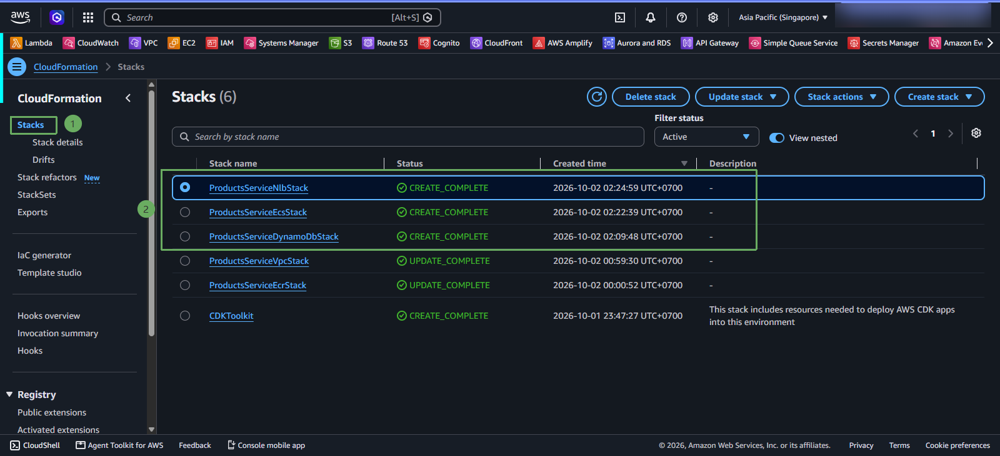

#### 1. Kiểm tra Amazon ECS Cluster và Service

1. Đăng nhập vào [AWS Management Console](https://console.aws.amazon.com/) > chọn dịch vụ **Elastic Container Service (ECS)**.
2. Nhấp vào cluster **`fcaj-products-cluster`**.
3. Tại tab **Services**, bạn sẽ thấy service **`fcaj-products-service`** có trạng thái **Active** và **Running tasks: 1/1**.

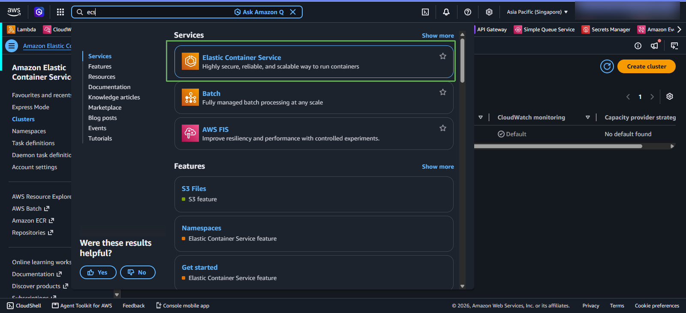

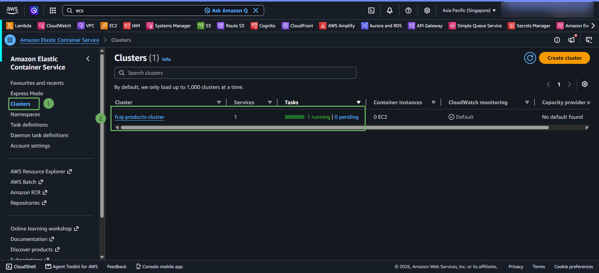

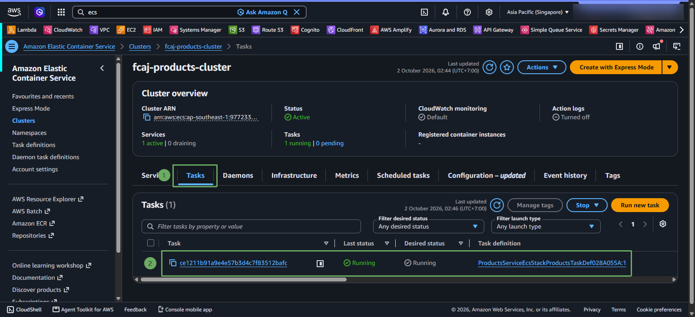

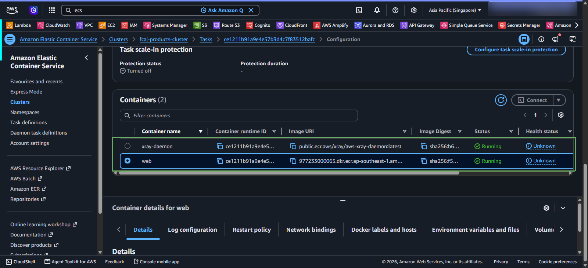

4. Chuyển sang tab **Tasks definitions** và nhấp vào Task đang chạy. Kiểm tra mục **Containers**:
   * Container **`web`**: Chạy image Spring Boot, port **8080**.
   * Container **`xray-daemon`**: Chạy sidecar X-Ray, port **2000** UDP.

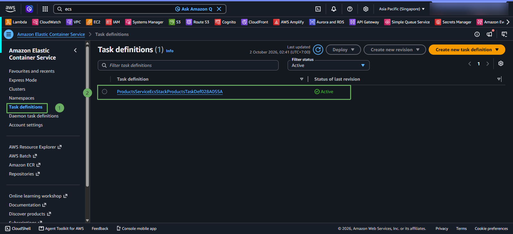

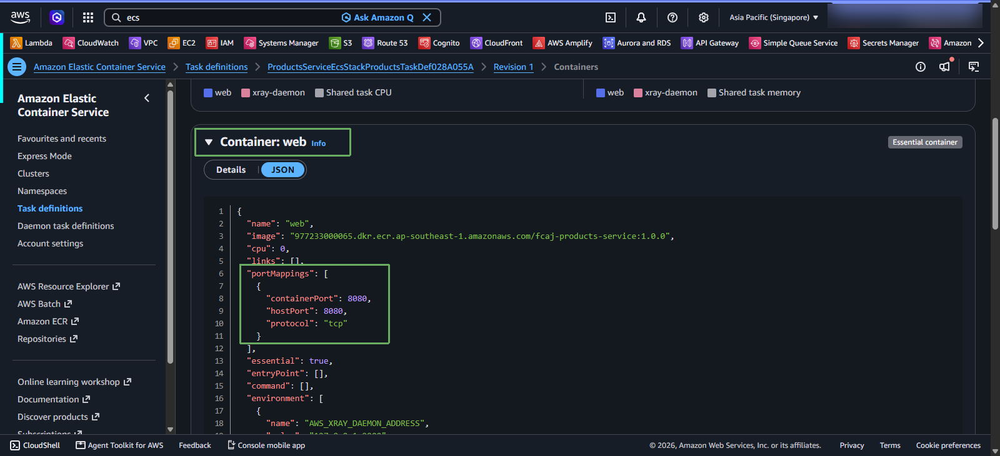

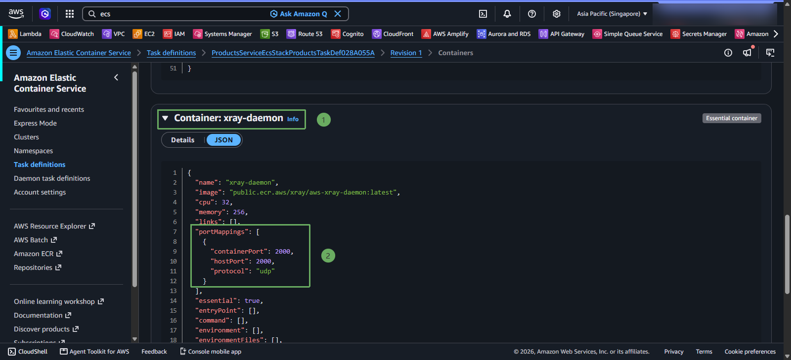

#### 2. Kiểm tra Load Balancers (ALB và NLB)

Vào dịch vụ **EC2** > chọn mục **Load Balancers** ở menu bên trái. Bạn sẽ thấy 2 bộ cân bằng tải nội bộ:
* **`InternalAlb`**: Loại `application`, scheme `internal`.
* **`InternalNlb`**: Loại `network`, scheme `internal`.

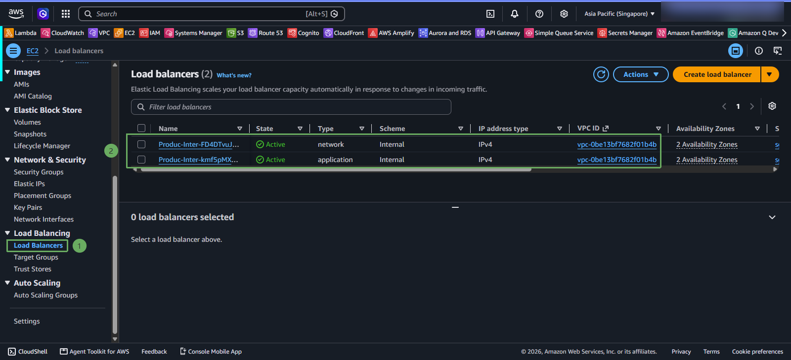

#### 3. Kiểm tra Target Groups và Health Check

Vào mục **Target groups** ở menu bên trái:
* Chọn Target Group của **Internal ALB** (port `8080`) > kiểm tra tab **Targets**: Trạng thái của Fargate Task là **Healthy** (đã vượt qua health check `/actuator/health`).
* Chọn Target Group của **Internal NLB** (port `80`) > kiểm tra tab **Targets**: Trạng thái đích ALB là **Healthy**.

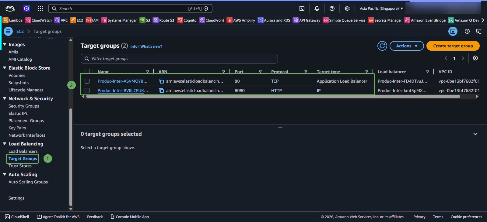

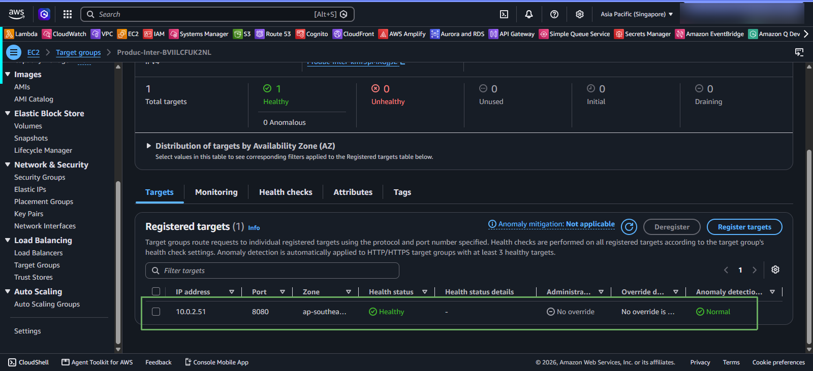

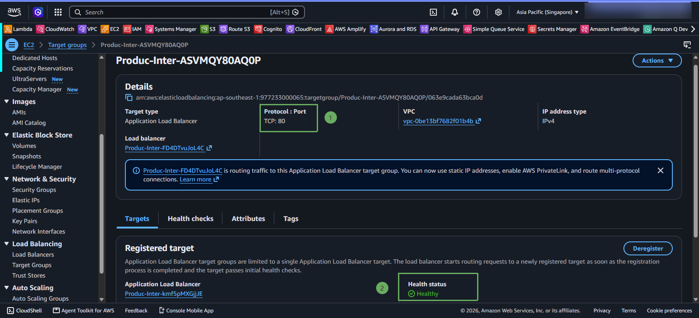

### Trong trường hợp gặp lỗi unhealthy ở port 80 của target group

{}
Trong trường hợp gặp lỗi unhealthy ở port 80 của target group, bạn cần kiểm tra và đảm bảo security group của Nlb có inbound và outbound rule như sau:
* inbound rules: Type: HTTP, Port: 80, Source: 0.0.0.0/0
* outbound rules: All traffic, Destination: Anywhere-IPv4 (0.0.0.0/0) (hoặc điền dải CIDR VPC 10.0.0.0/16)
{}

{}
Chúc mừng bạn! Bạn đã hoàn thành việc triển khai ứng dụng Spring Boot chạy trên cụm Amazon ECS Fargate không máy chủ với 2 container (App + X-Ray Daemon), kết nối an toàn qua Internal Application Load Balancer và Network Load Balancer. Hạ tầng này đã sẵn sàng để tích hợp với API Gateway ở bước 7!
{}
