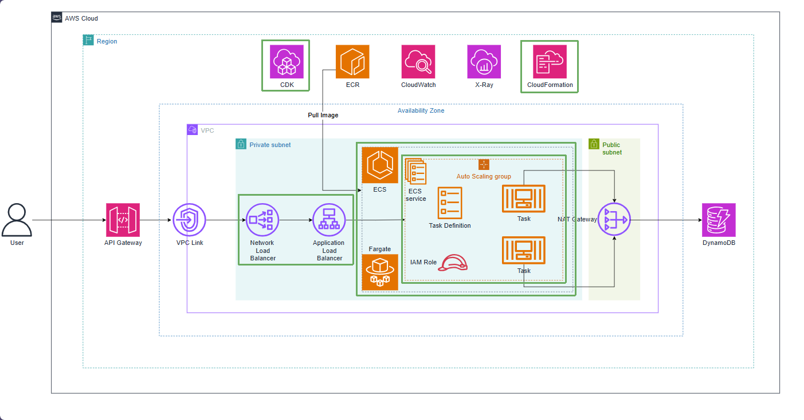

# Run the application with ECS Fargate

EcsStack creates the ECS cluster, Fargate task definition, Spring Boot container, X-Ray sidecar and ECS service. The task definition specifies 512 CPU units, 1024 MiB memory, port 8080, the CloudWatch log driver and ECR image tag 1.0.0.

The task role can read and write the DynamoDB table and write X-Ray traces. The execution role is used for startup operations such as pulling the image and sending logs.

The service runs one task in private subnets without a public IP. The deployment circuit breaker rolls back a failed deployment. The internal ALB listens on port 80 and forwards traffic to port 8080 on the task.

The health check calls GET /actuator/health. If a task is RUNNING but the target is unhealthy, inspect CloudWatch logs, port 8080, the health endpoint, security groups and subnet routes.

NlbStack creates an internal NLB in front of the ALB. The NLB uses AlbListenerTarget so the listener dependency is explicit. The NLB is the VPC Link entry point; it does not replace the ALB's HTTP routing role.

