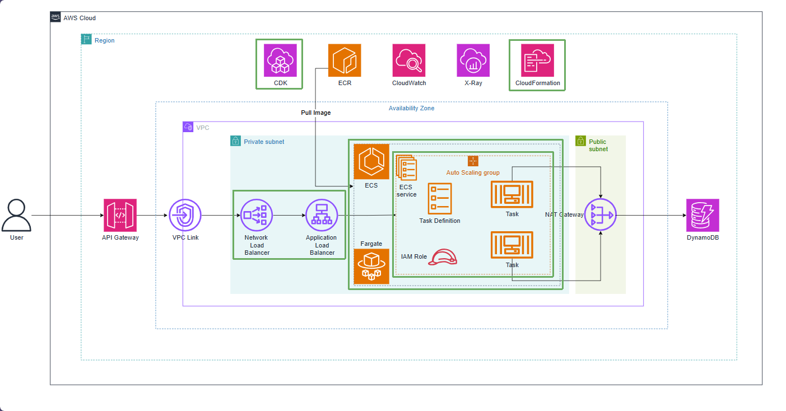

# Chạy ứng dụng bằng ECS Fargate

EcsStack tạo ECS cluster, Fargate task definition, container Spring Boot, X-Ray sidecar và ECS service. Task definition mô tả CPU 512, memory 1024 MiB, container port 8080, log driver và image ECR tag 1.0.0.

Task role được cấp quyền đọc/ghi bảng DynamoDB và quyền ghi trace X-Ray. Execution role do CDK dùng cho các thao tác khởi động task như pull image và gửi log.

ECS service chạy một task trong private subnet, không gán public IP. Deployment circuit breaker được bật để rollback nhanh nếu task không thể khởi động. ALB internal có listener HTTP port 80 và target group chuyển request tới port 8080 của task.

Health check dùng GET /actuator/health. Nếu task ở trạng thái RUNNING nhưng target unhealthy, hãy kiểm tra CloudWatch logs, port 8080, health endpoint, security group và route của subnet.

NlbStack tạo internal NLB ở phía trước ALB. NLB dùng AlbListenerTarget để tạo dependency đúng tới ALB listener. NLB không thay ALB xử lý HTTP; nó là điểm vào cho API Gateway VPC Link trong kiến trúc enterprise.

