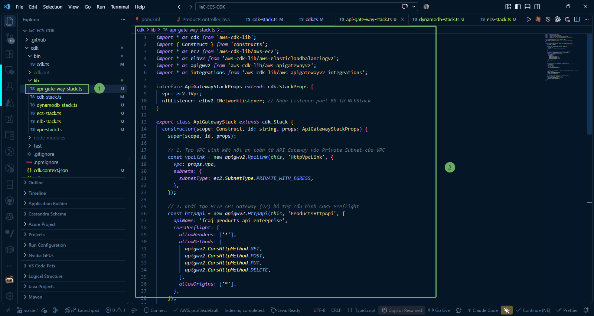

In this section, we explore the secure architectural pattern connecting **Amazon API Gateway** into a private corporate network via **VPC Link**, and write the TypeScript source code for `ApiGatewayStack` using AWS CDK.

---

### 1. Role of API Gateway and VPC Link in Enterprise Architecture

In modern, production-grade microservices architectures on AWS:
* **Zero Trust & Private Isolation**:
  * Backend services such as **ECS Fargate**, **DynamoDB**, and internal load balancers (**ALB/NLB**) reside strictly in **Private Subnets** with no assigned public IP addresses.
  * Eliminating public IPs protects your internal application tiers from direct internet scanning, DDoS, and perimeter attacks.
* **What is a VPC Link?**
  * **VPC Link** is a specialized feature of Amazon API Gateway. When initialized, VPC Link provisions Elastic Network Interfaces (ENIs) inside the designated private subnets of your VPC.
  * Through these ENIs, API Gateway creates a secure private tunnel to route external requests directly to internal resources, specifically the **Network Load Balancer (NLB)**.
* **Why HTTP API (v2) over REST API (v1)?**
  * **Lower Latency & Higher Throughput**: HTTP API is purpose-built as a lightweight proxy with minimal overhead.
  * **Up to 70% Cost Reduction**: Highly economical for routing API traffic directly to backend container workloads.
  * First-class native integration (`HttpNlbIntegration`) with Network Load Balancers in just a few lines of CDK code.

---

### 2. Write the API Gateway Stack Definition (`api-gate-way-stack.ts`)

Navigate to **IaC-ECS-CDK/cdk/lib** and open **api-gate-way-stack.ts** (or create it). We will construct the stack step-by-step as outlined below:

#### 2.1. Import Modules and Define Interface Props

Import the required AWS CDK constructs and define the `ApiGatewayStackProps` interface to receive dependencies (`vpc` from `VpcStack` and `nlbListener` from `NlbStack`):

~~~typescript
import * as cdk from 'aws-cdk-lib';
import { Construct } from 'constructs';
import * as ec2 from 'aws-cdk-lib/aws-ec2';
import * as elbv2 from 'aws-cdk-lib/aws-elasticloadbalancingv2';
import * as apigwv2 from 'aws-cdk-lib/aws-apigatewayv2';
import * as integrations from 'aws-cdk-lib/aws-apigatewayv2-integrations';

interface ApiGatewayStackProps extends cdk.StackProps {
  vpc: ec2.IVpc;
  nlbListener: elbv2.INetworkListener; // Receives port 80 listener from NlbStack
}

export class ApiGatewayStack extends cdk.Stack {
  constructor(scope: Construct, id: string, props: ApiGatewayStackProps) {
    super(scope, id, props);
~~~

#### 2.2. Initialize Security Group and Amazon VPC Link into Private Subnets

Provision a dedicated Security Group permitting outbound traffic to the NLB, then establish a secure private tunnel (**VPC Link**) from API Gateway into the VPC's private subnets without assigning public IPs to backend services:

~~~typescript
    // 1. Create a dedicated Security Group for VPC Link (permitting outbound traffic to NLB)
    const vpcLinkSecurityGroup = new ec2.SecurityGroup(this, 'VpcLinkSecurityGroup', {
      vpc: props.vpc,
      description: 'Security group for API Gateway VPC Link to Internal NLB',
      allowAllOutbound: true,
    });

    // 2. Create VPC Link connecting API Gateway into private VPC subnets with the explicit Security Group
    const vpcLink = new apigwv2.VpcLink(this, 'HttpVpcLink', {
      vpc: props.vpc,
      securityGroups: [vpcLinkSecurityGroup],
      subnets: {
        subnetType: ec2.SubnetType.PRIVATE_WITH_EGRESS,
      },
    });
~~~

{}
**Important Note on VPC Link Security Group:**  
If the `securityGroups` property is omitted, AWS automatically assigns the VPC's **Default Security Group** to the VPC Link Elastic Network Interfaces (ENIs). AWS CDK enforces security hardening by disabling all outbound rules on the default security group (`restrictDefaultSecurityGroup`), causing all VPC Link $\rightarrow$ NLB requests to be dropped and triggering a **503 Service Unavailable** (due to 30s timeout). Defining an explicit Security Group completely prevents this failure mode.
{}

#### 2.3. Initialize HTTP API Gateway (v2) and Configure CORS

Provision the public HTTP API entry point and configure CORS Preflight for standard HTTP methods (GET, POST, PUT, DELETE):

~~~typescript
    // 3. Initialize HTTP API Gateway (v2) with CORS preflight support
    const httpApi = new apigwv2.HttpApi(this, 'ProductsHttpApi', {
      apiName: 'fcaj-products-api-enterprise',
      corsPreflight: {
        allowHeaders: ['*'],
        allowMethods: [
          apigwv2.CorsHttpMethod.GET,
          apigwv2.CorsHttpMethod.POST,
          apigwv2.CorsHttpMethod.PUT,
          apigwv2.CorsHttpMethod.DELETE,
        ],
        allowOrigins: ['*'],
      },
    });
~~~

#### 2.4. Integrate HTTP API with Network Load Balancer (HttpNlbIntegration)

Use the native `HttpNlbIntegration` construct to connect the HTTP API with the NLB port 80 listener through the provisioned VPC Link:

~~~typescript
    // 4. Connect HTTP API to the NLB Listener through the VPC Link
    const nlbIntegration = new integrations.HttpNlbIntegration(
      'NlbIntegration',
      props.nlbListener,
      {
        vpcLink: vpcLink,
        method: apigwv2.HttpMethod.ANY,
      }
    );
~~~

#### 2.5. Define Catch-All Proxy Route, Root Route, and Export Output

Configure a catch-all proxy route `/{proxy+}` to route all sub-paths and a root route `/` for base URL requests to the NLB, and emit the public invoke URL to CloudFormation outputs:

~~~typescript
    // 5. Catch-all proxy route forwarding all sub-paths and methods to NLB
    httpApi.addRoutes({
      path: '/{proxy+}',
      methods: [apigwv2.HttpMethod.ANY],
      integration: nlbIntegration,
    });

    // 6. Catch-all route for base URL "/" to prevent 503 errors when calling base Invoke URL
    httpApi.addRoutes({
      path: '/',
      methods: [apigwv2.HttpMethod.ANY],
      integration: nlbIntegration,
    });

    // 7. Output the public API Gateway invoke endpoint
    new cdk.CfnOutput(this, 'ApiEndpoint', {
      value: httpApi.apiEndpoint,
      description: 'API Gateway Endpoint',
    });
  }
}
~~~

#### 2.6. Complete Source Code of `api-gate-way-stack.ts`

Below is the complete implementation of **api-gate-way-stack.ts** for cross-referencing and deployment:

~~~typescript
import * as cdk from 'aws-cdk-lib';
import { Construct } from 'constructs';
import * as ec2 from 'aws-cdk-lib/aws-ec2';
import * as elbv2 from 'aws-cdk-lib/aws-elasticloadbalancingv2';
import * as apigwv2 from 'aws-cdk-lib/aws-apigatewayv2';
import * as integrations from 'aws-cdk-lib/aws-apigatewayv2-integrations';

interface ApiGatewayStackProps extends cdk.StackProps {
  vpc: ec2.IVpc;
  nlbListener: elbv2.INetworkListener; // Receives port 80 listener from NlbStack
}

export class ApiGatewayStack extends cdk.Stack {
  constructor(scope: Construct, id: string, props: ApiGatewayStackProps) {
    super(scope, id, props);

    // 1. Create a dedicated Security Group for VPC Link (permitting outbound traffic to NLB)
    const vpcLinkSecurityGroup = new ec2.SecurityGroup(this, 'VpcLinkSecurityGroup', {
      vpc: props.vpc,
      description: 'Security group for API Gateway VPC Link to Internal NLB',
      allowAllOutbound: true,
    });

    // 2. Create VPC Link connecting API Gateway into private VPC subnets with the explicit Security Group
    const vpcLink = new apigwv2.VpcLink(this, 'HttpVpcLink', {
      vpc: props.vpc,
      securityGroups: [vpcLinkSecurityGroup],
      subnets: {
        subnetType: ec2.SubnetType.PRIVATE_WITH_EGRESS,
      },
    });

    // 3. Initialize HTTP API Gateway (v2) with CORS preflight support
    const httpApi = new apigwv2.HttpApi(this, 'ProductsHttpApi', {
      apiName: 'fcaj-products-api-enterprise',
      corsPreflight: {
        allowHeaders: ['*'],
        allowMethods: [
          apigwv2.CorsHttpMethod.GET,
          apigwv2.CorsHttpMethod.POST,
          apigwv2.CorsHttpMethod.PUT,
          apigwv2.CorsHttpMethod.DELETE,
        ],
        allowOrigins: ['*'],
      },
    });

    // 4. Connect HTTP API to the NLB Listener through the VPC Link
    const nlbIntegration = new integrations.HttpNlbIntegration(
      'NlbIntegration',
      props.nlbListener,
      {
        vpcLink: vpcLink,
        method: apigwv2.HttpMethod.ANY,
      }
    );

    // 5. Catch-all proxy route forwarding all sub-paths and methods to NLB
    httpApi.addRoutes({
      path: '/{proxy+}',
      methods: [apigwv2.HttpMethod.ANY],
      integration: nlbIntegration,
    });

    // 6. Catch-all route for base URL "/" to prevent 503 errors when calling base Invoke URL
    httpApi.addRoutes({
      path: '/',
      methods: [apigwv2.HttpMethod.ANY],
      integration: nlbIntegration,
    });

    // 7. Output the public API Gateway invoke endpoint
    new cdk.CfnOutput(this, 'ApiEndpoint', {
      value: httpApi.apiEndpoint,
      description: 'API Gateway Endpoint',
    });
  }
}
~~~

---

### 3. Detailed Property Breakdown

* **`new ec2.SecurityGroup(this, 'VpcLinkSecurityGroup', ...)`**:
  * Provisions a dedicated Security Group for the VPC Link network interfaces with `allowAllOutbound: true`.
  * Guarantees that VPC Link can dispatch TCP traffic to the private IP address of the Network Load Balancer on port 80 without interference from default SG restrictions.

* **`new apigwv2.VpcLink(..., { securityGroups: [vpcLinkSecurityGroup] })`**:
  * Provisions VPC Link network interfaces inside private subnets (`ec2.SubnetType.PRIVATE_WITH_EGRESS`) bound to our explicit Security Group.
  * AWS manages the private tunnel bridging the public API Gateway service and your internal VPC environment securely.

* **`new apigwv2.HttpApi(...)`**:
  * Creates an HTTP API v2 named **`fcaj-products-api-enterprise`**.
  * Configures **`corsPreflight`**: Permits standard headers (`allowHeaders: ['*']`) and REST methods (GET, POST, PUT, DELETE) so single-page applications (React, Vue, Angular) can communicate with your backend without CORS restrictions.

* **`new integrations.HttpNlbIntegration(...)`**:
  * Native construct in AWS CDK v2 for HTTP APIs.
  * Binds **`nlbListener`** (forwarded from `NlbStack`) with the **`vpcLink`**. Incoming API Gateway requests are packaged and proxied directly to the NLB port 80 over the private link.

* **`httpApi.addRoutes({ path: '/{proxy+}' })` & `httpApi.addRoutes({ path: '/' })`**:
  * **`/{proxy+}`**: Catches all sub-resource requests (`/actuator/health`, `/api/products`, `/api/products/{id}`, etc.) and forwards them to Spring Boot.
  * **`/`**: Catches root base URL requests, eliminating unexpected 503 errors when users test the base invoke URL directly.

* **`cdk.CfnOutput`**:
  * Prints the **`ApiEndpoint`** URL (`https://<api-id>.execute-api.ap-southeast-1.amazonaws.com`) to CloudFormation outputs and the terminal for immediate testing with Postman or curl.

{}
**Architectural Flexibility**: Thanks to the **Catch-all proxy (`/{proxy+}`)**, adding new Spring Boot controllers (e.g. `/api/orders`, `/api/users`) requires zero modifications to API Gateway or CDK code. All routing logic is seamlessly handled downstream by Spring Boot and the Application Load Balancer!
{}
