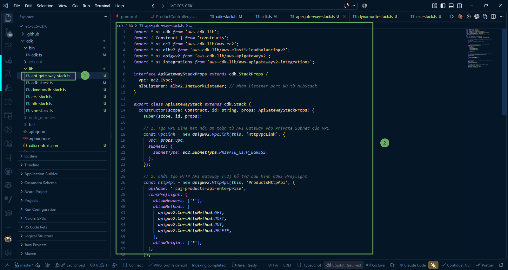

Trong phần này, chúng ta sẽ tìm hiểu về mô hình kết nối bảo mật từ **Amazon API Gateway** vào mạng nội bộ thông qua **VPC Link**, đồng thời viết mã nguồn TypeScript định nghĩa `ApiGatewayStack` bằng AWS CDK.

---

### 1. Vai trò của API Gateway và VPC Link trong kiến trúc Enterprise

Trong các kiến trúc microservices đạt chuẩn doanh nghiệp (Enterprise Architecture) trên AWS:
* **Nguyên tắc bảo mật Zero Trust & Private Isolation**:
  * Các tài nguyên backend như **ECS Fargate**, **DynamoDB** và các bộ cân bằng tải **ALB/NLB** đều được cô lập hoàn toàn trong **Private Subnet** (không có Public IP).
  * Việc không mở Public IP cho ALB hay ECS giúp ngăn chặn triệt để các cuộc tấn công dò quét cổng hoặc tấn công trực tiếp từ Internet.
  
* **VPC Link là gì?**
  * **VPC Link** là một tính năng chuyên biệt của Amazon API Gateway. Khi được khởi tạo, VPC Link sẽ tự động phân bổ các Elastic Network Interface (ENI) bên trong các Private Subnet của VPC bạn chỉ định.
  * Nhờ VPC Link, API Gateway có thể tạo một kênh truyền dữ liệu riêng tư (Private Tunnel) kết nối thẳng vào **Network Load Balancer (NLB)**.
* **Tại sao lại chọn HTTP API (API Gateway v2) thay vì REST API (v1)?**
  * **Hiệu năng cao hơn & độ trễ thấp hơn**: HTTP API được thiết kế tối giản, tập trung vào proxy HTTP với độ trễ siêu thấp.
  * **Chi phí rẻ hơn tới 70%**: Phù hợp tối đa cho việc làm gateway định tuyến vào các cụm container Fargate.
  * Hỗ trợ tích hợp gốc (`HttpNlbIntegration`) với Network Load Balancer chỉ bằng vài dòng code CDK.

---

### 2. Viết mã nguồn API Gateway Stack (`api-gate-way-stack.ts`)

Truy cập vào thư mục **IaC-ECS-CDK/cdk/lib** và mở file **api-gate-way-stack.ts** (hoặc tạo mới nếu chưa có). Chúng ta sẽ lần lượt xây dựng các thành phần của Stack theo từng bước cụ thể dưới đây:

#### 2.1. Khai báo thư viện và Interface Props

Import các module AWS CDK cần thiết và định nghĩa interface `ApiGatewayStackProps` nhận các tài nguyên phụ thuộc (`vpc` từ `VpcStack` và `nlbListener` từ `NlbStack`):

~~~typescript
import * as cdk from 'aws-cdk-lib';
import { Construct } from 'constructs';
import * as ec2 from 'aws-cdk-lib/aws-ec2';
import * as elbv2 from 'aws-cdk-lib/aws-elasticloadbalancingv2';
import * as apigwv2 from 'aws-cdk-lib/aws-apigatewayv2';
import * as integrations from 'aws-cdk-lib/aws-apigatewayv2-integrations';

interface ApiGatewayStackProps extends cdk.StackProps {
  vpc: ec2.IVpc;
  nlbListener: elbv2.INetworkListener; // Nhận listener port 80 từ NlbStack
}

export class ApiGatewayStack extends cdk.Stack {
  constructor(scope: Construct, id: string, props: ApiGatewayStackProps) {
    super(scope, id, props);
~~~

#### 2.2. Khởi tạo Security Group và Amazon VPC Link vào Private Subnet

Thiết lập một Security Group riêng biệt cho phép lưu lượng mạng đi ra (Outbound) tới NLB, sau đó khởi tạo kênh kết nối an toàn (**VPC Link**) từ API Gateway vào các Private Subnet của VPC mà không cần gán Public IP cho backend:

~~~typescript
    // 1. Tạo Security Group tường minh cho VPC Link (cho phép gửi outbound traffic tới NLB)
    const vpcLinkSecurityGroup = new ec2.SecurityGroup(this, 'VpcLinkSecurityGroup', {
      vpc: props.vpc,
      description: 'Security group for API Gateway VPC Link to Internal NLB',
      allowAllOutbound: true,
    });

    // 2. Tạo VPC Link kết nối an toàn từ API Gateway vào Private Subnet của VPC kèm Security Group
    const vpcLink = new apigwv2.VpcLink(this, 'HttpVpcLink', {
      vpc: props.vpc,
      securityGroups: [vpcLinkSecurityGroup],
      subnets: {
        subnetType: ec2.SubnetType.PRIVATE_WITH_EGRESS,
      },
    });
~~~

{}
**Lưu ý quan trọng về Security Group cho VPC Link:**  
Nếu không khai báo tham số `securityGroups`, AWS sẽ tự động gán **Default Security Group** của VPC cho các card mạng (ENI) của VPC Link. Trong khi đó, AWS CDK mặc định áp dụng chính sách bảo mật khóa toàn bộ chiều Outbound của Default SG (`restrictDefaultSecurityGroup`), dẫn đến các request từ VPC Link sang NLB bị chặn và gây lỗi **503 Service Unavailable** (do timeout 30s). Do đó, việc cấu hình Security Group tường minh là cực kỳ cần thiết.
{}

#### 2.3. Khởi tạo HTTP API Gateway (v2) và Cấu hình CORS

Tạo cổng tiếp nhận công khai HTTP API thế hệ 2 và mở cấu hình CORS Preflight cho các phương thức phổ biến (GET, POST, PUT, DELETE):

~~~typescript
    // 3. Khởi tạo HTTP API Gateway (v2) hỗ trợ cấu hình CORS Preflight
    const httpApi = new apigwv2.HttpApi(this, 'ProductsHttpApi', {
      apiName: 'fcaj-products-api-enterprise',
      corsPreflight: {
        allowHeaders: ['*'],
        allowMethods: [
          apigwv2.CorsHttpMethod.GET,
          apigwv2.CorsHttpMethod.POST,
          apigwv2.CorsHttpMethod.PUT,
          apigwv2.CorsHttpMethod.DELETE,
        ],
        allowOrigins: ['*'],
      },
    });
~~~

#### 2.4. Tích hợp HTTP API với Network Load Balancer (HttpNlbIntegration)

Sử dụng construct tích hợp `HttpNlbIntegration` để liên kết HTTP API với listener port 80 của NLB thông qua VPC Link vừa tạo:

~~~typescript
    // 4. Sử dụng HttpNlbIntegration kết nối với NLB Listener thông qua VPC Link
    const nlbIntegration = new integrations.HttpNlbIntegration(
      'NlbIntegration',
      props.nlbListener,
      {
        vpcLink: vpcLink,
        method: apigwv2.HttpMethod.ANY,
      }
    );
~~~

#### 2.5. Định nghĩa Route Catch-all, Root Route và Xuất Endpoint Công Khai

Cấu hình route đại diện `/{proxy+}` để bắt toàn bộ các đường dẫn con và route `/` cho đường dẫn gốc chuyển tiếp vào NLB, đồng thời in URL chính thức của API Gateway ra màn hình:

~~~typescript
    // 5. Bắt toàn bộ các route con chuyển tiếp vào NLB (Catch-all proxy)
    httpApi.addRoutes({
      path: '/{proxy+}',
      methods: [apigwv2.HttpMethod.ANY],
      integration: nlbIntegration,
    });

    // 6. Bắt cả route gốc "/" để tránh lỗi 503 khi người dùng gọi thẳng vào base Invoke URL
    httpApi.addRoutes({
      path: '/',
      methods: [apigwv2.HttpMethod.ANY],
      integration: nlbIntegration,
    });

    // 7. Xuất URL công khai (Endpoint) của API Gateway ra màn hình
    new cdk.CfnOutput(this, 'ApiEndpoint', {
      value: httpApi.apiEndpoint,
      description: 'API Gateway Endpoint',
    });
  }
}
~~~

#### 2.6. Mã nguồn hoàn chỉnh của `api-gate-way-stack.ts`

Dưới đây là toàn bộ mã nguồn hoàn chỉnh của file **api-gate-way-stack.ts** để bạn dễ dàng đối chiếu và triển khai:

~~~typescript
import * as cdk from 'aws-cdk-lib';
import { Construct } from 'constructs';
import * as ec2 from 'aws-cdk-lib/aws-ec2';
import * as elbv2 from 'aws-cdk-lib/aws-elasticloadbalancingv2';
import * as apigwv2 from 'aws-cdk-lib/aws-apigatewayv2';
import * as integrations from 'aws-cdk-lib/aws-apigatewayv2-integrations';

interface ApiGatewayStackProps extends cdk.StackProps {
  vpc: ec2.IVpc;
  nlbListener: elbv2.INetworkListener; // Nhận listener port 80 từ NlbStack
}

export class ApiGatewayStack extends cdk.Stack {
  constructor(scope: Construct, id: string, props: ApiGatewayStackProps) {
    super(scope, id, props);

    // 1. Tạo Security Group tường minh cho VPC Link (cho phép gửi outbound traffic tới NLB)
    const vpcLinkSecurityGroup = new ec2.SecurityGroup(this, 'VpcLinkSecurityGroup', {
      vpc: props.vpc,
      description: 'Security group for API Gateway VPC Link to Internal NLB',
      allowAllOutbound: true,
    });

    // 2. Tạo VPC Link kết nối an toàn từ API Gateway vào Private Subnet của VPC kèm Security Group
    const vpcLink = new apigwv2.VpcLink(this, 'HttpVpcLink', {
      vpc: props.vpc,
      securityGroups: [vpcLinkSecurityGroup],
      subnets: {
        subnetType: ec2.SubnetType.PRIVATE_WITH_EGRESS,
      },
    });

    // 3. Khởi tạo HTTP API Gateway (v2) hỗ trợ cấu hình CORS Preflight
    const httpApi = new apigwv2.HttpApi(this, 'ProductsHttpApi', {
      apiName: 'fcaj-products-api-enterprise',
      corsPreflight: {
        allowHeaders: ['*'],
        allowMethods: [
          apigwv2.CorsHttpMethod.GET,
          apigwv2.CorsHttpMethod.POST,
          apigwv2.CorsHttpMethod.PUT,
          apigwv2.CorsHttpMethod.DELETE,
        ],
        allowOrigins: ['*'],
      },
    });

    // 4. Sử dụng HttpNlbIntegration kết nối với NLB Listener thông qua VPC Link
    const nlbIntegration = new integrations.HttpNlbIntegration(
      'NlbIntegration',
      props.nlbListener,
      {
        vpcLink: vpcLink,
        method: apigwv2.HttpMethod.ANY,
      }
    );

    // 5. Bắt toàn bộ các route con chuyển tiếp vào NLB (Catch-all proxy)
    httpApi.addRoutes({
      path: '/{proxy+}',
      methods: [apigwv2.HttpMethod.ANY],
      integration: nlbIntegration,
    });

    // 6. Bắt cả route gốc "/" để tránh lỗi 503 khi người dùng gọi thẳng vào base Invoke URL
    httpApi.addRoutes({
      path: '/',
      methods: [apigwv2.HttpMethod.ANY],
      integration: nlbIntegration,
    });

    // 7. Xuất URL công khai (Endpoint) của API Gateway ra màn hình
    new cdk.CfnOutput(this, 'ApiEndpoint', {
      value: httpApi.apiEndpoint,
      description: 'API Gateway Endpoint',
    });
  }
}
~~~

---

### 3. Giải thích chi tiết các thành phần cốt lõi

* **`new ec2.SecurityGroup(this, 'VpcLinkSecurityGroup', ...)`**:
  * Tạo một Security Group chuyên biệt cho các ENI của VPC Link với quyền `allowAllOutbound: true`.
  * Đảm bảo VPC Link có thể gửi các gói tin TCP tới địa chỉ IP private của Network Load Balancer trên cổng 80 một cách thông suốt, tránh bị ảnh hưởng bởi chính sách khóa Default SG của VPC.

* **`new apigwv2.VpcLink(..., { securityGroups: [vpcLinkSecurityGroup] })`**:
  * Khởi tạo tài nguyên VPC Link trong các Private Subnet (`ec2.SubnetType.PRIVATE_WITH_EGRESS`) và liên kết trực tiếp với Security Group vừa tạo.
  * AWS sẽ quản lý việc kết nối bảo mật giữa dịch vụ API Gateway trên hạ tầng công khai của AWS và mạng nội bộ VPC của bạn.

* **`new apigwv2.HttpApi(...)`**:
  * Tạo một phiên bản HTTP API thế hệ 2 có tên là **fcaj-products-api-enterprise**.
  * Cấu hình **corsPreflight**: Mở quyền cho các tiêu đề (`allowHeaders: ['*']`) và phương thức phổ biến (GET, POST, PUT, DELETE) để các ứng dụng Web Frontend (React, Vue, Angular) có thể gọi trực tiếp API mà không gặp lỗi CORS.

* **`new integrations.HttpNlbIntegration(...)`**:
  * Construct tích hợp chuẩn trong AWS CDK v2.
  * Nó gắn kết **nlbListener** (được truyền từ **NlbStack**) với **vpcLink**. Mỗi khi có request gửi tới API Gateway, request sẽ được đóng gói và chuyển tiếp trực tiếp vào cổng 80 của Network Load Balancer thông qua VPC Link.

* **`httpApi.addRoutes({ path: '/{proxy+}' })` & `httpApi.addRoutes({ path: '/' })`**:
  * **`/{proxy+}`**: Bắt toàn bộ các đường dẫn con (`/actuator/health`, `/api/products`, `/api/products/{id}`, v.v.) và chuyển tiếp tới Spring Boot backend.
  * **`/`**: Bắt đường dẫn gốc, giúp xử lý các request gọi thẳng vào Invoke URL cơ sở của API Gateway mà không phát sinh lỗi 503 (No matching route).

* **`cdk.CfnOutput`**:
  * Xuất biến **ApiEndpoint** (dưới dạng `https://<api-id>.execute-api.ap-southeast-1.amazonaws.com`) lên màn hình terminal sau khi triển khai để kiểm thử trên Postman.

{}
**Lợi thế kiến trúc**: Nhờ cơ chế **Catch-all proxy (`/{proxy+}`)**, khi ứng dụng Spring Boot bổ sung thêm các controller mới (như `/api/orders`, `/api/users`), bạn không cần phải cập nhật lại cấu hình của API Gateway hay deploy lại CDK stack này. Toàn bộ routing đã được ủy quyền hoàn toàn cho Spring Boot và ALB xử lý!
{}
