After completing the source code for `ApiGatewayStack` in the `lib` directory, the next step is to declare this stack in the main entry point `bin/cdk.ts`, compile and check the source code, deploy to AWS, and perform end-to-end testing from the outside via the Internet.

---

### 1. Register and Link Stacks in `bin/cdk.ts`

Open the file **IaC-ECS-CDK/cdk/bin/cdk.ts** in VS Code. Ensure the entire chain of 6 Stacks is connected sequentially according to the dependency tree:

~~~typescript
#!/usr/bin/env node
import * as cdk from 'aws-cdk-lib';
import { CdkStack } from '../lib/cdk-stack';
import { VpcStack } from '../lib/vpc-stack';
import { DynamoDbStack } from '../lib/dynamodb-stack';
import { EcsStack } from '../lib/ecs-stack';
import { NlbStack } from '../lib/nlb-stack';
import { ApiGatewayStack } from '../lib/api-gate-way-stack';

const app = new cdk.App();
const env: cdk.Environment = {
  account: process.env.CDK_DEFAULT_ACCOUNT,
  region: process.env.CDK_DEFAULT_REGION ?? 'ap-southeast-1',
};

// 1. ECR Stack
const ecrStack = new CdkStack(app, 'ProductsServiceEcrStack', { env });

// 2. VPC Stack
const vpcStack = new VpcStack(app, 'ProductsServiceVpcStack', { env });

// 3. DynamoDB Stack
const dynamoStack = new DynamoDbStack(app, 'ProductsServiceDynamoDbStack', { env });

// 4. ECS Fargate Stack (Receives VPC, DynamoDB Table and ECR Repo)
const ecsStack = new EcsStack(app, 'ProductsServiceEcsStack', {
  env,
  vpc: vpcStack.vpc,
  table: dynamoStack.table,
  repository: ecrStack.repository,
});

// 5. NLB Stack (Receives VPC and ALB Listener from ecsStack)
const nlbStack = new NlbStack(app, 'ProductsServiceNlbStack', {
  env,
  vpc: vpcStack.vpc,
  albListener: ecsStack.albListener,
});

// 6. API Gateway Stack (Receives VPC and NLB Listener from nlbStack)
new ApiGatewayStack(app, 'ProductsServiceApiGatewayStack', {
  env,
  vpc: vpcStack.vpc,
  nlbListener: nlbStack.listener,
});
~~~

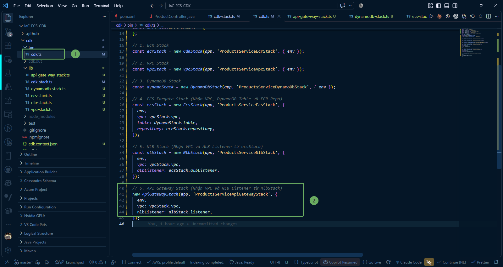

---

### 2. Compile and Check Source Code

1. Run the TypeScript build command to check the validity of all source code:

~~~powershell
npm run build
~~~

2. List all registered Stacks:

~~~powershell
npx cdk list
~~~

or:

~~~powershell
cdk list
~~~

3. Synthesize and inspect the CloudFormation template for the API Gateway Stack:

~~~powershell
npx cdk synth ProductsServiceApiGatewayStack
~~~

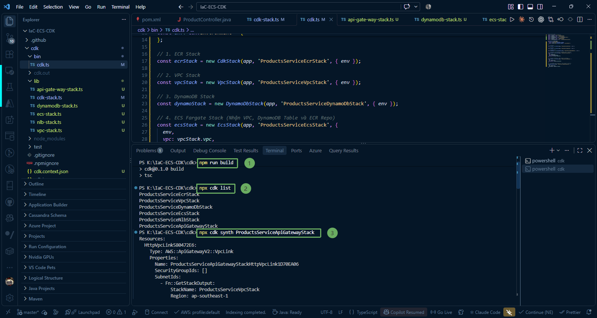

---

### 3. Deploy API Gateway Stack to AWS (`cdk deploy`)

Run the command to deploy only `ProductsServiceApiGatewayStack`:

~~~powershell
npx cdk deploy ProductsServiceApiGatewayStack --require-approval never
~~~

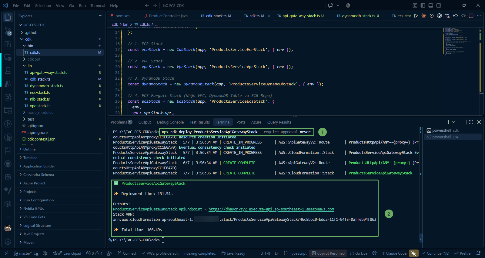

{}
Deploying the API Gateway typically takes about **2 to 3 minutes**. This time is mainly spent by AWS allocating the Network Interfaces (ENI) of the **VPC Link** attached to the Private Subnets in your VPC.
{}

When deployment completes, the terminal will print the public Invoke URL of API Gateway.

---

### 4. Check Resources on AWS Management Console

#### Check CloudFormation ProductsServiceApiGatewayStack created successfully.

1. Sign in to the [AWS Management Console](https://console.aws.amazon.com/) > Select the **CloudFormation** service.

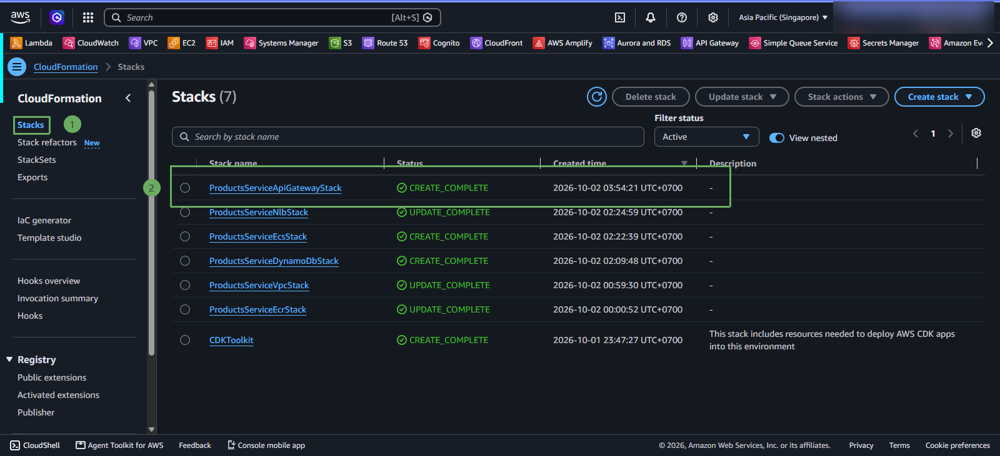

#### Check HTTP API Gateway and VPC Link

1. Select the **API Gateway** service.
2. Click on the API **`fcaj-products-api-enterprise`** (Type **HTTP**).
3. In the left menu, select **VPC links**:
   * Verify link **`HttpVpcLink`** is in the **Available** state and linked to the correct VPC ID of the lab.

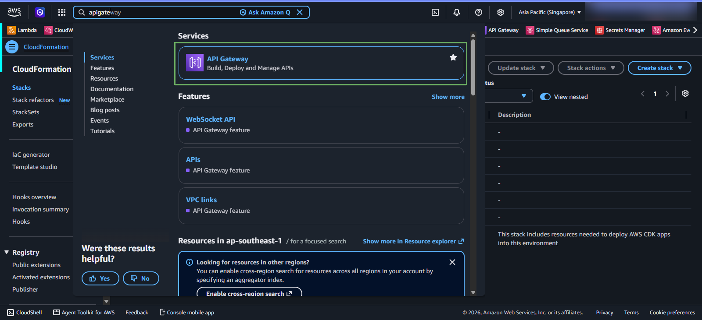

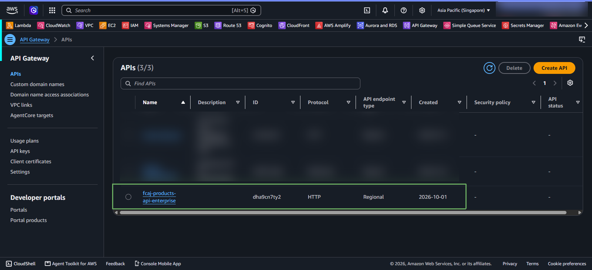

4. Switch to **Routes**:
   * You will see the route **ANY /{proxy+}** automatically created and linked with integration **NlbIntegration** pointing to the listener of the Network Load Balancer.

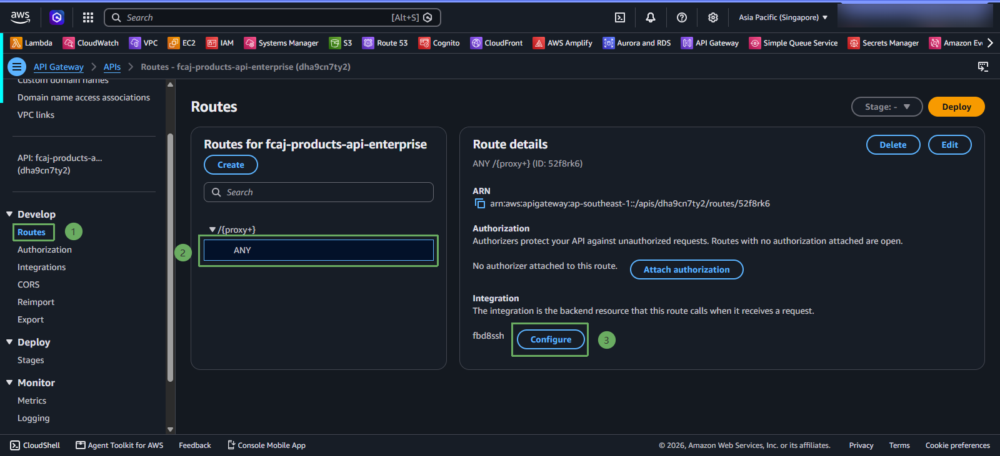

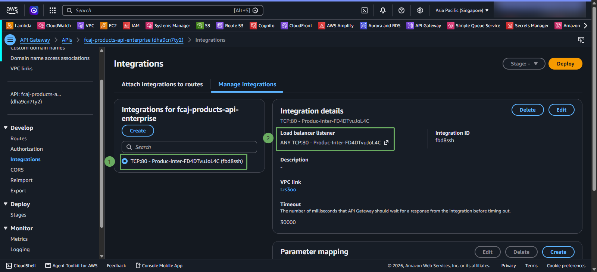

5. Switch to **Metrics**:

* Enable **Detailed route metrics** to allow tracking detailed metrics for each route.

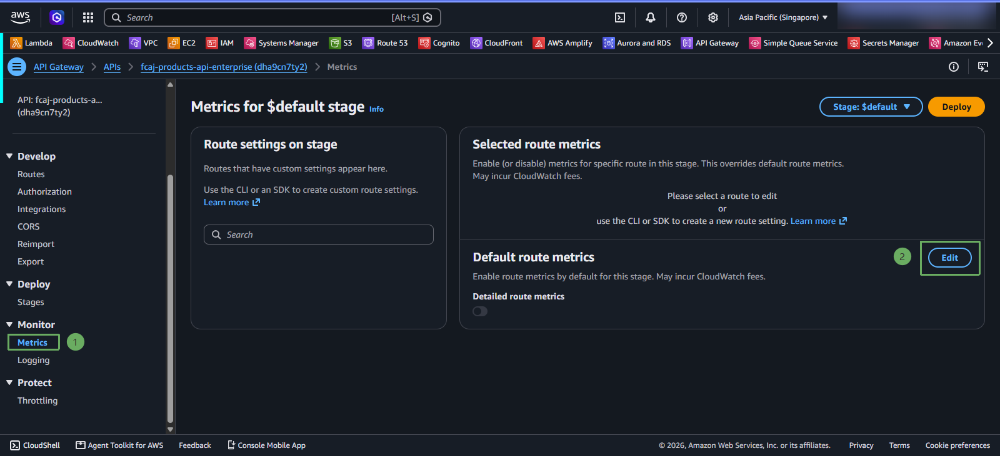

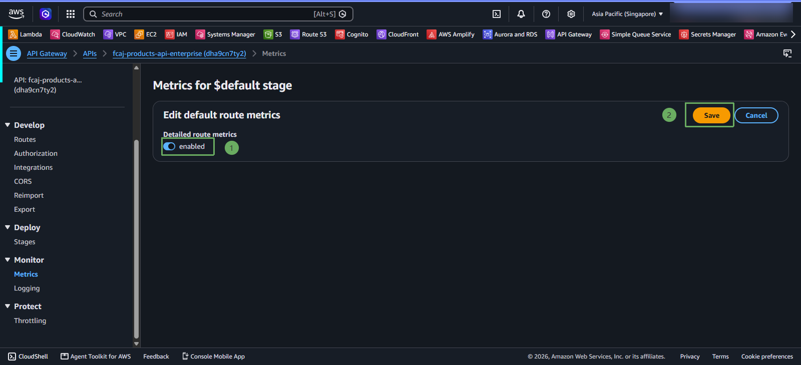

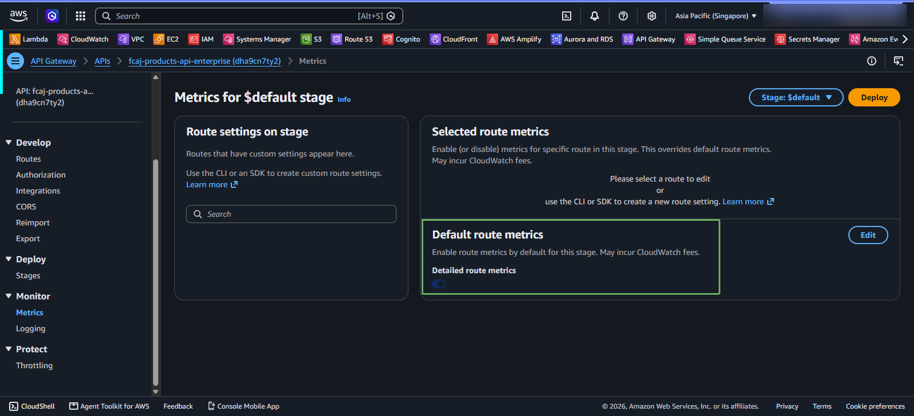

---

### 5. Comprehensive End-to-End System Testing from the Internet

Now you can open a terminal (PowerShell, Git Bash, or Command Prompt) on your personal computer or use Postman to call the APIs:

#### 1. Check Actuator Health Check Endpoint
Send a request to check the health of the Spring Boot application:

~~~powershell
https://<api-id>.execute-api.ap-southeast-1.amazonaws.com/actuator/health
~~~

*(Replace `<api-id>` with the actual API Gateway ID displayed in the Outputs section)*

Expected result returns HTTP status `200 OK`:
~~~json
{"status":"UP"}
~~~

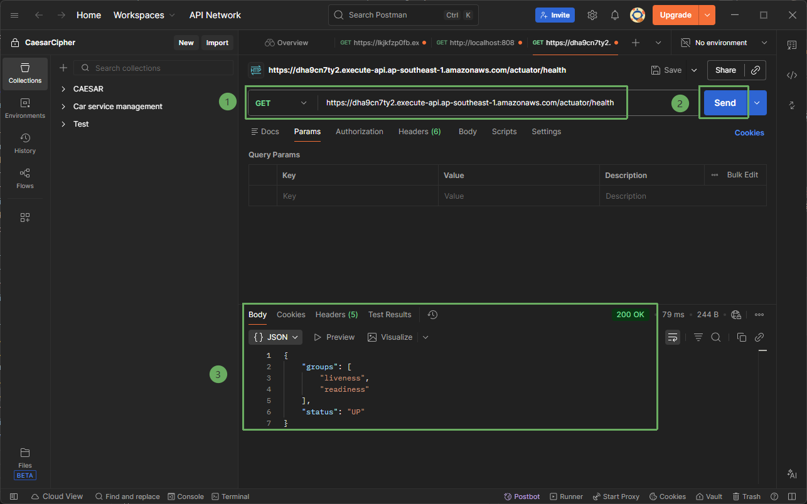

{}
If you receive `{"status":"UP"}`, congratulations! The request from your personal computer successfully traveled through the Internet -> API Gateway -> VPC Link -> Internal NLB -> Internal ALB -> Spring Boot Container in ECS Fargate.
{}

#### 2. Create a new product in DynamoDB (POST)
Send a `POST` request with JSON-formatted product data:

* Open Postman -> Body -> Method: Post

* Paste the URL with the API Gateway endpoint:

~~~powershell
https://<api-id>.execute-api.ap-southeast-1.amazonaws.com/api/products
~~~

* Select Body -> raw

~~~powershell
[
    {
        "id": "1",
        "name": "Asus Zephyrus 16 duo",
        "price": 160000.0
    },
    {
        "id": "2",
        "name": "Alienware Area 51",
        "price": 999999.0
    },
    {
        "id": "3",
        "name": "Razer Blade 16",
        "price": 900000.0
    }
]
~~~

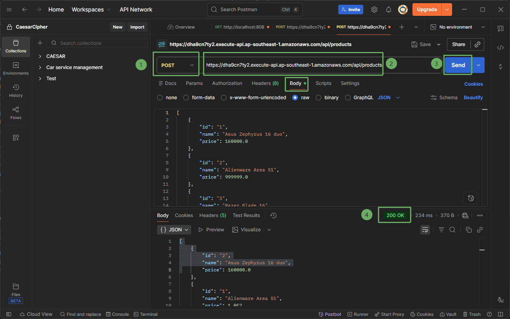

#### 4. Verify data on DynamoDB Console and GET by ID
1. Call the GET request for the product list again:
~~~powershell
https://<apigw-id>.execute-api.ap-southeast-1.amazonaws.com/api/products
~~~
Now the API will return the list containing the newly created products.

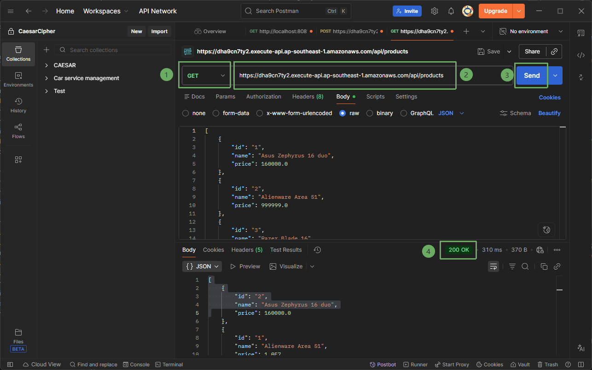

2. Access **DynamoDB Console** -> **Explore items**:
   * You will see the new product records appear directly in the table with string partition key `id` and associated fields.

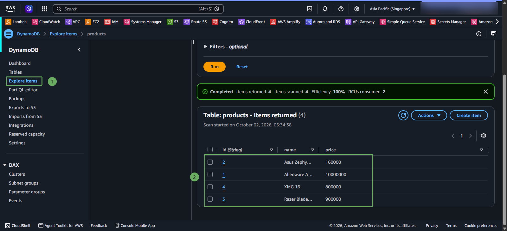

{}
Congratulations on completing the entire **Enterprise-standard secure Microservices** architecture on AWS using AWS CDK! The entire infrastructure from Private network, NoSQL database, serverless Fargate compute cluster, 2-layer load balancing (NLB + ALB) to API Gateway operates harmoniously and with absolute security.
{}
