Sau khi đã hoàn thiện mã nguồn `ApiGatewayStack` trong thư mục `lib`, bước tiếp theo là khai báo stack này vào điểm khởi chạy chính `bin/cdk.ts`, biên dịch kiểm tra mã nguồn, triển khai lên AWS và thực hiện kiểm thử toàn diện từ bên ngoài qua Internet.

---

### 1. Đăng ký và liên kết các Stack trong `bin/cdk.ts`

Mở file **IaC-ECS-CDK/cdk/bin/cdk.ts** trong VS Code. Đảm bảo toàn bộ chuỗi 6 Stack được kết nối tuần tự theo đúng cây phụ thuộc:

~~~typescript
#!/usr/bin/env node
import * as cdk from 'aws-cdk-lib';
import { CdkStack } from '../lib/cdk-stack';
import { VpcStack } from '../lib/vpc-stack';
import { DynamoDbStack } from '../lib/dynamodb-stack';
import { EcsStack } from '../lib/ecs-stack';
import { NlbStack } from '../lib/nlb-stack';
import { ApiGatewayStack } from '../lib/api-gate-way-stack';

const app = new cdk.App();
const env: cdk.Environment = {
  account: process.env.CDK_DEFAULT_ACCOUNT,
  region: process.env.CDK_DEFAULT_REGION ?? 'ap-southeast-1',
};

// 1. ECR Stack
const ecrStack = new CdkStack(app, 'ProductsServiceEcrStack', { env });

// 2. VPC Stack
const vpcStack = new VpcStack(app, 'ProductsServiceVpcStack', { env });

// 3. DynamoDB Stack
const dynamoStack = new DynamoDbStack(app, 'ProductsServiceDynamoDbStack', { env });

// 4. ECS Fargate Stack (Nhận VPC, DynamoDB Table và ECR Repo)
const ecsStack = new EcsStack(app, 'ProductsServiceEcsStack', {
  env,
  vpc: vpcStack.vpc,
  table: dynamoStack.table,
  repository: ecrStack.repository,
});

// 5. NLB Stack (Nhận VPC và ALB Listener từ ecsStack)
const nlbStack = new NlbStack(app, 'ProductsServiceNlbStack', {
  env,
  vpc: vpcStack.vpc,
  albListener: ecsStack.albListener,
});

// 6. API Gateway Stack (Nhận VPC và NLB Listener từ nlbStack)
new ApiGatewayStack(app, 'ProductsServiceApiGatewayStack', {
  env,
  vpc: vpcStack.vpc,
  nlbListener: nlbStack.listener,
});
~~~

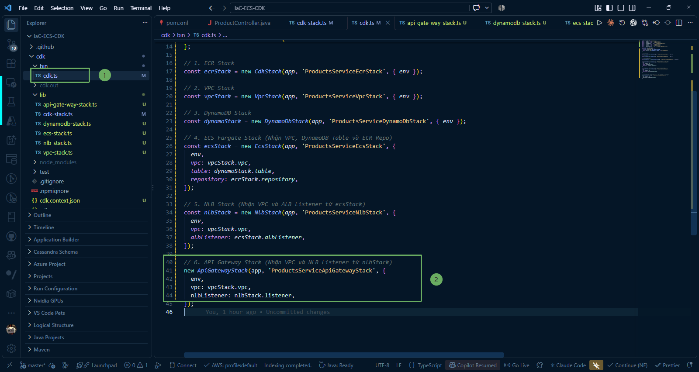

---

### 2. Biên dịch và kiểm tra mã nguồn

1. Chạy lệnh build TypeScript để kiểm tra tính hợp lệ của toàn bộ mã nguồn:

~~~powershell
npm run build
~~~

2. Liệt kê danh sách tất cả các Stack đã đăng ký:

~~~powershell
npx cdk list
~~~

hoặc:

~~~powershell
cdk list
~~~

3. Kiểm tra mẫu CloudFormation tổng hợp cho API Gateway Stack:

~~~powershell
npx cdk synth ProductsServiceApiGatewayStack
~~~

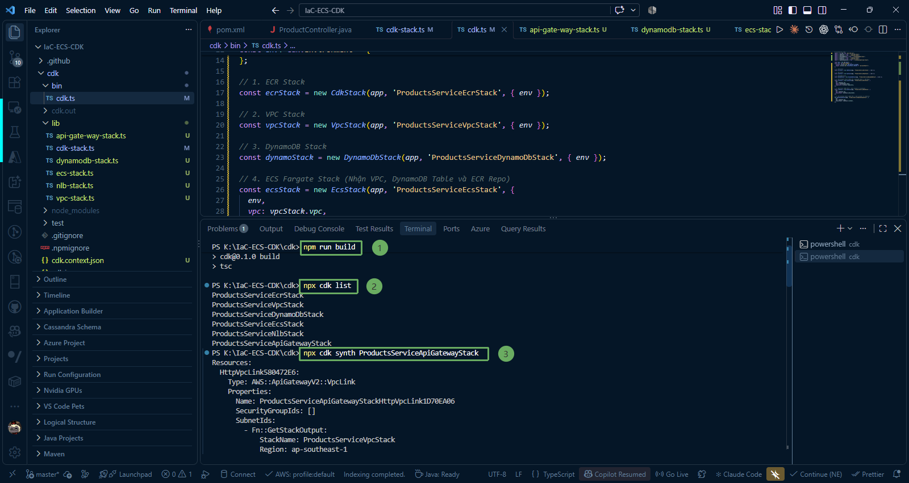

---

### 3. Triển khai API Gateway Stack lên AWS (`cdk deploy`)

Chạy lệnh triển khai riêng Stack `ProductsServiceApiGatewayStack`:

~~~powershell
npx cdk deploy ProductsServiceApiGatewayStack --require-approval never
~~~

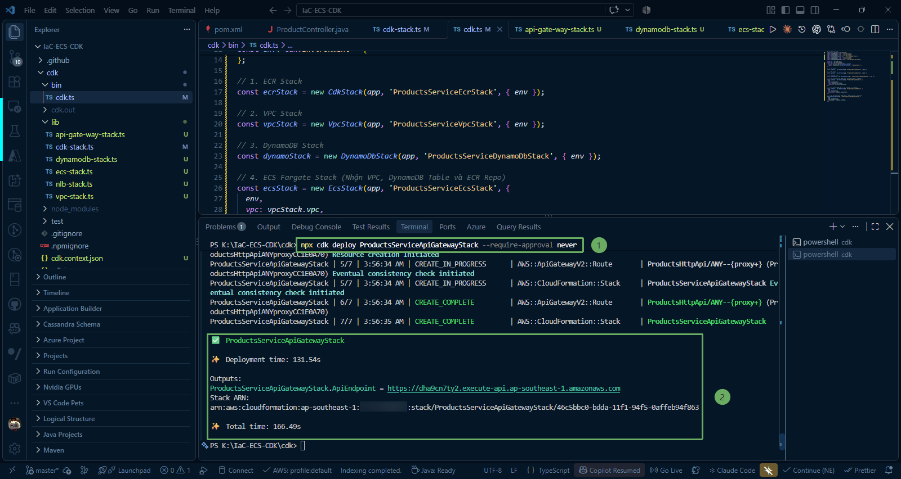

{}
Quá trình triển khai API Gateway thường mất khoảng **2 đến 3 phút**. Thời gian này chủ yếu dành cho AWS cấp phát các Network Interface (ENI) của **VPC Link** gắn vào các Private Subnet trong VPC của bạn.
{}

Khi triển khai hoàn tất, terminal sẽ in ra đường dẫn công khai (Invoke URL) của API Gateway:

---

### 4. Kiểm tra tài nguyên trên AWS Management Console

#### Kiểm tra CloudFormation ProductsServiceApiGatewayStack đã được tạo thành công.

1. Đăng nhập vào [AWS Management Console](https://console.aws.amazon.com/) > Chọn dịch vụ **CloudFormation**.

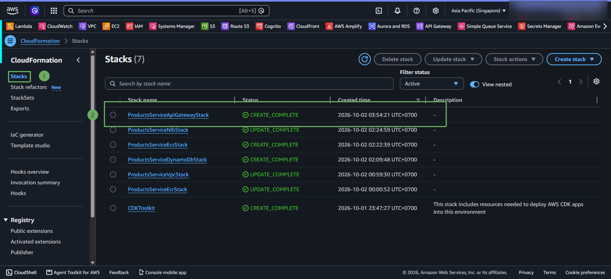

#### Kiểm tra HTTP API Gateway và VPC Link

1. Chọn dịch vụ **API Gateway**.
2. Nhấp vào API **`fcaj-products-api-enterprise`** (Loại **HTTP**).
3. Ở menu bên trái, chọn **VPC links**:
   * Kiểm tra link **`HttpVpcLink`** đang ở trạng thái **Available (Sẵn sàng)** và đã liên kết với đúng VPC ID của bài lab.

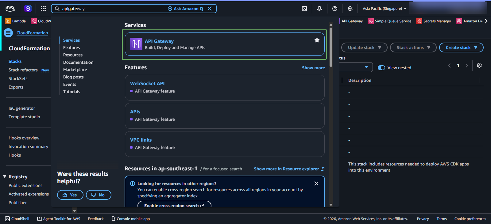

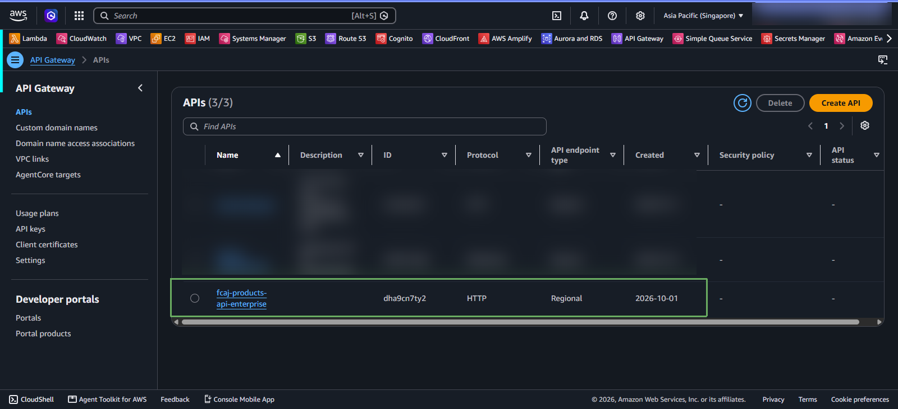

4. Chuyển sang mục **Routes**:
   * Bạn sẽ thấy route **ANY /{proxy+}** được tạo tự động và gắn liền với integration **NlbIntegration** trỏ tới listener của Network Load Balancer.

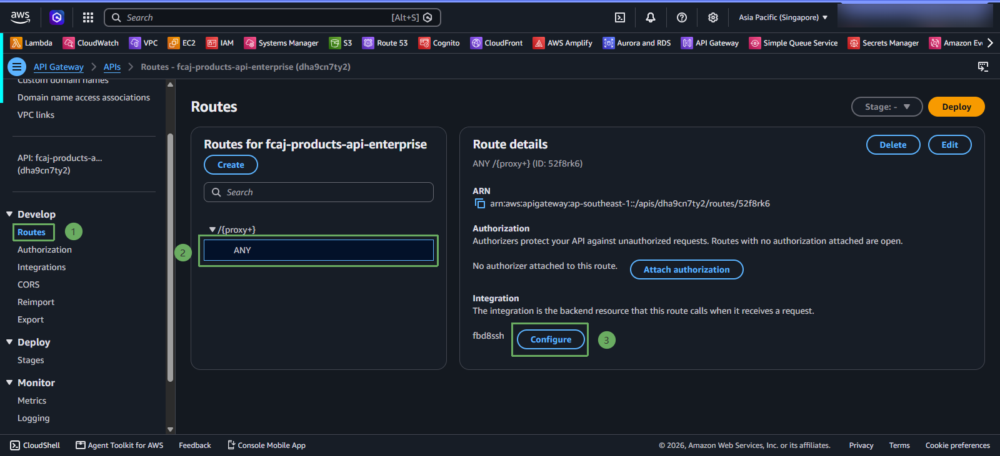

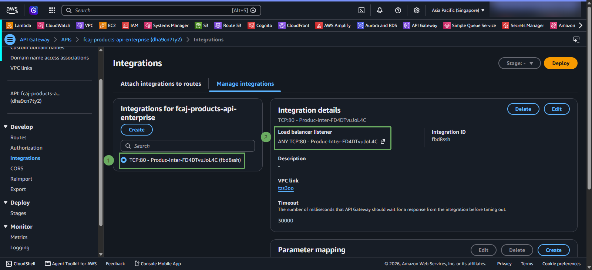

5. Chuyển đến mục **Metrics**:

* Enable **Detailed route metrics** để cho phép theo dõi metrics chi tiết của từng route.

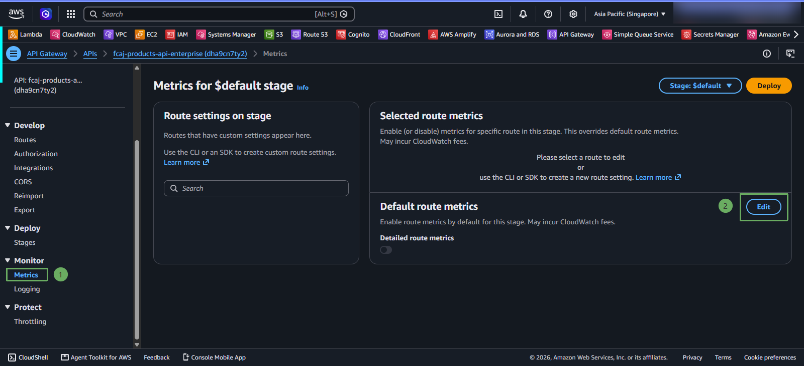

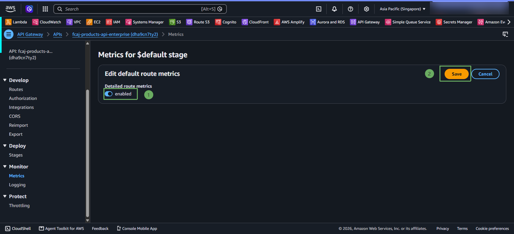

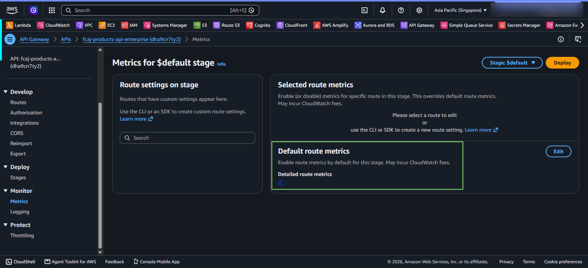

---

### 5. Kiểm thử toàn diện hệ thống từ Internet (End-to-End Testing)

Bây giờ bạn có thể mở terminal (PowerShell, Git Bash, hoặc Command Prompt) trên chính máy tính cá nhân của mình hoặc sử dụng Postman để gọi thử các API:

#### 1. Kiểm tra Endpoint Actuator Health Check
Gửi request kiểm tra sức khỏe của ứng dụng Spring Boot:

~~~powershell
https://<api-id>.execute-api.ap-southeast-1.amazonaws.com/actuator/health
~~~

*(Thay `<api-id>` bằng mã ID API Gateway thực tế hiển thị ở phần Outputs)*

Kết quả trả về HTTP status `200 OK`:
~~~json
{"status":"UP"}
~~~

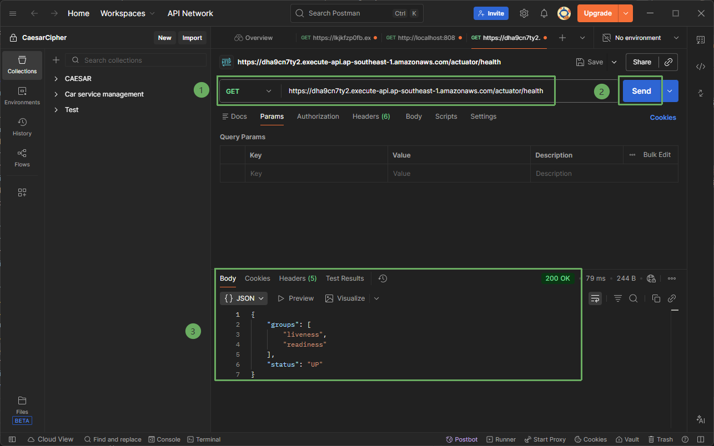

{}
Nếu nhận được `{"status":"UP"}`, chúc mừng bạn! Yêu cầu từ máy tính cá nhân của bạn đã đi qua Internet -> API Gateway -> VPC Link -> Internal NLB -> Internal ALB -> Container Spring Boot trong ECS Fargate thành công.
{}

#### 2. Tạo mới một sản phẩm vào DynamoDB (POST)
Gửi request `POST` kèm dữ liệu sản phẩm định dạng JSON:

* Truy cập vào Postman -> Body -> Method: Post

* Dán đường dẫn có api gateway endpoint:

~~~powershell
https://<api-id>.execute-api.ap-southeast-1.amazonaws.com/api/products
~~~

* Chọn body -> raw

~~~powershell
[
    {
        "id": "1",
        "name": "Asus Zephyrus 16 duo",
        "price": 160000.0
    },
    {
        "id": "2",
        "name": "Alienware Area 51",
        "price": 999999.0
    },
    {
        "id": "3",
        "name": "Razer Blade 16",
        "price": 900000.0
    }
]
~~~

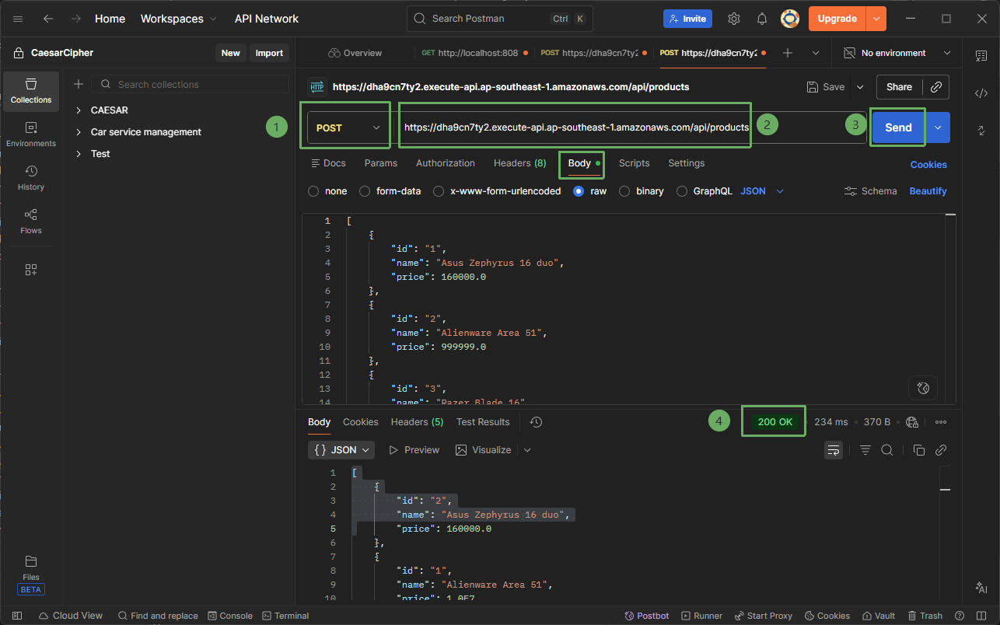

#### 4. Kiểm tra lại dữ liệu trên DynamoDB Console và GET theo ID
1. Gọi lại lệnh GET danh sách sản phẩm:
~~~powershell
https://<apigw-id>.execute-api.ap-southeast-1.amazonaws.com/api/products
~~~
Lúc này API sẽ trả về danh sách chứa sản phẩm vừa tạo.

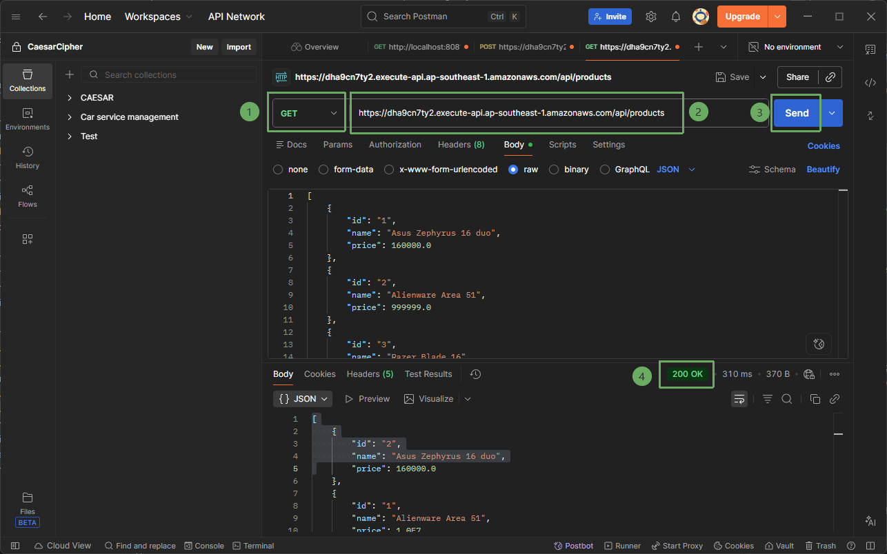

2. Truy cập **DynamoDB Console** -> **Explore items**:
   * Bạn sẽ thấy bản ghi sản phẩm mới xuất hiện trực tiếp trên bảng với khóa chính `id` dạng chuỗi và các trường thông tin đi kèm.

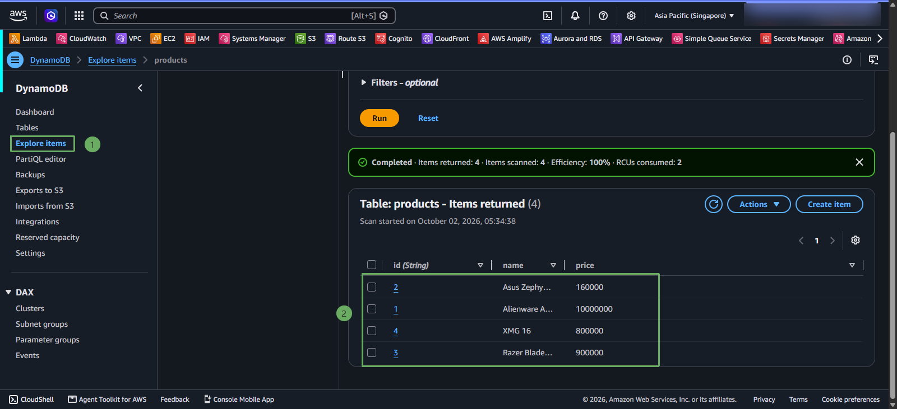

{}
Chúc mừng bạn đã hoàn thành việc thiết lập toàn bộ chuỗi kiến trúc **Microservices bảo mật chuẩn Enterprise** trên AWS bằng AWS CDK! Toàn bộ hạ tầng từ mạng Private, cơ sở dữ liệu NoSQL, cụm tính toán Fargate không máy chủ, cân bằng tải 2 lớp (NLB + ALB) cho tới API Gateway đều hoạt động đồng bộ và bảo mật tuyệt đối.
{}
