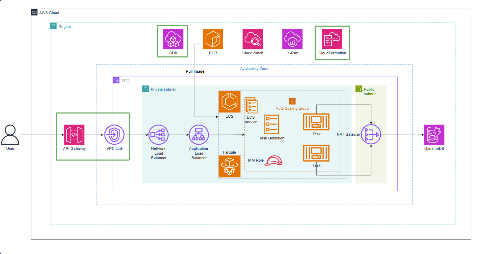

# Create API Gateway and VPC Link

In previous chapters, we built the entire backend infrastructure including the **Amazon DynamoDB** database, **Amazon ECS Fargate** container cluster, along with the **Internal Application Load Balancer (ALB)** and **Internal Network Load Balancer (NLB)** load balancing system. All of these resources are placed securely inside **Private Subnets** and have completely no public IP addresses.

To enable external client applications from the Internet (mobile apps, web frontends, Postman) to communicate securely with backend APIs, we will build **Amazon API Gateway (HTTP API)** combined with **VPC Link**.

* **Amazon API Gateway (HTTP API v2)**: Acts as the Public Entry Point, providing traffic management, CORS Preflight controls, and automatic scaling on demand with optimized cost (over 70% cheaper than traditional REST APIs).

* **VPC Link**: Creates a "Private Tunnel" using Elastic Network Interfaces (ENI) placed in the Private Subnet of the VPC. VPC Link allows API Gateway to route requests directly to the internal **Network Load Balancer** without having to open public IPs for resources in the VPC.

* **HttpNlbIntegration**: Standard integration from AWS CDK v2 that links the proxy route (`/{proxy+}`) with the listener of the NLB, forwarding all GET, POST, PUT, DELETE methods to the Spring Boot application.

