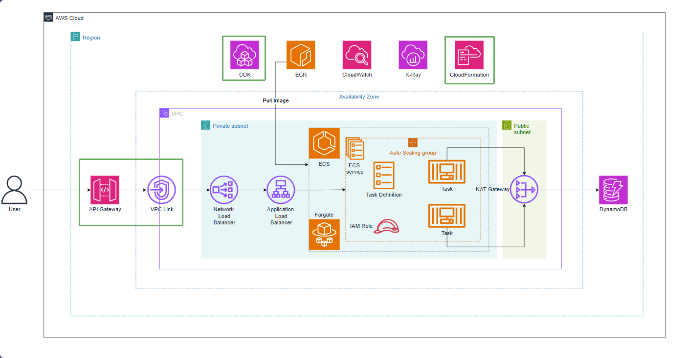

# Tạo API Gateway và VPC Link

Trong các chương trước, chúng ta đã xây dựng toàn bộ hạ tầng backend bao gồm cơ sở dữ liệu **Amazon DynamoDB**, cụm container **Amazon ECS Fargate**, cùng hệ thống cân bằng tải **Internal Application Load Balancer (ALB)** và **Internal Network Load Balancer (NLB)**. Toàn bộ các tài nguyên này đều được đặt an toàn bên trong các **Private Subnets** và hoàn toàn không có địa chỉ IP công khai (Public IP).

Để ứng dụng client bên ngoài Internet (mobile app, web frontend, Postman) có thể giao tiếp an toàn với các API backend, chúng ta sẽ xây dựng **Amazon API Gateway (HTTP API)** kết hợp với **VPC Link**.

* **Amazon API Gateway (HTTP API v2)**: Đóng vai trò là điểm tiếp nhận công khai (Public Entry Point), cung cấp tính năng quản lý lưu lượng, kiểm soát CORS Preflight, và tự động mở rộng theo nhu cầu với chi phí tối ưu (tiết kiệm hơn 70% so với REST API truyền thống).

* **VPC Link**: Tạo một "đường hầm riêng tư" (Private Tunnel) sử dụng các Elastic Network Interface (ENI) đặt trong Private Subnet của VPC. VPC Link cho phép API Gateway điều hướng trực tiếp các request đến **Network Load Balancer** nội bộ mà không cần phải mở public IP cho các tài nguyên trong VPC.

* **HttpNlbIntegration**: Tích hợp chuẩn của AWS CDK v2 giúp liên kết route đại diện (`/{proxy+}`) với listener của NLB, chuyển tiếp toàn bộ các phương thức GET, POST, PUT, DELETE vào ứng dụng Spring Boot.

