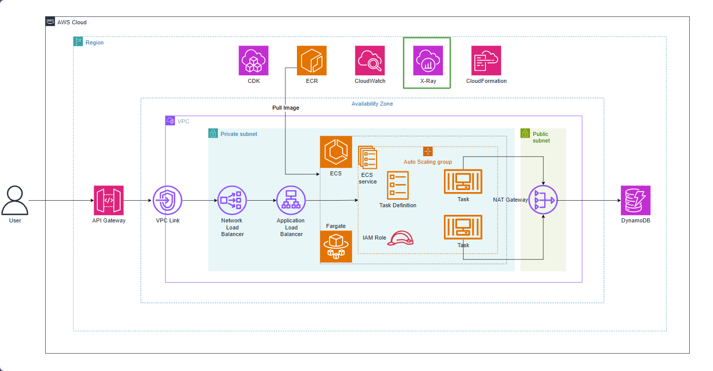
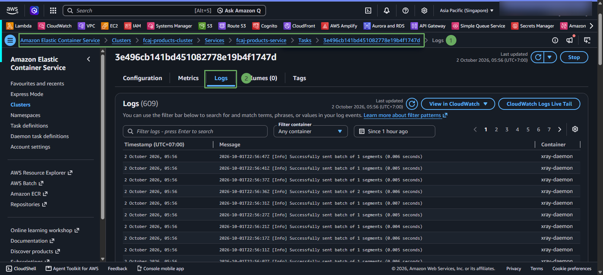
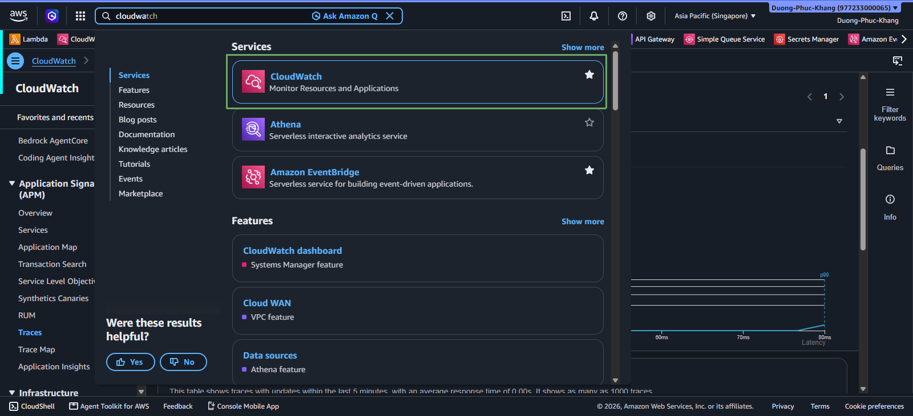
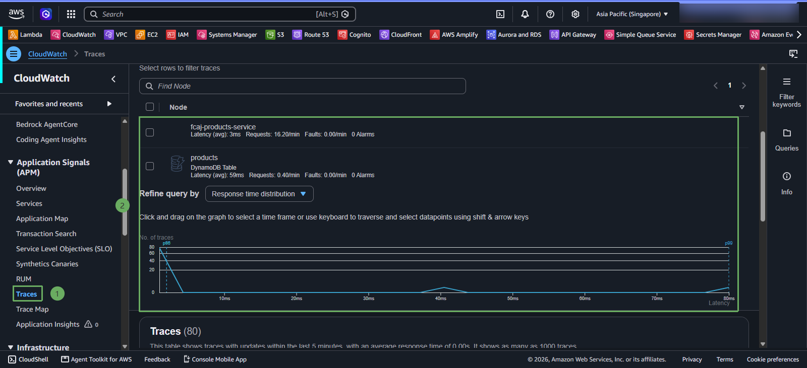
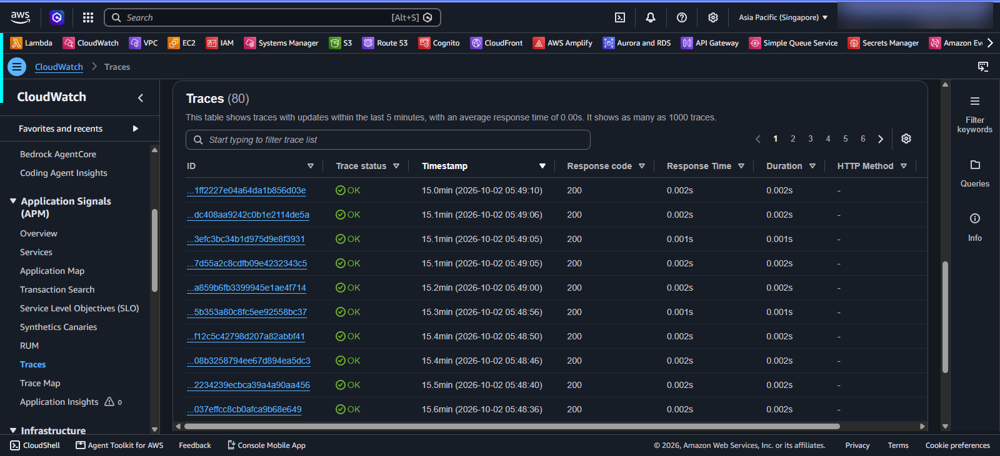

# Observability for AWS ECS with AWS X-Ray

The web container writes logs via AwsLogDriver with the products-service stream prefix. The xray-daemon container runs as a sidecar in the same task and receives traces via UDP port 2000. The application points to the sidecar using AWS_XRAY_DAEMON_ADDRESS=127.0.0.1:2000.

WebConfig creates segments for HTTP requests. DynamoDbConfig adds TracingInterceptor to the DynamoDB client to trace DynamoDB calls. The Task role is granted permissions to write X-Ray data.

* To verify, call the API multiple times, open CloudWatch Logs in ECS, inspect the log streams of products-service and xray, then open the X-Ray Trace Map. If the sidecar is not running, check the image **public.ecr.aws/xray/aws-xray-daemon**, UDP port 2000, task role, and private network routing.

X-Ray helps you see requests traveling through the application and DynamoDB. It does not replace logs; logs provide detailed events, while traces show which components requests pass through and how long each step takes.

#### Monitor X-Ray Traces

1. Access CloudWatch and select Traces

