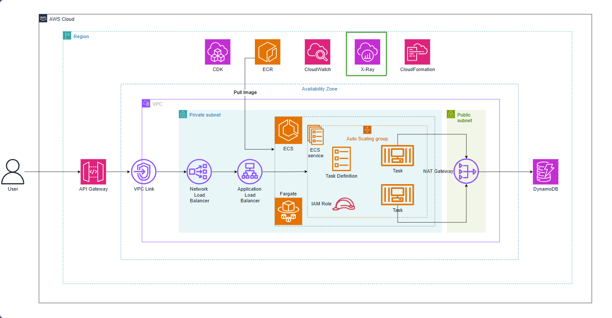
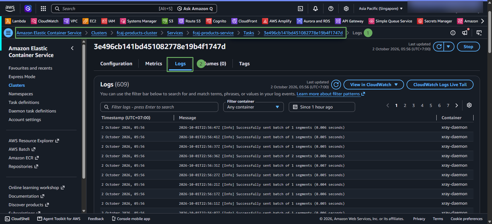
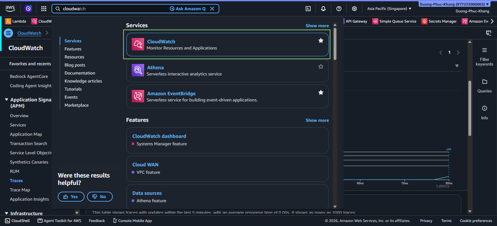
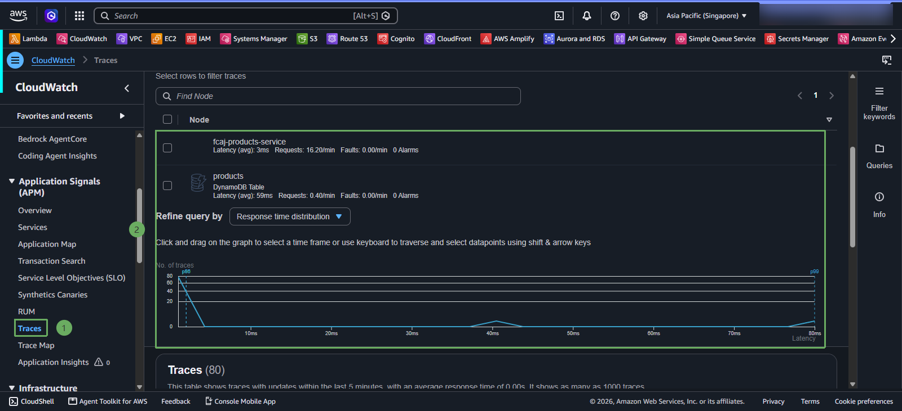
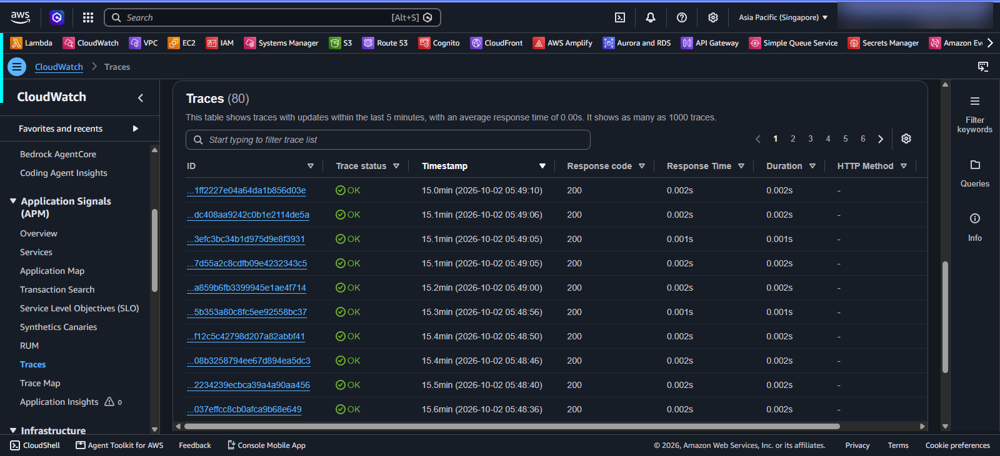

# Đo lường dịch vụ AWS ECS với AWS X-Ray

Container web ghi log qua AwsLogDriver với stream prefix products-service. Container xray-daemon chạy sidecar trong cùng task và nhận trace qua UDP port 2000. Ứng dụng trỏ tới sidecar bằng AWS_XRAY_DAEMON_ADDRESS=127.0.0.1:2000.

WebConfig tạo segment cho HTTP request. DynamoDbConfig thêm TracingInterceptor vào DynamoDB client để trace các thao tác gọi DynamoDB. Task role được cấp quyền ghi dữ liệu X-Ray.

* Để kiểm tra, gọi API nhiều lần, mở CloudWatch Logs ở ECS, xem log stream của products-service và xray, sau đó mở X-Ray Trace Map. Nếu sidecar không chạy, kiểm tra image **public.ecr.aws/xray/aws-xray-daemon**, port UDP 2000, task role và đường mạng private.

X-Ray giúp nhìn thấy request đi qua application và DynamoDB. Nó không thay thế log; log cho biết chi tiết sự kiện, còn trace cho biết request đi qua các thành phần nào và mất bao lâu.

#### Theo dõi X-Ray Trace

1. Truy cập vào CloudWatch và chọn Traces

