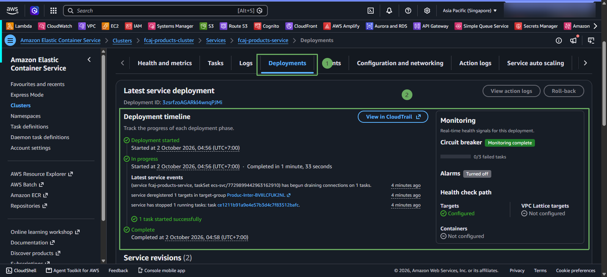

# Update image and deploy a new revision

When modifying Spring Boot code, build an image with a new tag. Do not reuse tag 1.0.0 because ECS may continue using the old task definition or learners may not know which version the task is running.

~~~powershell
cd fcaj-spring
.\mvnw.cmd clean package -DskipTests
docker build --platform linux/amd64 -t fcaj-products-service:1.0.1 .
docker tag fcaj-products-service:1.0.1 "$registry/fcaj-products-service:1.0.1"
docker push "$registry/fcaj-products-service:1.0.1"
~~~

Access AWS ECS -> Clusters -> fcaj-products-cluster -> Services -> fcaj-products-service -> select and click FORCE NEW DEPLOYMENT: 

Open cdk/lib/ecs-stack.ts and change the image tag from 1.0.0 to 1.0.1. Then build TypeScript and deploy the ECS stack:

~~~powershell
cd ..\cdk
npm run build
npx cdk deploy --all --require-approval never
~~~

CDK creates a new task definition revision. ECS rolling deployment will launch the new task, wait for health check, and stop the old task according to deployment configuration.

Images to add later: /images/UPDATE/12-update.
