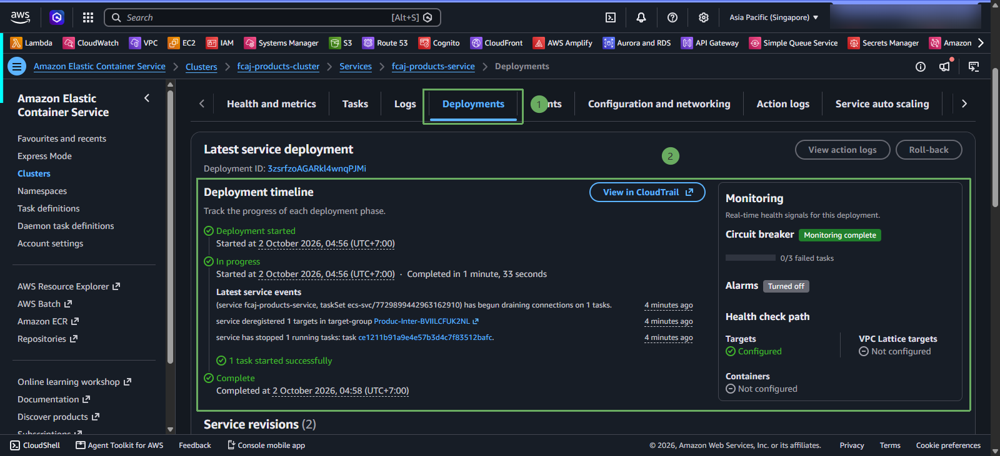

# Cập nhật image và triển khai revision mới

Khi sửa code Spring Boot, hãy build image với tag mới. Không nên dùng lại tag 1.0.0 vì ECS có thể tiếp tục dùng task definition cũ hoặc người học không biết task đang chạy phiên bản nào.

~~~powershell
cd fcaj-spring
.\mvnw.cmd clean package -DskipTests
docker build --platform linux/amd64 -t fcaj-products-service:1.0.1 .
docker tag fcaj-products-service:1.0.1 "$registry/fcaj-products-service:1.0.1"
docker push "$registry/fcaj-products-service:1.0.1"
~~~

Truy cập vào AWS ECS -> Clusters -> fcaj-products-cluster -> Services -> fcaj-products-service -> click chọn và FORCE NEW DEPLOYMENT: 

Mở cdk/lib/ecs-stack.ts và đổi image tag từ 1.0.0 sang 1.0.1. Sau đó build TypeScript và deploy ECS stack:

~~~powershell
cd ..\cdk
npm run build
npx cdk deploy --all --require-approval never
~~~

CDK tạo task definition revision mới. ECS rolling deployment sẽ khởi động task mới, chờ health check và dừng task cũ theo cấu hình deployment.

Ảnh cần bổ sung sau: /images/UPDATE/12-update.

