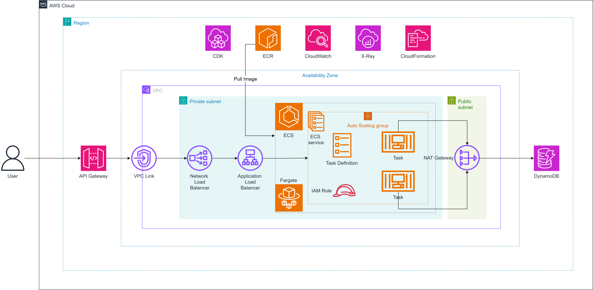

# Deploying Spring Boot on ECS Fargate with AWS CDK TypeScript

This lab guides you on how to package a Spring Boot application into a Docker image, store the image in Amazon ECR, and use AWS CDK written in TypeScript to provision infrastructure running the application on Amazon ECS Fargate.

Throughout the lab, CloudFormation executes the templates generated by CDK. The application runs inside Fargate tasks in private subnets, accessed via an internal Application Load Balancer, Network Load Balancer, and API Gateway HTTP API through a VPC Link.

The core flow of the system is: the Spring Boot application is packaged into an image, the image is pushed to ECR, CDK provisions VPC/ECS/DynamoDB/API Gateway, ECS pulls the image and runs tasks, then requests flow from API Gateway through VPC Link, NLB, and ALB to Spring Boot.

This lab is written based on the current IaC-ECS-CDK repository, using Maven for Spring Boot and TypeScript for CDK. Please follow the order of the items in the navigation bar and always verify local steps before deploying to AWS.

